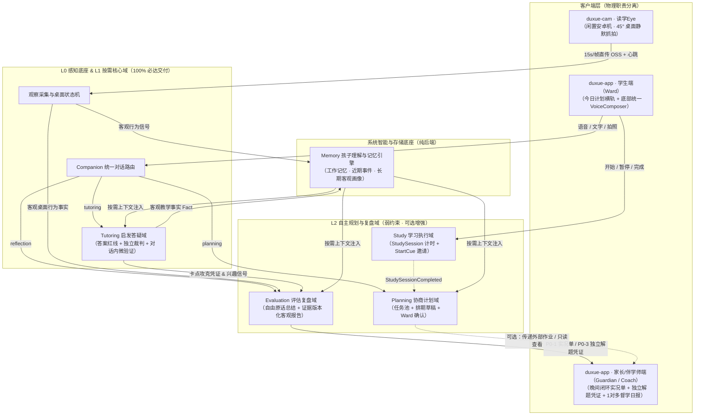

# 读学系统 — 产品架构（Product Architecture）

> 版本 v4.0 | 本文档是读学系统的**产品架构主文档**，涵盖：产品愿景与三大目标、可度量核心交付物、弱约束高可靠原则、核心角色、三层产品运转闭环、按角色划分的模块地图（§四）、以及各能力规格文档路由（§五 → `prd-*.md` / `domain-*.md`）。
>
> **当前阶段：自用验证与商业化切口打磨期。**

---

## 一、产品愿景、核心交付与设计原则

读学系统是一款围绕孩子**线下真实学习过程**的 AI 伴学平台。它不是“监控孩子有没有偷懒”的电子监工，也不是“直接给答案”的拍照搜题工具，而是聚焦于三个明确的目标：**提升孩子专注效率、引导孩子独立思考、解放家长陪读时间**。

### 1.1 三大产品目标

| 目标 | 当前问题假设 | 系统的应对方式 | 衡量方式（方向性指标） |
| :--- | :--- | :--- | :--- |
| **G1. 提升专注力与消灭“垃圾时间”** | 孩子在纸质作业场景下大量时间耗散在“启动拖延、换书发呆、遇难题死磕”三大黑洞，且对自身真实状态缺乏客观觉察 | 侧后方 45° 稀疏视觉静默感知桌面物理状态 + 卡壳超时温和递梯子 + 课后自由复盘与客观记录对照 | 有效动笔时长占书桌驻留时长比例（净效率比）提升；启动延迟缩短；同量作业耗时压缩 |
| **G2. 引导独立思考与自主学习** | 遇到难题要么呆坐放弃、要么用搜题软件直接抄答案；学习过程长期被动等待大人安排 | 答疑严守“答案保护红线”，按题目推理链分步启发，并在收尾引导孩子自己推导完成“临门一脚”；提供轻量语音排期与到点邀请（StartCue） | 启发后独立解出率（Scaffolded Self-Solve Rate）；孩子主动提问与自主排期的占比 |
| **G3. 解放家长陪读时间** | 家长下班后被迫充当“作业监工与随时待命的讲题老师”（催开始、盯发呆、讲难题），耗费大量时间与精力 | 用 AI 即时启发答疑与后台静默观察替代家长肉身陪坐；每晚向家长交付客观的伴学闭环实况与难题攻克凭证 | **家长脱手率（Hands-off Ratio / 0 介入夜晚占比）**；每晚为家长净省陪读时长 |

### 1.2 核心可度量交付物（商业化价值锚点）

用户不为抽象的“数字成长画像”或“AI 概念”买单，只为**每晚可感知、可度量的确定性结果**买单。系统对外死磕以下四项核心交付（前三项面向家庭 To C 闭环，第四项面向机构 To B2C 放大）：

1. **【P0-1 面向家长】每晚省下 90 分钟的《伴学闭环实况单》**
   - 无需家长坐在书桌旁盯梢或随时待命讲题，每晚准时交付：在桌净专注时长、各学段投入分布、AI 接管解决的卡点数，直接兑现“今晚为您节省的陪读时间”。
2. **【P0-2 面向孩子】挤干纸质作业“垃圾时间”，赢回自由支配时间**
   - 针对线下纸质作业，通过到点温和邀请（砍掉启动黑洞）、桌面卡壳雷达主动唤醒（砍掉死磕黑洞）、换书节奏激励（砍掉切换黑洞），帮孩子每晚早 30~40 分钟收工，名正言顺兑现自由玩耍时间。
3. **【P0-3 面向学业定心丸】不抄答案、“真搞懂了”的《独立解题凭证》**
   - 孩子在线下纸质作业中只挑不会的 1~3 道难题问 AI。系统通过答案保护状态机分步启发，并在对话最后一轮引导孩子**在对话内独立说出/算出最终关键结果（对话内微验证）**，向家长交付“这道难题是他自己想通算出的”防伪铁证。
4. **【P1 面向 B2C 督学/晚托机构】1 人精细服务 15+ 人的《超级伴学师工作台与家校日报》**
   - 针对线下精品晚托班、社区自习室与伴学工作室“1 个老师看管 10~15 个孩子，只能管纪律、无法向家长交代每个孩子具体学习过程与卡点”的痛点，通过零硬件成本的闲置手机接入 + AI 伴学，自动汇总每位学员当晚的专注曲线、卡点题目切片与攻克过程，一键生成高专业度的定制化家校交付日报。

### 1.3 核心设计信念

1. **弱约束输入，强可靠交付（Zero-Input Baseline）**：
   - **孩子的真实作业在线下纸质本上。** 将任务转到线上（建 Plan）、手动点击开始/标记完成，全部定位为**可选、弱约束的增强动作**，绝不能作为系统交付的前置阻塞条件。
   - **额外操作越少，交付可靠度越高**：哪怕家长没空转发作业、孩子坐下直接翻开纸质书本写、写完直接合上书包走人，系统依然能依靠“被动桌面状态感知 + 按需答疑对话”100% 稳定交付当晚的伴学报告与攻克凭证。
2. **AI 补的是“专业认知”和“在场时间”的缺口，不是电子监工**：
   - 严禁向家长提供实时监控视频流，严禁在孩子学习界面弹出实时分心红字警告或扣分呵斥。专注力提升靠的是心流保护与事后自我觉察，而非外部高压监视。
3. **教学优先，死守答案红线，拒绝形式主义留痕**：
   - 有逻辑层次的推理留给孩子，纯记忆事实直接回答；绝不直接泄题代写。
   - 坚决剔除“任务结束强制拍照上传纸质作业打卡”等形式主义动作，不打断孩子收工时的成就感。
4. **主观自述与客观事实严格分界**：
   - 孩子的复盘自述（原话总结）代表其主观视角与元认知状态，客观视觉与答疑记录代表过程事实；两者对照产生洞察，但主观自述绝不直接混淆写入客观能力画像。

---

## 二、目标用户群体、核心角色与端侧分工

### 2.1 双轨商业化目标用户

系统在商业化落地上采取 **“To C 精准家庭破局 + To B2C 高杠杆机构放大”** 的双轨用户定位：

1. **核心破局用户（To C 第一曲线）：小学中高年级至初中（3~8 年级，9~14 岁）的赋能型中产家庭**
   - **年龄特征**：3~8 年级是“父母试图放手、孩子试图独立，但双方都缺乏工具与方法”的最高频冲突期（低年级完全依赖肉身陪读，高年级自主习惯已定型且排斥观察）。
   - **高价值细分切口**：**轻度执行功能薄弱（Executive Function Deficit）的聪明孩子**——智力与好奇心正常，但在任务启动、时间预估、持续专注上存在明显困难，传统刷题工具与补习班对其无效，家长为“科学陪伴与习惯养成”付费意愿极强。
2. **高杠杆商业用户（To B2C 第二曲线）：精品晚托班 / 社区自习室 / 伴学教练工作室**
   - **核心痛点**：一个晚托班老师往往要同时看管 10~15 个孩子，精力只够维持纪律和检查作业是否写完，根本无法回答家长“我家孩子今天状态到底怎么样？是怎么思考的？为什么这道题磨蹭了半小时？”。
   - **赋能契合度**：读学系统的架构（闲置手机零硬件成本接入 + 云端多模态分析 + 伴学 Agent）天然适配中小型督学与晚托机构。在 `ward` / `guardian` 基础上增加一层 `coach`（伴学师）视角，一套读学系统能让普通晚托老师瞬间拥有“1对1 高端成长顾问”的数据洞察与家校沟通交付能力，显著提升机构续费率与客单价。

### 2.2 核心角色与端侧分工

| 角色 / 端 | 说明 |
| :--- | :--- |
| **ward（学生）** | 被陪伴与赋能的主体。在线下纸质作业场景中按需使用 AI 答疑、自由表达计划意图与今日总结，拥有计划的最终确认权（通过 `duxue-app` 学生角色交互）。 |
| **guardian（家长/监护人）** | 创建与绑定家庭关系、可选传递外部作业信息、当晚接收《伴学闭环实况单》与《独立解题凭证》（通过 `duxue-app` 家长角色交互）。 |
| **coach（伴学师/晚托教师 · 演进角色）** | 在晚托班、自习室或督学工作室场景下，同时关联与管理多名 `ward`（1对多工作台），实时掌握全场卡点动态，批量审阅并向对应 `guardian` 交付定制化伴学日报。 |
| **读学Eye（`duxue-cam`）** | 架设在家庭书桌或自习室工位侧后方 45° 的闲置 Android 手机专用采集端。零端侧推理，仅负责静音稀疏抓拍（默认 15s/帧）直传 OSS、断网本地 Room 队列补传与 60s 健康心跳，物理规避孩子正脸。 |

---

## 三、产品运转闭环：三层递进架构（L0 兜底 → L1 按需 → L2 增强）

为了彻底消除传统教育产品“一旦忘了打卡/排计划就全盘失效”的脆弱性，读学系统的运转模型从“单向强耦合流水线”升级为**“三层弱耦合递进架构”**：

```text
┌───────────────────────────────────────────────────────────────────────────────┐
│  L2 自主规划与复盘层（可选增强 · 弱约束）：                                   │
│  家长顺手转发作业 / Ward 语音排期协商 / 到点 StartCue 邀请 / 课后自由语音总结 │
│  👉 增量价值：训练时间预估与任务拆解能力、明确科目名称、主客观双轨对照觉察    │
├───────────────────────────────────────────────────────────────────────────────┤
│  L1 刚需启发答疑层（按需触发 · 零形式负担）：                                 │
│  纸质作业遇卡点 ──▶ 拍照/语音提问 ──▶ 苏格拉底分步启发 ──▶ 对话内微验证闭环   │
│  👉 必达交付（P0-3）：每一道问过的难题 100% 产出《“真搞懂了”的独立解题凭证》  │
│                      + 偶发好奇心捕获为 Interest Signal                       │
├───────────────────────────────────────────────────────────────────────────────┤
│  L0 桌面感知底座层（插电静默运行 · 100% 兜底交付）：                          │
│  读学Eye 45° 稀疏抓拍 ──▶ 桌面物理状态机（动笔/停滞卡壳/换书/离座）           │
│  👉 必达交付（P0-1 & P0-2）：自动还原有效专注时长、挤压垃圾时间、             │
│                              生成家长晚间省心实况单                           │
└───────────────────────────────────────────────────────────────────────────────┘
```

### 3.1 四大核心场景在弱约束下的协同

| 场景域 | 核心机制（支持零前置输入运行） | 关键交互与边界 | 产出与交付 |
| :--- | :--- | :--- | :--- |
| **① 桌面观察与物理状态感知** | `duxue-cam` 持续 15s/帧稀疏抓拍；服务端识别桌面物理状态（连续书写、停滞思考、翻页换书、离座空置） | 不推实时流、不拍正脸、不发分心警告；支持与线上任务关联，也支持**无计划下的自动会话分段** | 净专注时长、启动延迟、停滞卡壳时段 |
| **② 陪伴执行与启发答疑** | Ward 通过统一对话入口（`VoiceComposer`）随时拍照或语音提问；支持到点 `StartCue` 温和邀请开始 | **答案保护红线**：独立裁判拦截答案泄露；每轮只推进最小下一步；收尾通过**对话内微验证**确认独立解出；任务完成无需拍照打卡 | 《独立解题凭证》（原题+卡点诊断+独立推导结果）、好奇心信号（`Interest Signal`） |
| **③ 协商计划（可选增强）** | Ward 一句话语音/文字新增、修改、排期或暂不安排任务；AI 检查冲突并给软建议，Ward 确认后生效 | 有标题与预计时长即可入任务池，排入当天计划才需开始时间；Guardian 仅可查看或传递任务候选，无权直接修改 Ward 计划 | 当日时间轴计划、预估 vs 实际耗时校准记录 |
| **④ 结果评估与晚间洞察** | 会话结束后当晚聚合客观行为与答疑卡点；Ward 可选通过语音/文字自由表达今日总结（保留原话、可修订） | 退役机械点选问卷与强制锦囊；Ward 自述仅留存 `Evaluation` 域（不直接当成客观能力写入 `Memory`）；当晚向家长推送伴学实况 | Ward 端：原话总结与客观时间轴对照；Guardian 端：《伴学闭环实况单》+《独立解题凭证》 |

---

## 四、产品能力模块划分与架构图

### 4.1 客户端与服务端领域边界

系统采用**“三端物理分离 + 统一伴学对话入口 + 领域严格解耦”**的架构：

- **客户端层**：
  1. **`duxue-cam`（读学Eye）**：专职运行在闲置 Android 手机上，摆放在书桌侧后方 45°。彻底解决“同一台设备无法同时做桌面俯拍与屏幕交互”的物理冲突。
  2. **`duxue-app` · Ward 端**：以**今日计划横轨**为顶层上下文，底部常驻唯一的 **`VoiceComposer`（统一伴学对话入口）**。无需在多个繁琐 Tab 间跳转，一句话即可由 `Companion` 自动路由至排期（`planning`）、答疑/发音（`tutoring`）或今日总结（`reflection`）。
  3. **`duxue-app` · Guardian 端**：聚焦设备绑定与在线状态、外部作业信息传递、以及每晚查收结构化伴学实况单与难题独立解题凭证。
- **服务端核心领域（Domain）**：
  - **`Companion`（陪伴编排域）**：Ward 可见对话的唯一 append-only 账本，负责意图路由、跨场景切换核查（`scene-switch`）、确认卡与交互按钮生命周期管理。
  - **`Planning`（计划与排程域）**：管理已知任务池、日程草稿、半开区间冲突校验、软建议与 Ward 确认版本。
  - **`Study`（学习执行域）**：管理 `StudySession`（开始/暂停/继续/完成/跨天自动放弃）与到点开始邀请（`StartCue`）。
  - **`Tutoring`（辅导答疑域）**：执行答案状态红线（`permit()`）、`TutoringTurnLoop`、多模态配图（`visual`）、发音示范（`pronounce`）及独立泄露裁判。
  - **`Evaluation`（评估与复盘域）**：管理 Ward 今日总结原话与六维结构化条目、证据版本化的客观行为与卡点聚合报告。
  - **`Memory`（孩子理解与记忆域）**：纯后端智能底座，基于客观事实事件账本维护工作记忆、近期事件（`Episodic`）与长期画像（`Claim/Signal`），严守与主观自述的隔离边界。

### 4.2 按角色与层级划分的模块清单

| 模块 | 归属 | 约束级别 | 说明 | 对应文档 |
| :--- | :--- | :--- | :--- | :--- |
| **桌面稀疏抓拍与离线补传** | `duxue-cam` | **L0 零操作底座** | 15s/帧直传 OSS + Room 断网队列 + 60s 心跳 | [`prd-supervise.md`](prd-supervise.md) / [`design-cam.md`](../technical/design-cam.md) |
| **启发式分步答疑与微验证** | Ward 专属 | **L1 按需触发** | 答案保护红线 + 独立裁判 + 配图/发音 + 对话内微验证 | [`prd-companion.md`](prd-companion.md) / [`domain-tutoring.md`](../technical/domain-tutoring.md) |
| **统一伴学对话（Companion）** | Ward 专属 | **L1 核心入口** | 底部 `VoiceComposer` 统一承接语音/文字/图片，自动路由三场景 | [`domain-companion.md`](../technical/domain-companion.md) |
| **晚间伴学实况单与解题凭证** | Guardian 专属 | **L0/L1 必达交付** | 净专注时长、省下陪读时间、难题独立攻克凭证 | [`prd-evaluate.md`](prd-evaluate.md) / [`domain-evaluation.md`](../technical/domain-evaluation.md) |
| **协商计划：语音排期与确认** | Ward 专属 | **L2 可选增强** | 任务池与日程分离，AI 软建议，Ward 单按钮确认 | [`prd-schedule.md`](prd-schedule.md) / [`domain-planning.md`](../technical/domain-planning.md) |
| **学习会话与到点邀请（StartCue）** | Ward 专属 | **L2 可选增强** | 任务计时状态机、到点未开始时温和卡片邀请（不自动开课） | [`domain-study.md`](../technical/domain-study.md) |
| **今日自由总结与主客观对照** | Ward 专属 | **L2 可选增强** | 语音/文字自由回顾经历，保留原话可修订，与客观记录对照 | [`prd-evaluate.md`](prd-evaluate.md) / [`domain-evaluation.md`](../technical/domain-evaluation.md) |
| **传递外部任务 / 查看计划** | Guardian / Coach | **L2 可选增强** | 转发学校作业信息入池；只读查看 Ward 计划，无权直接修改 | [`prd-schedule.md`](prd-schedule.md) |
| **多学员督学工作台与家校日报** | Coach（演进） | **B2C 机构赋能** | 1对多查看学员专注曲线与卡点切片，一键生成定制化家校交付日报 | [`prd-user.md`](prd-user.md)（多 Ward 切换与共管） |
| **身份认证、家庭与设备绑定** | 共同能力 | 基础设施 | Guardian 邮箱验证码登录、Ward 绑定码与可轮换凭证、Cam 扫码绑定 | [`prd-user.md`](prd-user.md) / [`design-app.md`](../technical/design-app.md) |
| **孩子理解与三层记忆引擎** | 系统纯后端 | 基础设施 | 仅消费客观事实事件（答疑/行为/执行），按需向各域注入上下文 | [`prd-memory.md`](prd-memory.md) / [`domain-memory.md`](../technical/domain-memory.md) |

### 4.3 产品与领域架构图



---

## 五、能力规格路由（PRD & Domain Index）

> 产品体验与验收背景见 `docs/product/prd-*.md`，最新已落地的领域不变量与状态机契约以 `docs/technical/domain-*.md` 为单一事实源。

| 能力域 | 产品规格（PRD） | 领域技术契约（事实源） | 当前状态与关键演进说明 |
| :--- | :--- | :--- | :--- |
| **用户、身份与首页** | [`prd-user.md`](prd-user.md) | [`design-app.md`](../technical/design-app.md) | **已落地**。Ward 首页采用横轨计划 + 底部唯一 `VoiceComposer`，取消独立「AI 伙伴」Tab。 |
| **陪伴对话统一入口** | [`prd-companion.md`](prd-companion.md) | [`domain-companion.md`](../technical/domain-companion.md) | **已落地**。统一 `/companion/turn`，支持 `planning`/`tutoring`/`reflection`/`unclear` 路由与跨场景核查。 |
| **启发式答疑与表达** | [`prd-companion.md`](prd-companion.md) | [`domain-tutoring.md`](../technical/domain-tutoring.md)<br/>[`domain-tutoring-presentation.md`](../technical/domain-tutoring-presentation.md)<br/>[`eval-offline.md`](../technical/eval-offline.md) | **主链路已落地**。含答案保护许可、独立泄露裁判、5 种结构化配图、发音 `pronounce` 与离线评测。 |
| **协商式计划** | [`prd-schedule.md`](prd-schedule.md) | [`domain-planning.md`](../technical/domain-planning.md) | **已落地**。任务池与入日程分离，定位为**弱约束可选增强**，不阻塞答疑与观察报告交付。 |
| **学习执行与到点邀请** | [`prd-companion.md`](prd-companion.md) | [`domain-study.md`](../technical/domain-study.md) | **已落地**。含 `StudySession` 状态机与 `StartCue` 到点开始邀请卡片。 |
| **学习观察与行为采集** | [`prd-supervise.md`](prd-supervise.md) | [`design-cam.md`](../technical/design-cam.md) | **已落地**。独立 `duxue-cam` App，15s/帧稀疏抓拍直传 OSS + Room 离线容灾。 |
| **结果评估与复盘引导** | [`prd-evaluate.md`](prd-evaluate.md) | [`domain-evaluation.md`](../technical/domain-evaluation.md) | **部分落地**。Ward 自由语音/文字总结（六维条目）已落地，旧版“单选题盲评+自动专注锦囊”已退役；客观证据版本化报告待完善。 |
| **孩子理解与记忆系统** | [`prd-memory.md`](prd-memory.md) | [`domain-memory.md`](../technical/domain-memory.md) | **底座已落地**。严格区分客观教学/行为事实与主观自述（自述不写入 Memory）。 |
| *历史归档与外部分享* | — | — | **已取消独立模块**。坚决不做任务结束拍照上传作业的形式主义打卡。 |
| *兴趣与家庭关系深水区* | — | — | **暂不实施**。兴趣信号捕获已并入答疑域，家庭关系引导已取消。 |

---

## 六、非目标与范围边界

以下内容明确不在系统设计范围内，避免范围蔓延与偏离核心价值：

- **强制线上化作业与形式化拍照打卡**：不要求家长每天必须导入作业，不要求孩子每次必须先建线上计划才能用 AI，更不要求孩子写完纸质作业后拍照上传打卡。
- **实时视频监控与实时分心告警**：不向家长提供实时摄像头画面，不在孩子学习过程中发出实时分心红字警告或扣分声音。
- **直接给答案的拍照搜题与代写**：任何情况下不直接输出作业题目的最终答案、完整解法或代写作文。
- **把孩子的主观自评当成客观掌握证据**：孩子口头说“我懂了”或复盘自述“今天很专注”只作为主观记录，不能绕过答疑验证或客观行为数据直接写入长期能力画像。
- **家庭关系/情绪诊断与说教**：系统聚焦于客观伴学事实与解放家长陪读时间，不承担心理诊断或对家长教育方式进行评判与说教。

---

## 七、核心待验证假设（商业化与下一阶段重点）

1. **L0 无计划纯被动感知的会话还原准确度（技术与体验验证）**：
   - 在孩子完全不建线上计划、不手动点“开始/结束学习”的底线场景下，仅靠 `duxue-cam` 的 15s/帧桌面视觉分析，能否准确切分出“落座开写 → 停滞卡壳 → 换书休息 → 写完离座”的完整纸质作业会话，并产出令家长信服的《伴学闭环实况单》？
2. **“卡壳雷达”主动递梯子的时机与打扰边界（产品验证）**：
   - 当视觉检测到孩子对着纸质作业停笔凝视或反复擦改超过 $N$ 分钟（如 3~4 分钟）时，主动发出轻量语音/卡片提示（“遇到难缠的题了吗？随时问我”），多大阈值既能帮孩子砍掉发呆黑洞，又不会误伤正在深度心流思考的孩子？
3. **对话内“临门一脚微验证”作为《独立解题凭证》的家长买单度（商业验证）**：
   - 放弃繁琐的“纸面写完再拍照回传核验”，改为在启发答疑最后一轮引导孩子口算/说出最终得数，并将此过程打包成《独立解题凭证》推给家长，能否完全消除家长对“孩子是不是在用 AI 抄作业”的顾虑？
4. **To B2C 晚托班/督学工作室的“1 对 15”赋能溢价验证（第二曲线商业验证）**：
   - 在线下晚托班或社区自习室每个工位部署一台闲置手机，能否让 1 名普通看班老师在不增加操作负担的前提下，每天向 15 名孩子的家长交付媲美“1对1 高端伴学顾问”的过程实况与卡点报告，从而显著提升机构的续费率与客单价？
