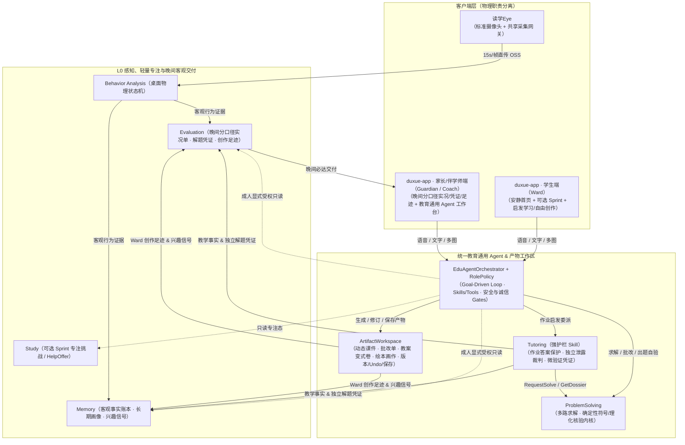

# 读学系统 — 产品架构（Product Architecture）

> 版本 v5.0（2026-11-27） | 本文档是读学系统的**产品架构主文档**，涵盖：产品愿景与三大目标、统一教育通用 Agent 双端范式、可度量核心交付物、弱约束高可靠原则、核心角色、系统运转闭环、模块地图（§四）以及各能力规格文档路由（§五 → `prd-*.md` / `domain-*.md`）。
>
> **重大架构演进声明**：旧版 `Planning`（线上计划、任务池与排期确认）与 `Reflection`（Ward 每日结构化自述复盘）已正式退场；系统全面收敛为**「L0 桌面静默观察底座 + 双端统一教育通用 Agent（Role Policy 差异化） + 晚间客观闭环交付」**。

---

## 一、产品愿景、核心交付与设计原则

读学系统是一款面向 K–12 的 **AI 伴学与教育生产力平台**，围绕孩子的**线下真实学习过程**、家庭的**日常辅导减负**以及教师的**高频备课与批改教研**展开。它不是“监控孩子有没有偷懒”的电子监工，也不是“直接给答案”的拍照搜题工具，而是聚焦于四个明确目标：**提升孩子专注效率、引导孩子独立思考与主动探索、解放家长陪读时间、赋能教师备课批改与教学生产力**。

### 1.1 四大产品目标

| 目标 | 当前问题假设 | 系统的应对方式 | 衡量方式（方向性指标） |
| :--- | :--- | :--- | :--- |
| **G1. 提升专注力与消灭“垃圾时间”** | 孩子在纸质作业场景下大量时间耗散在“启动拖延、换书发呆、遇难题死磕”三大黑洞，且易在电子设备前分心 | 侧后方 45° 稀疏视觉静默感知桌面物理状态 + 卡壳超时温和递梯子 + 可选主动专注挑战（Sprint）+ 专注态软守护 | 有效动笔时长占书桌驻留时长比例（净效率比）提升；同量作业耗时压缩 |
| **G2. 引导独立思考并激发主动探索** | 遇到难题要么呆坐放弃、要么抄答案；只做作业辅导会让孩子把 AI 视为“写作业才打开的工具” | 统一教育通用 Agent（Ward 策略）：作业答疑严守答案保护与防代写红线、难度目标达高考综合题；作业外开放画图、故事共创与互动演示探索 | 启发后独立解出率（Scaffolded Self-Solve Rate）；作业外主动探索与创作留存 |
| **G3. 解放家长陪读时间** | 家长下班后被迫充当“作业监工与随时待命的讲题老师”（催开始、盯发呆、讲难题），耗费大量时间精力 | 用 AI 即时启发答疑与后台静默观察替代家长肉身陪坐；每晚向家长交付客观的伴学汇总实况、解题凭证与创作足迹 | **家长脱手率（0 介入夜晚占比）**；每晚为家长净省陪读时长 |
| **G4. 赋能教师备课、批改与教学生产力** | 学科老师、教培老师与晚托伴学师日常耗费大量时间在重复性作业批改、寻找/制作直观课件、出分层变式题与个性化讲评上，难以兼顾个体差异 | 提供**成人教育通用 Agent 工作台**：一站式完成整页作业批改诊断（确定性核验、存疑标待复核）、动态交互课件制作与局部修订、教案讲义与自验变式出题，支持显式受权读取绑定学生学情 | 备课/课件制作与批改耗时降幅；出题自验通过率；教师/伴学师 1 对多服务杠杆 |

### K–12 答疑覆盖与难度目标

答疑与教研能力面向 K–12，覆盖学前启蒙、小学、初中和高中学习场景，目标从基础概念与日常练习延伸到高考级多学科综合题（含图表与材料理解、多小问综合题与多步推导）。Ward 端在各难度执行相同的答案保护与防代写规则；Guardian / Coach 端可在教育通用 Agent 工作台直接获取核验结论、批改诊断、动态交互课件与经自验的变式练习题，详见 [教育通用 Agent PRD](prd-edu-agent.md) 与 [首页 PRD](prd-user.md#72-成人教育-agent-工作台与体验)。能力实现和评测方法见 [解题领域设计](../technical/domain-problem-solving.md) 与 [答疑离线评测设计](../technical/eval-offline.md)。

### 1.2 核心可度量交付物（商业化价值锚点）

用户不为抽象的“AI 概念”买单，只为**每晚可感知、可度量的确定性结果与高频生产力**买单：

1. **【P0-1 面向家长】每晚省下 90 分钟的《伴学闭环实况单》**
   - 无需家长盯梢或随时讲题，每晚准时交付：线下作业净专注时长与 AI 自由探索时长**严格分口径账单**、各学段投入分布、卡点解决记录与省时折算。
2. **【P0-2 面向孩子】作业提速赢回自由时间 + 自由探索与创作空间**
   - 作业时靠桌面卡壳雷达与可选专注挑战（Sprint）压缩垃圾时间；作业外通过教育通用 Agent（Ward 策略）画图、共创故事绘本、做互动数理实验与知识卡片，沉淀个人作品与「好奇心与创作足迹」。
3. **【P0-3 面向学业定心丸】不抄答案、“真搞懂了”的《独立解题凭证》**
   - 孩子在线下纸质作业中挑不会的难题提问，系统通过答案保护状态机分步启发，并在收尾引导孩子**在对话内独立说出/算出最终关键结果（对话内微验证）**，向家长交付防伪铁证。
4. **【P0-4 面向家长与伴学师】双轨高频《教育通用 Agent 生产力工作台》**
   - 面向 To C 家长与 To B2C 晚托班 Coach（1 人服务 15+ 人）：一站式完成整页作业拍照批改诊断、深度动态交互课件制作、备课教案与自验变式出题，并可在显式授权下只读绑定孩子近期卡点生成针对性讲义与家校沟通日报。

### 1.3 核心设计信念

1. **零前置负担，强可靠交付（Zero-Input Baseline）**：
   - 彻底取消线上建 Plan、任务打卡与强制课后复盘自述。哪怕家长没空导作业、孩子坐下直接写纸质本、写完合书走人，系统依然靠“L0 桌面静默感知 + 按需答疑”100% 稳定交付晚间报告与解题凭证。
2. **统一通用 Agent 内核，角色策略严守边界**：
   - 双端共用一套 Goal-Driven 教育通用 Agent 与多形态可修订产物工作区（`EduArtifact`）；差异由代码级 **Role Policy** 强制约束（成人开放批改/直答/备课出题；学生死守答案保护、作业防代写与专注态软边界）。
3. **验证优先与核验诚实（Verification-First）**：
   - 涉及客观计算、批改对错、新题生成，强制调用确定性算子与多路核验；手写模糊或低置信度时如实标明「待人工复核」，绝不伪装确定性结论。
4. **AI 不是电子监工，时长与事实严格分口径**：
   - 严禁向家长提供实时监控视频流或向孩子弹出分心呵斥；线下作业专注时长与 AI 自由探索时长严格分开统计；自由创作仅沉淀为 `Interest Signal`，不混入客观学科掌握度画像。

---

## 二、目标用户群体、核心角色与端侧分工

### 2.1 三类核心目标用户

1. **学生（Ward）**：写作业时获得克制高效的启发答疑，作业外拥有安全、激发好奇心的 AI 创作与探索伙伴。
2. **家长（Guardian）**：晚间查收确定性汇总实况单、独立解题凭证与创作足迹，彻底解放陪读时间；日常也可用成人教育通用 Agent 辅助检查作业与讲题。
3. **教师与伴学师（Teacher / Coach）**：涵盖学校学科老师、教培老师、精品晚托班与伴学工作室教师——既可独立高频使用**教育通用 Agent 工作台**完成备课、动态课件制作、整页作业批改诊断与变式出题（无需依赖家庭摄像头），也可在晚托/督学场景下结合 L0 观察实现 1 对 15 精细化服务与家校日报交付。

### 2.2 核心角色与端侧分工

| 角色 / 端 | 说明 |
| :--- | :--- |
| **ward（学生）** | 通过 `duxue-app` 学生角色交互：安静首页 + 可选主动专注挑战（Sprint）+ 教育通用 Agent（作业启发答疑 + 自由画图/故事/探索与「我的作品」）。 |
| **guardian（家长/监护人）** | 通过 `duxue-app` 家长角色交互：查收晚间汇总报告（分口径实况单、解题凭证与创作足迹）；按需使用成人教育通用 Agent。 |
| **teacher / coach（教师与伴学师）** | 使用成人教育通用 Agent 工作台进行备课、动态课件制作、批量作业批改诊断与自验变式出题；在绑定学生场景下兼具 1 对多实况查看与家校日报交付（协议预留 Web 教师工作台接入）。 |
| **读学Eye** | 标准网络摄像头 + 共享本地采集网关（侧后方 45° 稀疏采图、持久队列补传直传 OSS），物理独立于交互设备。 |

---

## 三、产品运转闭环：极简三层协同

去掉沉重的 `Planning` 与 `Reflection` 后，全系统收敛为清晰的协同闭环：

```text
┌───────────────────────────────────────────────────────────────────────────────┐
│  双端统一教育通用 Agent（EduAgent + 多形态可修订 EduArtifact 工作区）          │
│  ├─ Guardian / Coach 策略：批改诊断 · 动态课件 · 备课/自验出题 · 只读学情      │
│  └─ Ward 策略：作业启发答疑（答案红线/微验证）· 自由画图/故事/探索 · 专注守护  │
├───────────────────────────────────────────────────────────────────────────────┤
│  轻量专注辅助（Study · 可选）：                                                │
│  Ward 主动开启限时专注挑战（Sprint） / 观察触发温和卡壳求助邀请（HelpOffer）    │
├───────────────────────────────────────────────────────────────────────────────┤
│  L0 桌面感知底座（插电静默运行 · 100% 兜底交付）：                             │
│  读学Eye 45° 稀疏抓拍 ──▶ 桌面物理状态机（动笔/停滞卡壳/换书/离座）             │
│  👉 晚间客观交付：《伴学闭环实况单》（作业/探索分口径）+《独立解题凭证》+创作足迹│
└───────────────────────────────────────────────────────────────────────────────┘
```

---

## 四、产品能力模块划分与架构图

### 4.1 按角色与层级划分的模块清单

| 模块 | 归属 | 层级 | 说明 | 对应文档 |
| :--- | :--- | :--- | :--- | :--- |
| **桌面稀疏抓拍与离线补传** | 读学Eye | **L0 零操作底座** | 稀疏采图直传 OSS + 网关持久队列 + 健康状态 | [`prd-supervise.md`](prd-supervise.md) / [`design-gateway.md`](../technical/design-gateway.md) |
| **双端统一教育通用 Agent 与产物工作区** | Guardian / Coach / Ward | **核心智能层** | Goal-Driven 编排 + Role Policy + 批改/动态课件/备课出题/自由创作 + 局部修订与资产库 | [`prd-edu-agent.md`](prd-edu-agent.md) / [`topic-edu-agent.md`](../technical/domain-conversation.md) |
| **作业启发答疑与答案保护** | Ward（强护栏 Skill） | **L1 核心红线** | 答案保护状态机 + 独立泄露裁判 + 主动配图/发音 + 对话内微验证《独立解题凭证》 | [`prd-edu-agent.md §4.2`](prd-edu-agent.md#42-作业启发答疑红线与教学方法论) / [`domain-tutoring.md`](../technical/domain-tutoring.md) |
| **主动专注挑战（Sprint）** | Ward | **轻量可选** | 口述只读确认、明确开启倒计时、触发专注态软守护；到时不等于作业完成 | [`prd-schedule.md`](prd-schedule.md) / [`domain-study.md`](../technical/domain-study.md) |
| **晚间客观汇总报告、解题凭证与创作足迹** | Guardian / Coach | **L0/L1 必达交付** | 作业专注 vs 自由探索分口径时长 + 独立解题凭证 + 好奇心与创作足迹（产品口径收口于首页 PRD） | [`prd-user.md §7.1`](prd-user.md#71-孩子首页晚间客观汇总报告直接呈现) / [`domain-evaluation.md`](../technical/domain-evaluation.md) |
| **身份认证、家庭共管与设备绑定** | 共同能力 | **基础设施** | Guardian 邮箱验证码登录、共管邀请、Ward 绑定码、读学Eye 绑定 | [`prd-user.md`](prd-user.md) / [`design-app.md`](../technical/design-app.md) |
| **孩子理解与三层记忆引擎** | 系统纯后端 | **基础设施** | 仅消费客观教学/行为事实与兴趣信号；支持成人端受权只读，严禁隐式写回 | [`prd-memory.md`](prd-memory.md) / [`domain-memory.md`](../technical/domain-memory.md) |

### 4.2 产品与领域架构图



---

## 五、能力规格路由（PRD & Domain Index）

| 能力域 | 产品规格（PRD） | 领域技术契约（事实源） | 当前状态与演进说明 |
| :--- | :--- | :--- | :--- |
| **教育通用 Agent 与产物工作区** | [`prd-edu-agent.md`](prd-edu-agent.md) | [`topic-edu-agent.md`](../technical/domain-conversation.md)<br/>[`topic-mentor-courseware.md`](../technical/domain-artifact-workspace.md) | **目标演进设计已确认**；导师动态课件 P0-1 与主动保存基线已合入 `main`，后续平滑泛化为 `EduArtifact` 与双端通用 Agent |
| **用户、身份与双端首页** | [`prd-user.md`](prd-user.md) | [`design-app.md`](../technical/design-app.md) | **身份、共管、安静首页与 Sprint 已落地**；将随 Phase 1/2/3 移除旧作业菜单并升级工作台与「我的资源库/作品」 |
| **作业启发答疑与答案保护** | [`prd-edu-agent.md §4.2`](prd-edu-agent.md#42-作业启发答疑红线与教学方法论) | [`domain-tutoring.md`](../technical/domain-tutoring.md)<br/>[`domain-problem-solving.md`](../technical/domain-problem-solving.md)<br/>[`eval-offline.md`](../technical/eval-offline.md) | **主链路已落地**，原 `prd-companion.md` 核心方法论已并入 `prd-edu-agent.md §4.2`，作为 Ward 作业强护栏 Skill 保留复用 |
| **主动专注挑战（Sprint）** | [`prd-schedule.md`](prd-schedule.md) | [`domain-study.md`](../technical/domain-study.md) | **原 `Planning` 线上计划与任务池已退场**；仅保留轻量主动 Sprint 与 `HelpOffer` |
| **学习观察与行为采集** | [`prd-supervise.md`](prd-supervise.md) | [`design-gateway.md`](../technical/design-gateway.md)<br/>[`domain-behavior.md`](../technical/domain-behavior.md) | Go 采集网关主链路已实现，现场长测待完成；云端增量观察按目标设计演进 |
| **晚间客观汇总报告** | [`prd-user.md §7.1`](prd-user.md#71-孩子首页晚间客观汇总报告直接呈现) | [`domain-evaluation.md`](../technical/domain-evaluation.md) | **原 Ward `Reflection` 每日自述与独立 `prd-evaluate.md` 已移除**；聚焦分口径汇总实况单、独立解题凭证与新增创作足迹 |
| **孩子理解与记忆系统** | [`prd-memory.md`](prd-memory.md) | [`domain-memory.md`](../technical/domain-memory.md) | **底座已落地**；新增自由创作 `Interest Signal` 与成人端受权只读边界 |

---

## 六、非目标与范围边界

- **线上计划管理与形式化打卡（已退场）**：不再提供作业任务池、排期确认、估时纠偏、每日结构化自述问卷或任务结束拍照打卡。
- **实时视频监控与实时分心呵斥**：不向家长提供实时摄像头画面，不在孩子学习界面弹出实时分心红字警告或扣分声音。
- **Ward 端直接搜题、整页批改与作文代写**：Ward 端严守作业答案保护与防代写红线；整页批改、直接核验结论与变式出题仅限成人 Role Policy。
- **成人行为隐式污染孩子记忆**：成人使用教育通用 Agent 批改、备课或试探提问，即使关联了孩子学情上下文，也绝不自动写入该生的客观 `Memory` 或 `TutoringSession`。
- **家庭关系/情绪临床诊断与说教**：系统聚焦客观伴学事实、教育生产力与安全创作探索，不承担心理诊断或家长说教。
