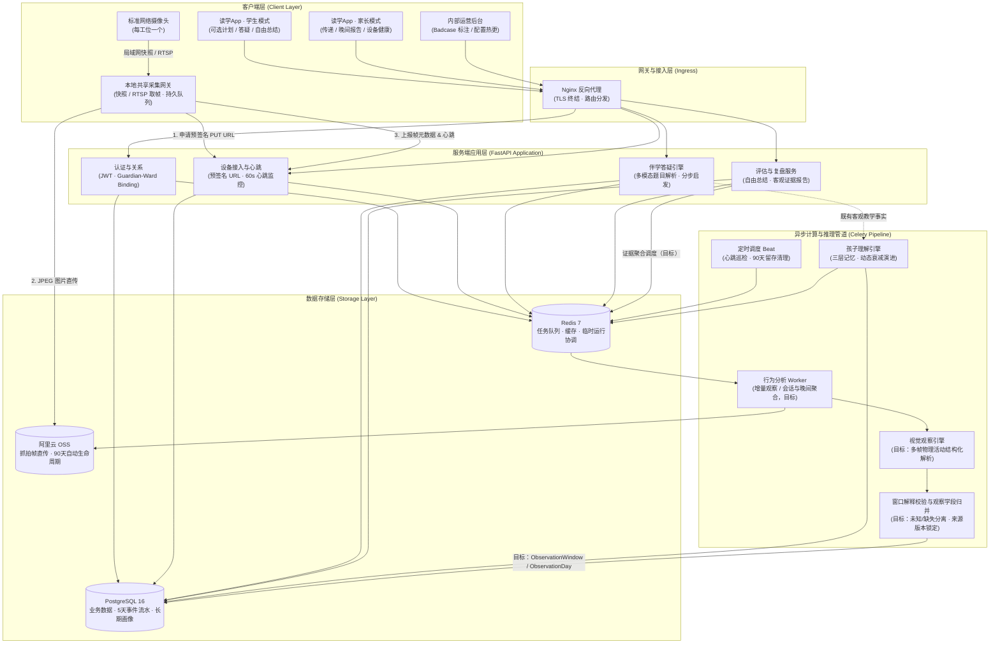

# 读学系统 — 全系统技术架构概览

> 版本 v4.0 · 2026-10-31 | 本文档为读学系统（Duxue）的**系统级技术架构概览**，涵盖系统拓扑与四端分工、主要数据流、合规与性能基线。Bounded Context 所有权由 [DDD 系统级 Overview](ddd-overview.md) 唯一维护；物理 Schema 与绑定表由 [Server 端详细技术设计](design-server.md) 唯一维护。

---

## 一、系统定位与四端组成

读学系统是一款基于 AI 视觉行为分析与大模型启发式伴学的智能成长平台。全系统遵循**“用户简单、方案简单、智能自动化”**三大设计原则，由以下四端协同构成：

```text
标准网络摄像头（每工位一个，局域网快照 / RTSP）
    ↓
共享采集网关（实验用电脑，机构用常开小主机）
    ├─ JPEG 预签名直传 → OSS
    └─ 绑定 / 帧元数据 / 心跳 → 读学服务端

读学 App（Ward / Guardian，Coach 演进） ─ REST/SSE → 读学服务端
内部运营后台 ─ HTTPS → 读学服务端
读学服务端：FastAPI + PostgreSQL + Redis + Celery + OSS + AI
```

| 端 / 模块 | 实现位置 | 职责与关键设计 |
|---|---|---|
| **读学Eye：摄像头与共享采集网关** | 标准摄像头 + Go `duxue-gateway/` | 局域网采图、持久缓存、OSS 直传；配置与验收唯一维护于 [采集设计](design-gateway.md) |
| **读学App** | `duxue-app/` | Ward 按需答疑、可选计划与自由总结；Guardian 查看设备健康和晚间报告，Coach 工作台按产品路线演进 |
| **Server** | `duxue-server/` | 接入鉴权、行为分析、启发答疑、客观报告与记忆底座 |
| **Admin** | `duxue-admin/`（待建设） | 内部运维、算法验证和数据治理工具 |

> Go采集网关与云端新接口已实现；真实摄像头/OSS长时间现场验收待完成。现有 OSS/Frame 基础设施可复用；家庭验证采用人工配置摄像头与 Ward、统一网关认证，新接口协议见 [采集设计](design-gateway.md)。机构批量管理与无计划自动会话还原需分别实现和验收。产品文档与接入手册已同步采集路线。

---

## 二、整体系统架构拓扑



---

## 三、领域边界与详细设计

为避免概览与领域文档分别维护 Context 图而漂移，领域所有权、跨 Context 集成与统一语言只在
[DDD 系统级 Overview](ddd-overview.md) 中维护。特别是，Working Memory 属于 Companion
Runtime，不是 Memory & Understanding 的持久化模型。

| 需要了解的内容 | 唯一详情文档 |
|---|---|
| Context Map、所有权和集成事件 | [DDD 系统级 Overview](ddd-overview.md) |
| 陪伴入口、Thread/Run 与 Agent Runtime | [Companion Orchestration](domain-companion.md) |
| Agent、Gate、Tool 与 Workflow 配置契约 | [Agent 配置设计](design-agent.md) |
| 当前 Agent 流程图 | [自动生成流程图](agent-flow-current.md) |
| 学习证据、Episode、Signal 与长期画像 | [Memory & Understanding](domain-memory.md) |
| 计划、学习执行、复盘的领域规则 | [Planning](domain-planning.md) · [Study](domain-study.md) · [Tutoring](domain-tutoring.md) · [Evaluation](domain-evaluation.md) |
| 稀疏图片解释、无计划观察学段与增量证据发布 | [Behavior Analysis](domain-behavior.md)（目标设计，未实现；求助邀请和晚间报告分别归 Study / Evaluation） |

---

## 四、核心业务关系与权限模型

系统不使用 Tenant。Guardian-Ward 是 M:N 关系，由 `guardian_ward_relations` 表承载；关联
Guardian/Ward 的角色资料扩展，而非泛化 `users` 外键。物理字段、索引、无数据库 Cascade 的
删除约束以及 Ward 登录邀请码均以 [Server 端详细技术设计](design-server.md#31-当前物理-er-图无-tenant直连-guardian-ward-关系) 为准。

本概览只约定授权语义：Ward 仅访问自身数据；Guardian 仅能访问存在绑定关系的 Ward 数据。
关系类型、权限分级、人数上限或共管邀请均不是当前 Schema 已实现能力，若要引入必须先在
Identity & Relationship Context 和物理 Schema 中新增设计，不能在此处预设字段。

### 极简 ACL 鉴权机制
服务端通过统一的依赖注入拦截器收口数据权限，杜绝越权访问：
```python
async def verify_ward_access(
    ward_id: UUID,
    current_user: User = Depends(get_current_user),
    db: AsyncSession = Depends(get_db)
) -> UUID:
    """统一学生数据访问鉴权依赖项"""
    if current_user.role == "ward":
        if current_user.id != ward_id:
            raise HTTPException(status_code=403, detail="无权访问其他学生数据")
    elif current_user.role == "guardian":
        is_bound = await check_guardian_ward_binding(
            db, guardian_id=current_user.id, ward_id=ward_id
        )
        if not is_bound:
            raise HTTPException(status_code=403, detail="未绑定该学生，无权访问")
    return ward_id
```

- **家庭场景（1~2 Guardian ↔ 1~3 Ward）**：App 顶部展示头像 Tab，左右滑动一键切换孩子；
- **小班/托管场景（少量 Guardian ↔ 几十个 Ward）**：App 提供学生下拉抽屉、按年级分组与拼音首字母快速检索。

---

## 五、核心数据流与交付边界

采集网关只负责记录图像证据，不判断学习状态。帧无需关联线上计划或显式 StudySession 即可入库。服务端目标是从连续证据自动还原学习学段，并将行为观察与按需答疑记录汇总为当晚报告；孩子自由总结是可选补充，不能作为报告生成的阻塞条件。

```text
摄像头 → 网关采图 → 本地持久队列 → OSS + Frame 元数据
                                          ↓
                          行为分析 → 学段归并 → 客观证据
按需答疑与微验证 ───────────────────────────┤
                                          ↓
                           当晚实况单 + 独立解题凭证
```

采集验收、采样预算和恢复边界见 [采集设计](design-gateway.md#五最小实验与验收)。行为分析与自动会话分段属于云端后续实现；报告版本与主客观隔离见 [Evaluation](domain-evaluation.md)。现有任务完成事件可作为增强触发，不能成为零计划场景的唯一入口。

## 六、关键技术决策

- **成熟摄像头 + 共享网关**：以标准本地接口降低硬件依赖，一处网关服务多个工位；先验证单摄像头，再压测多路。
- **快照优先、RTSP 兼容**：局域网可读取视频码流抽帧，公网只传稀疏图片；不提供实时监控，不建设云端视频转码集群。
- **OSS 预签名直传**：API 只处理身份、凭证与元数据，图片不经业务 API 转发。
- **云端语义分析**：网关不运行本地行为模型，识别策略统一在云端演进；15s 采样的辨识度需实测，不把停笔直接解释为不专注。
- **物理机位与数据治理**：侧后方机位降低正脸暴露，不能代替访问控制和数据删除机制。
- **沿用 Guardian-Ward 授权**：机构网关不意味着引入多租户系统，也不自动获得跨 Ward 管理权。工位映射与 Coach 权限须显式授权。

---

## 七、合规、安全与数据治理

1. **未成年人数据生命周期管理**：
   - 阿里云 OSS 桶配置生命周期规则，图像帧在上传 **90 天后自动物理擦除**（第一期用于模型微调训练积累）；
   - 服务端提取的 `structured_fields`、`frame_predictions`、`behavior_segments` 体积极小且无生物特征，长期保留；
   - 语音提问的音频切片在内存转写后，**24 小时内物理销毁**。
2. **防作弊与安全防护**：
   - 家庭实验网关使用一份受限云端凭证，服务端校验 Ward 白名单；凭证使用受限文件权限或系统凭证存储。摄像头本地密码不传云端，OSS 长期密钥仅服务端持有；配置与授权契约见 [采集设计](design-gateway.md)；
   - 预签名 PUT URL 使用短有效期并绑定 Object Key；文件类型和大小限制需在上传策略与帧入库校验中落实，不能只依靠客户端配置；
   - 启发式答疑网关由答案保护规则与出口检查约束，100% 拦截“直接要答案/整篇代写”等作弊请求；引导方式按孩子的实际卡点判断，不设固定等级。
3. **法定监护人知情与被遗忘权**：
   - Guardian 端提供透明的隐私管理看板，支持监护人依法行使“一键清除历史记忆”与“账号注销物理擦除”。

---

## 八、系统文档导航索引

- **产品架构与业务模块地图**：[`docs/product/ARCHITECTURE.md`](../product/ARCHITECTURE.md)
- **协商式计划 PRD**：[`docs/product/prd-schedule.md`](../product/prd-schedule.md)
- **伴学执行与启发答疑 PRD**：[`docs/product/prd-companion.md`](../product/prd-companion.md)
- **结果评估与复盘引导 PRD**：[`docs/product/prd-evaluate.md`](../product/prd-evaluate.md)
- **学习观察与行为采集 PRD**：[`docs/product/prd-supervise.md`](../product/prd-supervise.md)
- **孩子理解引擎与记忆系统 PRD**：[`docs/product/prd-memory.md`](../product/prd-memory.md)
- **服务端详细技术设计**：[`docs/technical/design-server.md`](design-server.md)
- **App端详细技术设计**：[`docs/technical/design-app.md`](design-app.md)
- **标准摄像头与采集网关详细技术设计**：[`docs/technical/design-gateway.md`](design-gateway.md)
- **摄像设备接入与操作手册**：[`docs/camera-setup-guide.md`](../camera-setup-guide.md)
