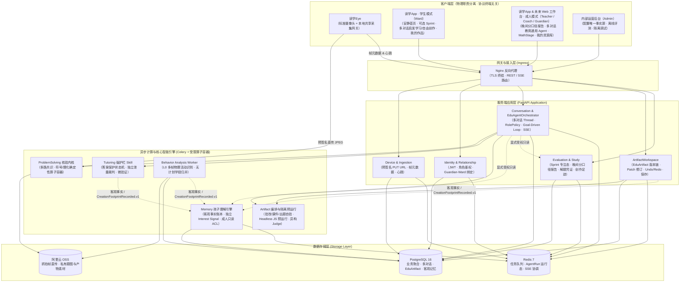

# 读学系统 — 全系统技术架构概览

> 版本 v5.1 · 2026-11-28 | 本文档为读学系统（Duxue）的**系统级技术架构概览**，涵盖系统拓扑与端侧分工、核心数据流、权限模型、合规与性能基线。领域所有权与 Domain Map 由 [DDD 系统级 Overview](ddd-overview.md) 唯一维护；多对话与教育通用 Agent 编排见 [Conversation Domain](domain-conversation.md)；多形态可修订产物与 `MathStage` 渲染见 [ArtifactWorkspace Domain](domain-artifact-workspace.md)；物理 Schema 与绑定表由 [Server 端详细技术设计](design-server.md) 唯一维护。

---

## 一、系统定位与四端组成

读学系统是一款面向 K–12 的 **AI 伴学与教育生产力平台**，遵循**“用户简单、方案简单、智能自动化”**三大设计原则，围绕**「L0 桌面静默感知底座 + 双端统一教育通用 Agent（Role Policy 差异化） + 多形态可修订产物工作区 + 晚间客观汇总交付」**运行（旧版 `Planning` 线上计划与 `Reflection` 每日自述已退场）：

```text
标准网络摄像头（每工位一个，局域网快照 / RTSP）
    ↓
共享采集网关（实验用电脑，机构用常开小主机）
    ├─ JPEG 预签名直传 → OSS
    └─ 绑定 / 帧元数据 / 心跳 → 读学服务端

读学 App（Ward / Guardian / Teacher·Coach）& 未来 Web 教师工作台 ─ REST/SSE → 读学服务端
内部运营后台（Admin） ─ HTTPS → 读学服务端
读学服务端：FastAPI + PostgreSQL + Redis + Celery + OSS + AI（EduAgent / ProblemSolving / MathStage）
```

| 端 / 模块 | 实现位置 | 职责与关键设计 |
|---|---|---|
| **读学Eye：摄像头与共享采集网关** | 标准摄像头 + Go `duxue-gateway/` | 局域网采图、持久缓存、OSS 直传；配置与验收唯一维护于 [采集设计](design-gateway.md) |
| **读学App（及未来 Web 工作台）** | `duxue-app/` | **Ward 端**：安静首页 + 可选 Sprint + `1:N` 多对话教育通用 Agent（作业启发答疑 + 自由画图/故事探索与「我的作品」）；**Teacher / Coach / Guardian 成人端**：晚间分口径汇总报告（含解题凭证与创作足迹）+ `1:N` 多对话教育通用 Agent 工作台（批改诊断、动态课件、备课与自验出题、「我的资源库」）；协议终端无关，预留 Web 工作台同源接入 |
| **Server** | `duxue-server/` | 接入鉴权、L0 行为分析、`Conversation` 多对话与 `EduAgentOrchestrator`（`RolePolicy`）、`ProblemSolving` 确定性核验内核、`Tutoring` 作业强护栏、`ArtifactWorkspace` 多形态版本化产物、晚间客观报告与记忆底座 |
| **Admin** | `duxue-admin/` | Workflow / Agent / Skill / Gate / Tool 唯一可编辑配置源、离线评测聚合与隔离调试，见 [管理台设计](design-admin.md) |

> Go 采集网关与云端新接口已实现，真实摄像头/OSS 长时间现场验收待完成；`MentorCourseware` P0-1 与主动保存已合入基线，正平滑演进为 `ArtifactWorkspace` 与双端统一教育通用 Agent。

---

## 二、整体系统架构拓扑



---

## 三、领域边界与详细设计

为避免概览与领域文档分别维护 Context 图而漂移，领域所有权、跨 Domain 集成与统一语言唯一维护于 [DDD 系统级 Overview](ddd-overview.md)。

| 需要了解的内容 | 唯一详情文档 |
|---|---|
| Domain Inventory、Domain Map 与跨域稳定契约 | [DDD 系统级 Overview](ddd-overview.md) |
| 多对话 `ConversationThread`、`EduAgentOrchestrator`、`RolePolicy` 与 Skill/Tool 归属 | [Conversation Domain](domain-conversation.md) |
| `EduArtifact` 多形态产物、版本链、局部修订、主动保存与 `MathStage` 渲染隔离 | [ArtifactWorkspace Domain](domain-artifact-workspace.md) |
| Ward 作业强护栏答疑、答案保护、结构化配图（`visual`）与联网检索 | [Tutoring Domain](domain-tutoring.md) |
| 多路求解、确定性符号/理化算子核验与题目档案 `ProblemDossier` | [ProblemSolving Domain](domain-problem-solving.md) · [数学核验设计](tutoring-math.md) |
| Agent、Skill、Gate 与 Tool 可编辑配置契约 | [Agent 配置设计](design-agent.md) · [管理台设计](design-admin.md) |
| 轻量主动专注挑战（`Sprint`）、专注态查询与 `HelpOffer` | [Study Domain](domain-study.md) |
| 稀疏行为观察、晚间分口径汇总交付与孩子记忆引擎 | [Behavior Analysis](domain-behavior.md) · [Evaluation](domain-evaluation.md) · [Memory](domain-memory.md) |
| 服务端物理 Schema 与端侧 Flutter 架构 | [Server 物理设计](design-server.md) · [App 端设计](design-app.md) |

---

## 四、核心业务关系与权限模型

系统不使用多租户（No-Tenant）。角色涵盖 `ward`、`guardian`、`teacher`、`coach`：
- **教师与成人独立使用工作台（G4）**：`teacher` / `coach` / `guardian` 账号**无需先绑定任何学生**，即可直接登录并拥有各自私有隔离的 `1:N` 多对话（`ConversationThread`）与个人资产库（`EduArtifact`）。
- **Guardian / Coach ↔ Ward 绑定与显式受权只读**：沿用 `guardian_ward_relations` M:N 绑定表（物理定义见 [design-server.md](design-server.md)）。Ward 仅访问自身数据；成人在工作台对话中**显式指定 `context_ward_id`** 时，服务端强制经 `verify_ward_access` 校验绑定关系，且仅开放**严格只读**的 `MemoryBundle` 与近期报告摘要，严禁隐式写回学生客观记忆或教学记录。

```python
async def verify_ward_access(
    ward_id: UUID,
    current_user: User = Depends(get_current_user),
    db: AsyncSession = Depends(get_db)
) -> UUID:
    """统一学生数据访问鉴权依赖项"""
    if current_user.role == "ward":
        if current_user.id != ward_id:
            raise HTTPException(status_code=403, detail="无权访问其他学生数据")
    elif current_user.role in ("guardian", "coach", "teacher"):
        is_bound = await check_guardian_ward_binding(
            db, guardian_id=current_user.id, ward_id=ward_id
        )
        if not is_bound:
            raise HTTPException(status_code=403, detail="未绑定该学生，无权访问")
    return ward_id
```

---

## 五、核心数据流与交付边界

全系统由两条解耦的主干数据流构成，零前置计划/打卡负担：

```text
【主干流 A · L0 静默观察 + Ward 伴学与自由探索 → 晚间分口径客观交付】
摄像头 → 网关采图 → OSS + Frame 元数据 → 行为分析（线下作业净专注时长）
Ward 作业答疑（Tutoring 强护栏）──────────→ 独立解题凭证 + 客观学业事实 → Memory
Ward 自由创作（ArtifactWorkspace）───────→ CreationFootprintRecorded.v1
                                              ├─→ Evaluation（主动保存的作品足迹，与作业严格分口径）
                                              └─→ Memory（独立 Interest Signal，不混入学业掌握度）

【主干流 B · Teacher / Coach / Guardian 教育通用 Agent 生产力闭环】
多对话目标输入（可选显式只读绑定 Ward）
    → EduAgentOrchestrator（RolePolicy 成人策略）
    → ProblemSolving 确定性核验（批改核验 / 课件基线 / 出题自解自验）
    → ArtifactWorkspace（grading_report / interactive_courseware / lesson_pack）
    → 局部修订 / Undo·Redo / 主动保存至「我的资源库」（零写回学生 Memory）
```

---

## 六、关键技术决策

- **成熟摄像头 + 共享网关**：标准本地接口 + OSS 预签名直传，公网不传视频流、不提供实时监控；
- **Agent Loop 不新建业务 Domain**：通用 Agent 编排收敛为 Application 层 `EduAgentOrchestrator` + 代码级 `RolePolicy` + 极薄 `Conversation` 载体，Skill/Tool 按业务归属分四层管理；
- **验证优先（Verification-First）**：确定性符号/理化算子容器与多路共识统一服务答疑、批改与出题自验，低置信显式标「待人工复核」；
- **隔离渲染与安全降级**：动态演示采用本地锁定 Web 绘图库 + 隔离 Headless 预运行 + WebView 外静态图文降级，未通过真机故障原型验收的设备禁用生成代码路径；
- **语义不靠正则**：作业识别、代写判别、偏题识别与错因归类全部交由模型或异构 Judge 裁决。

---

## 七、合规、安全与数据治理

1. **未成年人数据生命周期管理**：OSS 观察图像帧 90 天自动物理擦除；语音提问音频切片转写后 24 小时内物理销毁；支持监护人一键重置记忆与账号注销物理擦除。
2. **双端隔离与防作弊红线**：Ward 端答案保护、作业防代写（共创 vs 代写）与专注态软守护均由代码级 `RolePolicy` 与独立 Judge 强制守卫；新建/切换对话无法绕过 Sprint 专注态或作业保护。
3. **素材与隐私隔离**：成人与学生私有素材分前缀隔离；保存 `EduArtifact` 时将私有原图副本随聚合事务落库，不依赖临时附件 TTL。

---

## 八、系统文档导航索引

- **产品架构与四大目标（G1–G4）**：[`docs/product/ARCHITECTURE.md`](../product/ARCHITECTURE.md)
- **教育通用 Agent PRD（含 Ward 作业启发方法论与成人工作台）**：[`docs/product/prd-edu-agent.md`](../product/prd-edu-agent.md)
- **用户、首页与晚间客观汇总报告 PRD**：[`docs/product/prd-user.md`](../product/prd-user.md)
- **主动专注挑战（Sprint）PRD**：[`docs/product/prd-schedule.md`](../product/prd-schedule.md)
- **学习观察与行为采集 PRD**：[`docs/product/prd-supervise.md`](../product/prd-supervise.md)
- **孩子理解引擎与记忆系统 PRD**：[`docs/product/prd-memory.md`](../product/prd-memory.md)
- **DDD 系统级 Overview**：[`docs/technical/ddd-overview.md`](ddd-overview.md)
- **Conversation 与教育通用 Agent 编排设计**：[`docs/technical/domain-conversation.md`](domain-conversation.md)
- **ArtifactWorkspace 与 MathStage 设计**：[`docs/technical/domain-artifact-workspace.md`](domain-artifact-workspace.md)
- **服务端物理设计**：[`docs/technical/design-server.md`](design-server.md)
- **App 端详细技术设计**：[`docs/technical/design-app.md`](design-app.md)
- **标准摄像头与采集网关详细技术设计**：[`docs/technical/design-gateway.md`](design-gateway.md)
- **摄像设备接入与操作手册**：[`docs/camera-setup-guide.md`](../camera-setup-guide.md)
