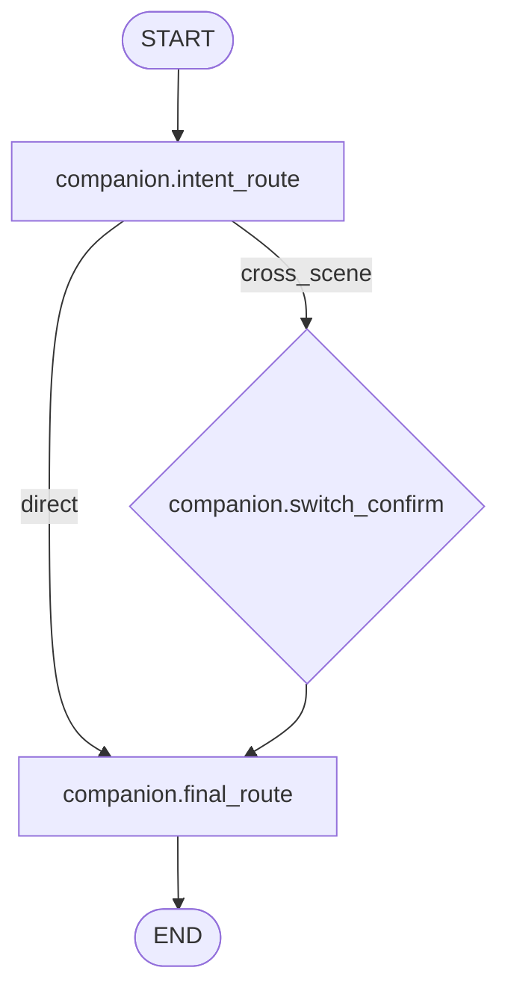
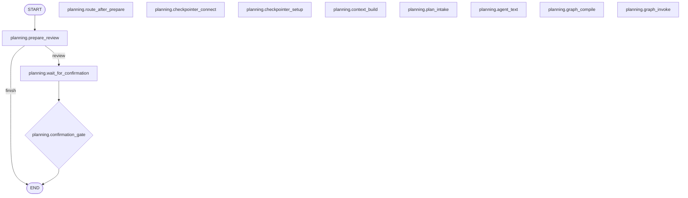
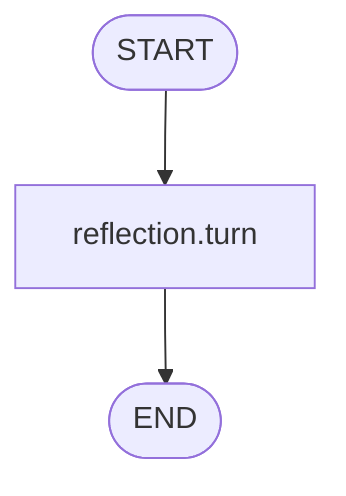
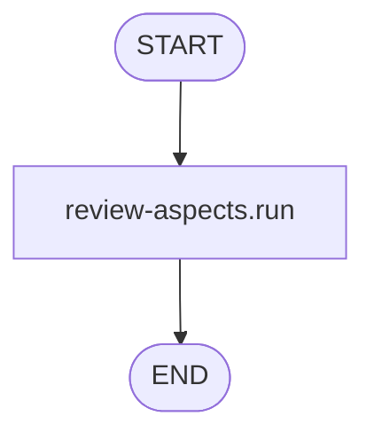
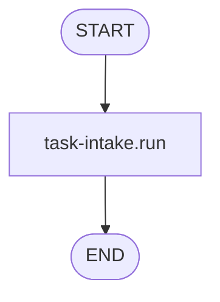
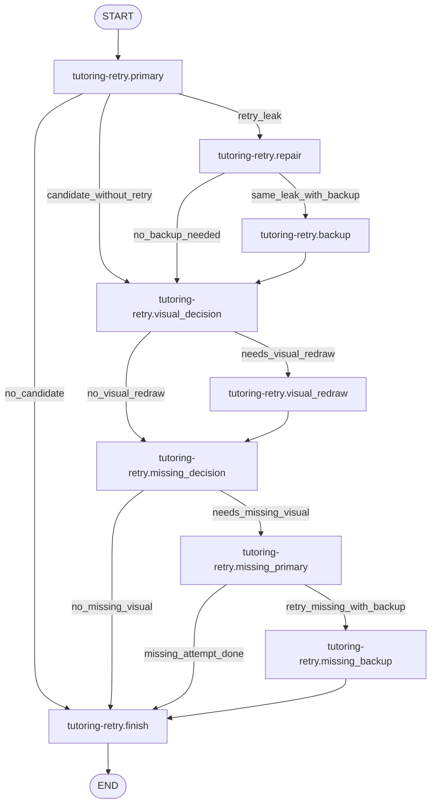
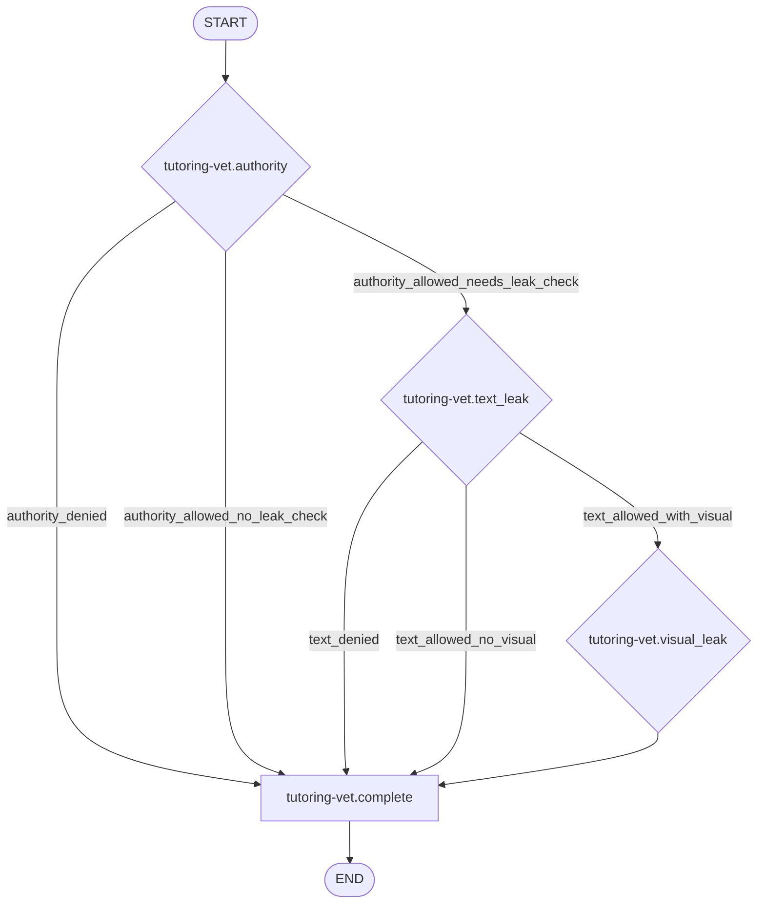
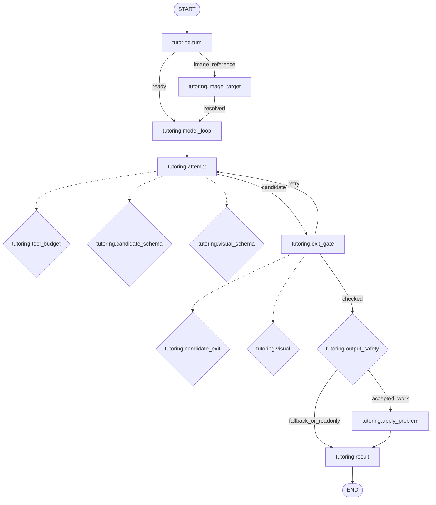

# 当前 Agent 流程图（自动生成）

> 由 `duxue-server/agent_specs/workflows/*.json` 生成；编辑定义后运行 `cd duxue-server && .venv/bin/python -m app.agent_specs export`。
> 实线表示主要执行路径，虚线表示节点内部的条件步骤；门禁实际执行条件仍由代码裁决。
> 独立 API 调用有各自的 Workflow；未连接的节点表示会话外阶段。

## companion · v1

| 组件 | 模型 | Prompt |
| --- | --- | --- |
| `companion.intent@v7` | `qwen-flash` | `companion.intent.system.v7` |
| `companion.scene-switch@v1` | `qwen3.8-flash` | `companion.scene-switch.system.v1` |

工具：无。

## planning · v1

| 组件 | 模型 | Prompt |
| --- | --- | --- |
| `planning.intake@v2` | `qwen3.7-plus-2026-05-26` | `planning.intake.prompt.v3` |
| `planning.reply@v2` | `qwen3.8-flash` | `companion.agent-text.system.v2` |

工具：无。

## reflection · v1

| 组件 | 模型 | Prompt |
| --- | --- | --- |

工具：无。

## review-aspects · v1

| 组件 | 模型 | Prompt |
| --- | --- | --- |
| `evaluation.review-aspects@v1` | `qwen-flash` | `evaluation.review-aspects.system.v1` |

工具：无。

## task-intake · v1

| 组件 | 模型 | Prompt |
| --- | --- | --- |
| `task.intake@v1` | `qwen3.7-plus-2026-05-26` | `task.intake.prompt.v2` |

工具：无。

## tutoring-retry · v1

| 组件 | 模型 | Prompt |
| --- | --- | --- |

工具：无。

## tutoring-vet · v1

| 组件 | 模型 | Prompt |
| --- | --- | --- |
| `tutoring.leak-judge@v8` | `qwen3.8-flash` | `tutoring.leak-judge.system.v7` |
| `tutoring.visual-leak-judge@v5` | `qwen-plus` | `tutoring.visual-leak-judge.system.v5` |

工具：无。

## tutoring · v1

| 组件 | 模型 | Prompt |
| --- | --- | --- |
| `tutoring.image-target@v1` | `qwen3.8-flash` | `tutoring.image-target.system.v1` |
| `tutoring.turn@v19` | `qwen3.7-plus-2026-05-26` | `tutoring.turn.system.v19` |
| `tutoring.turn-backup@v2` | `qwen3.8-flash` | `tutoring.turn.system.v19` |

工具：`tutoring.get_attempt_summary`, `tutoring.get_task_context`, `tutoring.lookup_history`, `tutoring.widget_guidelines`。

具体 Prompt 正文：`cd duxue-server && .venv/bin/python -m app.agent_specs show <agent>`。
