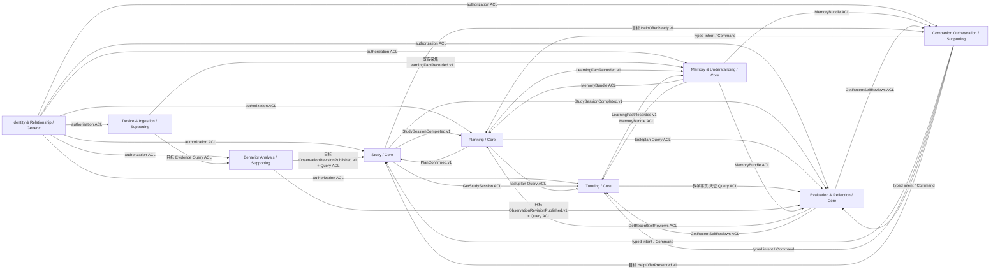
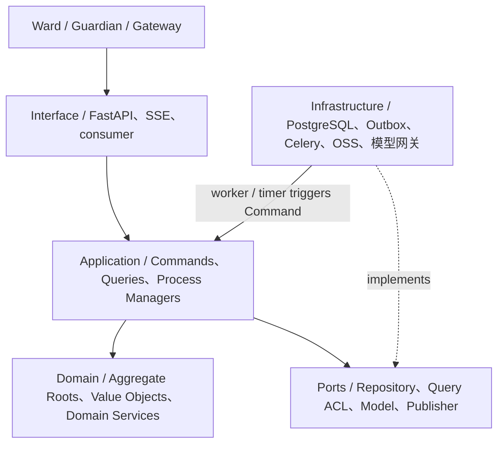

# 读学系统 — DDD 系统级 Overview

> 状态：目标设计（各领域实现状态见对应文档） · 版本 v2.0 · 2026-11-01。
> 方法：[domain-driven-design skill](../../.cursor/skills/domain-driven-design/SKILL.md)。
> 本文唯一维护全系统 Domain Inventory、Domain Map 与跨领域稳定契约目录。Domain 就是业务边界，Core/Supporting/Generic 是分类；不再嵌套 Subdomain / Bounded Context。既有代码目录名 contexts 不因此要求重命名。

## 一、阅读边界与单一事实源

| 内容 | 唯一归属 |
|---|---|
| 全系统领域清单、所有权、Domain Map、跨域契约目录 | 本文 |
| 领域语言、Aggregate Root、Command、Query、接口、局部 ER 与目标映射 | 各 domain 文档；采集域见 design-gateway |
| 当前物理 Schema、已发布索引/迁移、运行拓扑 | [design-server](design-server.md)、[技术架构](ARCHITECTURE.md) |
| 模型/Agent 组件装配与协议 | [design-agent](design-agent.md)、[Companion](domain-companion.md) |

目标 ER 不是已迁移 Schema；实施时须同步物理事实源。模型、Agent、Worker、数据库表、UI 页面都不自动成为 Domain。

## 二、Domain Inventory

全系统共 **9 个 Domain**。

| # | Domain | 类型 | 拥有的语言、模型与规则 / 非目标 | 上游 / 下游与集成 |
|---|---|---|---|---|
| 1 | Identity & Relationship | Generic | 身份、角色资料、Guardian-Ward 关系与凭据；不拥有学习状态 | 向各域提供授权 ACL / Query |
| 2 | Device & Ingestion | Supporting | CameraRegistration、AcceptedFrame、采集归属与健康；不解释学习行为 | Identity → 本域；向 Behavior 提供受权证据 Query；既有采集事实向 Memory 入账 |
| 3 | Planning | Core | 轻量计划与任务：Task、PlanDraft、DailySchedule、顺序与可选估时/约定钟点；保留完整状态，仅按需提示，不拥有实际执行或 Sprint | Identity/Memory Query → 本域；PlanConfirmed.v1 → Study；LearningFactRecorded.v1 → Memory |
| 4 | Study | Core | StudySession、执行区间、StartCue；目标扩展 Sprint 与 HelpOfferBudget/HelpOffer；不拥有图片解释、题目或任务安排 | Planning/Behavior Query 与事件 → 本域；StudySessionCompleted.v1 → Planning/Evaluation；HelpOfferReady.v1 → Companion |
| 5 | Tutoring | Core | TutoringSession、ProblemRecord、答案保护、验证尝试、发音；不拥有计时或报告 | Study/Planning/Memory 受权 Query → 本域；教学事实 → Memory；凭证 Query → Evaluation |
| 6 | Behavior Analysis | Supporting | ObservationWindow、ObservationDay、物理活动与被动学段；不判断主观感受、作业完成或掌握 | Device Query → 本域；ObservationRevisionPublished.v1 + Query ACL → Study/Evaluation |
| 7 | Evaluation & Reflection | Core | SelfReview、ReviewAspect、ReflectionReport/ReportVersion；自述和客观证据隔离，零自述晚间交付；不反写画像或计划 | Behavior/Study/Tutoring/Planning → 本域；授权报告 Query → Ward/Guardian；当前自述 Query → Companion/Planning/Tutoring |
| 8 | Memory & Understanding | Core | LearningEvidence、EpisodicMemory、Signal、长期理解；不拥有今日自述或 Runtime Working Memory | 已确认学习事实 → 本域；MemoryBundle Query ACL → 学习各域 |
| 9 | Companion Orchestration | Supporting | Thread/Run 连续性、交互协议、回复权与送达；不替各学习域作业务决定 | Identity/各学习域 Query 和交互请求 → 本域；typed intent → 对应领域 Command |

CompanionCoordinator 是 Application 的 Process Manager，不是额外 Domain 或拥有全部学习状态的 Aggregate Root。Working Memory 属于 Companion Runtime。LearningFactRecorded.v1 是 Published Language，不是通用 Domain Event；自述不投递 Memory。

## 三、DDD Domain Map

图源：本文 §三 Mermaid；这是唯一的全系统 Domain Map，不包含部署、数据库或队列。带“目标”的契约未实现，不能作为现有接口使用。

历史文档中的 FrameRecorded.v1 未形成采集分析调度事实源，本方案不新增该事件，改由接收游标扫描；BehaviorSegmentGenerated.v1 的 session_id 幂等设计不适合零计划观察，新设计使用独立的 ObservationRevisionPublished.v1，不伪装为原事件兼容升级。现有调用保持迁移窗口，按领域文档的 feature flag 切换。

## 四、跨域协作和稳定契约目录

发布方 Command 在本地事务保存 Root 与需要的 Outbox。Consumer Interface 只处理协议/投递，接收域 Command 经 ACL 翻译后改变自己的 Root。禁止跨域 Aggregate/ORM 写入。跨域默认最终一致，不存在全局学习事务。Worker/Timer 属于 Infrastructure，只触发 Command。

| 契约 / 状态 | 发布者 / 本地事实 | 消费者 → 本地意图 | 幂等 / 乱序 / 契约详情 |
|---|---|---|---|
| PlanConfirmed.v1 / 既有设计 | Planning / PlanConfirmed | Study → 校验执行与 StartCue | schedule_id + version；见 Planning/Study |
| StudySessionCompleted.v1 / 既有 | Study / StudySessionFinished | Planning → 完成任务；Evaluation → 刷新材料 | session_id + version；无任务会话不完成任务；见 Study |
| LearningFactRecorded.v1 / 既有 | 采集、计划、答疑中有独立用途的客观事实 | Memory → IngestLearningFact | source_type + source_id + event_type + source_version；见 Memory；Behavior 新衍生事件本期不扩展 |
| ObservationRevisionPublished.v1 / 目标 | Behavior / ObservationRevisionPublished | Study → ConsiderHelpOffer；Evaluation → PublishEveningReport | day_id + revision，各域独立 inbox；允许乱序、读锁定版本；见 [Behavior §五](domain-behavior.md#五内部接口与消息协议) |
| HelpOfferReady.v1 / 目标 | Study / HelpOfferReadied | Companion → PresentHelpOffer | offer_id + version；过期丢弃、不抢答疑回复权；见 [Study §九](domain-study.md#九观察触发的求助邀请目标扩展) |
| HelpOfferPresented.v1 / 目标 | Companion / 前台呈现已确认 | Study → MarkHelpOfferPresented | receipt_id；不能以写消息代表已看到；见 Study §九 |

事件 schema/权限、时限、退避/死信、对账重放和接收 Command 的事务在所有者领域文档唯一维护。每条 Integration Event 必须有 event_id、event_type/schema version、occurred_at、ward_id、来源 identity/version；旧契约缺字段不得未经兼容迁移强行套用新 envelope。

受权 Query 目录：

| Query | 所有者 → 消费者 | 边界 |
|---|---|---|
| ListAcceptedEvidence / ReadEvidenceManifest（目标） | Device → Behavior | 已接收清单与稳定接收游标；不是触发网关推理 |
| GetObservationDay / GetSupportCandidates / SceneWindow（目标） | Behavior → Evaluation/Study | 物理观察、来源版本、freshness；不暴露家长实时图像 |
| GetStudySession | Study → Tutoring | status、ward_id、task_id；不订阅 Root 内部事件 |
| 教学证据与凭证 Query | Tutoring → Evaluation | 原题、启发、微验证与明确状态；缺失不是通过 |
| GetRecentSelfReviews | Evaluation → Companion/Planning/Tutoring | 按用途只读当前确认版本；Planning 仅 Ward 明确请求；不向 Guardian 开放原话 |
| MemoryBundle | Memory → 调用域 | actor、Ward、用途、可见范围、预算；不是 Integration Event |

## 五、Layered Architecture Map

图源：本文 §五 Mermaid，与 Domain Map 分开维护。

API 不操作 ORM；Domain 不调用模型、数据库、队列。Query 是只读契约，可组合授权来源，不作为权威写模型。Aggregate 是本地一致性边界，不是业务目录。跨域结果无需全局 Saga 时，采用独立本地事务、幂等和对账即可。

## 六、领域详情入口

| Domain | 唯一详情 | 状态说明 |
|---|---|---|
| Device & Ingestion | [design-gateway](design-gateway.md) | 采集配置/模型/接入目标契约；实际实现进度见进行中 spec |
| Behavior Analysis | [domain-behavior](domain-behavior.md) | 新目标设计；窗口、观察日、缺口、增量分析和跨域发布未实现 |
| Planning | [domain-planning](domain-planning.md) | 轻量计划与任务、按需展示、安排确认与执行事实边界（目标设计待改造） |
| Study | [domain-study](domain-study.md) | 已有会话/StartCue；Sprint 与 HelpOffer 为目标扩展 |
| Tutoring | [domain-tutoring](domain-tutoring.md) | 启发、答案保护、教学事实；[视频专题](tutoring-video-answer.md)另行演进 |
| Evaluation & Reflection | [domain-evaluation](domain-evaluation.md) | 已有自述；零输入版本化客观报告为目标扩展 |
| Memory & Understanding | [domain-memory](domain-memory.md) | 客观证据账本、Episode/Signal/Profile |
| Companion Orchestration | [domain-companion](domain-companion.md) | 入口连续性与交互协议；help_offer kind 未实现 |
| Identity & Relationship | [design-server](design-server.md) | 沿用既有身份/关系/授权 |
