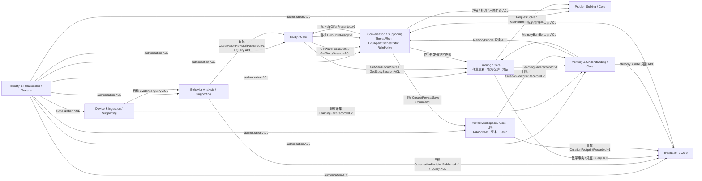
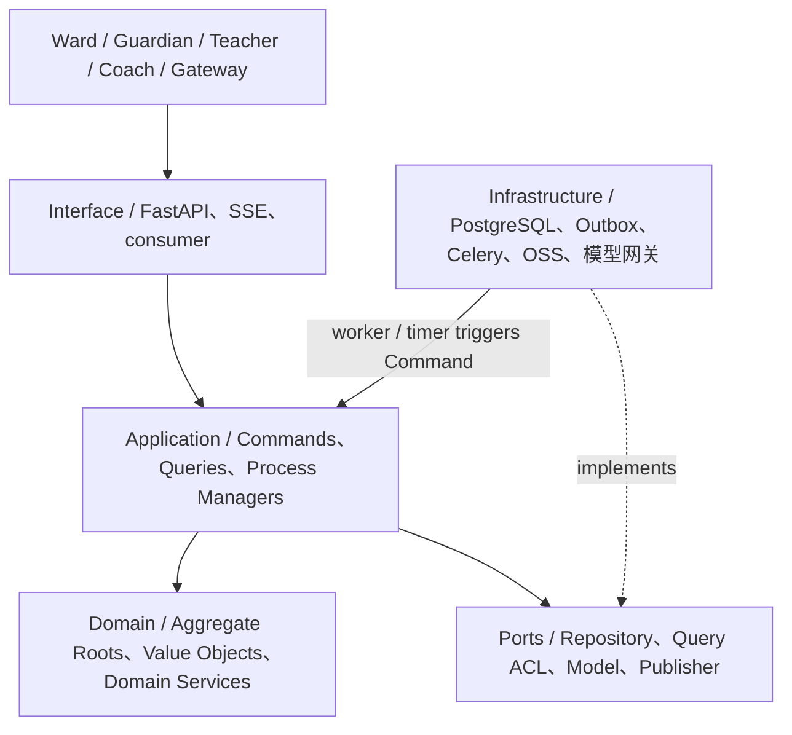

# 读学系统 — DDD 系统级 Overview

> 状态：目标设计（已对齐教育通用 Agent 演进，`Planning`/`Reflection` 已移除；各领域实现状态见对应文档） · 版本 v3.1 · 2026-11-27。
> 方法：[domain-driven-design skill](../../.cursor/skills/domain-driven-design/SKILL.md)。
> 本文唯一维护全系统 Domain Inventory、Domain Map 与跨领域稳定契约目录。Domain 就是业务边界，Core/Supporting/Generic 是分类；不再嵌套 Subdomain / Bounded Context。既有代码目录名 contexts 不因此要求重命名。

## 一、阅读边界与单一事实源

| 内容 | 唯一归属 |
|---|---|
| 全系统领域清单、所有权、Domain Map、跨域契约目录 | 本文 |
| 领域语言、Aggregate Root、Command、Query、接口、局部 ER 与目标映射 | 各 domain / topic 文档；采集域见 design-gateway |
| 当前物理 Schema、已发布索引/迁移、运行拓扑 | [design-server](design-server.md)、[技术架构](ARCHITECTURE.md) |
| 通用 Agent 编排、RolePolicy、对话载体与模型配置契约 | [Conversation Domain](domain-conversation.md)、[design-agent](design-agent.md) |

目标 ER 不是已迁移 Schema；实施时须同步物理事实源。**模型、Agent Loop、Skill、Tool、Worker、数据库表、UI 页面都不自动成为 Domain**；通用 Agent 编排（`EduAgentOrchestrator`）属于 Application 层 Process Manager。

## 二、Domain Inventory

全系统共 **10 个活跃 Domain**（原 `Planning` 已彻底退场；原 `Companion Orchestration` 收缩为极薄的 `Conversation` 对话载体，避免与 `Tutoring` 重叠）：

| # | Domain | 类型 | 拥有的语言、模型与规则 / 非目标 | 上游 / 下游与集成 |
|---|---|---|---|---|
| 1 | Identity & Relationship | Generic | 身份、角色资料（`ward` / `guardian` / `teacher` / `coach`）、Guardian-Ward 绑定与凭据；不拥有学习状态 | 向各域提供授权 ACL / Query |
| 2 | Device & Ingestion | Supporting | CameraRegistration、AcceptedFrame、采集归属与健康；不解释学习行为 | Identity → 本域；向 Behavior 提供受权证据 Query；既有采集事实向 Memory 入账 |
| 3 | Study | Core | 轻量主动专注挑战（`Sprint`）、执行区间与观察触发求助邀请（`HelpOffer`）；不拥有任务池、图片解释或题目 | Behavior Query 与事件 → 本域；`GetWardFocusState` ACL → EduAgent；`HelpOfferReady.v1` → Conversation |
| 4 | Tutoring | Core | **Ward 作业受保护教学域**：`TutoringSession`、`ProblemRecord`、答案保护状态机（`TutorPermitPolicy`）、独立泄露裁判、微验证、结构化配图（`visual`）与发音；作为通用 Agent 下的强护栏 Skill 被委派；不拥有通用对话路由或自由创作产物 | Study/Memory 受权 Query → 本域；ProblemSolving ACL；教学事实 → Memory；凭证 Query → Evaluation |
| 5 | ProblemSolving | Core | `ProblemDossier`：结构化题面、多路共识解题路线、确定性算子核验锚点、采分点与置信度；统一服务答疑、整页批改核验、动态课件基线与出题自验 | Tutoring / EduAgent → 本域；`GetProblemDossier` 受权 Query |
| 6 | ArtifactWorkspace（目标新增） | Core | `EduArtifact`（泛化既有 `MentorCourseware`）、不可变 `ArtifactVersion`、`ArtifactBlock`/`Patch`、核验诚实状态、Undo/Redo 与资产保留生命周期；承载动态课件、批改单、教案变式卷与 Ward 创意作品 | Identity / EduAgent Commands → 本域（与 ProblemSolving 零直接依赖）；Ward 创作发布 `CreationFootprintRecorded.v1` → Evaluation & Memory |
| 7 | Behavior Analysis | Supporting | ObservationWindow、ObservationDay、物理活动与被动学段；不判断主观感受、作业完成或掌握 | Device Query → 本域；`ObservationRevisionPublished.v1` + Query ACL → Study/Evaluation |
| 8 | Evaluation | Core | 晚间客观汇总报告（有证据的学习活动、独立解题凭证、好奇心与创作足迹）；原 Ward `SelfReview` 自述已退场；不反写画像 | Behavior/Study/Tutoring/ArtifactWorkspace → 本域；授权报告 Query → Guardian/Coach 与成人工作台（只读） |
| 9 | Memory & Understanding | Core | LearningEvidence、EpisodicMemory、`Interest Signal`（含自由创作足迹）与长期客观画像；不拥有 Runtime Working Memory；严禁成人工作台隐式写回 | 已确认客观事实与兴趣信号 → 本域；`MemoryBundle` Query ACL → Tutoring/Evaluation 及显式受权成人工作台（严格只读） |
| 10 | Conversation（原 Companion） | Supporting | 极薄双端多对话载体：`ConversationThread`（按 `owner_id + owner_role` 支持 `1:N` 多对话，默认 1 个、按需新建/切换/删除）、`AgentRun`、`history_generation` 与关闭词汇表交互信封；Application 层由 `EduAgentOrchestrator` + `RolePolicy` 编排；不拥有 `EduArtifact`、`TutoringSession` 或业务教学规则 | Identity/Study/Memory/Evaluation 只读 ACL；委派 Tutoring / ArtifactWorkspace / ProblemSolving |

`EduAgentOrchestrator` 是 Application 的 Process Manager，不是额外 Domain 或 Aggregate Root。Working Memory 属于运行态上下文。`LearningFactRecorded.v1` 与 `CreationFootprintRecorded.v1` 是 Published Language。

## 三、DDD Domain Map

图源：本文 §三 Mermaid；这是唯一的全系统 Domain Map，不包含部署、数据库或队列。带“目标”的契约未实现，不能作为现有接口使用。

## 四、跨域协作和稳定契约目录

发布方 Command 在本地事务保存 Root 与需要的 Outbox。Consumer Interface 只处理协议/投递，接收域 Command 经 ACL 翻译后改变自己的 Root。禁止跨域 Aggregate/ORM 写入。跨域默认最终一致，不存在全局学习事务。Worker/Timer 属于 Infrastructure，只触发 Command。

| 契约 / 状态 | 发布者 / 本地事实 | 消费者 → 本地意图 | 幂等 / 乱序 / 契约详情 |
|---|---|---|---|
| `LearningFactRecorded.v1` / 既有 | 采集、答疑中有独立用途的客观事实 | Memory → `IngestLearningFact` | `source_type + source_id + event_type + source_version`；见 Memory |
| `CreationFootprintRecorded.v1` / 目标 | ArtifactWorkspace / Ward 自由探索与创作保存或结算 | Evaluation → `RecordCreationFootprint`；Memory → `IngestInterestSignal` | `artifact_id + version_no`；**严禁混入作业专注时长与客观学业掌握度**；见 [ArtifactWorkspace](domain-artifact-workspace.md) |
| `ObservationRevisionPublished.v1` / 目标 | Behavior / `ObservationRevisionPublished` | Study → `ConsiderHelpOffer`；Evaluation → `PublishEveningReport` | `day_id + revision`，各域独立 inbox；见 [Behavior §五](domain-behavior.md#五内部接口与消息协议) |
| `HelpOfferReady.v1` / 目标 | Study / `HelpOfferReadied` | Conversation → `PresentHelpOffer` | `offer_id + version`；过期丢弃、不抢答疑回复权；见 [Study §九](domain-study.md#九观察触发的求助邀请目标扩展) |
| `HelpOfferPresented.v1` / 目标 | Conversation / 前台呈现已确认 | Study → `MarkHelpOfferPresented` | `receipt_id`；见 Study §九 |

受权 Query 目录：

| Query | 所有者 → 消费者 | 边界 |
|---|---|---|
| `ListAcceptedEvidence` / `ReadEvidenceManifest`（目标） | Device → Behavior | 已接收清单与稳定接收游标 |
| `GetObservationDay` / `GetSupportCandidates` / `SceneWindow`（目标） | Behavior → Evaluation/Study | 物理观察、来源版本、freshness；不暴露家长实时图像 |
| `GetStudySession` / `GetWardFocusState`（目标） | Study → Tutoring / EduAgent | 返回 Sprint 专注态与会话状态，支撑 Ward 专注态软边界 |
| 教学证据与凭证 Query | Tutoring → Evaluation | 原题、启发、微验证与明确状态；缺失不是通过 |
| `GetProblemDossier` / 无状态求解核验 | ProblemSolving → Tutoring / EduAgent | 私有解投影与置信度；Ward 侧永不解除答案保护 |
| `MemoryBundle` | Memory → Tutoring / Evaluation / 成人工作台（显式受权只读） | 校验 `verify_ward_access`；成人工作台只读不写回 |
| `GetRecentReportSummary`（目标） | Evaluation → 成人工作台（显式受权只读） | 仅在显式关联绑定 Ward 时返回摘要，不反写历史报告 |

## 五、Layered Architecture Map

图源：本文 §五 Mermaid，与 Domain Map 分开维护。

API 不操作 ORM；Domain 不调用模型、数据库、队列。Query 是只读契约，可组合授权来源，不作为权威写模型。Aggregate 是本地一致性边界，不是业务目录。

## 六、领域详情入口

| Domain | 唯一详情 | 状态说明 |
|---|---|---|
| Device & Ingestion | [design-gateway](design-gateway.md) | 采集配置/模型/接入目标契约；Go 网关已实现，现场长测待完成 |
| Behavior Analysis | [domain-behavior](domain-behavior.md) | 目标设计；窗口、观察日、缺口与增量分析待实现 |
| Study | [domain-study](domain-study.md) | 已有会话/StartCue/Sprint；`GetWardFocusState` 与 `HelpOffer` 为目标扩展 |
| ProblemSolving | [domain-problem-solving](domain-problem-solving.md) | 代码已实现（迁移 37），统一服务答疑、批改核验、课件基线与出题自验 |
| Tutoring | [domain-tutoring](domain-tutoring.md) | Ward 作业受保护教学、配图/表达与微验证；作为通用 Agent 强护栏 Skill 保留复用 |
| ArtifactWorkspace | [domain-artifact-workspace](domain-artifact-workspace.md) | `EduArtifact` 多形态产物（泛化既有 `MentorCourseware` 基线）、版本链、Patch 修订、保存与 `MathStage` 隔离渲染 |
| Evaluation | [domain-evaluation](domain-evaluation.md) | `SelfReview` 退场；聚焦晚间分口径汇总报告、解题凭证与创作足迹 |
| Memory & Understanding | [domain-memory](domain-memory.md) | 客观证据账本、Episode/Signal/Profile；新增自由创作 `Interest Signal` 与成人受权只读 |
| Conversation（原 Companion） | [domain-conversation](domain-conversation.md) | `1:N` 多对话载体（`ConversationThread` / `AgentRun` / 交互信封）+ Application 层 `EduAgentOrchestrator` 与代码级 `RolePolicy` |
| Identity & Relationship | [design-server](design-server.md) | 沿用既有身份/关系/授权，演进支持 `teacher` 角色独立使用工作台 |
