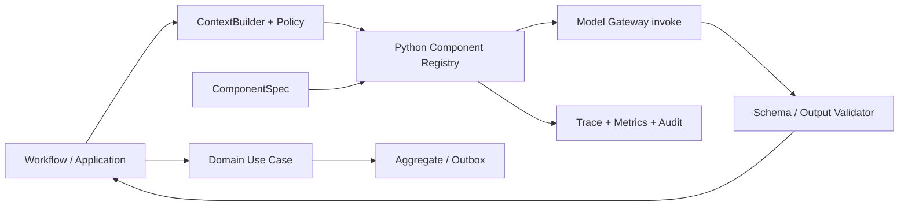

# 读学系统 — 声明式 AI Component 设计

> 状态：Phase 1 已实现，Phase 2 文本类调用已全量收口（VLM 帧分析待迁）· 版本：v1.2  
> 范围：服务端 LLM / VLM / LLM Judge 调用的类型化注册、统一 Gateway、版本、观测与离线回归。  
> 关联：[系统架构](ARCHITECTURE.md) · [Companion 编排](domain-companion.md) · [Tutoring](domain-tutoring.md) · [可观测性](../observability.md)

## 一、目标与非目标

读学的智能能力贯穿行为观察、场景路由、计划、答疑、复盘与长期理解。模型、提示词、上下文形状和输出约束都会直接影响孩子的体验与安全；它们需要可审计地迭代，而不应散落为业务代码里的提供商调用或实验分支。

本设计建立统一的 **AI Component**：每一次产生不确定输出的 LLM、VLM 或 Judge 调用，均以一个有稳定 ID、版本化 Python 声明、输入输出契约和运行记录的组件执行。Component 只封装一次模型调用；Workflow 仍是拥有控制流和领域边界的代码。

目标：

- 让模型、提示词、参数、预算和评测归属可查、可复现、可逐步变更。
- 先为关键调用建立无网络离线回归，防止模型、prompt 或协议变更造成明显退化。
- 让每次模型调用天然产生统一的成本、延迟、失败、降级和版本观测数据。
- 不破坏现有“LLM 负责提议，代码负责授权、领域状态和出口校验”的架构边界。

非目标：

- 不把所有业务流程 YAML 化；Planning 固定 Graph、Companion Run 生命周期和领域 Use Case 仍是代码。
- 不允许配置绕过授权、答案保护、安全审核、输出验证、事务或数据删除规则。
- 首期不建设 YAML 配置、远程配置、通用 override、A/B 平台、自动模型选择或通用 Agent 编排器。
- ASR、TTS 等非生成模型服务可复用观测字段，但不强制采用本协议的 prompt / 输出 Schema 定义。

## 二、收益与设计原则

| 问题 | AI Component 的收益 |
| --- | --- |
| 模型和 prompt 分散在 Adapter 中 | 每次调用有稳定 `component_id` 与不可变版本，可定位一次行为来自哪一个配置。 |
| 变更难以复现 | Trace 保存组件版本、模型和安全结果摘要；线上故障可定位当时的代码版本与装配。 |
| 迭代缺少安全基线 | 每个关键组件有无网络回归用例，先阻止结构和保守行为退化。 |
| “模型说安全/正确”被误当成事实 | 输出永远只是候选；领域 Policy、Validator 和 Use Case 是唯一的裁决者。 |
| 儿童数据不能随意记录 | 普通遥测只存安全元数据；原文审计走独立、加密、短留存和严格 RBAC 的通道。 |

设计原则：

1. **声明可调，代码裁决。** 组件声明只描述如何请求模型和如何验证其候选；权限、领域状态和副作用只能由代码执行。
2. **显式契约优先。** 每个组件必须声明输入/输出 Schema 版本；自由文本不能作为跨层协议。
3. **代码随版本发布。** Spec、prompt、Schema 与测试随 Python 代码提交和审阅，不存在另一个配置发布通道。
4. **默认最小权限。** 上下文范围、工具 allow-list、调用与 token 预算均由代码注册；调用方不能自行扩大。
5. **失败安全。** schema、提供商、Judge 或解析失败必须落入每个调用点预先注册的 fallback，不能静默改走更宽松策略。

## 三、边界与职责



| 层 | 负责什么 | 不负责什么 |
| --- | --- | --- |
| Component Registry | Python `ComponentSpec` 的集中注册、版本与唯一 ID 校验 | 领域规则、用户授权或业务写入 |
| Gateway `invoke()` | 用已注册 Spec 调用模型、解析 JSON、记录用量与错误 | 自行挑选实验、扩大权限或修改状态 |
| ContextBuilder | 根据 `ContextSpec` 读取已授权、受预算限制的上下文 | 将完整 transcript、其他 Ward 数据或 CoT 给模型 |
| Model Gateway | 提供商适配、调用、重试、用量与原始结果处理 | 接受未解析组件或返回领域事实 |
| Validator | Schema 与组件本地输出约束 | 替代领域 Policy 或安全的最终裁决 |
| Workflow / Use Case | 选择已注册组件、处理候选、调用领域命令 | 内嵌模型/实验分支或直接信任模型候选 |
| Domain | 权限外的业务不变量、状态迁移与事实写入 | 调用模型、读取配置或处理 prompt |

以下既有边界不变：`TutorPermitPolicy` 决定答案保护与题目推进；答疑每轮仍经结构、越权一致性、泄露和独立输出安全检查；Companion 仍拥有 Thread/Run/fence；模型候选不得直接写 Fact 或 Aggregate。

## 四、组件模型

### 4.1 组件类别

| 类别 | 例子 | 结果性质 |
| --- | --- | --- |
| `generator` | `tutoring.turn`、`reflection.advice` | 面向 Ward 的候选或结构化教学动作 |
| `classifier` | `companion.intent` | 闭集提议；失败映射到既定保守值 |
| `judge` | `tutoring.leak_judge` | 独立审核结果；受保护场景失败时 fail-closed |
| `extractor` | `planning.intake`、`task.intake` | 从输入提取结构化候选，必须由后续规则确认 |
| `vision` | `behavior.frame_analysis` | 帧的结构化观察，不直接形成长期画像 |

`component_id` 为稳定逻辑名，例如 `tutoring.turn`；`version` 是随代码发布的版本，例如 `v1`。同一个 ID 的 prompt、参数、Schema 或工具集合发生不兼容变化时必须提升版本，并更新相应回归用例。

### 4.2 可声明字段

组件声明是代码中的冻结 `dataclass`，不是 YAML 或运行时可写配置：

| 字段 | 说明 |
| --- | --- |
| `model` | 默认模型名，写在 Registry 中、随代码评审。密钥与端点不属于 Spec。 |
| `risk_tier` | `protected`（儿童安全链路：`tutoring.turn`、`tutoring.leak-judge`）或 `standard`。`protected` 不允许任何覆盖。 |
| `prompt` | 对 `prompts.py` 中 `PromptTemplate`（静态系统提示）或 `DynamicPrompt`（`module:function` 的运行时渲染器）的引用，不是裸字符串。 |
| `input_contract` / `output_contract` | 调用方 Pydantic / JSON 解析边界的名称与版本。 |
| `max_tokens` / `temperature` / `timeout_seconds` | 非安全生成参数；`timeout_seconds` 缺省用全局 `AGENT_MODEL_TIMEOUT_SECONDS`。 |
| `accepts_images` | 纯文本模型为 `False`：Gateway 在发送前把图片 part 替换为占位文字，不会因图片被提供商拒绝。 |
| `requires_agent_switch` | 是否受 `AGENT_MODEL_ENABLED` 总开关约束（Guardian/Ward intake 历来不受其约束）。 |

### 4.2.1 模型名、覆盖与密钥

| 信息 | 位置 |
| --- | --- |
| 行为：模型名、prompt、温度、token、版本 | Registry / `prompts.py`（代码） |
| 部署：端点、超时、总开关、`AI_MODEL_OVERRIDES` | 环境变量 |
| 密钥：`DASHSCOPE_API_KEY` 等 | 环境变量 / 密钥管理，绝不进入代码或 Spec |

`AI_MODEL_OVERRIDES='{"planning.intake": "model-name"}'` 只是应急开关：按组件 ID 覆盖模型名，只允许 `standard` 组件；未知 ID、`protected` 目标或格式错误在应用启动时失败。每次调用的 Trace 带 `ai.model_source = registry | env_override`，线上能区分默认与临时覆盖。

### 4.2.3 模型分配（当前）

选型依据：是否需要视觉、是否在用户等待的关键路径、答错的代价、调用量。

| 组件 | 模型 | 理由 |
| --- | --- | --- |
| `tutoring.turn` | `qwen3.7-plus-2026-05-26` | 看图、守教学契约、写结构化动作；关闭思考。protected |
| `tutoring.leak-judge` | `qwen-plus`（纯文本） | 只审文本；与主调用不同型号。决策模型更合适，但协议和预览状态未接入。protected |
| `companion.intent` | `qwen-flash`（纯文本） | 四选一、60 token；判错回退 `unclear`。决策模型更合适，但要另接 `/systemone` |
| `planning.reply` | `qwen3.8-flash` | 短回复，窗口里可能带图，孩子在等；关闭思考 |
| `reflection.advice` | `qwen3.7-plus-2026-05-26`（纯文本） | 会后生成，重语气与文字质量；不发送图片；关闭思考 |
| `planning.intake` / `task.intake` | `qwen3.7-plus-2026-05-26`，60s 超时 | 读图加多条硬规则的结构化提取；关闭思考 |
| 帧分析 VLM（未迁移） | `qwen3-vl-flash-2026-01-22` | 调用量最大；该快照加强了桌面与巡检类识别；关闭思考 |
| 实时 ASR | `qwen3-asr-flash-realtime` | 按住说话。北京业务空间不接受 2026-02-10 快照，会在会话中途断开。发音点读仍用标准 TTS |

JSON 组件和帧分析请求都带 `enable_thinking: false`。思考会占用 `max_tokens`，并可能把思维链写进给孩子的内容。`decision-model-preview` 仍不接入：它走 `/systemone`，预览版内容安全也可能直接拒绝作业文本。

### 4.2.2 Prompt 版本锁

Prompt 正文变化即行为变化。`tests/unit/ai/test_prompt_lock.py` 保存每个 prompt id 的内容摘要；修改正文而不提升版本号和锁，测试失败。动态 prompt 以其渲染函数源码计算摘要。

### 4.3 不可配置字段

以下字段必须留在版本化代码中，不属于 `ComponentSpec`：

- Ward / Guardian / 附件 ACL、跨 Ward 隔离、对象读取与脱敏。
- `TutorPermitPolicy`、答案保护、ProblemRecord 状态转换、事实和 Outbox 的生成。
- 输入/输出安全审核是否执行、受保护场景的 fail-closed 行为。
- ContextSpec 最大数据范围、工具实际实现与其写权限（工具只能已注册为只读）。
- 输出展示的最终 Validator、Companion Run fence、事务、幂等与删除策略。

## 五、Python 协议

Registry 是 `app.infrastructure.ai.components.COMPONENTS`，是服务端全部 LLM 调用的唯一总表；阅读它即可看到每个调用的 ID、版本、模型、风险等级、prompt、契约与参数。调用方只能按 ID 取 Spec，再交给统一的 `invoke_json_component(spec=…, user=…)`。静态 prompt 由 Gateway 作为 system 消息发送，调用方无法传入自己的 system 文本。

```python
@dataclass(frozen=True)
class ComponentSpec:
    component_id: str
    version: str
    operation: str
    agent_label: Literal["planning", "tutoring", "reflection"]
    risk_tier: Literal["protected", "standard"]
    model: str
    prompt: PromptTemplate | DynamicPrompt
    input_contract: str
    output_contract: str
    max_tokens: int
    temperature: float
    requires_agent_switch: bool = True
```

`invoke_json_component` 负责提供商调用、JSON object 解析、token / 时延 / provider request ID 记录以及稳定错误归类（`ModelGatewayError`）。它不验证领域输出，更不执行 fallback；调用方保留自己的 Pydantic 校验、结构恢复与保守降级语义。

当前注册表：

| Component | 风险 | 调用点 | 保留的调用方边界 |
| --- | --- | --- | --- |
| `tutoring.turn@v1` | protected | 答疑主调用 | `TutorTurnCandidate`、结构恢复与三道出口检查 |
| `tutoring.leak-judge@v1` | protected | 作业答案泄露审核 | `None` 由 Workflow fail-closed |
| `companion.intent@v1` | standard | 场景路由提议 | 非法或失败映射为 `unclear` |
| `planning.reply@v1` / `reflection.advice@v1` | standard | `QwenAgentModelGateway.generate` | `AgentTextCandidate` 校验，失败走确定性降级 |
| `planning.intake@v1` | standard | 当天计划草稿提取 | `PlanIntakeResult` 校验，失败映射为用户提示 |
| `task.intake@v1` | standard | Guardian 对话式任务整理 | `TaskIntakeResult` 校验与 ward 白名单 |

**防绕过：** `tests/unit/ai/test_no_direct_model_calls.py` 扫描 `app/`，除 `components.py`、`client.py` 与待迁移的 `inference.py`（VLM 帧分析：批处理 + 实时，调用形态不同）外，任何模块直接使用 `chat.completions` 或 `dashscope_client(` 都会失败。

## 六、运行协议

1. Workflow 按稳定 ID 获取组件，例如 `COMPONENTS.get("tutoring.turn")`，并提供类型化输入和当前 Run 元数据。
2. ContextBuilder 按既有 `ContextSpec` 装配最小上下文。图片、最近原句和 Memory Bundle 的授权规则仍由 Companion / ContextBuilder 代码执行。
3. Gateway 使用 Spec 解析出的模型（默认或受限覆盖）、prompt、参数与调用名执行模型，采集用量、延迟与 provider request ID，并只返回 JSON object。
4. 调用方执行既有 Pydantic 解析、结构恢复、安全与领域出口检查。通过后才可投影 UI、调用 Use Case 或持久化；否则走调用点既有 fallback。
5. Trace 记录组件 ID、版本、模型和结果元数据。模型原文不进入普通日志、transcript、Memory 或 Fact。

统一遥测的逻辑协议如下：

```json
{
  "component_id": "tutoring.turn",
  "component_version": "v1",
  "model": "qwen3.7-plus-2026-05-26",
  "model_source": "registry",
  "operation": "tutor_turn",
  "result": "success"
}
```

实际 Trace 仍遵守现有脱敏与留存策略；Run / attempt 由外层 Workflow span 关联，避免重复记录儿童内容。

## 七、观测、评测与发布

每次调用至少记录：`trace_id`、外层 `run_id`（若有）、`component_id`、版本、模型、操作名、延迟、输入/输出 token、provider request ID 和安全的结果类别。调用方继续记录结构校验结果与 fallback 原因。不得写入 API Key、Authorization、图像 data URL、完整上下文、思维链或普通日志中的儿童原文。

首期离线回归以普通 pytest fixture 与 fake provider 实现，不增加 `evaluation_profile` 配置协议。每个 P0 组件至少覆盖：

- 组件 ID、版本、模型、风险等级和调用参数；
- 覆盖规则（standard 可覆盖，protected 与非法值在加载期失败）；
- Prompt 摘要锁与防绕过扫描；
- 正常结构化输出；
- 非法 JSON / 非 object 结果和提供商失败的稳定保守行为；
- 对答疑，调用方的结构恢复、泄露检查与 fail-closed 边界。

发布路径：

1. 新版本组件在本地/CI 通过 Schema、契约和离线回归。
2. 人工审核 prompt、权限范围、数据处理、fallback 与测试结果。
3. 需要比较候选模型或 prompt 时，先新建显式、具名的候选 Component 和对应回归；不得以运行时覆盖篡改默认版本。
4. 只有出现真实灰度需求时，另立设计决定 shadow、分流和线上指标边界；不预设通用 override 语法。

离线评测用于阻止明显退化，不单独宣称学习效果提升；孩子的真实学习和参与效果需要在合规前提下通过线上指标或人工研究验证。

### 7.1 离线评测

数据集构造、重放判分、指标与阈值、运行方式见独立设计 [`design-offline-eval.md`](design-offline-eval.md)（实现在 `duxue-server/evals/`）。本文只约束：评测只做冒烟、不宣称学习效果；候选只能是评测进程内的具名 variant，采用须走上面的发布路径；评测同样不得绕过组件注册表直连提供商。

## 八、迁移状态与后续

| 现有调用 | 目标 Component | 状态 |
| --- | --- | --- |
| 答疑主调用、泄露 Judge、场景路由 | `tutoring.turn` / `tutoring.leak-judge` / `companion.intent` | 已迁移 |
| `QwenAgentModelGateway.generate` | `planning.reply` / `reflection.advice` | 已迁移 |
| 任务 / 计划 intake | `task.intake` / `planning.intake` | 已迁移（应用层不再直接依赖 SDK） |
| `DashscopeInference` 帧分析 | `behavior.frame-analysis` | 待迁：批处理 + 实时 + 200–400 帧并发，需要并发度与成本约束的独立设计 |
| 答疑流式输出 | — | 待设计：非 JSON 流式形态 |
| 记忆洞察、Guardian 报告叙事 | `memory.*`、`guardian.*` | 尚无 LLM 调用，出现时必须先注册 |

已知缺口（有意未做）：泄露判断与意图路由尚未接入决策模型（协议不同，预览版未过红队）；成本换算与按 Ward/会话归集；provider 级回退链；原文审计通道的留存与审批设计；离线评测的自动硬门槛（待 confirmed 集足够大，见 [design-offline-eval.md](design-offline-eval.md) §九）。

## 九、验收条件

- 除 VLM 帧分析外，每个 LLM 调用都映射到注册的 `component_id@version`，并通过统一 `invoke()` 执行；防绕过测试保证不再新增散落调用。
- 每次调用的 Trace 都能关联组件版本、模型与模型来源、用量、时延和结果，但不泄露儿童内容或密钥。
- `protected` 组件无法被环境变量覆盖；覆盖只改模型名，不能扩大上下文、工具、权限或改变领域/安全代码。
- Prompt 正文改动必须伴随版本和摘要锁更新。
- `TutorPermitPolicy`、独立安全审核、泄露检查 fail-closed、Companion fence 和领域写入的现有测试继续通过。
