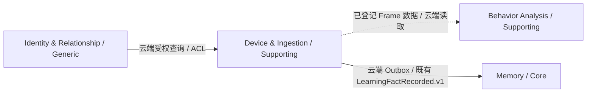
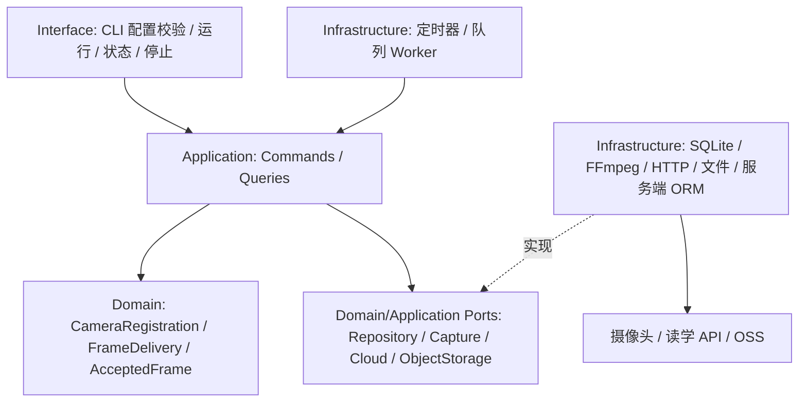
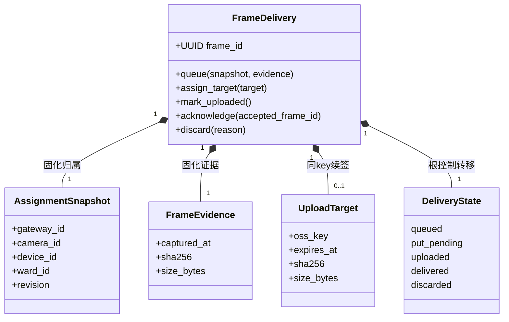
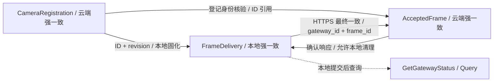
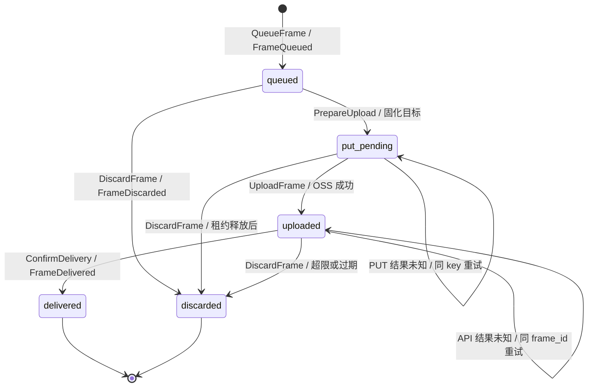
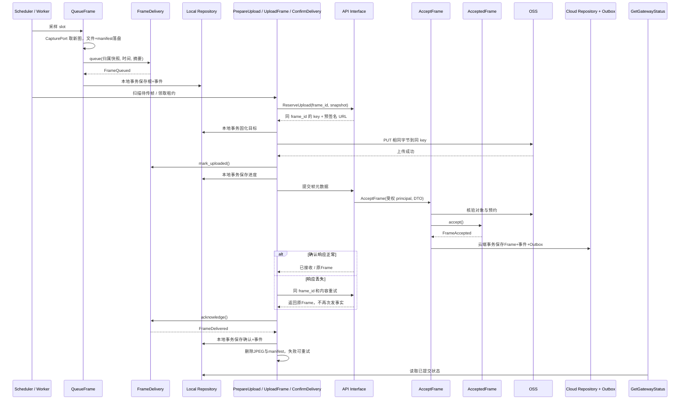
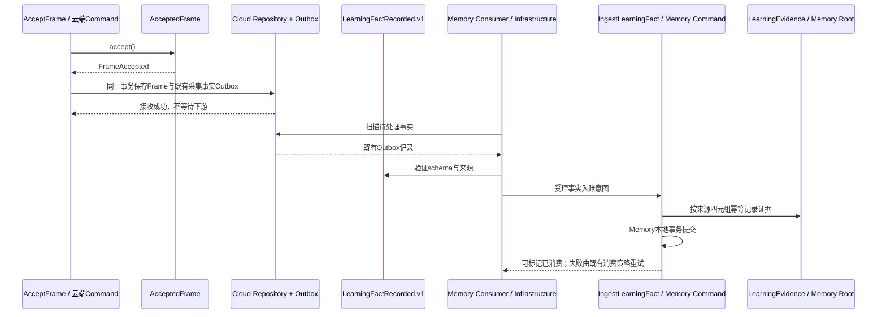
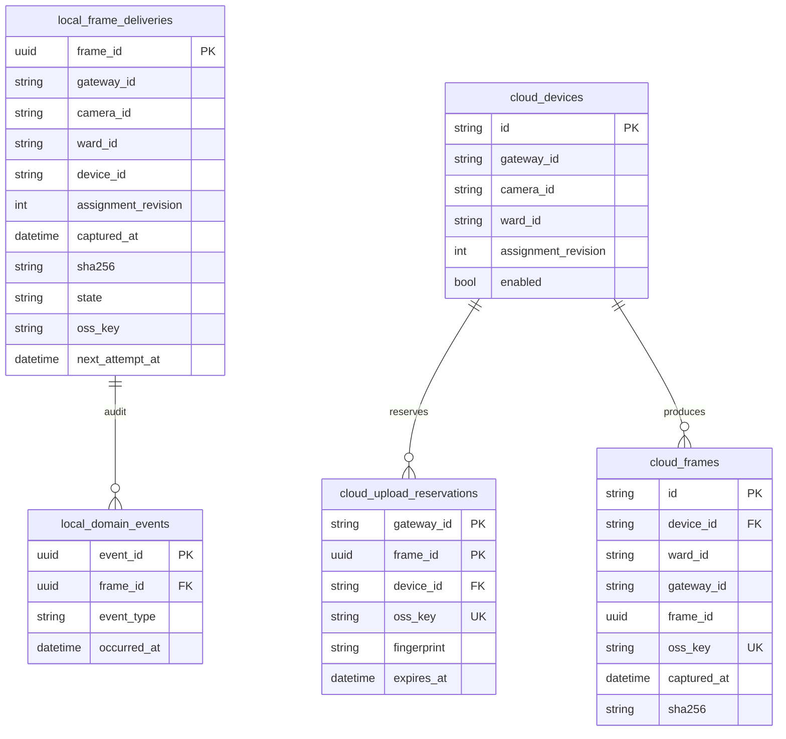

# 读学Eye — 采集网关技术架构

> 版本 v5.1 · 更新日期：2026-11-01
> 状态：目标设计，网关与网关统一认证接口尚未实现；本文不代表可直接执行的部署说明。
> 方法：遵循 [domain-driven-design skill](../../.cursor/skills/domain-driven-design/SKILL.md)。
> 事实源：本文唯一维护采集配置、网关领域模型、接入目标协议、可靠性与验收；现有 API 见 [design-server §7.2](design-server.md#72-采集设备接入-devices--frames)。
> 本次仅编写设计，不实现服务、不修改数据库。既有手机采集工程不作为实现基础。

## 一、产品边界与技术取舍

### 1.1 目标与非目标

服务于 [产品架构](../product/ARCHITECTURE.md) 的 L0 桌面观察：孩子不建线上计划、不点学习开始或结束，仍可收集真实纸质学习过程的图像证据。网关只采图、缓存、上传、报告运行状态；行为解释、自动学习会话还原与晚间报告属于云端，且需独立验证。

- 一台标准摄像头 + 同一 Wi-Fi 下的现有电脑先做家庭验证；后续共享网关服务多个工位。
- 默认每 15 秒保存一张 JPEG；侧后方约 45° 覆盖桌面与双手，尽量规避正脸。此机位不等于匿名化。
- 支持 RTSP 抽帧；有可靠 JPEG 快照接口时优先直接取图。不先录视频再抽帧，不采音频、不保存完整视频。
- 本地人工配置 `camera_id`、RTSP 地址、摄像头本地账号和 `ward_id`，不使用绑定码，不为每台摄像头配置云端 Token。
- 全网关一份受限云端凭证，由部署者配置一次。服务端检查 Ward 白名单；知道 `ward_id` 不等于拥有上传权。
- 无本地行为 AI、消息总线、Web 管理后台、全品牌自动发现、实时远程监控、摄像头存储卡回取。初期由操作员现场启动、暂停、停止。
- Python 单进程 + FFmpeg 子进程 + SQLite + JPEG 私有目录；准确版本在实现时按仓库环境固定并锁定依赖，不在设计阶段虚构已有工具链。

### 1.2 Domain Inventory 与关联范围

本文只设计 **1 个领域：Device & Ingestion（设备接入与采集，Supporting）**。本地网关是该领域的边缘运行程序；云端登记和帧接收是同一领域的服务端部分。它们的部署位置不同，不因此成为两个业务领域。

| Domain | 类型 | 统一语言与所有权 | 上下游与集成 |
|---|---|---|---|
| Device & Ingestion | Supporting | CameraRegistration、FrameDelivery、AcceptedFrame；拥有摄像头归属、证据接收和交付规则 | 上游 Identity 授权；向云端后续处理提供 Frame 证据；网关只调用采集 API 与 OSS |

下表列出系统关联供理解边界，**不是要在网关中实现这些领域**：

| 外部领域 | 与本领域的实际关系 | 网关是否直接依赖 | 代码/设计证据 |
|---|---|---|---|
| Identity & Relationship（Generic） | 云端核验 Ward 存在及监护授权；目标网关凭证由部署者受权配置 | 否；网关只持凭证调用采集 API | [现有设备接入](../../duxue-server/app/api/v1/device_ingestion.py)、[身份与关系路由](ddd-overview.md) |
| Behavior Analysis（Supporting） | 云端分析代码读取已登记 Frame；这是图像证据的数据依赖。当前不是网关向分析域发事件 | 否；抽帧上传成功不以分析完成为条件 | [analyze_and_generate](../../duxue-server/app/application/commands/legacy_services.py)、[分析入口](../../duxue-server/app/api/v1/behavior.py) |
| Memory（Core） | 现有云端帧登记事务写入 LearningFactRecorded.v1 Outbox（camera_frame.captured），消费器将其记入证据账本；不代表生成能力画像 | 否；网关不发 Memory 事件、不写记忆 | [帧登记](../../duxue-server/app/api/v1/device_ingestion.py)、[Outbox](../../duxue-server/app/infrastructure/messaging/outbox.py)、[消费器](../../duxue-server/app/application/commands/memory_worker.py)、[Memory设计](domain-memory.md) |

本次不新增 `FrameRecorded.v1`、分析任务聚合或跨域分析编排；未来是否改为事件驱动分析，在服务端分析设计中决定。完整系统领域路由见 [DDD Overview](ddd-overview.md)。本文采用 skill 的单层 Domain 命名，不复刻其历史 Domain/Subdomain/Context 嵌套结构。

DDD Domain Map 源码：本文件本节 Mermaid；边缘与云端是同一领域的运行边界，虚线表示数据使用，不表示已经实现事件订阅。



### 1.3 统一语言

| 术语 | 定义与所有者 |
|---|---|
| GatewayId | 一次网关安装的稳定身份，由服务端预配置凭证解析；不是电脑 IP |
| CameraId | 网关内稳定本地编号，如 `camera-01`；全局身份为 `(gateway_id, camera_id)` |
| CameraSource | 摄像头连接信息：地址、接口类型、本地账号引用；地址不是身份 |
| CameraRegistration | 云端登记的摄像头及固定 Ward 归属，兼容映射到现有 Device |
| AssignmentSnapshot | 采图时固化的 `camera_id + ward_id + assignment_revision`；用于补传，不从当前配置回填 |
| FrameDelivery | 本地一张已采集图像的交付责任及生命周期 |
| AcceptedFrame | 服务端已核验并接收的证据，映射现有 Frame |
| captured_at | 网关获得新帧的 UTC 时间，包含网络/编码延迟，不宣称是曝光时刻 |
| frame_id | 本地生成 UUID，创建后永不更换，跨重启、重试保持稳定 |

## 二、部署拓扑

```text
摄像头 ── 局域网 RTSP / JPEG ──> 电脑网关
                                  ├─ SQLite + JPEG 持久缓存
                                  ├─ HTTPS → 读学 API（登记、上传地址、帧元数据、心跳）
                                  └─ HTTPS PUT → OSS（图片文件，预签名授权）
```

无需公网 IP、端口映射、NVR、云录像套餐或入站 HTTP 服务。网关与摄像头之间不能启用 Wi-Fi 客户端隔离。机构后续用常开 Linux 小主机，网络优先有线；未经压测不承诺支持 15 路。

分层架构图源码：本文件本节 Mermaid。图中实线表示入口调用，虚线表示适配器实现端口；外部依赖只在 Infrastructure 内访问。



拟实现目录为 `duxue-gateway/`，按 `interface/`、`application/`、`domain/`、`infrastructure/`、`bootstrap/` 分层。仅 composition root 装配具体客户端。服务端仍放在现有 `duxue-server/app/` 对应层，不引入额外云端微服务。

## 三、摄像头采购与接入验收

| 项目 | 要求 |
|---|---|
| 图像接口 | 已验证型号/固件；支持本地 JPEG 快照或 RTSP，首期验证 H.264 子码流 |
| 本地运行 | 本地独立账号密码；断外网仍能取图，不依赖云订阅 |
| 网络地址 | 优先在路由器按 MAC 做 DHCP 地址保留；地址改变只更新 CameraSource |
| 成像 | 约 640×480 起步，保留宽高比，桌面、双手和书本清晰；必要时提高分辨率 |
| 供电与恢复 | 持续供电、稳定支架；重启保留配置；网关可自动重连 |
| 数据与控制 | 关闭音频、自动追踪及非必要云上传；现场可知晓采集状态并停止 |

“支持 ONVIF/RTSP”不能替代具体机型认证、图像新鲜度、断外网与重启测试。ONVIF 自动发现不作为首期前提，接口地址可手填。

## 四、网关与接入领域设计

### 4.1 配置与身份契约

以下为拟议配置格式，不代表已有程序支持这些命令或字段：

```yaml
api_base_url: https://<读学服务地址>/api/v1
api_token_env: DUXUE_GATEWAY_TOKEN
state_dir: ./state
capture_interval_seconds: 15
cameras:
  - camera_id: camera-01
    ward_id: "<已存在的 Ward ID>"
    source:
      kind: rtsp
      url: rtsp://192.168.1.50:554/<子码流路径>
      username_env: CAMERA_01_USERNAME
      password_env: CAMERA_01_PASSWORD
```

- 摄像头账号密码只访问局域网摄像头，不传云端；云端 Token 只发读学 API，不发摄像头或 OSS。
- 网关凭证由受信部署者为已有 Guardian 授权的 Ward 配置。首期服务端受限配置保存 `token_hash → gateway_id + allowed_ward_ids + enabled`；原始 Token 只交付网关。部署配置就是首期授权记录，不提供公开自助签发接口，也不接受客户端自报的 gateway_id。
- 凭证仅允许摄像头登记、申请上传、提交帧及心跳，不授予读取报告、聊天、修改孩子资料等权限。生产不使用一个全局万能密钥。
- `camera_id` 在同一网关唯一，限制为 1–64 位 ASCII 字母、数字、`-`、`_`；这是协议语法校验，不是语义判定。
- 首次联网登记后本地保存 `device_id` 和 `assignment_revision`，以后自动使用，不需人工管理。离线首次启动、尚未登记时不采集，明确提示初始化未完成。已有持久登记快照且本地配置归属一致时，可断外网启动并继续缓存；联网后重新核验授权。
- 摄像头 IP/密码变更不改变身份和归属。首期禁止原 camera_id 改 Ward：启动校验发现与登记不同即拒绝；需要换孩子时停采、处理旧队列，使用新的 camera_id 显式登记。机构换座版本化是后续能力。
- 配置更新须停采、验证后重启，不做热更新。系统凭证轮换保持 gateway_id 不变；更换 gateway_id 不能将旧队列冒充为新网关数据。
- 首期人工启停限定观察时段；定时观察窗口后续增强，不作为家庭首轮验收前提。停止采集时可继续清空待传队列；退出进程保留队列。

### 4.2 领域模型清单：Entity、Value Object、Service、Event 与 Repository

#### 4.2.1 聚合边界及必须保持的规则

**Entity（实体）**有稳定身份，即使属性改变仍是同一个对象。**Aggregate（聚合）**划定一次本地事务必须保持一致的对象范围，由 Aggregate Root（聚合根，也是一种 Entity）统一提供修改入口。**Invariant（不变量）**是每次修改完成后都必须成立的业务规则，例如“重试不能把原来属于孩子A的帧变成孩子B的帧”。聚合不是表名或模块名，不变量也不是所有属性都不能变。

本设计有3个根实体，每个聚合只有一个根和若干值对象，没有子实体。本地与云端没有跨网络事务；交付状态与接收事实最终一致。下表为聚合根设计（Aggregate Root）；后续表给出完整对象及服务分类，不能只凭聚合表决定实现职责。

| Aggregate Root（聚合根） | 根实体身份、ID引用与值对象 | 领域行为与不变量 | Domain Event / Repository Port |
|---|---|---|---|
| CameraRegistration（云端） | device_id；CameraIdentity、Ward ID、revision、enabled；不持有 Ward 实体 | register() / disable()；同摄像头固定归属，同归属重试不重复登记，改Ward冲突；停用不能恢复为可接收状态 | CameraRegistered、CameraDisabled / CameraRegistrationRepository |
| FrameDelivery（本地） | frame_id；AssignmentSnapshot、FrameEvidence、DeliveryState、可选UploadTarget、云端确认ID | queue() / assign_target() / mark_uploaded() / acknowledge() / discard()；归属和证据不可变；已有目标续签不能换key；先上传再确认，终态不可复活 | FrameQueued、FrameDelivered、FrameDiscarded / FrameDeliveryRepository |
| AcceptedFrame（云端） | 现有Frame ID；FrameIdentity、AssignmentSnapshot、FrameEvidence、oss_key | accept() / assert_same_evidence()；已接收事实不可修改；同幂等身份只接收一份内容；外部授权/对象核验由Application在创建前完成 | FrameAccepted / AcceptedFrameRepository |

#### 4.2.2 Entity / Value Object Inventory

以下列出本设计全部领域实体与值对象；属性只列参与身份、生命周期和规则的内容，不机械复制ORM列或DTO。

| Object | Kind | Identity | 关键属性 | 领域行为 | 规则责任与归属 |
|---|---|---|---|---|---|
| CameraRegistration | Aggregate Root / Entity | device_id | CameraIdentity、ward_id、revision、enabled | register、disable | 固定归属与停用；云端 |
| FrameDelivery | Aggregate Root / Entity | frame_id | AssignmentSnapshot、FrameEvidence、DeliveryState、UploadTarget、accepted_frame_id | queue、assign_target、mark_uploaded、acknowledge、discard | 交付生命周期、不可变证据；本地 |
| AcceptedFrame | Aggregate Root / Entity | 云端Frame ID | FrameIdentity、AssignmentSnapshot、FrameEvidence、oss_key | accept、assert_same_evidence | 单帧接收事实及内容一致；云端 |
| CameraIdentity | Value Object | 无，按值比较 | gateway_id、camera_id | 校验标识格式 | 摄像头身份不依赖IP；CameraRegistration持有 |
| FrameIdentity | Value Object | 无，按值比较 | gateway_id、frame_id | 校验标识格式 | 跨网关帧身份隔离；AcceptedFrame持有 |
| AssignmentSnapshot | Value Object | 无，按值比较 | gateway_id、camera_id、device_id、ward_id、revision | 校验完整性、比较归属 | 采图时固化，后续不可回填/改写；FrameDelivery和AcceptedFrame持有 |
| FrameEvidence | Value Object | 无，按值比较 | captured_at、sha256、size_bytes | 校验时间格式/摘要/大小、比较内容 | 固化所采图像事实，不访问OSS或系统时钟；两个帧根持有 |
| UploadTarget | Value Object | 无，按值比较 | oss_key、expires_at、期望摘要/大小 | 比较是否仍指向同一对象 | 续签只换授权有效期；FrameDelivery持有；URL/headers另存受限Infrastructure状态 |
| DeliveryState | Value Object / Enum | 无 | queued、put_pending、uploaded、delivered、discarded | 闭集合法性 | 转移由FrameDelivery控制，不允许外部直接赋状态 |

CameraSource是Infrastructure配置（接口地址、凭证引用），不是需要业务生命周期的Entity。重试、租约、进程连接、健康DTO、Outbox不是领域实体；它们另列在服务与基础设施清单中。FrameEvidence只校验自身形状，时间窗口等需要当前时间的判断由Application传入明确校验结果，不在值对象中读取外部时钟。

#### 4.2.3 Service 与 Factory Inventory

“服务”需按层区分。FFmpeg取图和HTTP上传不是Domain Service；它们访问外部资源，由Application通过端口协调。

| 类别 | 名称 / 归属 | 职责与边界 |
|---|---|---|
| Domain Service | 首期无独立领域服务 | 固定归属、帧不可变与状态转移均能由各根承担；不为凑齐类型新增空壳服务 |
| Factory | CameraRegistration.register、FrameDelivery.queue、AcceptedFrame.accept | 根的命名创建方法，构造时建立合法初态；无需独立Factory类 |
| Application Command services（本地） | QueueFrame、PrepareUpload、UploadFrame、ConfirmDelivery、DiscardFrame、RecoverLocalState | 调用领域行为、协调本地事务与外部端口；RecoverLocalState负责启动恢复；逐命令卡见§4.3 |
| Application Command services（云端） | RegisterCamera、ReserveUpload、AcceptFrame、ReportHealth、DisableCamera | 认证后的授权、对象核验、事务和幂等协调；不能把这些职责塞进根 |
| Application Query services | GetGatewayStatus、GetPendingFrames、GetGatewayHealth | 读取状态并返回脱敏DTO；一致性见§4.4 |
| Process Manager | 首期无独立Process Manager | 持久帧状态已足以驱动上传重试，不额外引入Saga/跨领域编排器 |
| Interface | 本地CLI；云端Gateway HTTP endpoints | 参数解析、认证适配、DTO和错误映射；不直接访问聚合/ORM |
| Infrastructure adapters | FFmpeg/HTTP快照、API/OSS HTTP clients、文件存储、SQLite/ORM Repository、调度/上传/恢复/清理Worker | 实现端口并触发Command；超时/重试/持久化见§4.7 |
| Infrastructure configuration/query data | CameraSource、凭证/白名单、健康store、采样检查点、租约、上传预约、Outbox | 配置或技术状态，不伪装成Domain Service或Entity |

#### 4.2.4 Repository 与事件清单

每个根一个Repository Port。CameraRegistrationRepository提供按稳定摄像头键/device_id加载及保存；FrameDeliveryRepository提供按frame_id加载及保存；AcceptedFrameRepository提供按FrameIdentity加载及保存。列表/健康查询使用Query store。端口不暴露ORM Session；唯一键和外部对象校验由Application配合持久化约束实施，根不能跨仓库查询来判重。

| 事件 | 类别 / 所有者 | 标识与关键字段 | 用途 |
|---|---|---|---|
| CameraRegistered、CameraDisabled | Domain Event / CameraRegistration | event_id、device_id、CameraIdentity、ward_id、revision、occurred_at | 本域登记与停用审计；不自动通知分析/Memory |
| FrameQueued、FrameDelivered、FrameDiscarded | Domain Event / FrameDelivery | event_id、frame_id、AssignmentSnapshot、occurred_at；丢弃含reason，交付含accepted_frame_id | 本地交付审计；与根同事务持久化，不充当上传消息 |
| FrameAccepted | Domain Event / AcceptedFrame | event_id、accepted_frame_id、FrameIdentity、occurred_at | 云端接收事实；Application决定是否翻译成既有集成事件 |
| LearningFactRecorded.v1（camera_frame.captured） | Integration Event / 云端Device & Ingestion | 沿用既有schema；source_type=frame、source_id=云端Frame ID、source_version=1 | 兼容现有Memory事实入账；网关不发布，协议不在本文重定义 |

FrameDelivery内部结构UML源码：本文件本节Mermaid。没有子Entity；图示值对象组合及不变量所有者，API DTO/Repository不属于根。



CameraRegistration与AcceptedFrame均只含自足值对象、无子Entity；它们的属性和规则已在清单与聚合根设计列全，省略额外内部UML。

Aggregate Map 源码：本文件本节 Mermaid。



FrameDelivery 状态图源码：本文件本节 Mermaid。`put_pending` 包含 OSS 写入结果未知的情况；重试不是新帧。



授权失败不会改成 delivered/discarded，由 Application 暂停该上传通道，待修复凭证后继续；本地容量与 TTL 仍有效。首次登记失败不创建采集任务。

### 4.3 Trigger → Application → Domain → Event/Query Matrix 与 Command Cards

每一行是一张紧凑 Command Card。云端命令均先解析网关 principal、检查启用状态/Ward 白名单；本地命令由已校验配置的系统 actor 或现场操作员触发。所有根的加载/保存、事务、端口调用和事件持久化由 Application 负责，适配器不能直接改聚合字段。

| Trigger / 入口 | Command 与输入 | 聚合行为 / 事务与事件 | 幂等、失败及后续 |
|---|---|---|---|
| 操作员启动 CLI → 云端 HTTP Interface | RegisterCamera(camera_id, ward_id) | 云端事务加载/创建 CameraRegistration，调用 register，保存 CameraRegistered | 唯一 `(gateway_id,camera_id)`；同归属返回原值；401/403 停止初始化，409 要求修正配置；成功后本地保存登记快照 |
| 15s 定时器（Infrastructure） | QueueFrame(camera_id, sampling_slot) | CapturePort 取新图；先安全落文件，再本地事务创建 FrameDelivery.queue 与 FrameQueued | 唯一 `(camera_id,sampling_slot)`，slot 是本地持久递增采样序号；同 slot 重试不取新图；取图失败记缺口；文件失败不入队；无图时不造帧 |
| 本地上传 Worker（Infrastructure） | PrepareUpload(frame_id) | 加载 FrameDelivery，经 CloudPort 调用 ReserveUpload；本地事务 assign_target 并固化 key | 请求结果未知按 frame_id 重试；领取上传租约后操作，网络调用不持有 SQLite 事务 |
| 云端上传地址 HTTP Interface | ReserveUpload(camera_id, ward_id, revision, frame_id, captured_at, sha256, size) | 校验 CameraRegistration；独立事务保存 upload_reservations 基础设施记录，返回相同目标 | 唯一 `(gateway_id,frame_id)`；相同请求续签同 key；异内容409；对象大小超限413；不产生业务 Domain Event |
| 获得上传目标 / 重试 Worker | UploadFrame(frame_id) | ObjectStoragePort PUT；成功后本地事务 mark_uploaded；只持久交付进度，无集成事件 | PUT 超时结果未知，重试同 key/相同字节；URL 过期续签同 key；不可因失败换 frame_id |
| 云端帧提交 HTTP Interface | AcceptFrame(camera_id, ward_id, revision, frame_id, oss_key, captured_at, sha256, size) | 核验授权/登记/目标/对象；事务创建 AcceptedFrame.accept、FrameAccepted 和既有采集事实 Outbox | 唯一 `(gateway_id,frame_id)` 与 oss_key；重复同内容返回原 Frame；冲突409；不存在对象422；数据库失败可重试 |
| 本地已上传 Worker → API 确认返回 | ConfirmDelivery(frame_id) | CloudPort 调用 AcceptFrame；本地事务 acknowledge，保存 FrameDelivered；随后文件清理 | 响应丢失重试 AcceptFrame；确认状态已持久化后才删文件；清理失败由启动恢复继续 |
| TTL/容量定时器 → 本地 Command | DiscardFrame(frame_id, reason) | 本地事务 discard、FrameDiscarded 与清理任务一起保存；之后删文件 | 不抢占有效上传租约；已终态重复为空操作；无可淘汰项则拒绝新采样并记缺口；不伪报交付 |
| 进程启动 → 恢复Worker（Infrastructure） | RecoverLocalState(state_dir) | Application核对manifest/SQLite，按原frame_id调用queue/discard，保存FrameQueued/FrameDiscarded与清理结果；每帧独立本地事务 | 持有目录锁；原始归属不可推断；先清理过期/终态文件再恢复上传；同frame_id幂等，不重造已确认帧 |
| 60s 定时器 → 云端 HTTP Interface | ReportHealth(sequence, cameras[]) | 云端更新健康 query store，无业务聚合/Domain Event；使用服务端接收时间判在线 | sequence 在一次进程 boot_id 内递增，旧序号不覆盖新快照；心跳失败不阻塞采图 |
| 现场受权运维撤销登记 | DisableCamera(device_id) | 云端事务 CameraRegistration.disable，保存 CameraDisabled | 同状态幂等；后续该登记上传返回403；本地停止采集并按保留规则处理缓存；首期走部署运维流程，无新增 App 页面 |

`sampling_slot` 分配及已处理 slot 记在本地运行检查点；重启跳过停机期间采样点，不用当前图像补造历史。文件存在但数据库未入队时，恢复流程按 manifest 中的 frame_id/slot 去重恢复。

本地 FrameQueued/Delivered/Discarded 与帧状态同 SQLite 事务保存到有限保留的 domain_events，供审计；不作为上传消息总线。上传 Worker 直接扫描持久帧状态，因此不需再维护一份本地 Outbox。数据库是当前状态存储，非 Event Sourcing。

### 4.4 Queries 与一致性

| Query 签名 | 返回 DTO / 数据源 | 一致性与权限 |
|---|---|---|
| GetGatewayStatus() | 本地运行状态、各 camera_id 最后采图/提交时间、积压帧/字节、丢弃/缺口计数、错误码、重连数；来自 SQLite 与运行诊断快照 | 本地已提交队列状态立即可见；运行诊断最多一个采样周期滞后；仅现场 CLI，脱敏 |
| GetPendingFrames(camera_id, cursor, limit) | frame_id、captured_at、交付状态、next_attempt_at；不返回图片/凭证 | 本地已提交状态；仅运维查询，不作为 Worker 改状态的授权依据 |
| GetGatewayHealth(gateway_id) | 云端最后心跳接收时间、逐摄像头最后取图/提交时间和积压量 | 最终一致，通常最多60s+网络延迟；超时明确显示陈旧；服务端运维受权查询 |

Query 走独立查询端口，不能改根或刷新在线状态来产生写副作用。在线由最后接收时间派生；心跳正常、摄像头不可达、上传积压需分别展示，不能合并成“工作正常”。不要求为首期增加 Guardian 健康 UI 或推送。

### 4.5 Interface：目标云端协议（全部待实现）

路径均相对 `/api/v1`；使用 `Authorization: Bearer <gateway_token>`。新路径与现有逐设备认证接口并存；网关不调用 invite/bind，也不配置逐摄像头 device_token。

| 方法 / 路径 | 输入 | 输出与语义 |
|---|---|---|
| POST /gateway/cameras | `{camera_id, ward_id}` | 201 首次 / 200 重复；`{device_id, camera_id, ward_id, assignment_revision}`；注册为 `ip_camera` |
| POST /gateway/frames/upload-url | `{camera_id, ward_id, assignment_revision, frame_id, captured_at, sha256, size_bytes, content_type:"image/jpeg"}` | 200；`{oss_key, upload_url, headers, expires_at}`；同一帧续签同 key，不创建新对象 |
| POST /gateway/frames | 上行身份/帧字段 + `oss_key`，不含图片内容 | 201 首次 / 200 幂等；`{id, frame_id, captured_at, duplicate}`；与旧接口一样不强制 StudySession |
| POST /gateway/heartbeat | `{boot_id, sequence, cameras:[{camera_id,last_capture_at,last_submit_at,queue_frames,queue_bytes,dropped_count,last_error_code}]}` | 200；`{server_time}`；最多仅接收已登记摄像头，不信任客户端自报在线状态 |

JSON 拒绝未知字段；UUID、UTC 时间、SHA-256 hex 等按确定协议校验。图片首期单张上限 1 MiB，HTTP 请求大小与 OSS 对象校验必须共同落实；不只依赖客户端。

OSS key 由服务端根据已登记的 Ward、原采集日期及稳定帧身份生成：`<ward_id>/<UTC采集日期>/<gateway_id>/<frame_id>.jpg`。Ward/key 不由客户端任意指定；不能仅检查 Ward 前缀就放行。申请目标时保存设备、Ward、revision、摘要、大小、时间；提交时逐项对照，核验实际 OSS 对象大小/类型与 SHA-256（ETag 不等于 SHA-256；首期服务端可流式读图校验），再入库。

预签名 URL 使用独立 HTTPS PUT，OSS 不接收网关 Bearer Token。网关严格使用服务端返回的 headers，API/OSS 使用独立 HTTP 客户端，防止默认认证头跨服务泄漏。OSS PUT 完成不等于服务端已接收证据。

错误响应统一为 `{error_code,message,request_id}`；已授权且曾登记的Ward被删除时返回403与 `WARD_DELETED`，其他未授权请求不披露Ward是否存在。错误：401 凭证无效/失效；403 Ward 未授权、登记停用或授权撤销；409 同摄像头改归属/同帧异内容；413 超限；422 时间/协议错误或对象未准备好；429 按 Retry-After；5xx/网络超时可退避重试。永久错误进入可查询的阻塞状态，人工修复前不忙重试，也不计成功；对象未出现的422允许短期重试后转阻塞。

时间契约：网关系统同步 UTC，以单调时钟调度而非对墙钟累加 sleep；首期不传 elapsed_realtime。目标接口对超过12h或未来超过5min的采集时间返回422，不静默改成接收时间。现有接口超过24h改写时间的行为不能直接沿用。容量清理由本地 TTL 处理；云端保留原始时间，不用补传时刻计算学习时长。

### 4.6 成功、重试与跨域交付时序

下表适用于本节两个时序图；只列实际参与者。

| 参与者 | Canonical type | 拥有职责 |
|---|---|---|
| Scheduler / Worker / 文件 / OSS / Repository / Outbox / Consumer | Infrastructure | 触发、传输、持久化、重投，不直接改变根 |
| QueueFrame / PrepareUpload / UploadFrame / ConfirmDelivery / AcceptFrame | Command | 授权、端口调用、各自本地事务 |
| API | Interface | HTTP 认证解析、DTO 和错误映射 |
| FrameDelivery / AcceptedFrame | Aggregate Root | 本地交付/云端接收不变量 |
| FrameQueued / FrameAccepted / FrameDelivered | Domain Event | 本域内已发生事实，随事务持久化 |
| LearningFactRecorded.v1 | Integration Event | 云端既有采集事实入账协议，网关不发布 |
| GetGatewayStatus | Query | 展示已提交状态，不修改根 |
| IngestLearningFact | Command | Memory本域受理事实；此处仅引用既有契约 |
| LearningEvidence | Aggregate Root | Memory既有证据根，模型与实现差异见Memory设计 |

时序图一源码：本文件本节 Mermaid。文件与 SQLite 不是同一事务；各网络等待均在数据库事务外。



时序图二源码：本文件本节Mermaid，**仅解释现有云端到Memory的间接关系**。目标网关接入保持既有发布契约；网关交付成功不等待Memory消费。Memory逻辑根与接收命令引用其设计，不在本次重新实现；现有代码由SqlAlchemyMemoryCommandService.ingest_learning_fact直接操作ORM，不能据此声称已有独立纯领域类。



既有集成事件字段、来源幂等和消费失败处理见 [Outbox实现](../../duxue-server/app/infrastructure/messaging/outbox.py)、[消费器](../../duxue-server/app/application/commands/memory_worker.py) 与 [Memory设计](domain-memory.md)。现有本地消费者与Celery消费者的重试路径并不完全一致，本设计不新增“最多10次”或新的死信协议；后续实施需明确实际启用的worker并做回归。

行为分析当前由服务端读取Frame及其图像证据；本次不承诺每次接收都自动创建分析任务，也不把报告生成加入网关退出条件。迟到证据重算另见 [Evaluation](domain-evaluation.md)。

### 4.7 Infrastructure Design Card

#### 端口、适配器与故障边界

| Port（所有者） | Adapter 与配置边界 | 超时 / 重试 / 错误处理 |
|---|---|---|
| CapturePort（Application） | FFmpeg RTSP TCP / JPEG HTTP；摄像头本地凭证；返回图像与接收时间的 ACL | 单次取图预算5s；无新图记缺口，连接按1s起退避、上限60s加抖动；一台故障不阻塞其他台 |
| CloudPort（Application） | HTTPS API，独立网关 Bearer 凭证 | 连接5s，总请求15s；1s起指数退避至60s加抖动，遵守429；鉴权/配置错误阻塞并提示 |
| ObjectStoragePort（Application） | HTTPS PUT，仅预签名 URL/headers | 连接5s，总请求30s；重试同 key；URL 过期续签；未知写入结果按同内容安全覆盖 |
| 三个 Repository Port（Domain） | 本地 SQLite / 云端现有 PostgreSQL ORM 扩展 | 短事务，本地单写队列；SQLITE_BUSY有界重试；数据库故障不确认成功；无外部网络等待 |
| EvidenceFilePort（Application） | 私有目录，临时JPEG+manifest、flush/fsync 后原子 rename | 写失败记存储故障，不入队；路径由 frame_id 生成；启动恢复孤儿/缺失文件 |
| FactPublisherPort（Application） | 云端事务 Outbox 与消费者适配器 | 沿用既有LearningFact Outbox；消费策略与边界见§4.6；本地无需消息中间件 |

首期摄像头只有一个有效采图任务，上传并发上限2；RTSP 每摄像头只保留一个最新解码帧，内存不能无限积攒。由持续输出的帧序号/解码接收时间判断新鲜度，连续5s无新帧视为不可用；不能因相同图像内容就判断故障。低采样率不等于低 RTSP 带宽/解码负载。FFmpeg 无音频，进程退出自动回收重启；stderr、启动参数必须脱敏，含密码的实际 URL/进程参数只允许受限本机运维访问。

不另加熔断框架：每摄像头重连退避、全局有界并发、鉴权阻塞与 next_attempt_at 已构成首期有界故障策略；必要时以实测决定引入。

#### 持久化、ER 与事务

本领域拥有本地交付表及云端摄像头/帧接收表。下图本地和云端是两个数据库，关联只表示 ID 引用，不是跨库 FK。Identity/Ward 表属于外域，不在图中复制。

ER 图源码：本文件本节 Mermaid。



- `local_frame_deliveries` 支撑 FrameDelivery；`local_domain_events` 为本地域事件审计，跟随同帧事务写入。索引 `(state,next_attempt_at,captured_at)`，唯一 `(camera_id,sampling_slot)`；JPEG 路径/字节数及租约也是持久化字段，ER 仅展示关键结构。
- 云端 `cloud_devices` / `cloud_frames` 是图中逻辑名，扩展现有 `devices` / `frames`，分别支撑 CameraRegistration / AcceptedFrame；不新建重复设备、帧表。新增 `(gateway_id,camera_id)`、`(gateway_id,frame_id)` 唯一约束；旧数据新增字段可空，兼容旧接口。
- `cloud_upload_reservations` 是 Infrastructure 幂等预约记录，非业务聚合；指纹包含完整归属和帧内容。预约时锁定设备登记行，接收时在写事务内复核 enabled/revision/授权；避免核验后撤销仍入库。对象网络校验在事务外，事务内核对预约未改变。
- 健康 query store、运行检查点、租约、现有 Outbox 是 Infrastructure 数据；实现时与上表一起迁移，非额外领域模型。云端健康 store 唯一 `(gateway_id,camera_id)`，本地检查点唯一 camera_id；Outbox 沿用现有基础设施并验证既有来源幂等约束。
- 启动持有 state_dir 单进程锁；SQLite 用 WAL、外键启用、可靠同步；租约到期可重新领取。磁盘总配额淘汰前必须取得受害帧租约，禁止边上传边删除。
- 文件/数据库不能共同原子提交：先写包含归属快照和 frame_id 的 manifest/JPEG；数据库成功前崩溃按 manifest 恢复；只有数据库指向缺失文件则标记损坏并记录缺口。已交付/丢弃但文件未删，启动继续清理。恢复命令按帧幂等，不能仅凭文件名猜 Ward。

迁移次序：先扩展服务端 schema/索引及网关授权配置 → 部署新 API（旧接口仍工作）→ 部署网关。旧 Device 不自动认领为 camera-01，不把默认历史类型批量改成 ip_camera；只给新登记写正确类型。回滚先停网关、保留队列，再回滚应用；含新帧数据的 schema 不自动降级删除，备份后前向修复。迁移与唯一约束必须在 PostgreSQL 验证，SQLite 不能代替服务端迁移测试。

#### 异步交付、容量和恢复

- 上传由持久帧状态驱动；至少一次尝试，云端业务效果幂等一次。没有跨 OSS、API、SQLite 的“恰好一次”事务。
- 初始上限：每摄像头2000帧、12h TTL、网关总JPEG缓存1GB；任一触发淘汰最旧的无租约待传帧。2000帧约8.3小时；TTL是上限，不保证能保留12小时。TTL从captured_at计算，不因重试延长；系统时钟异常时停止采样并提示校时。SQLite、事件、manifest、日志独立轮转，预留100MB磁盘余量；不足则停采并记录存储故障。
- 最新帧与补传按1:3轮询配额调度，无积压时不空等；每摄像头公平轮询，不能一台相机独占。停机后不补造图像。外网断而局域网正常可继续排队；摄像头/局域网断开只能记录缺口。
- 终态帧和本地事件保留24h后批量清理；积压受TTL约束，清理先落终态及计数再删JPEG，不把删除日志当作完整图像证据。
- OSS已上传但未登记成功可能形成孤儿对象；服务端按过期预约（最晚24h）对账，先锁定预约阻止并发提交，确认无Frame引用后删除孤儿；不能删除已登记对象。有效接收帧留存遵循系统数据治理，不在网关另定云端保留期。
- 云端 Query 可由健康上报重建；本地队列不可由日志重建。禁止将查询缓存当作交付成功依据。

#### 安全、治理与可观测性

目录0700、配置与状态文件0600；秘密从环境/受限凭证存储读取，不提交仓库。日志不打印图片、RTSP密码、Bearer Token、完整预签名URL或原始认证错误。网关只向明确配置的API及返回的OSS上传目标出站；不跟随会携带认证头的跨域重定向。

授权撤销立即阻止新上传目标和帧登记；已发预签名URL在短有效期内仍可能PUT，但不得接收为证据，按孤儿规则清理。删除Ward同时移除采集白名单/停用登记，按既有删除契约清理云端证据；网关收到已删除Ward的明确错误码时停止该源并清理对应待传缓存；一般403只暂停上传，不能推断为删除。网关运行但外网离线时由12h TTL清理；关机或进程停止期间无法执行物理删除，重启时先清理过期数据再恢复上传。不能保证离线机器的远程即时删除。

关联键 `gateway_id/camera_id/frame_id/request_id`；传播受限 trace context。记录采图成功/失败、端到端提交成功率、积压帧/字节与最老年龄、重试/重连/丢弃、摄像头最后新帧时间、云端最后心跳时间。首期输出脱敏结构化日志和本地状态，不要求先搭完整监控后台；积压接近TTL、磁盘不足、授权失败必须有可见提示。采集缺口不能转成“不专注”。

## 五、最小实验与验收

准备：具体型号/固件已验收的摄像头、同网电脑、已存在Ward、预配置网关凭证与Ward白名单、实际OSS后端。下表是后续实现的退出条件，本次文档交付不声称已经通过硬件或运行测试。

| 编号 | 验证 | 通过标准 |
|---|---|---|
| AC-G01 | RTSP/快照、本地账号、IP变更 | 新鲜JPEG、无音频；地址更新不改变camera_id/归属；断外网仍取图 |
| AC-G02 | 默认15s，连续3小时 | 约720采样点；统计成功/失败/缺口；完整链路成功率目标≥98%；静态场景不误报旧帧 |
| AC-G03 | 无绑定码配置、真实OSS直传 | 配置camera_id、源和ward_id即可；网关凭证部署一次；Frame归属/时间/key一致；无Plan/StudySession也可入库 |
| AC-G04 | 断外网10分钟恢复 | 约40帧持久排队并补传；保留原采集时间和归属；最新帧不被补传饿死 |
| AC-G05 | 摄像头断电恢复 | 自动重连；缺口可查；心跳在线不误报摄像头正常 |
| AC-G06 | 强制杀进程与网络结果未知 | 文件落盘/数据库未提交、PUT成功/进度未写、Frame提交/响应丢失均可恢复；同frame_id同key、只有一个Frame和一份集成事实 |
| AC-G07 | 容量、TTL、磁盘与鉴权 | 达限可控丢弃并计数；上传租约不被清理抢占；401/403无忙循环；超时帧不改写时间 |
| AC-G08 | 两摄像头/不同Ward | camera_id在网关内唯一；两台归属隔离，一台故障不阻塞另一台；改原camera_id的Ward返回409 |
| AC-G09 | 越权与幂等冲突 | 无Token/未授权Ward不可上传；跨网关冒用key、跨设备/旧revision提交、同frame_id异内容均拒绝；OSS收不到Bearer Token |
| AC-G10 | 发布与恢复 | Frame和既有采集事实Outbox同事务；重试不重复发事实，Memory重复消费不重复入账；分析不阻塞交付；孤儿清理不误删已登记图片 |
| AC-G11 | 兼容与隐私 | PostgreSQL迁移/旧接口回归通过；日志无凭证；停止采集、凭证轮换、Ward删除后缓存清理符合契约 |

单元测试覆盖聚合不变量与状态转换；集成测试覆盖SQLite/文件恢复、模拟API/OSS故障及服务端PostgreSQL唯一约束/Outbox；真实摄像头与OSS完成AC-G01～08的现场验证。只有通过采集验收后才评估15路容量及行为识别准确度。

## 六、产品化演进

| 阶段 | 交付 | 下一阶段条件 |
|---|---|---|
| 家庭最小实验 | 人工配置 + 电脑网关 + 预配置受限凭证，无绑定码 | 单摄像头与故障恢复通过，再做双摄像头隔离 |
| 机构试点 | 常开共享网关；显式Coach授权、换座生效版本、远程运维 | 多路容量、授权、旧帧归属、更新/回滚通过 |
| 家庭规模化 | OEM/ODM适配采样、缓存与出站上传；优化自助接入 | 厂商接口、成本、配网、授权与运维可验证；不自研硬件 |

家庭直传仍复用接收帧和证据协议。普通ONVIF摄像头不能被假定有自定义OSS直传能力。

## 七、实现状态与参考

| 能力 | 当前实际 | 本设计要求 |
|---|---|---|
| 摄像头/网关程序 | 网关待实现 | 新建duxue-gateway，按本文分层 |
| 云端认证 | 现有设备绑定码 + 每Device Token | 新增统一网关principal与Ward白名单；旧接口兼容保留 |
| 摄像头登记 | 现有Device缺少网关本地编号契约 | 新增gateway_id/camera_id/revision及唯一约束；新设备类型ip_camera |
| OSS与Frame | 已有预签名URL、上传完成后登记、按key去重 | 增加frame_id预约/稳定key续签/所有权和摘要校验/事务幂等 |
| 时间 | 现有旧接口可能改写超过24h的时间 | 新接口显式拒绝超窗，不改原采集时间 |
| 心跳 | 现有每Device心跳只表示云端连通 | 新增网关/逐摄像头健康快照，与采图状态分别表达 |
| 云端既有后续处理 | 分析读取Frame；采集LearningFact由Memory消费 | 新接入保持既有事务发布与幂等语义，不新增分析事件/网关直连Memory |
| 晚间报告 | 客观证据版本化报告尚待完善 | 另按Evaluation设计实现与验收，不扩大网关职责 |

现有实现入口：[device_ingestion.py](../../duxue-server/app/api/v1/device_ingestion.py)、[models.py](../../duxue-server/app/infrastructure/persistence/models.py)。协议参考入口：[ONVIF规范](https://www.onvif.org/specs/)、[FFmpeg RTSP文档](https://ffmpeg.org/ffmpeg-protocols.html#rtsp)；具体版本和参数在实现时按实际依赖验证。
