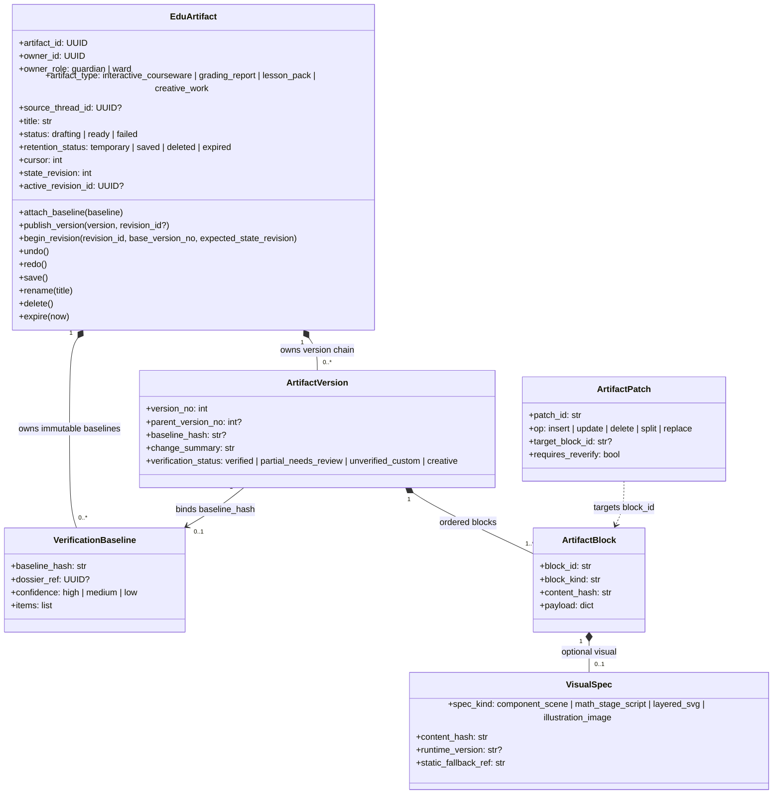
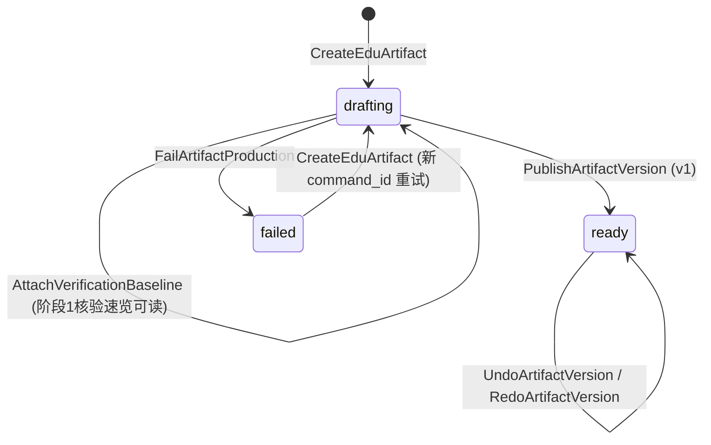
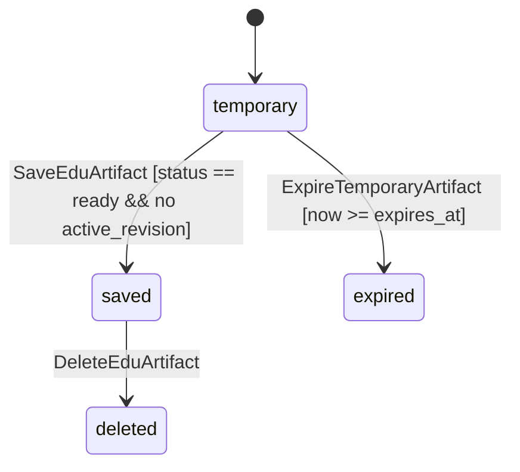
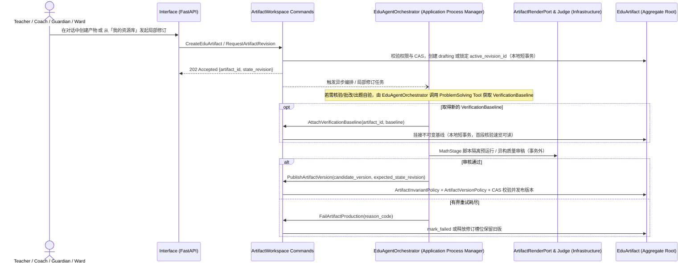
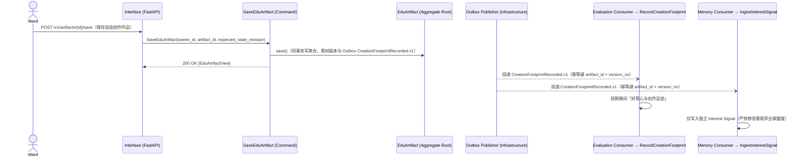
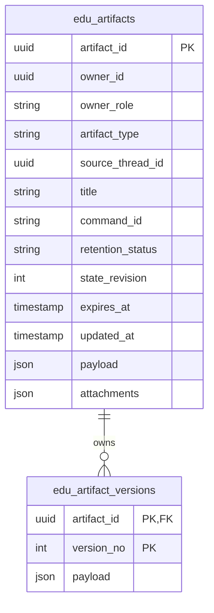

# 读学系统 — ArtifactWorkspace Domain Design（教育产物工作区）

> 状态：目标演进设计（既有 `MentorCourseware` P0-1 与主动保存已合入 `main` 基线，本设计将其平滑泛化为双端多形态核心 Domain） · 版本 v1.1 · 2026-11-28  
> 方法：[domain-driven-design skill](../../.cursor/skills/domain-driven-design/SKILL.md)  
> 关联：[DDD 系统总览](ddd-overview.md) · [Conversation 与通用 Agent 编排](domain-conversation.md) · [ProblemSolving](domain-problem-solving.md) · [Tutoring](domain-tutoring.md) · [教育通用 Agent PRD](../product/prd-edu-agent.md)

全系统 Domain Inventory、Domain Map 与分层架构图唯一归属 [ddd-overview.md](ddd-overview.md)。本 Domain 是 **Core Domain**，负责双端所有多形态、可版本化、可对话局部修订的教育产物（`EduArtifact`）的生命周期、核验诚实与资产沉淀。

---

## 一、边界与统一语言

### 1.1 职责与非目标
- **职责**：
  1. 统一承载双端四类核心教育产物：交互动态课件（`interactive_courseware`，直接承接既有 `MentorCourseware`）、作业/试卷批改诊断单（`grading_report`）、备课教案与自验变式卷（`lesson_pack`）、Ward 自由创作作品（`creative_work`：绘本故事、画作、知识卡片）；
  2. 守卫不可变版本链（`ArtifactVersion`）、按 `block_id` 寻址的对话式局部修订（`ArtifactPatch`）、零模型调用的毫秒级 **Undo / Redo** 与基于 `state_revision` 的并发 CAS；
  3. 守卫**核验诚实红线**：批改低置信显式标「待人工复核」、出题未通过自验禁标 `verified`、纠错与确定性核验矛盾须二次确认标 `unverified_custom`；
  4. 管理产物的独立保留生命周期（`temporary | saved | deleted | expired`），支撑成人「我的资源库」与 Ward「我的作品」；
  5. 维护交互式数理演示的端侧离线 Web 渲染与安全隔离契约（`Duxue MathStage Runtime`）。
- **非目标**：
  - 不负责多轮聊天上下文、通用 Agent 规划循环或角色路由（归 [Conversation](domain-conversation.md)）；
  - **不直接调用求解器或确定性数学/理化引擎**（客观求解、整页批改核验与出题自验由 `EduAgentOrchestrator` 调度 [ProblemSolving](domain-problem-solving.md) Tool 完成后，将只读 `VerificationBaseline` 值对象经本域 Command 传入）；
  - 不承担 Ward 作业答疑的答案保护状态机与《独立解题凭证》（归 [Tutoring](domain-tutoring.md)）；
  - 成人产物绝不写入学生 `Memory` 或 `TutoringSession`。

### 1.2 上下游契约

| 方向 | Domain / 契约 | 集成方式 | 说明 |
| :--- | :--- | :--- | :--- |
| 上游 | `Identity & Relationship` | Authorization ACL | 校验 `owner_id`、`owner_role` 与私有附件所有权 |
| 上游 | `Conversation`（`EduAgentOrchestrator`） | Application Command 调用 | 唯一上游编排方：负责按需调用 `ProblemSolving` Tool 取得 `VerificationBaseline` 并生成候选块或局部 Patch，再经本域 Command 校验提交；对话与产物仅通过 `source_thread_id` 松耦合 |
| 下游 | `Evaluation` & `Memory` | Integration Event（Outbox：`CreationFootprintRecorded.v1`） | 仅当 `owner_role == "ward"` 且为自由创作产物保存/更新时发布，向晚间报告投影「好奇心与创作足迹」并向 `Memory` 写入独立 `Interest Signal`（**绝不混入作业专注时长与学业掌握度**） |

### 1.3 统一语言

| 术语 | 本域中的含义 | 明确不是 |
| :--- | :--- | :--- |
| `EduArtifact` | 本域唯一聚合根，代表一份归属特定角色的可版本化教育产物（`MentorCourseware` 的超集泛化） | 单条聊天消息、对话线程或一次性静态文件 |
| `ArtifactType` | 产物形态枚举：`interactive_courseware`、`grading_report`、`lesson_pack`、`creative_work` | 无类型任意 HTML/JSON |
| `ArtifactVersion` | 不可变的产物完整版本快照（`v1, v2, ...`），绑定该版 `baseline_hash` 与 `verification_status` | 原地覆写的草稿 |
| `ArtifactBlock` | 产物内带稳定 `block_id` 与 `content_hash` 的最小可寻址内容单元（课件步骤、逐题批改项、教案段落、变式题、故事页/插画/知识卡） | 固定模板章节 |
| `ArtifactPatch` | 对话式局部修订指令（`insert \| update \| delete \| split \| replace`），未改动块按哈希 100% 复用 | 全篇重生成纯文本 |
| `VerificationBaseline` | 来自 `ProblemSolving` 的只读客观核验快照；各版本固定绑定自己的 `baseline_hash` | 可由教学模型自由改写的草稿 |
| `VisualSpec` | 交互图形/演示判别联合：`component_scene`、`math_stage_script`、`layered_svg`、`illustration_image` | 无审核的任意外链页面 |

---

## 二、Domain Model

### 2.1 Aggregate Map
- **图示说明**：本域仅拥有 **1 个写聚合根**（`EduArtifact`），按 DDD 规范无需绘制域内多聚合图。
- **跨聚合引用与一致性**：`EduArtifact` 仅通过只读 ID 引用外部聚合（`source_thread_id` → `ConversationThread`，`dossier_ref` → `ProblemDossier`），严禁共享事务或直接对象引用；聚合内部通过单库本地事务强一致，向外发布 `CreationFootprintRecorded.v1` 通过 Outbox 实现最终一致。

### 2.2 Aggregate Root Summary

本域拥有 **1 个 Aggregate Root**：

| Aggregate Root | Consistency boundary | Business responsibility |
| :--- | :--- | :--- |
| `EduArtifact` | 单份教育产物的归属（`owner_id` + `owner_role`）、`artifact_type`、制作状态（`status`）、保留状态（`retention_status`）、不可变基线集、不可变版本链（`versions`）、当前激活指针（`cursor`）、单调 `state_revision` 与至多 1 个活跃修订槽位；不包含异步渲染日志、模型原始草稿或聊天记录 | 守卫角色与产物形态合法性、版本不可变、Undo/Redo 指针合法性、CAS 并发防迟到覆盖、核验诚实红线与资产保存/删除终态 |

### 2.3 Entity & Value Object Inventory

| Object | Kind | Identity | Behavior and invariant responsibility |
| :--- | :--- | :--- | :--- |
| `ArtifactVersion` | Value Object | `version_no`（聚合内单调递增） | 不可变快照：持有 `parent_version_no`、可选 `baseline_hash`、`change_summary`、`verification_status`（`verified \| partial_needs_review \| unverified_custom \| creative`）与有序 `blocks[]`；发布后永不原地修改 |
| `ArtifactBlock` | Value Object | `block_id`（聚合内稳定寻址键） | 承载类型化 `block_kind`（`courseware_step \| grading_item \| lesson_section \| variant_question \| story_page \| illustration \| knowledge_card`）、`content_hash`、结构化 `payload` 与可选 `visual_spec` |
| `VisualSpec` | Value Object | None | 判别联合：`component_scene`、`math_stage_script`、`layered_svg`、`illustration_image`；携带对象引用、内容哈希、兼容 `runtime_version` 与已审核静态降级引用 |
| `VerificationBaseline` | Value Object | `baseline_hash` | 冻结来自 `ProblemSolving` 的题面/批改基准/出题自验结论与 `confidence`；换法或纠错生成新基线而不覆盖旧版；`creative_work` 允许为空 |
| `ArtifactPatch` | Value Object | `patch_id` | 局部修订指令：`op`（`insert \| update \| delete \| split \| replace`）、`target_block_id`、`requires_reverify` 与候选块载荷；作为 `ArtifactInvariantPolicy` 的输入值对象参与局部重算与差异审计 |

### 2.4 Aggregate Internal UML

- **图源**：本文 §2.4 Mermaid（与 §2.3 Entity Inventory 严格一致；不变量由 `EduArtifact` 聚合根与 `ArtifactInvariantPolicy` / `ArtifactVersionPolicy` 共同守卫）。



### 2.5 Lifecycle State Diagrams（两个独立正交状态维度）

> **设计说明**：`EduArtifact` 拥有**制作状态（`status`）**与**保留状态（`retention_status`）**两个正交状态维度，互不覆盖（例如 `ready` 态下既可处于 `temporary`，也可转为 `saved` 后继续修订与 Undo/Redo），因此分两张状态图表达以避免笛卡尔积爆炸。

**维度 A · 制作状态（`status`）**：


**维度 B · 保留状态（`retention_status`，`deleted` / `expired` 为终态，拒绝一切迟到写入）**：


### 2.6 Domain Services

1. **`ArtifactInvariantPolicy`**（无状态）
   - **输入 / 输出**：`(owner_role, artifact_type, candidate_version, baseline?, patch?) -> ValidationResult`
   - **核心规则**：
     - **角色-形态红线**：`owner_role == "ward"` 禁止创建 `grading_report` 与 `lesson_pack`；Ward 的 `interactive_courseware` 仅限概念/原理演示，禁止包含受保护作业题完整答案；
     - **批改诚实红线**：`grading_report` 中任一 `grading_item` 手写置信度不足或等价性未证实时，须标 `needs_manual_review=true`，整版 `verification_status` 强制降级为 `partial_needs_review`；
     - **出题自验红线**：`lesson_pack` 中任一 `variant_question` 未通过 `ProblemSolving` 自解自验，禁止标为 `verified`；
     - **纠错诚实红线**：`requires_reverify=true` 且复核与确定性引擎矛盾时，拒绝标为 `verified`，仅经成人显式二次确认（`allow_unverified_override=true`）才允许发布为 `unverified_custom`。
2. **`ArtifactVersionPolicy`**（无状态）
   - **输入 / 输出**：`(versions, cursor, state_revision, op) -> NextVersionState`
   - **核心规则**：`undo`（`cursor > 0`）与 `redo`（`cursor < len - 1`）零模型调用仅移动指针；在途修订未完成时用户执行 Undo/Redo，立即推进 `state_revision` 并清空 `active_revision_id` 废弃旧任务；迟到任务 CAS 校验基础版本与 `state_revision` 任一不匹配均返回 `409 revision_base_changed`；从历史指针发布新版本时截断旧 redo 分支且单调递增 `version_no`（上限默认 20 版）；每次 Undo/Redo 的核验摘要严格投影自目标版本绑定的不可变 `baseline_hash`。

---

## 三、Application Commands & 异步/跨领域状态变化时序

### 3.1 State-change Trigger Matrix

| Trigger and source | Trigger class | Interface / entrypoint | Receiving Command | Aggregate / domain method | Local domain event | Outbox / next action | Consistency, idempotency, failure |
| :--- | :--- | :--- | :--- | :--- | :--- | :--- | :--- |
| Agent 编排或用户创建产物 | User/API intent | `POST /v1/artifacts` / `EduAgentOrchestrator` | `CreateEduArtifact` | `EduArtifact.create()` | `EduArtifactCreated` | 投递异步编排/渲染任务 | 本地短事务；幂等键 `owner_id + command_id`；越权形态 `403` |
| Worker 完成阶段 1 核验 | Deferred worker | Infrastructure Worker Adapter | `AttachVerificationBaseline` | `EduArtifact.attach_baseline()` | `VerificationBaselineAttached` | 刷新只读视图 | 本地短事务；幂等键 `artifact_id + baseline_hash` |
| Worker 完成编排/渲染/审稿 | Deferred worker | Infrastructure Worker Adapter | `PublishArtifactVersion` | `ArtifactInvariantPolicy` + `ArtifactVersionPolicy` + `publish_version()` | `ArtifactVersionPublished` | 释放槽位；若为 Ward 已保存创作则 Outbox 发 `CreationFootprintRecorded.v1` | 本地短事务 + CAS；校验不过不落库，迟到任务 `409` |
| Worker 有界重试耗尽 | Deferred worker | Infrastructure Worker Adapter | `FailArtifactProduction` | `EduArtifact.mark_failed()` | `ArtifactProductionFailed` | 附带纯文本降级引用（如有） | 本地短事务；幂等键 `artifact_id + revision_id` |
| 用户发起对话局部修订 | User/API intent | `POST /v1/artifacts/{id}/revisions` | `RequestArtifactRevision` | `EduArtifact.begin_revision()` | `ArtifactRevisionRequested` | 投递局部 Patch 任务 | 本地短事务 + CAS；已有在途修订返回 `409` |
| 用户点击 Undo / Redo | User/API intent | `POST /v1/artifacts/{id}/{undo\|redo}` | `UndoArtifactVersion` / `RedoArtifactVersion` | `ArtifactVersionPolicy` + `undo()` / `redo()` | `ArtifactCursorMoved` | 无（同步返回最新视图） | 强一致本地短事务；**零模型调用（<50ms）**；越界 `409` |
| 用户主动保存产物 | User/API intent | `POST /v1/artifacts/{id}/save` | `SaveEduArtifact` | `EduArtifact.save()` | `EduArtifactSaved` | 原图副本同事务提交；Ward 创作 Outbox 发 `CreationFootprintRecorded.v1` | 本地短事务 + CAS；仅 `ready` 且无在途修订可保存 |
| 用户修改标题 | User/API intent | `PATCH /v1/artifacts/{id}` | `RenameEduArtifact` | `EduArtifact.rename()` | `EduArtifactRenamed` | 列表立即更新 | 本地短事务 + CAS；仅 `saved`，标题去空白 1–80 字 |
| 用户确认删除 | User/API intent | `DELETE /v1/artifacts/{id}` | `DeleteEduArtifact` | `EduArtifact.delete()` | `EduArtifactDeleted` | 事务内删聚合与素材副本，作废在途任务 | 本地短事务；幂等返回 `204` |
| 定时清理器检查到期 | Scheduled job | Infrastructure Scheduler | `ExpireTemporaryArtifact` | `EduArtifact.expire()` | `TemporaryArtifactExpired` | 级联清理到期临时记录 | 本地短事务；仅到期 `temporary`（4h），重复扫描无副作用 |

### 3.2 异步创建与局部修订时序图（由 `EduAgentOrchestrator` 驱动，本域与 `ProblemSolving` 零直接依赖）



#### Sequence Diagram Participant Inventory（Async Production）

| Participant | Canonical type | Owned responsibility |
| :--- | :--- | :--- |
| Teacher / Coach / Guardian / Ward | Actor | 发起产物创建、对话局部修订或从资源库重开修订 |
| Interface (FastAPI) | Interface | 鉴权、参数校验、幂等头解析与 HTTP 202/409/403 映射 |
| ArtifactWorkspace Commands | Command | 守卫本地短事务、CAS 乐观锁、幂等性并调用聚合与领域服务 |
| `EduAgentOrchestrator` | Process Manager | 统一编排层（位于 Application 层）：按需调用 `ProblemSolving` Tool 获取 `VerificationBaseline` 并生成候选块/Patch，再通过本域 Command 提交；不直接改表 |
| `ArtifactRenderPort & Judge` | Infrastructure | Headless JS 隔离预运行与异构质量审稿 |
| `EduArtifact` | Aggregate Root | 守卫版本不可变、核验诚实不变量、并发修订槽位与终态保护 |

### 3.3 跨领域 Outbox 编排流（Ward 创作足迹发布：Command–Event–Query Flow）



#### Sequence Diagram Participant Inventory（Cross-Domain Outbox）

| Participant | Canonical type | Owned responsibility |
| :--- | :--- | :--- |
| Ward | Actor | 主动保存自由创作作品至「我的作品」 |
| Interface (FastAPI) | Interface | 鉴权与请求转发 |
| `SaveEduArtifact` | Command | 校验权限、事务外拉取原图副本后同事务提交保存状态与 Outbox |
| `EduArtifact` | Aggregate Root | 校验 `status==ready`、无在途修订且未到期，迁移至 `saved` |
| Outbox Publisher | Infrastructure | 事务提交后可靠投递 `CreationFootprintRecorded.v1` |
| `Evaluation` / `Memory` Consumer → Command | Interface + Command | 校验事件 schema/version、按 `artifact_id + version_no` 去重并各自更新本地模型 |

### 3.4 Complete Command Cards（覆盖全部写命令）

#### 1. `CreateEduArtifact`
```python
class CreateEduArtifactInput(BaseModel):
    owner_id: UUID
    owner_role: Literal["guardian", "ward"]
    artifact_type: Literal["interactive_courseware", "grading_report", "lesson_pack", "creative_work"]
    command_id: str
    source_thread_id: UUID | None = None
    prompt_text: str = Field(max_length=4000)
    attachment_keys: list[str] = Field(default_factory=list, max_length=8)
    target_grade_hint: str | None = None
```
- **授权与前置**：校验所有者身份、`owner_role` 与 `artifact_type` 合法性（Ward 禁建 `grading_report`/`lesson_pack`）、附件前缀归属与账号级频控（通用色情/暴力安全直接复用上游 LLM/生图 API 过滤）。
- **事务与幂等**：本地短事务仅创建 `drafting / temporary` 聚合并入队异步任务；幂等键 `owner_id + command_id`（同键同载返回同一 `artifact_id`，同键异载 `409`）。
- **事件与失败**：本地事件 `EduArtifactCreated`；越权 `403`，超频 `429`。

#### 2. `AttachVerificationBaseline`
```python
class AttachVerificationBaselineInput(BaseModel):
    artifact_id: UUID
    baseline: VerificationBaseline
```
- **入口与前置**：仅内部 Worker Adapter 触发；聚合须未进入 `deleted / expired` 终态。
- **事务与幂等**：本地短事务调用 `attach_baseline()`；幂等键 `artifact_id + baseline.baseline_hash`，重复调用无副作用。

#### 3. `PublishArtifactVersion`
```python
class PublishArtifactVersionInput(BaseModel):
    artifact_id: UUID
    revision_id: UUID | None
    base_version_no: int | None
    expected_state_revision: int
    candidate_version: ArtifactVersion
    requires_reverify: bool = False
    reverify_passed: bool | None = None
    allow_unverified_override: bool = False
```
- **入口与前置**：仅内部 Worker Adapter 触发；v1 时 `revision_id=None`，修订版须严格匹配 `active_revision_id`、`base_version_no` 与 `expected_state_revision`。
- **领域校验与事务**：依次执行 `ArtifactInvariantPolicy` 与 `ArtifactVersionPolicy`，通过后原子提交新版本、推进 `cursor` 与 `state_revision`、释放 `active_revision_id`；若为 `owner_role=="ward"` 且 `retention_status=="saved"` 且 `artifact_type=="creative_work"`，同事务写 Outbox `CreationFootprintRecorded.v1`。
- **失败**：CAS 不匹配返回 `409 revision_base_changed` 拒绝激活迟到结果，不截断历史。

#### 4. `FailArtifactProduction`
```python
class FailArtifactProductionInput(BaseModel):
    artifact_id: UUID
    revision_id: UUID | None
    reason_code: str
    fallback_text: str | None = None
```
- **入口与行为**：仅内部 Worker Adapter 触发；初版失败迁移 `drafting → failed`，修订失败仅释放匹配的 `active_revision_id` 并保留原 `ready` 版本不破坏。幂等键 `artifact_id + revision_id`。

#### 5. `RequestArtifactRevision`
```python
class RequestArtifactRevisionInput(BaseModel):
    owner_id: UUID
    artifact_id: UUID
    command_id: str
    instruction: str = Field(min_length=1, max_length=1200)
    base_version_no: int
    expected_state_revision: int
    target_block_id: str | None = None
    allow_unverified_override: bool = False  # 仅成人角色允许置 True
```
- **授权与行为**：校验所有者、`status=="ready"`、未过期/未删、无活跃 `active_revision_id` 及 CAS 版本号；锁定修订槽位并投递局部 Patch 任务；幂等键 `artifact_id + command_id`；冲突返回 `409`。

#### 6. `UndoArtifactVersion` / `RedoArtifactVersion`
```python
class MoveArtifactCursorInput(BaseModel):
    owner_id: UUID
    artifact_id: UUID
    command_id: str
    expected_state_revision: int
```
- **行为与性能**：校验所有者与 `expected_state_revision`，调用 `ArtifactVersionPolicy` 仅移动 `cursor` 并递增 `state_revision`；若存在在途修订则立即清空 `active_revision_id` 废弃旧任务。纯本地短事务、**零模型调用（<50ms）**；越界返回 `409`。

#### 7. `SaveEduArtifact`
```python
class SaveEduArtifactInput(BaseModel):
    owner_id: UUID
    artifact_id: UUID
    command_id: str
    expected_state_revision: int
    title: str | None = Field(default=None, max_length=80)
```
- **前置与事务**：校验所有者、`status=="ready"`、无在途修订且未到期；事务外读取私有题图生成缩略图与原图副本，随后本地短事务清空 `expires_at`、置 `retention_status="saved"`、提交原图副本；若为 Ward `creative_work` 同事务写 Outbox `CreationFootprintRecorded.v1`。已保存重复调用幂等返回既有视图，素材不可读不改变状态。

#### 8. `RenameEduArtifact` & `DeleteEduArtifact`
```python
class RenameEduArtifactInput(BaseModel):
    owner_id: UUID
    artifact_id: UUID
    command_id: str
    expected_state_revision: int
    title: str = Field(min_length=1, max_length=80)

class DeleteEduArtifactInput(BaseModel):
    owner_id: UUID
    artifact_id: UUID
    command_id: str
    expected_state_revision: int | None = None
```
- **规则**：均仅限所有者操作；`Rename` 仅允许 `saved` 态且标题去空白后 1–80 字；`Delete` 置 `deleted` 终态、事务内移除聚合与素材副本并作废在途任务，目标已不存在时幂等返回 `204`。

#### 9. `ExpireTemporaryArtifact`
```python
class ExpireTemporaryArtifactInput(BaseModel):
    now: datetime
    batch_limit: int = 200
```
- **入口与规则**：Infrastructure Scheduler 定期触发；仅扫描 `retention_status=="temporary"` 且 `expires_at <= now` 的记录置为 `expired` 并级联清理，重复扫描无副作用。

---

## 四、CQRS Query 侧与 Interface 契约

### 4.1 Queries（输入/输出契约、来源与一致性）

#### `GetEduArtifactView`
- **消费方**：`duxue-app` 与未来 Web 工作台产物详情页。
- **来源与脱敏**：直读 `edu_artifacts` + `edu_artifact_versions`；严格校验 `owner_id`；私有原图仅在详情鉴权返回短期签名或受权字节，绝不暴露模型隐藏草稿。
- **一致性**：对 Undo / Redo / Save / Rename **强一致**；对异步生成/修订 **最终一致**（配合 SSE 或轮询）。

```python
class GetEduArtifactQuery(BaseModel):
    owner_id: UUID
    artifact_id: UUID

class EduArtifactView(BaseModel):
    artifact_id: UUID
    artifact_type: Literal["interactive_courseware", "grading_report", "lesson_pack", "creative_work"]
    title: str
    status: Literal["drafting", "ready", "failed"]
    retention_status: Literal["temporary", "saved", "deleted", "expired"]
    state_revision: int
    active_revision_pending: bool
    verification_summary: dict | None
    current_version: dict | None          # version_no, baseline_hash, verification_status, change_summary, blocks[]
    history_controls: dict                # cursor, total_versions, can_undo, can_redo, version_summaries[]
    updated_at: datetime
    expires_at: datetime | None
```

#### `GetArtifactProductionStatus`
- **消费方**：产物生成/修订进度条。
- **来源与一致性**：只读查询运行阶段（`solving | directing | rendering | judging | ready | failed`），最终一致（秒级）。

```python
class ArtifactProductionStatusView(BaseModel):
    artifact_id: UUID
    stage: Literal["solving", "directing", "rendering", "judging", "ready", "failed"]
    message: str
    updated_at: datetime
```

#### `ListSavedEduArtifacts`
- **消费方**：成人「我的资源库」与 Ward「我的作品」。
- **来源与脱敏**：直读 `edu_artifacts` 主表（`retention_status='saved'`），列表仅返回缩略图引用与摘要，不加载全量版本块。
- **一致性**：保存/改名/删除提交后下一次查询**强一致立即可见**。

```python
class ListSavedEduArtifactsQuery(BaseModel):
    owner_id: UUID
    owner_role: Literal["guardian", "ward"]
    artifact_type: str | None = None
    cursor: str | None = None
    limit: int = Field(default=20, ge=1, le=50)

class SavedEduArtifactListView(BaseModel):
    items: list[dict]                     # artifact_id, artifact_type, title, preview_text, thumbnail_ref?, updated_at
    next_cursor: str | None
```

### 4.2 Interface Contracts（终端无关，同时服务 App 与未来 Web 工作台）

```text
GET    /v1/artifacts?saved=true&type=…&cursor=…  → ListSavedEduArtifacts (200 OK)
POST   /v1/artifacts                             → CreateEduArtifact (202 Accepted)
GET    /v1/artifacts/{id}                        → GetEduArtifactView (200 OK)
GET    /v1/artifacts/{id}/status                 → GetArtifactProductionStatus (200 OK)
POST   /v1/artifacts/{id}/revisions              → RequestArtifactRevision (202 Accepted)
POST   /v1/artifacts/{id}/undo                   → UndoArtifactVersion (200 OK + View)
POST   /v1/artifacts/{id}/redo                   → RedoArtifactVersion (200 OK + View)
POST   /v1/artifacts/{id}/save                   → SaveEduArtifact (200 OK + View)
PATCH  /v1/artifacts/{id}                        → RenameEduArtifact (200 OK + View)
DELETE /v1/artifacts/{id}                        → DeleteEduArtifact (204 No Content)

# 跨领域 Integration Event（Outbox）
ArtifactWorkspace.CreationFootprintRecorded.v1   → {event_id, event_type, occurred_at, ward_id, artifact_id, version_no, title, topic_tags[], thumbnail_ref?}
```

- **向后兼容**：既有 `/guardian/courseware/*` 路径作为 `/v1/artifacts/*`（固定 `artifact_type="interactive_courseware"`）的兼容适配层保留。
- **错误映射**：跨账号或越权形态返回 `403`；并发修订/CAS 冲突/Undo 越界返回 `409`；超频返回 `429`；到期返回 `404`。

---

## 五、Infrastructure Design Card

### 5.1 Ports & Adapters

| Port owned by Domain/Application | Concrete adapter | Protocol / dependency | Configuration / secret boundary | Timeout, retry, rate limit | Error mapping / fallback |
| :--- | :--- | :--- | :--- | :--- | :--- |
| `EduArtifactRepository` | `PgEduArtifactRepository` | PostgreSQL + `state_revision` 乐观锁 | 复用服务端连接池 | 短事务，无长锁 | 到期 `404`，冲突 `409`，库不可用可重试 |
| `ArtifactRenderPort` | `HybridMathStageAdapter` + `ImageGenAdapter` + `AudioTimelineAdapter`（P1）+ `HeadlessExportAdapter`（P2） | 本地预置组件校验、无凭证禁网 Headless 预运行、生图接口、私有 OSS | 锁定本地 runtime 版本；预运行进程无业务凭证且禁网 | 预运行独立进程墙钟/内存预算外部终止；模型修复最多 1 次 | 代码/生图失败有界修复后降级静态图文，不标动态可用 |
| `ArtifactJudgePort` | `AdminModelArtifactJudgeAdapter` | 异构 LLM API（严禁与生成同型号） | Admin 快照组件配置 | 单次 25s，打回重修最多 1 次 | 教研质量与防代写审核 fail-closed（通用内容安全复用上游 API） |
| `ArtifactOutboxPort` | `PgOutboxPublisher` | PostgreSQL Outbox 表 + Celery 投递 | 复用服务端 Outbox 通道 | 指数退避重试 + 死信告警 | 投递失败保留 Outbox 待对账重放 |

### 5.2 Entity-Relationship Diagram

- **图源**：本文 §5.2 Mermaid。
- **表归属与角色**：`edu_artifacts` 与 `edu_artifact_versions` 均由 `ArtifactWorkspace` 拥有，共同作为 `EduArtifact` 聚合的权威写表，并直接支撑 `GetEduArtifactView` / `ListSavedEduArtifacts` 强一致查询。
- **外域 ID-only 引用**：`owner_id` 引用 `Identity` 账号、`source_thread_id` 引用 `ConversationThread`，均不建跨领域数据库外键。



### 5.3 Persistence and Transaction

| Aggregate / Query | Repository / Store | Tables, keys, indexes, and FK policy | Transaction owner & atomic writes | Schema migration / compatibility / rollback |
| :--- | :--- | :--- | :--- | :--- |
| `EduArtifact` | `PgEduArtifactRepository` | `edu_artifacts`（PK `artifact_id`；唯一键 `(owner_id, command_id)`；列表索引 `(owner_id, owner_role, retention_status, artifact_type, updated_at DESC, artifact_id DESC)`；清理索引 `(retention_status, expires_at)`）；`edu_artifact_versions`（复合 PK `(artifact_id, version_no)`，FK 级联删） | 各 Command 持有本地短事务；聚合状态、新增版本、素材副本与 Outbox 同事务提交 | 增量 Alembic 从既有 `mentor_coursewares`（迁移 `20261127_41`）平滑扩展或回填（映射 `owner_role="guardian"`, `artifact_type="interactive_courseware"`）；回滚先切回旧入口，禁止删表回滚用户资产 |

### 5.4 Async Delivery and Queries

| Event / Job | Outbox / Producer owner | Consumer adapter → Receiving Command | Idempotency key | Ordering & freshness | Retry, dead-letter, reconciliation, replay |
| :--- | :--- | :--- | :--- | :--- | :--- |
| `artifact.produce` / `artifact.revise`（Celery 任务） | `CreateEduArtifact` / `RequestArtifactRevision` | Celery Worker → `AttachVerificationBaseline` / `PublishArtifactVersion` / `FailArtifactProduction` | `artifact_id + revision_id` | 迟到结果按 `base_version_no + state_revision` CAS 拒收 | 有界重试 + 任务租约防死锁；耗尽触发 `FailArtifactProduction` |
| `ArtifactWorkspace.CreationFootprintRecorded.v1` | `SaveEduArtifact` / `PublishArtifactVersion`（本地事务 Outbox） | `Evaluation` Consumer → `RecordCreationFootprint`；`Memory` Consumer → `IngestInterestSignal` | `artifact_id + version_no` | 允许乱序，消费方按最新 `version_no` 幂等覆盖；最终一致（秒级） | 指数退避重试，失败进死信队列并支持按 `artifact_id` 对账重放 |

### 5.5 Security, Data Governance, and Observability

| Concern | Boundary / mechanism | Redaction, retention, or deletion | Evidence / metric / alert |
| :--- | :--- | :--- | :--- |
| Authorization | 所有读写强制校验 `owner_id + owner_role`；`ArtifactInvariantPolicy` 锁定角色可用 `artifact_type` | 跨账号一律 `403`；私有原图分角色前缀隔离 | 越权拒绝计数告警 |
| Content & Code Safety | 生成接口返回内容过滤或拒答时不发布被拒内容；JS 预运行无凭证禁网 | 临时产物 4h 自动到期物理清理；删除产物同步擦除原图副本与版本行 | 安全拦截率、预运行失败率、静态降级率 |
| Trace & Operations | OpenTelemetry + Grafana + Langfuse 传播 `artifact_id`、`run_id`、`version_no` | 原始图片字节与敏感 PII 不入观测 | 分阶段耗时、`reused_block_count`、`verification_status` 分布 |

---

## 六、端侧交互渲染底座：离线 Web 数理舞台（Duxue MathStage Runtime）

> 继承自既有已验证基线，适用于 `interactive_courseware`（成人完整动态课件 + Ward 原理探索演示）：采用**「通用 Web 绘图环境 + 预置常用组件 + 隔离模型生成特殊演示 JS」**混合路线，外加 WebView 外的已审核静态图文降级。

1. **三层渲染路径**：
   - `component_scene`：由随 App 打包的锁定本地绘图库（Canvas2D / SVG / Three.js / KaTeX）与预置组件（坐标系/函数动点、平面几何、3D 多面体截面/展开）按结构化参数绘制，不生成 JS；
   - `math_stage_script`（P0-2 灰度）：模型生成遵守 `mount(surface, context)` / `render({block_id, t_ms, parameters, camera})` / `dispose()` 契约的 JS 产物，固定随机种子、按内容哈希绑定 `runtime_version`；
   - **静态降级**：已审核 SVG / 代表帧与公式正文保留在 WebView 之外，故障或旧 runtime 不兼容时立即可读。
2. **隔离、预运行与宿主恢复硬边界**：
   - **平台隔离与禁网**：生成代码运行于隔离绘图区域，不共享登录 Cookie/Token/存储或原生桥接，禁用外链导航/弹窗/下载/文件访问，仅加载锁定本地库；
   - **发布前必须预运行**：所有生成 JS 在服务端无凭证、禁网、受 OS 资源预算限制的 Headless 子进程中测试初始化、关键时间点与参数边界并抽帧审查图文对齐，超时外部强杀，最多修复 1 次，仍失败仅发静态降级；
   - **宿主外部监测与故障原型门禁**：首帧截止时间、心跳（`HEARTBEAT` / `STAGE_ERROR`）与内容进程退出由 Flutter 宿主外部计时处理；死循环/内存溢出/WebGL 上下文丢失时直接切换静态降级并销毁重建舞台，不依赖卡死页面执行 `dispose()`；**未通过 Android/iOS 真机故障原型验收的设备禁用生成代码路径**。
3. **后续演进（同源复用）**：P1 叠加逐 Beat TTS 音轨时间轴；P2 服务端 Headless Chromium 按同一 `render` 契约采样导出 MP4。

---

## 七、验收场景（Acceptance Scenarios）

```gherkin
Given 一页手写作业中第 3 题涂改模糊，确定性核验置信度为 low
When Teacher 或 Guardian 发起批改诊断生成 grading_report
Then 第 3 题标为 needs_manual_review=true，整版 verification_status 为 partial_needs_review，绝不标为 verified

Given Teacher 请求生成 3 道二次函数变式巩固题（lesson_pack）
When 其中第 2 题未通过 ProblemSolving 自解自验
Then PublishArtifactVersion 拒绝将该题标为 verified，触发有界重生成或降级标注

Given 产物处于 ready 且当前为 v2，用户基于 v2 发起局部修订“把第 3 步拆细”
When 用户在修订未完成时点击 Undo 回到 v1
Then Undo 零模型调用毫秒级回到 v1 并立即废弃在途修订，迟到任务提交时因 state_revision 不匹配被拒（409），不破坏版本链

Given Ward 尝试请求创建 grading_report 或 lesson_pack
When 命令进入 ArtifactInvariantPolicy 校验
Then 请求被 403 拒绝，不创建任何聚合或版本

Given Ward 保存一篇自由共创故事绘本（creative_work）
When SaveEduArtifact 事务提交
Then 产物进入 Ward「我的作品」，并通过 Outbox 发布 CreationFootprintRecorded.v1
And Evaluation 投影至晚间「好奇心与创作足迹」，Memory 仅写入 Interest Signal，绝不修改学业掌握度

Given 既有已保存的 MentorCourseware 课件完成平滑迁移
When Guardian 重启 App 打开「我的资源库」
Then 原有 courseware_id、完整版本链、Undo/Redo 与 MathStage 3D 演示 100% 兼容可读
```
