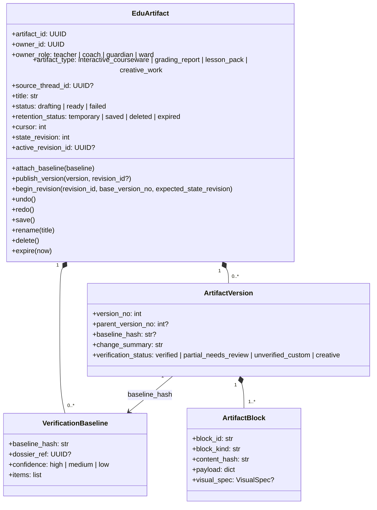
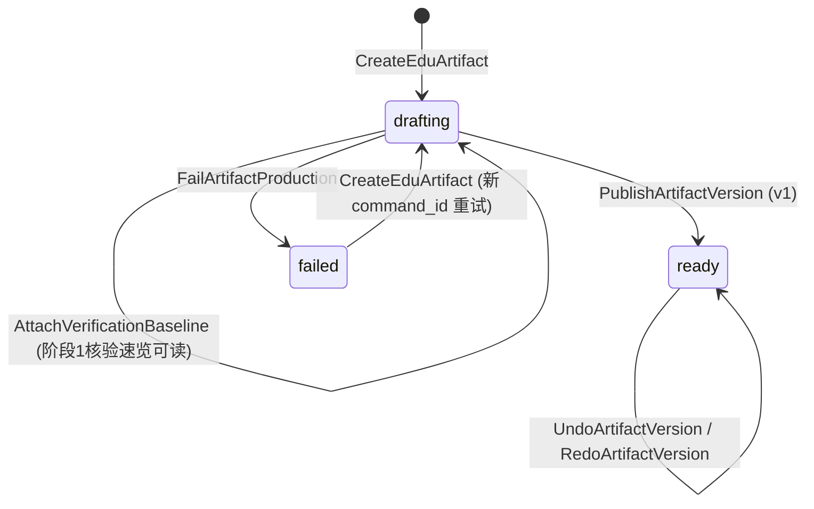
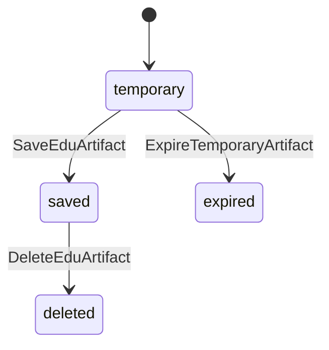
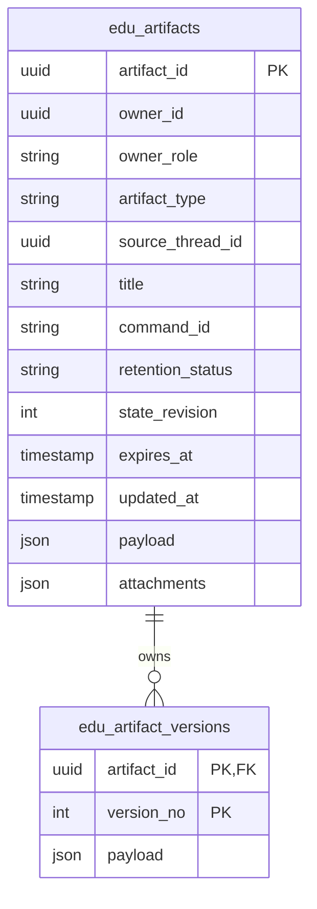

# 读学系统 — ArtifactWorkspace Domain Design（教育产物工作区）

> 状态：目标演进设计（既有 `MentorCourseware` P0-1 与主动保存已合入 `main` 基线，本设计将其平滑泛化为双端多形态核心 Domain） · 版本 v1.0 · 2026-11-28  
> 方法：[domain-driven-design skill](../../.cursor/skills/domain-driven-design/SKILL.md)  
> 关联：[DDD 系统总览](ddd-overview.md) · [Conversation 与通用 Agent 编排](domain-conversation.md) · [ProblemSolving](domain-problem-solving.md) · [Tutoring](domain-tutoring.md) · [教育通用 Agent PRD](../product/prd-edu-agent.md)

全系统 Domain Inventory、Domain Map 与分层图唯一归属 [ddd-overview.md](ddd-overview.md)。本 Domain 是 **Core Domain**，负责双端所有多形态、可版本化、可对话局部修订的教育产物（`EduArtifact`）的生命周期、核验诚实与资产沉淀。

---

## 一、边界与统一语言

### 1.1 职责与非目标
- **职责**：
  1. 统一承载双端四类核心教育产物：交互动态课件（`interactive_courseware`，直接承接既有 `MentorCourseware`）、作业/试卷批改诊断单（`grading_report`）、备课教案与自验变式卷（`lesson_pack`）、Ward 自由创作作品（`creative_work`：绘本故事、画作、知识卡片）；
  2. 守卫不可变版本链（`ArtifactVersion`）、按 `block_id` 寻址的对话式局部修订（`ArtifactPatch`）、零模型调用的毫秒级 **Undo / Redo** 与基于 `state_revision` 的并发 CAS；
  3. 守卫**核验诚实红线**：批改低置信显式标「待人工复核」、出题未通过自验禁标 `verified`、纠错与确定性核验矛盾须二次确认标 `unverified_custom`；
  4. 管理产物的独立保留生命周期（`temporary | saved | deleted | expired`），支撑成人「我的资源库」与 Ward「我的作品」；
  5. 维护交互式数理演示的端侧离线 Web 渲染与安全隔离契约（`Duxue MathStage Runtime`）。
- **非目标**：
  - 不负责多轮聊天上下文、通用 Agent 规划循环或角色路由（归 [Conversation](domain-conversation.md)）；
  - 不自建客观求解器或确定性数学/理化引擎（通过 ACL 调用 [ProblemSolving](domain-problem-solving.md)）；
  - 不承担 Ward 作业答疑的答案保护状态机与《独立解题凭证》（归 [Tutoring](domain-tutoring.md)）；
  - 成人产物绝不写入学生 `Memory` 或 `TutoringSession`。

### 1.2 上下游契约

| 方向 | Domain / 契约 | 集成方式 | 说明 |
| :--- | :--- | :--- | :--- |
| 上游 | `Identity & Relationship` | Authorization ACL | 校验 `owner_id`、`owner_role` 与私有附件所有权 |
| 上游 | `ProblemSolving` | ACL / Port（无状态求解核验 + 只读题库） | 获取不可变 `VerificationBaseline`（课件解题基线、整页批改核验基线、变式出题自解自验结果） |
| 上游 | `Conversation`（`EduAgentOrchestrator`） | Application Command 调用 | 编排层产出候选块或局部 Patch 后，经本域 Command 校验提交；对话与产物仅通过 `source_thread_id` 松耦合 |
| 下游 | `Evaluation` & `Memory` | Integration Event（Outbox：`CreationFootprintRecorded.v1`） | 仅当 `owner_role == "ward"` 且为自由创作产物保存/结算时发布，向晚间报告投影「好奇心与创作足迹」并向 `Memory` 写入独立 `Interest Signal`（**绝不混入作业专注时长与学业掌握度**） |

### 1.3 统一语言

| 术语 | 本域中的含义 | 明确不是 |
| :--- | :--- | :--- |
| `EduArtifact` | 本域唯一聚合根，代表一份归属特定角色的可版本化教育产物（`MentorCourseware` 的超集泛化） | 单条聊天消息、对话线程或一次性静态文件 |
| `ArtifactType` | 产物形态枚举：`interactive_courseware`、`grading_report`、`lesson_pack`、`creative_work` | 无类型任意 HTML/JSON |
| `ArtifactVersion` | 不可变的产物完整版本快照（`v1, v2, ...`），绑定该版 `baseline_hash` 与 `verification_status` | 原地覆写的草稿 |
| `ArtifactBlock` | 产物内带稳定 `block_id` 与 `content_hash` 的最小可寻址内容单元（课件步骤、逐题批改项、教案段落、变式题、故事页/插画/知识卡） | 固定模板章节 |
| `ArtifactPatch` | 对话式局部修订指令（`insert \| update \| delete \| split \| replace`），未改动块按哈希 100% 复用 | 全篇重生成纯文本 |
| `VerificationBaseline` | 来自 `ProblemSolving` 的只读客观核验快照；各版本固定绑定自己的 `baseline_hash` | 可由教学模型自由改写的草稿 |
| `VisualSpec` | 交互图形/演示判别联合：`component_scene`、`math_stage_script`、`layered_svg`、`illustration_image` | 无审核的任意外链页面 |

---

## 二、Domain Model

### 2.1 Aggregate Map
本域仅拥有 **1 个写聚合根**（`EduArtifact`），无跨域直接对象引用，无需多聚合关系图。`EduArtifact` 仅通过只读 ID（`source_thread_id`、`source_run_id`、`dossier_ref`）关联外部域；跨域事实仅通过 Outbox 发布 `CreationFootprintRecorded.v1` 实现最终一致。

### 2.2 Aggregate Root Summary

本域拥有 **1 个 Aggregate Root**：

| Aggregate Root | Consistency boundary | Business responsibility |
| :--- | :--- | :--- |
| `EduArtifact` | 单份教育产物的归属（`owner_id` + `owner_role`）、`artifact_type`、制作状态、保留状态、不可变基线集、不可变版本链（`versions`）、当前激活指针（`cursor`）、单调 `state_revision` 与至多 1 个活跃修订槽位；不包含异步渲染日志、模型原始草稿或聊天记录 | 守卫角色与产物形态合法性、版本不可变、Undo/Redo 指针合法性、CAS 并发防迟到覆盖、核验诚实红线与资产保存/删除终态 |

### 2.3 Entity & Value Object Inventory

| Object | Kind | Identity | Behavior and invariant responsibility |
| :--- | :--- | :--- | :--- |
| `ArtifactVersion` | Value Object | `version_no`（聚合内单调递增） | 不可变快照：持有 `parent_version_no`、可选 `baseline_hash`、`change_summary`、`verification_status`（`verified \| partial_needs_review \| unverified_custom \| creative`）与有序 `blocks[]` |
| `ArtifactBlock` | Value Object | `block_id`（聚合内稳定寻址键） | 承载类型化 `block_kind`（`courseware_step \| grading_item \| lesson_section \| variant_question \| story_page \| illustration \| knowledge_card`）、`content_hash`、结构化 `payload` 与可选 `visual_spec` |
| `VerificationBaseline` | Value Object | `baseline_hash` | 冻结来自 `ProblemSolving` 的题面/批改基准/出题自验结论与 `confidence`；换法或纠错生成新基线而不覆盖旧版；`creative_work` 允许为空 |
| `ArtifactPatch` | Value Object | `patch_id` | 局部修订指令：`op`、`target_block_id`、`requires_reverify` 与新块载荷 |
| `VisualSpec` | Value Object | None | 判别联合：`component_scene`（预置组件参数）、`math_stage_script`（隔离预运行 JS 产物）、`layered_svg`（静态图解）、`illustration_image`（过审私有插画）；均带内容哈希与静态降级引用 |

### 2.4 Aggregate Internal UML



### 2.5 Lifecycle State Diagrams

**制作生命周期**：


**保留生命周期（独立于制作状态，`deleted` / `expired` 为终态，拒绝迟到写入）**：


### 2.6 Domain Services

1. **`ArtifactInvariantPolicy`**（无状态）
   - **输入 / 输出**：`(owner_role, artifact_type, candidate_version, baseline?, patch?) -> ValidationResult`
   - **核心规则**：
     - **角色-形态红线**：`owner_role == "ward"` 禁止创建 `grading_report` 与 `lesson_pack`；Ward 的 `interactive_courseware` 仅限概念/原理演示，禁止包含受保护作业题完整答案；
     - **批改诚实红线**：`grading_report` 中任一 `grading_item` 手写置信度不足或等价性未证实时，须标 `needs_manual_review=true`，整版 `verification_status` 强制降级为 `partial_needs_review`；
     - **出题自验红线**：`lesson_pack` 中任一 `variant_question` 未通过 `ProblemSolving` 自解自验，禁止标为 `verified`；
     - **纠错诚实红线**：`requires_reverify=true` 且复核与确定性引擎矛盾时，拒绝标为 `verified`，仅经成人显式二次确认（`allow_unverified_override=true`）才允许发布为 `unverified_custom`。
2. **`ArtifactVersionPolicy`**（无状态）
   - **规则**：`undo`（`cursor > 0`）与 `redo`（`cursor < len - 1`）零模型调用仅移动指针；在途修订未完成时用户执行 Undo/Redo，立即推进 `state_revision` 并清空 `active_revision_id` 废弃旧任务；迟到任务 CAS 校验基础版本与 `state_revision` 任一不匹配均返回 `409 revision_base_changed`；从历史指针发布新版本时截断旧 redo 分支且单调递增 `version_no`（上限默认 20 版）；每次 Undo/Redo 的核验摘要严格投影自目标版本绑定的不可变 `baseline_hash`。

---

## 三、Application Commands & Trigger Matrix

### 3.1 State-change Trigger Matrix

| Trigger and source | Interface / entrypoint | Receiving Command | Aggregate / domain method | Local domain event | Outbox / next local action | Consistency, idempotency, failure |
| :--- | :--- | :--- | :--- | :--- | :--- | :--- |
| Agent 编排或成人直接创建产物 | `EduAgentOrchestrator` / `POST /v1/artifacts` | `CreateEduArtifact` | `EduArtifact.create()` | `EduArtifactCreated` | 投递异步编排/渲染任务 | 短事务；幂等键 `owner_id + command_id`；越权角色形态返回 `403` |
| Worker 完成阶段 1 核验 | Infrastructure Worker Adapter | `AttachVerificationBaseline` | `EduArtifact.attach_baseline()` | `VerificationBaselineAttached` | 刷新只读视图 | 短事务；幂等键 `artifact_id + baseline_hash` |
| Worker 完成编排/渲染/审稿 | Infrastructure Worker Adapter | `PublishArtifactVersion` | `ArtifactInvariantPolicy` + `ArtifactVersionPolicy` + `publish_version()` | `ArtifactVersionPublished` | 释放 `active_revision_id`；若为 Ward 已保存创作则 Outbox 发 `CreationFootprintRecorded.v1` | 短事务 + CAS；校验不过不落库，迟到任务返回 `409` |
| 用户发起对话局部修订 | `POST /v1/artifacts/{id}/revisions` | `RequestArtifactRevision` | `EduArtifact.begin_revision()` | `ArtifactRevisionRequested` | 投递局部 Patch 任务 | 短事务 + CAS；已有在途修订返回 `409` |
| 用户点击 Undo / Redo | `POST /v1/artifacts/{id}/{undo\|redo}` | `UndoArtifactVersion` / `RedoArtifactVersion` | `ArtifactVersionPolicy` + `undo()` / `redo()` | `ArtifactCursorMoved` | 无（同步返回最新视图） | 强一致短事务；**零模型调用（<50ms）**；越界返回 `409` |
| 用户保存产物 | `POST /v1/artifacts/{id}/save` | `SaveEduArtifact` | `EduArtifact.save()` | `EduArtifactSaved` | 私有素材副本随事务提交；若为 Ward 创作则 Outbox 发 `CreationFootprintRecorded.v1` | 短事务 + CAS；仅 `ready` 且无在途修订可保存 |
| 用户改名 / 删除 | `PATCH` / `DELETE /v1/artifacts/{id}` | `RenameEduArtifact` / `DeleteEduArtifact` | `rename()` / `delete()` | `EduArtifactRenamed` / `Deleted` | 删除同时清理私有素材副本并作废在途任务 | 仅 `saved` 可操作；删除幂等返回 `204` |
| 定时清理器检查到期 | Infrastructure Scheduler | `ExpireTemporaryArtifact` | `EduArtifact.expire()` | `TemporaryArtifactExpired` | 级联物理清理 | 仅到期 `temporary`（默认 4h），重复扫描无副作用 |

### 3.2 核心 Command Cards

#### `CreateEduArtifact`
```python
class CreateEduArtifactInput(BaseModel):
    owner_id: UUID
    owner_role: Literal["teacher", "coach", "guardian", "ward"]
    artifact_type: Literal["interactive_courseware", "grading_report", "lesson_pack", "creative_work"]
    command_id: str
    source_thread_id: UUID | None = None
    prompt_text: str = Field(max_length=4000)
    attachment_keys: list[str] = Field(default_factory=list, max_length=8)
    target_grade_hint: str | None = None
```
- **授权与前置**：校验角色与 `artifact_type` 合法性（Ward 禁建 `grading_report`/`lesson_pack`）、附件前缀归属与输入安全预检；短事务创建 `drafting` 聚合，模型求解/渲染/审稿全部在事务外执行。

#### `RequestArtifactRevision`
```python
class RequestArtifactRevisionInput(BaseModel):
    owner_id: UUID
    artifact_id: UUID
    command_id: str
    instruction: str = Field(min_length=1, max_length=1200)
    base_version_no: int
    expected_state_revision: int
    target_block_id: str | None = None
    allow_unverified_override: bool = False  # 仅成人角色允许置 True
```
- **行为**：原子校验所有者、`status == "ready"`、无活跃 `active_revision_id` 与 CAS 版本号；锁定修订槽位后唤醒局部 Patch 管线（表达类修订跳过 `ProblemSolving`，未改动块按 `content_hash` 100% 复用；纠错/换法类修订重新调用 `ProblemSolving` 复核）。

#### `PublishArtifactVersion`
```python
class PublishArtifactVersionInput(BaseModel):
    artifact_id: UUID
    revision_id: UUID | None
    base_version_no: int | None
    expected_state_revision: int
    candidate_version: ArtifactVersion
    requires_reverify: bool = False
    reverify_passed: bool | None = None
    allow_unverified_override: bool = False
```
- **入口**：仅限内部 Worker Adapter 调用；先过 `ArtifactInvariantPolicy` 与 `ArtifactVersionPolicy`，再按固定基础版本与 `state_revision` 原子 CAS 提交。

---

## 四、CQRS Query 侧与 Interface 契约

### 4.1 Queries
- **`GetEduArtifactView`**：强一致读取当前 `cursor` 投影（`artifact_id`、`artifact_type`、`title`、`retention_status`、`state_revision`、`verification_summary`、`current_version{blocks[]}`、`history_controls{can_undo, can_redo, version_summaries[]}`、`active_revision_pending`）。
- **`GetArtifactProductionStatus`**：只读查询运行阶段（`solving | directing | rendering | judging | ready | failed`）与进度文案。
- **`ListSavedEduArtifacts`**：按 `(owner_id, owner_role, retention_status='saved', optional artifact_type)` 以 `(updated_at DESC, artifact_id DESC)` 游标稳定分页，支撑成人「我的资源库」与 Ward「我的作品」。

### 4.2 Interface Contracts（终端无关，同时服务 App 与未来 Web 工作台）

```text
GET    /v1/artifacts?saved=true&type=…&cursor=…  → ListSavedEduArtifacts (200 OK)
POST   /v1/artifacts                             → CreateEduArtifact (202 Accepted)
GET    /v1/artifacts/{id}                        → GetEduArtifactView (200 OK)
GET    /v1/artifacts/{id}/status                 → GetArtifactProductionStatus (200 OK)
POST   /v1/artifacts/{id}/revisions              → RequestArtifactRevision (202 Accepted)
POST   /v1/artifacts/{id}/undo                   → UndoArtifactVersion (200 OK + View)
POST   /v1/artifacts/{id}/redo                   → RedoArtifactVersion (200 OK + View)
POST   /v1/artifacts/{id}/save                   → SaveEduArtifact (200 OK + View)
PATCH  /v1/artifacts/{id}                        → RenameEduArtifact (200 OK + View)
DELETE /v1/artifacts/{id}                        → DeleteEduArtifact (204 No Content)

# 跨领域 Integration Event（Outbox）
ArtifactWorkspace.CreationFootprintRecorded.v1   → {event_id, occurred_at, ward_id, artifact_id, version_no, title, topic_tags[], thumbnail_ref?}
```

- **向后兼容**：既有 `/guardian/courseware/*` 路径作为 `/v1/artifacts/*`（固定 `artifact_type="interactive_courseware"`）的兼容适配层保留。
- **错误映射**：跨账号或越权形态返回 `403`；并发修订/CAS 冲突/Undo 越界返回 `409`；超频返回 `429`。

---

## 五、Infrastructure Design Card

### 5.1 Ports & Adapters

| Port | Concrete Adapter | 协议 / 依赖 | 预算与降级 |
| :--- | :--- | :--- | :--- |
| `EduArtifactRepository` | `PgEduArtifactRepository` | PostgreSQL + `state_revision` 乐观锁 | 短事务；到期返回 `404` |
| `ProblemVerificationPort` | `ProblemSolvingAclAdapter` | 进程内受权调用 `ProblemSolving` + 确定性符号/理化引擎 | 阶段 1 预算 60s；失败标 `confidence="low"` 绝不伪装已核验 |
| `ArtifactRenderPort` | `HybridMathStageAdapter` + `ImageGenAdapter` + `AudioTimelineAdapter`（P1）+ `HeadlessExportAdapter`（P2） | 本地组件校验、无凭证禁网 Headless 预运行、生图安全审核、私有 OSS | 预运行独立进程墙钟/内存超时外部终止；有界修复 1 次，失败降级静态图文 |
| `ArtifactJudgePort` | 异构 LLM Judge（严禁与生成模型同型号） | Admin 组件配置快照 | 单次 25s；安全与防代写审核 fail-closed |

### 5.2 Entity-Relationship Diagram 与平滑迁移



- **表归属与索引**：两张表共同承载 `EduArtifact` 聚合；列表索引 `(owner_id, owner_role, retention_status, artifact_type, updated_at DESC, artifact_id DESC)`；到期清理索引 `(retention_status, expires_at)`；幂等唯一键 `(owner_id, command_id)`。
- **从既有 `mentor_coursewares`（迁移 `20261127_41`）平滑迁移**：增量 Alembic 迁移将 `mentor_coursewares` / `mentor_courseware_versions` 平滑扩展或回填至 `edu_artifacts` / `edu_artifact_versions`（原有记录映射为 `owner_role="guardian"`、`artifact_type="interactive_courseware"`），保持原 `courseware_id`、`versions`、私有原图副本与 Undo/Redo 指针 100% 兼容不丢失；回滚先切回旧入口，禁止删表回滚用户资产。

### 5.3 Async Delivery、Security & Observability
- **异步投递**：复用 Celery 队列执行事务外编排与渲染；`CreationFootprintRecorded.v1` 经本地事务 Outbox 投递，消费方（`Evaluation` / `Memory`）以 `artifact_id + version_no` 幂等去重。
- **安全与隐私**：输入与每版所有 `ArtifactBlock` 可见文本、插画及生成代码内标注强制过双向内容安全审核；素材按角色私有前缀隔离，保存时复制原图入聚合事务避免依赖临时附件 TTL。
- **可观测性**：OpenTelemetry + Grafana + Langfuse 记录 `artifact_id`、`artifact_type`、`version_no`、`stage_latency_ms`、`reused_block_count`、`verification_status` 与成本拆解。

---

## 六、端侧交互渲染底座：离线 Web 数理舞台（Duxue MathStage Runtime）

> 继承自既有已验证基线，适用于 `interactive_courseware`（成人完整动态课件 + Ward 原理探索演示）：采用**「通用 Web 绘图环境 + 预置常用组件 + 隔离模型生成特殊演示 JS」**混合路线，外加 WebView 外的已审核静态图文降级。

1. **三层渲染路径**：
   - `component_scene`：由随 App 打包的锁定本地绘图库（Canvas2D / SVG / Three.js / KaTeX）与预置组件（坐标系/函数动点、平面几何、3D 多面体截面/展开）按结构化参数绘制，不生成 JS；
   - `math_stage_script`（P0-2 灰度）：针对预置组件未覆盖的特殊演示，模型生成遵守 `mount(surface, context)` / `render({block_id, t_ms, parameters, camera})` / `dispose()` 契约的 JS 产物，固定随机种子、按内容哈希绑定 `runtime_version`；
   - **静态降级**：已审核 SVG / 代表帧与公式正文保留在 WebView 之外，故障或旧 runtime 不兼容时立即可读。
2. **隔离、预运行与宿主恢复硬边界**：
   - **平台隔离与禁网**：生成代码运行于隔离绘图区域，不共享登录 Cookie/Token/存储或原生桥接，禁用外链导航/弹窗/下载/文件访问，仅加载锁定本地库；
   - **发布前必须预运行**：所有生成 JS 在服务端无凭证、禁网、受 OS 资源预算限制的 Headless 子进程中测试初始化、关键时间点与参数边界并抽帧审查图文对齐，超时外部强杀，最多修复 1 次，仍失败仅发静态降级；
   - **宿主外部监测与故障原型门禁**：首帧截止时间、心跳（`HEARTBEAT` / `STAGE_ERROR`）与内容进程退出由 Flutter 宿主外部计时处理；死循环/内存溢出/WebGL 上下文丢失时直接切换静态降级并销毁重建舞台，不依赖卡死页面执行 `dispose()`；**未通过 Android/iOS 真机故障原型验收的设备禁用生成代码路径**。
3. **后续演进（同源复用）**：P1 叠加逐 Beat TTS 音轨时间轴；P2 服务端 Headless Chromium 按同一 `render` 契约采样导出 MP4。

---

## 七、验收场景（Acceptance Scenarios）

```gherkin
Given 一页手写作业中第 3 题涂改模糊，确定性核验置信度为 low
When Teacher 或 Guardian 发起批改诊断生成 grading_report
Then 第 3 题标为 needs_manual_review=true，整版 verification_status 为 partial_needs_review，绝不标为 verified

Given Teacher 请求生成 3 道二次函数变式巩固题（lesson_pack）
When 其中第 2 题未通过 ProblemSolving 自解自验
Then PublishArtifactVersion 拒绝将该题标为 verified，触发有界重生成或降级标注

Given 产物处于 ready 且当前为 v2，用户基于 v2 发起局部修订“把第 3 步拆细”
When 用户在修订未完成时点击 Undo 回到 v1
Then Undo 零模型调用毫秒级回到 v1 并立即废弃在途修订，迟到任务提交时因 state_revision 不匹配被拒（409），不破坏版本链

Given Ward 尝试请求创建 grading_report 或 lesson_pack
When 命令进入 ArtifactInvariantPolicy 校验
Then 请求被 403 拒绝，不创建任何聚合或版本

Given Ward 保存一篇自由共创故事绘本（creative_work）
When SaveEduArtifact 事务提交
Then 产物进入 Ward「我的作品」，并通过 Outbox 发布 CreationFootprintRecorded.v1
And Evaluation 投影至晚间「好奇心与创作足迹」，Memory 仅写入 Interest Signal，绝不修改学业掌握度

Given 既有已保存的 MentorCourseware 课件完成平滑迁移
When Guardian 重启 App 打开「我的资源库」
Then 原有 courseware_id、完整版本链、Undo/Redo 与 MathStage 3D 演示 100% 兼容可读
```
