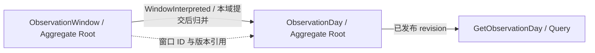
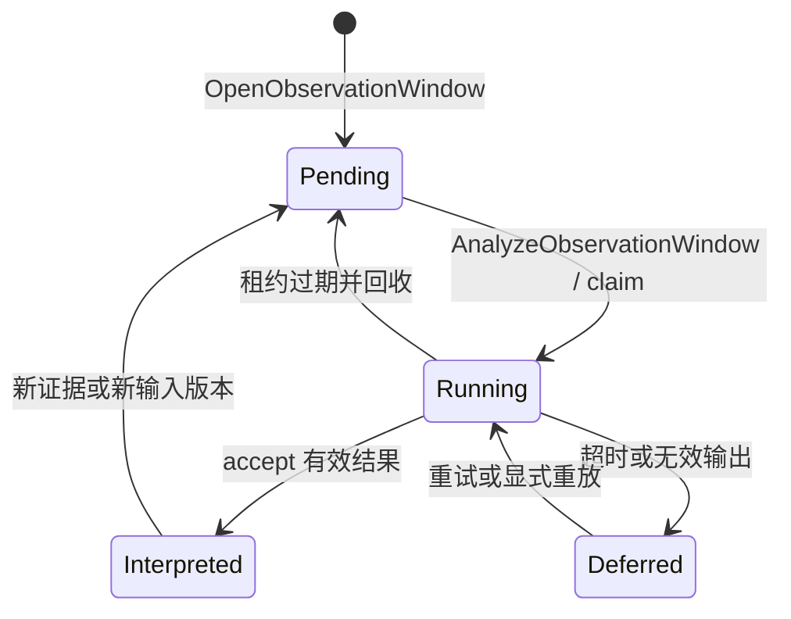
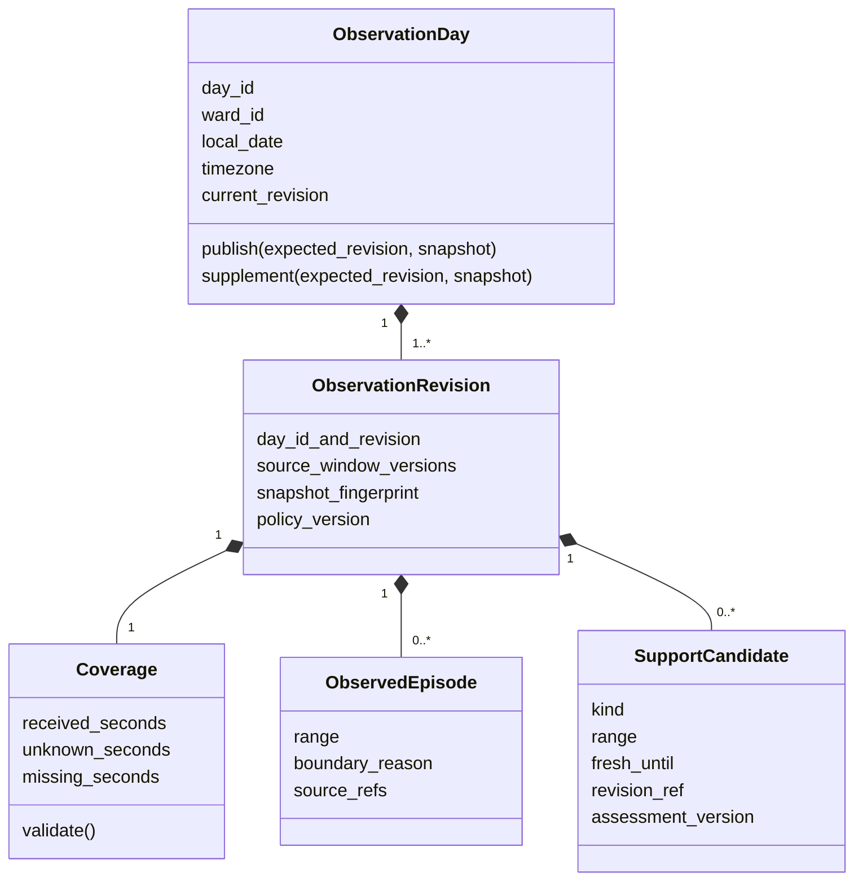
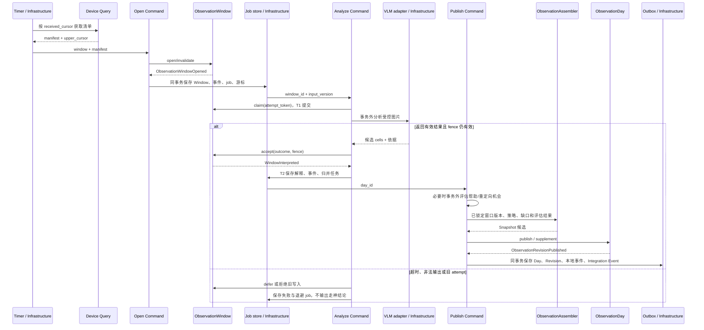
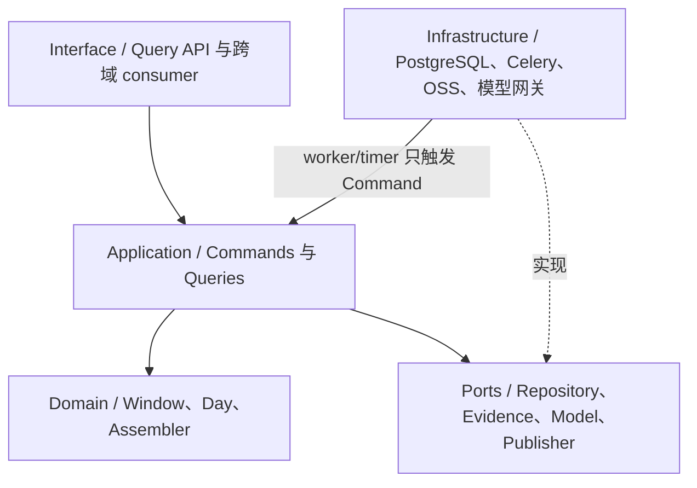
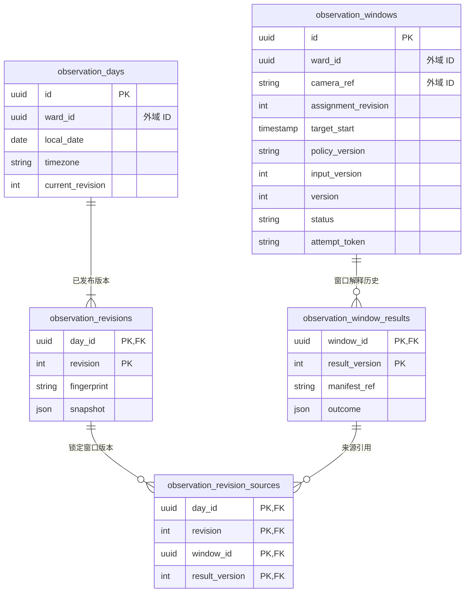
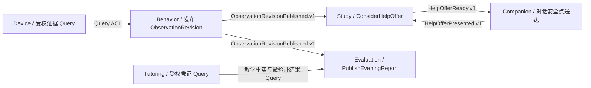

# 读学系统 — Behavior Analysis Domain Design

> 状态：核心链路已有本地实现，默认 shadow；真实样本与现场验收待完成。2026-11-12，落地范围见 §十。
> 方法：[domain-driven-design skill](../../.cursor/skills/domain-driven-design/SKILL.md)。
> 目标：把网关的稀疏图片转为可追溯的观察学段，为适时帮助和零输入晚间交付提供证据。
> 采集协议唯一归属 [design-gateway](design-gateway.md)；全系统领域清单与关系唯一归属 [DDD Overview](ddd-overview.md)。本文拥有行为解释、观察学段、证据版本与分析运行契约。概念模型与实际表映射见 [物理设计](design-server.md#近实时观察物理映射2026-11-12迁移35)；未落地扩展以 §十为准。

## 一、领域清单、边界与统一语言

本次协作涉及 **6 个 Domain**，其中新增详细模型仅为 Behavior Analysis；其余扩展在所属文档维护，不重新划分微服务。

| Domain | 类型 | 本次拥有的语义与规则 | 上游 / 下游与集成 |
|---|---|---|---|
| Identity & Relationship | Generic | Ward 身份、监护授权 | 全域授权 ACL；不因网关知道 Ward ID 而授予读权限 |
| Device & Ingestion | Supporting | 采图归属、AcceptedFrame、采集健康 | Identity → 本域；本域 → Behavior 的受权增量证据 Query |
| Behavior Analysis | Supporting | 可见活动、观察覆盖、观察学段、解释版本 | Device → 本域；本域 → Study/Evaluation 的 Published Language + Query ACL |
| Study | Core | 是否邀请求助、邀请频率和 Ward 响应 | Behavior → 本域；经 Companion 交付；设计见 [HelpOffer](domain-study.md#九观察触发的求助邀请目标扩展) |
| Companion Orchestration | Supporting | 对话回复权、交互登记与送达去重 | Study 的送达请求；点击接受后 Ward 自主通过既有入口提问 |
| Evaluation & Reflection | Core | 零自述晚间报告、证据快照和报告版本 | Behavior、既有 Tutoring/Study Query → 本域；见 [晚间交付扩展](domain-evaluation.md#九零输入晚间交付目标扩展) |

Tutoring、Planning、Memory 的既有所有权不变。它们不属于本次新增写模型范围：答疑凭证只读既有教学证据；计划仅作可选关联；Memory 暂不新增行为衍生事件，避免把未校准观察写为长期能力。既有采集事实账本不是视觉解释。

### 1.1 目标与非目标

- 没有 Plan、没有显式 StudySession、没有自述，也能产生观察结果并触发晚间缺失标注版报告。
- 观察只描述可见活动，不把停笔认定为发呆、卡壳或不懂；不推断情绪、人格、知识掌握和作业完成。
- 不向家长开放实时图像或原始窗口 Query，不生成专注排名或分心告警。
- 网关不等待本域分析，不向模型直发任务；本域不修改 Frame、Task、StudySession 或长期画像。
- 每日批处理可用于复核，学习中帮助必须读取增量结果；没有新鲜证据时不发起观察式求助邀请。

### 1.2 统一语言

| 术语 | 含义与所有者 |
|---|---|
| EvidenceManifest | Device 受权 Query 的证据清单快照：Frame 引用、采集时间、归属版本、健康缺口、接收游标；不是图片副本 |
| ObservationWindow | 本域一分钟目标窗口的分析责任；归属一个 Ward、摄像来源和 assignment revision；上下文可以跨窗口，计时不能跨目标窗口 |
| ObservationCell | 半开时间区间内的估计活动及来源帧引用；不是连续视频事实 |
| ObservationDay | 一个 Ward 在一个本地学习日、固定时区下的观察结果发布入口 |
| ObservationRevision | ObservationDay 内不可变发布版本，锁定窗口解释版本、学段、覆盖、策略版本 |
| ObservedEpisode | 一段被动还原的桌面学习活动；不等于 StudySession，离座也不等于完成作业 |
| SupportCandidate | 持续停滞后的递梯子候选，或持续活动偏离后的回归候选；均不是难题/心理诊断 |
| missing / unknown | missing 为未获得证据；unknown 为证据存在但无法解释；都不能算作不专注 |

活动闭集：`writing`、`reading_material`、`handling_material`、`still_with_material`、`other_visible_activity`、`away`、`unknown`。头朝桌面不充分证明阅读；拿着手机不充分证明娱乐。模型无法确认时选 unknown。`other_visible_activity` 也不自动等于浪费时间。

## 二、领域模型

### 2.1 Aggregate Map

图源：本文本节 Mermaid。一个窗口和一个观察日分别是本地事务边界；二者只以 ID + version 引用，最终一致。查询组合它们的已发布结果，不作为权威写状态。



### 2.2 Aggregate Root 汇总与作用

本 Domain 有 **2 个 Aggregate Root**，按一致性边界而非表或处理阶段划分：

| Aggregate Root | 边界 | 职责 |
|---|---|---|
| ObservationWindow | 一个 Ward、一个摄像来源/归属版本、一个目标时间窗口的解释；输入变更、尝试隔离与结果接受在本窗口内一致 | 回答“这段短时间的图片观察到了什么”；保存可重试、可重算的窗口解释，不累计整晚、不发邀请 |
| ObservationDay | 一个 Ward 在固定时区的一个本地日；观察发布版本、来源窗口版本及计时结果原子保存 | 回答“截至现在，今天连续发生了什么”；跨窗口形成学段、累计持续停滞/活动偏离候选、核算覆盖与时长，供 Study 和 Evaluation 消费 |

例如，19:00—19:01、19:01—19:02 分别是两个 Window；它们都属于当天同一个 Day。窗口解释停笔一分钟还不能触发四分钟超时；Day 读取连续窗口，发现 19:00—19:04 的有效停滞证据后才形成帮助候选。**Day 是全天持续更新的观察结果，不是到晚上才执行，也不是面向家长的报告。** 后者归 Evaluation。

窗口唯一身份、版本和仓储映射见 §六；命令行为见 §三。关键约束：Frame 必须属于相同 Ward/归属，解释区间不能重叠或超出目标区间；来源必须来自输入清单；缺失不得补造活动，旧任务不能覆盖新输入。窗口结果只追加版本。

模型置信度只作未校准的辅助数据，不作为概率承诺。模型负责物理活动语义；Domain 校验闭集、区间、来源、归属、版本与计时不变量，不使用关键词规则复判语义。

窗口没有子实体或跨子对象关系，省略内部 UML；Outcome 的完整字段在 §五定义。



### 2.3 对象关系与发布约束

Day 的 revision 单调增加；每一版锁定窗口解释版本、学段、覆盖、帮助机会 assessment_version 和策略。活动、unknown、missing 在启用观察范围内互斥且总量守恒。相同来源 fingerprint 不重复发布，fingerprint 同时覆盖语义评估版本；补传只追加版本。Day 不装载图片、不修改窗口或 StudySession。

#### Entity Inventory

| 对象 | 类型 | Identity | 决策属性 | 行为 | 不变量责任 |
|---|---|---|---|---|---|
| Outcome | Value Object | 无 | cells、来源、模型/提示词/协议版本 | validate_ranges/validate_refs | 合法闭集、半开区间和受控引用 |
| ObservationRevision | Entity | day_id + revision | source_refs、fingerprint、coverage、episodes、policy_version | 无独立修改入口 | 由 Root 保证不可变和来源完整 |
| ObservedEpisode | Value Object | 无 | range、boundary_reason、activity_totals、source_refs | validate | 不跨未知长缺口；不是任务完成事实 |
| Coverage | Value Object | 无 | expected、received、interpretable、unknown、missing_seconds | validate/account | 不重复累计、分母明确 |
| SupportCandidate | Value Object | 无 | kind、range、source_refs、fresh_until、revision_ref、assessment_version | validate | 只提供停滞或活动偏离候选，不证明内心走神或遇到难题 |



ObservationDay 无完成状态：今天可增量发布，历史日可补充；每个 Revision 一经发布不可变。无需另造“学完”状态机。

### 2.4 Domain Service：ObservationAssembler

输入：同一 Ward/本地日的不可变窗口解释、采集范围、健康缺口、受控语义评估结果、ObservationPolicy；输出待发布 Snapshot 值对象。它不读库、不调模型、不决定发消息。

规则：

1. 以采集时间而非接收时间排列。目标一分钟内每个采样槽只归属一次；跨窗口上下文不能重复贡献时长。
2. 默认采样槽 15 秒，最后一个槽截断到目标窗口结束；迟到帧落入原槽重算。槽没有有效 Frame 为 missing；有图但不可解释为 unknown。不跨缺口插值，不用帧数乘采样周期覆盖整个首尾跨度。
3. 多来源覆盖同一时段时先按授权的主观察来源选取；主来源缺失才可选授权备用来源。相互冲突时标 unknown，不相加、不混接不同座位证据。首期只启用单 Ward 单来源。
4. 连续学习材料活动形成 ObservedEpisode。短暂离座可保留为段内 away；连续 away 达 5 分钟结束学段，长 unknown/missing 达 2 分钟断开连续性并标注边界不确定。静止不结束学段。
5. 候选启动准备时间仅计算“入座准备迹象 → 首次可靠学习活动”的可观察差值，不等同于任务计划启动延迟。换书仅标材料切换；无可靠科目证据时称“学段 1/2”。
6. still_with_material 连续 4 分钟进入“是否递梯子”的评估；other_visible_activity 连续 2 分钟进入“是否邀请回到学习”的评估。两类均不能仅凭标签生成提醒：Application 在事务外调用 SupportOpportunityPort，用连续图像及可选的当前学习上下文判断是否值得询问。模型返回 `offer_help`、`invite_return`、`none` 或 `uncertain`，必须给证据引用；前两者才可形成 SupportCandidate，kind 同取该值。正常阅读/思考、查资料、转头瞬间、原因不明或评估失败均不形成重定向候选。两类候选共用连续性检查，unknown/missing 中断累计。
7. 候选 fresh_until 为末证据后 120 秒；补传或历史重算不产生当前有效邀请。实际送达前还需重新读取最新观察：末证据年龄必须 ≤60 秒，已恢复学习或出现缺口就丢弃。候选到期时间不是允许使用两分钟前观察直接出声的许可。

上述 2/4/5 分钟和 freshness 时限为首期实验参数，随 policy_version 固化；须通过标注实验再校准，不作为认知科学结论。动作阈值是确定性时间规则；何为可见活动由模型判断。

“桌面学习活动估计时长”统计 writing、reading_material、handling_material；still_with_material 单独展示。不得把它命名为真实认知专注或净学习效率，不把其他时间全部命名为垃圾时间。

### 2.5 持续状态累计与帮助机会判定

本节是“何时值得询问”的完整判定入口；§五定义模型协议，Study §9 决定这次是否允许实际干预。三步不能合并成“超过时长就说孩子卡住/走神”。

**第一步：检查同一种情况已经持续了多久。** 先前的图片分析已经把每张图片标为“停笔看材料”“书写”“阅读”“其他活动”等。这里的代码不再看图片猜含义，只把这些结果按拍摄时间排好，检查最近一段时间是不是一直为同一种状态：

- 如果最近约四分钟的图片都显示“停笔看材料”，才请模型进一步判断要不要询问是否需要帮助。
- 如果最近约两分钟的图片都显示“其他活动”，才请模型进一步判断要不要邀请回到学习。**其他活动不一定无关学习，必须再由模型判断。**
- 中途恢复书写或阅读，就停止计算前面那段停笔时间；以后再停笔，从新的时间开始计算。
- 中途没有采到图片、图片看不清、孩子离座或摄像头换了学生，就不把前后两段拼起来。
- 同一张图片重复上传、同一批图片重新分析，都不能让持续时间增加。计算依据是图片拍摄时间，与服务器处理了多久无关。

例如，下面每格表示一分钟内的图片分析结果：

| 时间顺序 | 是否进入帮助机会评估 |
|---|---|
| 19:00—19:01 停笔 → 19:01—19:02 停笔 → 19:02—19:03 停笔 → 19:03—19:04 停笔 | 约四分钟一直停笔，请模型判断是否值得问一句 |
| 停笔一分钟 → 书写一分钟 → 停笔两分钟 | 最近只连续停笔两分钟，尚不评估递梯子 |
| 停笔两分钟 → 缺图一分钟 → 停笔两分钟 | 缺图前后不能相加，最近只连续观察到停笔两分钟 |

技术上由 `ObservationAssembler` 检查按时间排序的已接受结果，每张正常采样图片至多代表约 15 秒，连续的时间相加；跨一分钟分析窗口也继续计算，不能因为服务器换了一批图片就重新开始。上述四分钟/两分钟都是稀疏图片推算的时长，不能证明期间每秒都保持同样状态。后续代码中的 `run` 就指“这一段连续相同状态的时间”。

**第二步：模型判断是否值得发起邀请。** `PublishObservationDay` 在事务外将已达到上述时长的图片、按时间排列的观察结果、来源版本及可选学习上下文交给 `SupportOpportunityPort`。模型一次选择：

| decision | 必须满足的语义条件 | 后续 |
|---|---|---|
| offer_help | 学习材料仍在使用且持续没有明显推进，整体证据支持一次试探性求助询问，而非有明确正在阅读、顺利推演或其他正常活动的证据 | 形成递梯子候选；不能写“已确认卡壳” |
| invite_return | 已有学习活动或 Ward 明确学习意图；连续多帧支持正在持续进行与该学习过程无关的活动，而非查资料、换材料或正常休息 | 形成回归邀请候选；不能写“已确认走神” |
| none | 有充分证据显示无需此类邀请，例如正在阅读、已恢复推进、主动休息 | 无候选 |
| uncertain | 图像、上下文或解释不足以区分，包括思考与卡壳难以辨别 | 无候选 |

具体 [inputSchema、outputSchema 和输入输出示例](#帮助机会评估的-inputschema-和-outputschema) 见 §5.2。

模型必须引用输入中的证据；超时、非法结构、跨 Ward 引用、无法区分正常思考与卡壳，均不产生候选。Domain 校验枚举、引用和时间规则，不用关键词/正则复判语义。相同 run 的同一来源/模型/策略版本只评估一次；新的证据版本可再评估，Study 仍按连续 run 去重邀请。

**第三步：代码判断现在能否呈现。** Study 的 `ConsiderHelpOffer` 读取候选，检查新鲜度、最新活动、有效陪伴通道、答疑/休息/确认状态、频次和冷却。全部允许才保存邀请并发布 HelpOfferReady.v1。Companion 在出声前再次检查当前活动和回复权，恢复学习或条件变化就丢弃。

系统只能确认“达到一次温和询问的条件”，不能仅靠图片确认孩子真的卡壳。孩子接受递梯子并描述题目/卡点后，才进入 Tutoring 诊断和启发；孩子是否回归、是否解出也各有独立证据，不由邀请成功推出。

## 三、Application Commands 与触发矩阵

所有命令接收 `actor/system_scope, command_id, expected_version`（创建除外）；授权、仓储、发布、时钟、模型均经 Port。事务外准备模型/上游数据，事务内校验输入 fence 后提交。下表各行即 Command Card，未列出的业务写入口不得由 Worker 直接补写 ORM。

| 真实场景 / 谁触发 | Application Command / 输入 | 授权与前置条件 | Root / 本地事务 | 事件与后续 | 幂等、失败 |
|---|---|---|---|---|---|
| 每 15 秒扫描新接收的 Frame，发现一个已结束的一分钟窗口；扫描器调用 | OpenObservationWindow(ward, target_range, manifest_ref, policy_version) | 系统 scope，已接受的正确归属证据 | Window.open/invalidate；保存输入版本 | 同事务保存分析任务；提交后才由派发器交 Celery | 窗口唯一键 + manifest fingerprint；无新输入不重复建 job |
| Celery 收到上述持久化分析任务；Worker 调用 | AnalyzeObservationWindow(window_id, input_version) | 系统 scope，输入有效，取得 attempt fence | T1 claim；事务外取图/模型；T2 accept/defer | WindowInterpreted；同事务创建归并任务 | window/input_version/attempt；旧尝试不可覆盖新结果 |
| 某个窗口解释成功，事务中保存了归并任务；Worker 立即调用；事务提交后即时归并 | PublishObservationDay(day_id, source_fingerprint) | 系统 scope，锁定已接受窗口版本；事务外备好必要语义评估 | assembler 归并；T 内 Day.publish/supplement | ObservationRevisionPublished；Outbox 通知 Study/Evaluation | Day + fingerprint；未变不发布；不等待定时任务才更新 |
| 每分钟检查未完成工作：发现新补传改变已分析窗口、Worker 租约过期或持久化 job 漏派发；或管理员提交审计重放请求 | ReconcileObservationEvidence(ward, range, reason) | 系统或审计管理员；图像仍在合法留存期 | 按原因分别重开窗口、回收失效尝试或重派 job；不直接改 Day | 重新进入相同 Analyze → Publish 链路 | 协调命令不新增 Root；每窗口独立幂等、部分失败保留任务 |

例如：19:01:00 后扫描器收齐 19:00—19:01 的输入并提交分析任务；Worker 开始分析，结果提交时产生当天归并任务，随后即时更新当天 Day。**分析任务是数据库中已提交的工作记录，包含 window_id、input_version、状态和下一次可执行时间；Worker 领取任务后调用 Command。记录存在不代表分析已经完成。**

本期**不另设每五分钟全量比对窗口与 Day 的定时任务**。分析结果与后续归并任务同事务保存；Day 版本与下游 Outbox 同事务保存。进程在提交后崩溃时，持久任务仍在，可重新派发；事务未提交则回滚，由原任务重试。正常链路靠这些任务立即推动，不靠周期汇总。

每分钟执行一次 `ReconcileObservationEvidence` 的恢复检查，只查询已到重试时间的任务、已过租约且未完成的任务、未派发的持久任务，重试或重新派发；同一恢复入口可处理被接收游标发现的补传。租约是某次 Worker 对任务的临时执行权：回收后旧 attempt 失效，不能覆盖新结果。它不每分钟重扫所有图片、不重新调用全部模型，也不逐日全量比对来源版本。对于异常数据损坏或人工改库，保留受审计的按范围重建命令，不在首期增加另一套五分钟补偿任务。

一分钟窗口结束后才创建一次基础分析任务；15 秒扫描只发现新证据，不每来一帧就重复调用整窗模型。补传改变 manifest 时，合并受影响窗口的任务并重算，再进入即时归并链路。

扫描器的游标、租约、重试记录是 Infrastructure，不是分析任务 Aggregate。首次扫描时持久化快照上界；游标和待处理清单同事务保存，不允许游标先推进而 job 丢失。Device Query 若不可用，保持游标不动。

### 3.1 异步模型调用与提交因果链

| 参与者 | Canonical type | 职责 |
|---|---|---|
| Timer / Worker / Job store / Outbox | Infrastructure | 周期触发、可靠重试、租约、发布 |
| Device evidence query | Query | 返回已接收清单和接收游标，不解释行为 |
| Open / Analyze / Publish | Command | 授权、事务、Port 编排 |
| Window / Day | Aggregate Root | 接受解释、发布不可变版本 |
| ObservationAssembler | Domain Service | 时序归并和覆盖核算 |
| VLM adapter | Infrastructure | 调模型；无权写 Root |
| WindowInterpreted / ObservationRevisionPublished | Domain Event | 本地已发生事实，由 Command 保存 |
| ObservationRevisionPublished.v1 | Integration Event | 发布的来源版本通知 |
| Evaluation consumer | Interface | 验证 schema，转为接收域命令 |



图源：本文 §3.1；同时覆盖 Command–Event–Query 的写侧一致性点。读侧仅读取已提交 Revision，不能读半成品。

### 3.2 目标代码调用链：谁启动递梯子与回归邀请

以下是**尚未实现的目标伪代码**，不代表仓库已有 handler。两个邀请都由新分析结果自动推动，无需孩子请求 `/companion/turn`，也不靠五分钟定时器：

```text
Celery 分析任务 → AnalyzeObservationWindow
  └─ 结果与归并任务同事务提交
       → PublishObservationDay
          ├─ assembler.find_continuous_runs：累计活动持续时间
          ├─ SupportOpportunityPort.assess：必要时事务外语义评估
          └─ ObservationDay.publish：保存候选和观察版本
               + Outbox ObservationRevisionPublished.v1（同事务）
                  → Study consumer → ConsiderHelpOffer
                     → HelpOfferBudget.consider：额度与时机校验
                        + Outbox HelpOfferReady.v1（同事务）
                           → Companion consumer → PresentHelpOffer
                              → App 卡片 / 已开启 handsfree 的短语音
```

```python
# Application Command：准备候选；模型不在 Domain 内调用。
async def publish_observation_day(command):
    inputs = await observation_source_port.load_accepted_versions(command.day_id)
    snapshot = assembler.build_observation(inputs, policy)
    runs = assembler.find_continuous_runs(snapshot, policy)
    assessments = await support_opportunity_port.assess_eligible(runs)
    # assess_eligible 只评估达阈值且新鲜的 run；失败返回 uncertain，不阻塞基础观察。
    snapshot = assembler.attach_support_candidates(snapshot, assessments, policy)
    await publish_day_and_outbox_atomically(command, snapshot)

# Interface：收到跨域消息后调用接收域 Command，不直接改任何 Root。
async def on_observation_revision_published(event):
    await study_commands.consider_help_offer(
        day_id=event.source_id,
        revision=event.source_version,
        command_id=event.event_id,
    )

async def on_help_offer_ready(event):
    await companion_commands.present_help_offer(
        offer_id=event.payload.offer_id,
        version=event.payload.offer_version,
        command_id=event.event_id,
    )
```

`publish_day_and_outbox_atomically` 代表本域授权、Root 版本/fingerprint 校验、来源 fence 校验和原子保存，不是已有仓库函数。`ConsiderHelpOffer` 内部调用 HelpOfferBudget.consider；`PresentHelpOffer` 只负责呈现门禁/登记和交付，不绕过 Study 判定。consumer 的 schema 校验、inbox 幂等与消息确认规则仍按 §六执行，伪代码只突出触发入口，不展示基础设施实现。

实现位置规划：Behavior Command 放 `app/application/commands/behavior_observation.py`，连续状态算法放 `app/contexts/behavior_analysis/domain/`，Celery 入口放 `app/workers/`，Study/Companion 接收 Command 放各自 Application 模块，模型组件放 `agent_specs/`。这些新增模块/组件尚未创建；不得把现有 `legacy_services` 的关键词分类或每日批处理当作该链路已经落地。

## 四、CQRS Queries

| Query 签名 | 响应 DTO 与消费者 | 一致性 / freshness |
|---|---|---|
| GetObservationDay(actor, ward_id, local_date, revision?) | day_id、revision、timezone、范围、活动时长、学段、coverage、来源版本、generated_at、missing_reasons；Evaluation、Ward、授权 Guardian 的脱敏摘要 | 已发布版提交后可读；跨窗口最终一致；正常负载目标末证据到日更新 P95 ≤ 120 秒，未压测不作 SLA |
| GetSupportCandidates(system_scope, ward_id, since_revision) | candidate kind、range、revision_ref、末证据时间、fresh_until、source_refs；仅 Study | 已发布且未过期结果；过期返回空，不返回历史候选供当前触发 |
| SceneWindow(actor_scope, ward_id, range, max_age) | observation_refs、observable_activity、coverage、observed_until、missing_reason；仅受权 Study | 不额外调模型；过期/缺帧显式缺席，由 Study ACL 映射其 SceneRead；不暴露图片 URL |
| GetWindowAnalysis(operator_scope, window_id, version?) | manifest refs、候选/结果、模型版本、状态、失败原因；内部算法复核 | 提交后强一致；不开放给 Guardian |

Query 输入都含用途、范围和预算，默认窗口分页 100、最大 500；跨域通过 Query Port，不 join 对方 ORM。ObservationDay 的基础事实不含自述。报告文案由 Evaluation 生成，不由本域 Query 拼接。

## 五、内部接口与消息协议

### 5.1 Device → Behavior 的受权 Query（目标）

```text
ListAcceptedEvidence(system_scope, after_received_sequence, upper_sequence?, limit)
 -> {items: [{frame_id, ward_id, camera_ref, assignment_revision,
              captured_at, received_sequence, storage_ref, quality_metadata}],
     next_cursor, upper_sequence, capture_health_refs}
ReadEvidenceManifest(system_scope, ward_id, camera_ref, assignment_revision, range)
 -> {manifest_ref, manifest_revision, fingerprint, frame_refs, health_gaps}
```

`received_sequence` 是提交有序、可重放游标，不以 captured_at 充当消费水位；补传的旧帧必须被扫描到。Device 负责实现稳定快照/分页和接收序号，不在本域跨表读取模拟。无需本次新增 FrameRecorded.v1；现有 Memory 采图事实不承担分析调度。

EvidenceManifest 还须给出已知启用的 `observation_ranges` 与来源（配置时段或可靠启动/停止记录）。覆盖率分母仅取已知启用范围，不把全天未运行摄像头算成孩子离座；完全不知道启用范围时 coverage 为 unavailable，不能编造百分比。该 Query 为 Device 的目标供给契约，实现阶段须在采集域补接收序号/健康与启用范围映射，不能假定现有 Frame API 已支持。

### 5.2 模型端口（Application Port）

```text
AnalyzeVisibleActivity(manifest_ref, target_range, context_refs, schema_version)
 -> {cells: [{start, end, activity, evidence_frame_ids, uncertainty_reason}],
     model_version, prompt_version, schema_version}
```

默认目标 60 秒，4 个 15 秒槽；按需读取前后上下文，总输入不超过 8 帧，同一来源/归属。在线不等待未来图片，晚间复核可使用后文。不同输入固化不同 manifest。模型可跨图理解变化，但输出区间只限 target_range。图像中的文字是证据，不是系统指令；不得服从书页上的操作要求。格式/来源非法可修复重试一次，仍非法记 deferred/unknown，不能关键词兜底。

#### 一分钟窗口的成本与位移感知优化（Adapter 层）

在不改变 `ObservationWindow` 聚合契约和 `evidence_frame_ids` 引用粒度的前提下，`VisibleActivityPort` 适配器支持两项降本增效机制：

1. **2×2 网格拼图输入（Grid Collage）**：
   - 将目标一分钟内的 4 张 15 秒采样图（如 `640×480`）在内存中按时间顺序合成为 1 张 `2×2` 网格图（左上 `T+00s`、右上 `T+15s`、左下 `T+30s`、右下 `T+45s`，角落叠加 `frame_id` 短序号与相对秒数水印），连同可选的前序参考图一并送入轻量视觉模型。
   - **作用**：单次请求减少多图 Token 开销，同时让模型在同一画面内直接对比四个采样时刻的手部、笔尖与书页位移，提高 `writing`（有连续动笔位移）与 `still_with_material`（四格姿态/笔尖完全静止）的区分度。
   - **追溯不变**：合成图仅作为模型调用的瞬时内存输入，不替代 OSS 原始单帧存储；模型输出的 `evidence_frame_ids` 仍须引用原始单帧 ID，由服务端校验。
2. **连续空座像素差分短路（Empty-Seat Pixel-Diff Short-Circuit）**：
   - **前置条件**：仅当同一摄像头、同一 `assignment_revision` 的**紧邻上一已解释窗口全部为 `away`（离座）**，且当前窗口 4 张图齐全、无健康缺口时才允许评估短路。
   - **判定方式**：在调用视觉模型前，用确定性的缩略图归一化像素差分（如转 `64×48` 灰度后计算相邻帧及与上一空座基准帧的平均绝对误差 MAE / 变化像素占比）检查画面是否完全静止。若所有帧与上一 `away` 基准帧的像素变化率均低于严格阈值（如 `< 1%`），可直接产出 `away` 结果并记录 `model_version="pixel-diff-away-v1"`，跳过当次大模型调用。
   - **安全红线**：**像素差分只允许延续已确认的 `away` 空座状态，严禁用于在座状态（如将画面静止直接判为 `still_with_material` 或 `writing`）**，因为在座静止涉及阅读、思考与卡壳等开放语义。一旦检测到任何超阈值像素变化、光线突变、补传乱序或上一窗口非 `away`，立即回退走视觉模型正常分析。

帮助机会评估是独立的 Application Port，调用不进入 Domain Service，也不对每帧执行：

```text
AssessSupportOpportunity(source_window_versions, evidence_refs, observed_range,
                         optional_learning_context, schema_version)
 -> {decision: offer_help|invite_return|none|uncertain,
     evidence_refs, observed_basis, assessment_version, uncertainty_reason?}
```

只在达到持续时间条件后调用，对相同来源 fingerprint 缓存；最多读取最近 4 分钟的 16 张受权图片，本端口与一分钟解释端口的 8 帧预算分开核算。它判断“是否值得询问”，不是诊断孩子心理状态；`invite_return` 要有连续的、与当前学习活动不一致的可见行为依据，并存在当晚已观察学习活动或 Ward 明确学习意图，不能孩子一坐下玩耍就自行宣称其偏离学习。单次转头、停笔、桌上有手机均不足以支持。无上下文或无把握返回 uncertain；超时按无候选处理，不能阻塞基础观察版本与晚间报告。

#### 帮助机会评估的 inputSchema 和 outputSchema

下面是给 `SupportOpportunityPort` 背后的视觉模型使用的 **JSON Schema 示意**。这些是模型收到和返回的 JSON；授权、来源窗口版本、缓存 fingerprint、model/prompt/assessment_version 由服务端另外保存，不让模型自行填写。不是已经上线的组件配置。

模型输入包含三件事：**为什么这次请它判断、最近拍到了什么、有没有已知的学习背景**。图片本身必须作为多模态 image part 一起发送；`image_ref` 只用于把 JSON 中的说明与对应图片配对，不能只发图片编号却要求模型看图。

**inputSchema**：

```json
{
  "type": "object",
  "additionalProperties": false,
  "required": ["trigger", "observed_period", "frames", "learning_context"],
  "properties": {
    "trigger": {
      "type": "string",
      "enum": ["stillness_reached_duration", "other_activity_reached_duration"]
    },
    "observed_period": {
      "type": "object",
      "additionalProperties": false,
      "required": ["start", "end", "estimated_duration_seconds"],
      "properties": {
        "start": {"type": "string", "format": "date-time"},
        "end": {"type": "string", "format": "date-time"},
        "estimated_duration_seconds": {"type": "integer", "minimum": 1}
      }
    },
    "frames": {
      "type": "array",
      "minItems": 1,
      "maxItems": 16,
      "items": {
        "type": "object",
        "additionalProperties": false,
        "required": ["frame_id", "captured_at", "image_ref", "observed_activity"],
        "properties": {
          "frame_id": {"type": "string", "minLength": 1},
          "captured_at": {"type": "string", "format": "date-time"},
          "image_ref": {"type": "string", "minLength": 1},
          "observed_activity": {
            "type": "string",
            "enum": ["writing", "reading_material", "handling_material", "still_with_material", "other_visible_activity", "away", "unknown"]
          }
        }
      }
    },
    "learning_context": {
      "type": "object",
      "additionalProperties": false,
      "required": ["basis", "current_task_title"],
      "properties": {
        "basis": {
          "type": "string",
          "enum": ["earlier_study_observed", "ward_stated_study_intent", "unknown"]
        },
        "current_task_title": {"type": ["string", "null"]}
      }
    }
  }
}
```

`trigger` 是代码已经检查过的时长条件，不是“孩子已卡壳/走神”的结论。`observed_activity` 来自前一阶段的图片分析，模型仍需结合原图判断；不能把这些标签当成必然正确的答案。没有线上任务时 `current_task_title=null`，没有可靠学习背景时 `basis=unknown`；不得自行补写科目或学习意图。

**outputSchema**：

```json
{
  "type": "object",
  "additionalProperties": false,
  "required": ["decision", "evidence_frame_ids", "observed_basis", "uncertainty_reason"],
  "properties": {
    "decision": {
      "type": "string",
      "enum": ["offer_help", "invite_return", "none", "uncertain"]
    },
    "evidence_frame_ids": {
      "type": "array",
      "maxItems": 16,
      "uniqueItems": true,
      "items": {"type": "string", "minLength": 1}
    },
    "observed_basis": {"type": "string", "minLength": 1, "maxLength": 300},
    "uncertainty_reason": {"type": ["string", "null"], "maxLength": 300}
  }
}
```

`observed_basis` 是简短的可见事实依据，不是模型内部推理过程，也不能写成“懒惰”“不想学”等心理归因。返回 offer_help/invite_return 时必须引用至少一张本次输入图片；返回 uncertain 时必须说明不确定原因。引用必须属于本次输入，这些跨字段约束由服务端校验。模型无权返回播报命令、修改额度或直接认定解题成功。

适配器将 `evidence_frame_ids` 转成应用端口的受控 `evidence_refs`，加上服务端记录的 assessment_version 等元数据，再交给 Application。格式或引用不合法时按“无候选”处理，不能用关键词匹配补一个提醒决定。

#### 输入输出示例

例如代码发现“其他活动”已持续约两分钟，请模型判断是否适合发起回归邀请。下面只展示 JSON；image_01～image_08 对应的八张图片会另外随请求发送。示例假定原图连续显示孩子在操作玩具，且本晚之前已经观察到学习活动。

```json
{
  "input": {
    "trigger": "other_activity_reached_duration",
    "observed_period": {
      "start": "2026-11-01T19:00:00+08:00",
      "end": "2026-11-01T19:02:00+08:00",
      "estimated_duration_seconds": 120
    },
    "frames": [
      {"frame_id": "f01", "captured_at": "2026-11-01T19:00:00+08:00", "image_ref": "image_01", "observed_activity": "other_visible_activity"},
      {"frame_id": "f02", "captured_at": "2026-11-01T19:00:15+08:00", "image_ref": "image_02", "observed_activity": "other_visible_activity"},
      {"frame_id": "f03", "captured_at": "2026-11-01T19:00:30+08:00", "image_ref": "image_03", "observed_activity": "other_visible_activity"},
      {"frame_id": "f04", "captured_at": "2026-11-01T19:00:45+08:00", "image_ref": "image_04", "observed_activity": "other_visible_activity"},
      {"frame_id": "f05", "captured_at": "2026-11-01T19:01:00+08:00", "image_ref": "image_05", "observed_activity": "other_visible_activity"},
      {"frame_id": "f06", "captured_at": "2026-11-01T19:01:15+08:00", "image_ref": "image_06", "observed_activity": "other_visible_activity"},
      {"frame_id": "f07", "captured_at": "2026-11-01T19:01:30+08:00", "image_ref": "image_07", "observed_activity": "other_visible_activity"},
      {"frame_id": "f08", "captured_at": "2026-11-01T19:01:45+08:00", "image_ref": "image_08", "observed_activity": "other_visible_activity"}
    ],
    "learning_context": {
      "basis": "earlier_study_observed",
      "current_task_title": null
    }
  },
  "output": {
    "decision": "invite_return",
    "evidence_frame_ids": ["f01", "f04", "f08"],
    "observed_basis": "多张图片中双手持续操作玩具，期间未见使用摊开的学习材料；已有此前学习活动的背景。",
    "uncertainty_reason": null
  }
}
```

如果是“停笔四分钟”，但图片无法分清正在思考还是遇到困难，应返回下面的结果，而非强行递梯子：

```json
{
  "decision": "uncertain",
  "evidence_frame_ids": ["f01", "f16"],
  "observed_basis": "前后图片均显示孩子停笔面对学习材料，未能看清是否仍在推演。",
  "uncertainty_reason": "仅凭这些图片无法区分正常思考与遇到困难。"
}
```

最后一个例子属于另一组四分钟输入，假设该组包含 f01～f16；不是引用上面只有八张图片的请求。无论返回哪种邀请，都还要经过 Study 的频次/冷却/当前活动检查，模型结果本身不会直接播放语音。

### 5.3 Behavior → 下游的 Published Language

```json
{
  "event_type": "ObservationRevisionPublished.v1",
  "payload_schema_version": 1,
  "event_id": "uuid",
  "occurred_at": "UTC timestamp",
  "ward_id": "uuid",
  "source_id": "observation_day_id",
  "source_version": 3,
  "payload": {
    "local_date": "2026-11-01",
    "timezone": "Asia/Shanghai",
    "previous_version": 2,
    "evidence_snapshot_ref": "day_id:3",
    "observed_until": "UTC timestamp",
    "policy_version": "observation-v1"
  }
}
```

事件只通知新版本；接收方按 day_id + revision 读取不可变 Query，不请求“当前最新版”代替事件版本。Study 消费后调用 `ConsiderHelpOffer`；Evaluation 消费后调用 `PublishEveningReport`。同一个通知两域各自去重，无全局事务。

公开 HTTP：`GET /api/v1/behavior/observation-days?ward_id=&date=&revision=` 返回脱敏 Query DTO；Ward 本人或已绑定 Guardian 可访问。内部诊断、重放采用管理员入口 `POST /internal/behavior/replays`，输入 `{ward_id, range, reason, command_id}`，返回 `202 {operation_id}`；运行记录只是 Infrastructure。未经 Identity 授权 403/404，格式/时间范围错误 422，版本冲突 409，证据已删除 410，模型不可用内部重试、Query 返回当前版与缺失状态。无公开“修改观察结果”接口。

## 六、Infrastructure Design Card

### 6.1 分层与 Ports

图源：本文本节。延续 FastAPI + Celery + PostgreSQL + Redis + OSS，不新建服务或消息总线。



| Port / 所有者 | Adapter | 配置与 bounded failure policy |
|---|---|---|
| ObservationWindowRepository / Domain | SQLAlchemy PostgreSQL | 每 Root 一仓储；事务锁超时 3 秒、乐观冲突最多自动重试 3 次，之后返回冲突并重排 |
| ObservationDayRepository / Domain | SQLAlchemy PostgreSQL | 同上；发布 Root、Revision、Outbox 一个事务 |
| EvidenceQueryPort / Application | Device Query ACL | 服务身份；5 秒超时、瞬时故障最多 2 次；不推进游标；无权限永久失败 |
| VisibleActivityPort / Application | 现有组件网关的新增声明式组件 | 模型名来自 agent_specs，密钥走环境；30 秒超时，最多 2 次瞬时重试，429 按 Retry-After；配置总并发上限与每 Ward 公平队列 |
| SupportOpportunityPort / Application | 组件网关的帮助机会评估组件 | 10 秒超时，在线不重试；受限并发，失败不产生候选，仍发布物理观察；与主模型同配置/熔断边界 |
| EvidenceImagePort / Application | 受控 OSS 读取 | storage_ref 不能是任意 URL；5 秒超时、瞬时重试 2 次；404/410 标不可用，不编造内容 |
| Publisher/JobPort / Application | PostgreSQL Outbox + Celery | 事务内写任务，提交后派发；Redis 非事实源；租约初值 120 秒，过期可回收 |

模型连续 5 次服务失败熔断 60 秒，之后单探测；失败窗口保持 deferred。初始模型并发默认 2，可配置，队列积压超 freshness 时停止观察式邀请，但不停止采集和晚间缺失标注版交付。延迟和成本需以实际模型与真实图像压测，不在此假定单次费用。

### 6.2 ER 与持久化

图源：本文 §6.2。以下仅画本域拥有的表；跨域 Ward、Frame、摄像来源都是 ID 引用，无跨域 DB 级联。



windows/days 支撑 Aggregate Root；window_results 是不可变 Outcome 历史，不是另一个 Aggregate；revisions 是子 Entity；sources 是 Revision 内值对象的关系存储；Queries 初期直接读取本域已发布表，不额外建投影表。job、cursor、lease、Outbox 使用 Infrastructure 表，不进入业务 ER，沿用平台实现约定。

唯一约束：窗口业务键为 `(ward_id, camera_ref, assignment_revision, target_start, policy_version)`；观察日 `(ward_id, local_date)` 唯一；发布快照 `(day_id, fingerprint)` 唯一；result 与 revision 的复合主键不可重复。sources 的两组复合 FK 分别引用 revision 和 result。索引：`(ward_id, target_start)`、`(status, updated_at)`、`(ward_id, local_date)`；基础审计列和版本字段迁移时补全。

先增表与 Feature Flag，旧 API/批任务继续服务旧报告，按 Ward 互斥切换，不让旧每日任务覆盖新报告。影子运行只比较，不发邀请、不写 Memory。历史只对仍保留的合法图片回放；没有图片不从旧“走神”标签反推新事实。回滚关闭 flag、保留新审计数据，不删历史版本。

### 6.3 异步交付、重试与恢复

| 链路 | 幂等 / 顺序 | 恢复 |
|---|---|---|
| Device 增量扫描 → Window | received_cursor + manifest fingerprint；不假设采集时间有序 | 接收游标与创建任务原子提交；每分钟恢复到期任务/租约；历史补传按接收游标发现后定向归并原采集日 |
| Window → Day 本域延迟归并 | window_id + result_version；Day 发布校验完整来源 fingerprint | 窗口结果与归并任务同事务；合并同日任务，提交后即时执行，冲突重算；不依赖内存事件 |
| Day → Study / Evaluation | 各自 inbox unique(consumer, day_id, revision)；允许乱序 | Study 只用新鲜当前候选；Evaluation 不允许旧来源降级新报告；下游通知依赖原子 Outbox 与确认后派发；失败重试，死信告警后受控重放，不新增五分钟全量比对 |

消息瞬时失败按 1/5/30/120/600 秒退避，最多 8 次后进死信；操作员修复后按原幂等键重放。未知 schema 直接隔离告警，不按旧 schema 猜。Outbox 标记成功前须收到 broker 确认；消费者在本地 Root 与 inbox 提交成功后才确认消息，执行失败/崩溃必须重投，不允许收到消息即确认。故障重复投递由接收域 inbox + Root 不变量消除。没有跨域回滚或 Saga：报告与邀请失败不撤销观察事实。

### 6.4 安全、治理与可观测性

- 内部模型读取图像只持最小授权引用，不下发长期 OSS 凭据；日志不包含图片 URL、书页文字、摄像账号或原始模型明文。
- 沿用系统图像留存规则；解释版本保存的是引用与结构化物理观察，不复制图像。Ward 删除时停止扫描/重试、撤销访问，清理本域结果与下游受权证据。清理必须对在途 job 设删除 fence，禁止重放复活。
- Revision 明确记录末证据时间、生成时间和模型/提示词/策略版本。图像过期后不可声称仍可查看原图；已发布结构化结果保持其来源不可用标记。
- trace 关联 ward_id（受控 ID）、frame/window/day/revision、command_id、event_id、attempt_token；原话与图像不进 trace。
- 指标：接收至解释/日发布延迟、unknown/missing 占比、schema 失败率、窗口重试、队列积压、旧 attempt 拒绝数、Outbox/死信积压、每晚模型调用/图像数与成本、空座像素差分短路命中率。实时链路 P95 超 120 秒或持续缺口告警给运维，不给孩子分心警报。
- 采样预算：每路每小时 240 帧、最多 60 个一分钟基础分析窗口（支持 2×2 拼图降低单窗图像 Token，空座时段由像素差分短路跳过模型调用）；上下文重复读图须计入成本。15 路满负荷即每小时 900 次基础窗口分析，容量未压测前不承诺 1 对 15。晚间重分析只处理新增/失败/获授权复核窗口，避免全量无差别重跑。

## 七、跨域交付与产品指标

图源：本文 §七。图只表示事件协作；各接收命令及本地事务见所属设计。



| 目标 | 本方案的可交付证据 | 不能直接兑现的指标 |
|---|---|---|
| G1 专注效率 | 可观察准备/切换时长、桌面学习活动估计、候选停滞后是否恢复活动 | 同量作业早结束需可比任务量；时间相关不证明干预因果 |
| G2 独立思考 | 求助邀请接受情况、Tutoring 启发后微验证状态 | 不凭动笔、离座或一句“懂了”发通过凭证 |
| G3 解放家长 | 无输入准时交付率、可靠覆盖、已验证卡点攻克 | 净省 90 分钟与脱手率需家庭基线和介入反馈；摄像头看见大人不能证明在陪读 |

所有模型不可用时，仍可交付“本晚证据不足”的实况单，列明覆盖与失败；不可交付虚构的专注时长或攻克凭证。“必达”是按时提供诚实结果，不是保证每晚都有成功解题。

## 八、实现次序与验收

本轮只有设计。后续按 feature loop 建实施 spec 并经过计划确认，再改代码。

1. 建 Device 证据 Query、窗口分析与人工标注回放；未知/缺失先正确，无下游干预。
2. 上线影子观察日与 Evaluation 零输入晚间报告，验收补传、时区与版本。
3. HelpOffer 先 shadow：只记录拟邀请时机，复核误触发和打扰率；通过后默认 opt-in、小频次启用。
4. 验证家庭多晚效果，再压测多摄像头；模型、阈值、分辨率和采样频率依据样本调整。

验收与测试契约：

| Given / When | Then |
|---|---|
| 没有计划、未点开始/结束、没有自述；晚间到截止时刻 | 生成实况单；未知科目用学段名；不虚构 StudySession/任务完成 |
| 单帧停笔，或持续静止但证据无法区分原因 | 只记物理观察/unknown；不记不懂、走神或浪费 |
| 网络中断后次日补传昨天图片，或发生重复上报 | 按原采集日追加唯一解释/报告版本；不触发当前帮助 |
| 连续丢帧/模糊/遮挡 | missing/unknown 分离、无跨缺口计时、不归为低效 |
| 模型超时、输出非法、含外 Ward 引用 | 重试/拒绝；不得默认走神；当晚缺失标注版仍交付 |
| 重复/乱序事件，旧 worker 在新输入后返回 | 无重复版本/邀请；旧 attempt 不覆盖新结果 |
| 学习日跨 UTC 日期、末槽不足 15 秒、两来源重叠 | 依据固定本地日边界截断；时长守恒且无重叠累计 |
| 学习中正在答疑、未开 App、候选过期 | 不插话；无能力送达不声称已帮助 |
| 微验证未完成或未通过 | 凭证状态如实呈现，不显示已独立解出 |
| 删除 Ward 后在途推理/消息返回 | 删除 fence 拒绝写入，不复活结果 |

上述场景是验收契约；具体测试分层、样本方法、指标与发布门槛统一见 §九。

## 九、上线前测试验证方法论

> 本节为待实施的验证方案，不代表已经执行测试或取得效果数据。适用于图片观察、帮助机会评估、Study 邀请策略与 Companion 实际送达的完整链路。

### 9.1 分开验证三个问题

1. **代码是否算对、守住规则**：持续时间、缺图中断、重复去重、频次、冷却、过期、并发与故障恢复。
2. **模型是否判断得当**：正常阅读、思考、查资料与可能需要帮助的活动能否区分；不确定时是否保留不确定。
3. **实际邀请是否合时宜且有用**：孩子是否被打扰、是否愿意回应，以及是否成功进入后续答疑或恢复学习活动。

Schema 合法、接口成功和自动化测试全绿，只能证明部分工程契约成立，不能证明模型不会误判，也不能证明孩子因此学得更快。

### 9.2 四阶段验证

| 阶段 | 执行方式 | 重点验证 | 进入下一阶段的证据 |
|---|---|---|---|
| 1．固定数据自动化测试 | 构造带拍摄时间的图片分析结果；模型用固定输出替代 | 连续时间计算、缺口、阈值边界、额度、冷却、去重、版本和异常处理 | §八的确定性规则与故障场景通过；失败可定位并复现 |
| 2．真实图片离线回放 | 获授权的真实学习图片与上下文，按原始到达顺序运行同一套生产代码和模型配置 | 图片解释、候选产生、语义评估、干预门禁的整体误判与漏判 | 在独立验收样本上人工复核，提交分场景指标与限制 |
| 3．真实环境静默观察 | 连续多晚运行，只记录“本来会何时邀请、为何邀请、为何抑制”，不实际显示或播放 | 每晚拟邀请次数、触发时机、实际延迟、学习已恢复却仍拟邀请等问题 | 原始事件、拟决策和人工复核可对齐；不把拟邀请算实际帮助 |
| 4．主动开启的封闭试用 | 少量家庭显式开启，使用已验证的低频策略，随时可关闭 | 实际打扰、接受/拒绝、送达与播放、断线恢复，以及后续使用情况 | 用户反馈与送达日志一致，无硬规则违规；再决定扩大范围 |

阶段 1 中：Domain 单元测试验证时间和策略；契约测试验证模型 schema、引用、事件和授权；PostgreSQL 集成测试验证原子任务/Outbox、唯一键、并发版本和 inbox；端到端测试用固定模型结果验证“图片进入 → 邀请/抑制 → 回执”及零输入晚间交付。不要以 SQLite、内存队列或单独模拟 HTTP 成功替代事务与真实 App 播放验证。

故障测试至少覆盖：模型超时/非法输出、跨 Ward 引用、补传/乱序/重复图片、结果提交前后崩溃、失效 Worker 返回、重复/乱序消息、候选过期、通道离线、前后台切换、静音、播放中断和删除 Ward 后在途结果返回。每种故障都要断言最终业务结果，不能只断言没有异常。

### 9.3 样本与人工标注

评测单元是一段真实学习过程及其中的决策时点，不是随机抽取的单张图片。既要有针对性的难例，也要有连续整晚样本：前者发现边界问题，后者衡量真实打扰频率、漏判和成本。只收集系统已触发的候选，会漏掉“前置图片分类错误导致从未产生候选”的情况，不能据此计算整体漏邀请率。

样本至少覆盖：连续书写、安静阅读、正常思考、主动查资料、换材料、短暂转头、操作玩具、离座休息、低照度、遮挡与缺图，以及有/无线上计划、有/无答疑中的上下文。合成数据用于确定性规则和边界测试，不能代替真实视觉判断验收。

人工先标记三类：**适合询问、不适合询问、无法判断**；适合询问时再区分递梯子/回归，并标出可接受的邀请时间范围。标注描述可见事实和依据，不靠姿态推断“已卡壳”“不想学”。标注人员先看当时可得信息，不先看模型结论；争议样本交叉复核，无法达成判断的保留为不确定。孩子事后反馈可作为独立补充信息，但不能伪装成模型当时能看到的背景。

按家庭或完整学习时段分成“调参集”和“独立验收集”，不能把同一段的相邻图片拆到两组。确定阈值、提示词和指标门槛后，再运行独立验收；查看验收失败并据此修改后，该批失败即成为回归样本，需新的独立样本确认改动效果。

图片只使用获授权资产引用，遵循系统留存/删除规则，不提交原图、签名 URL 或身份信息到代码仓库。每个案例记录输入/来源版本、拍摄与接收时间、当时上下文、人工标签和标注状态，能够复现同一决策。

### 9.4 回放方法与阈值比较

- **只给模型当时已经收到的图片和上下文**，不提前提供后续图像或孩子事后说明；同时模拟拍摄时间、接收时间和执行延迟，检查补传不会触发当前提醒。
- 同一回放复用线上 Command、Domain 规则、模型组件、提示词和 schema；固定模型输出的工程测试与真实模型回放分别报告，不能混合成一个通过率。现有 [答疑离线评测](eval-offline.md)的方法可参考，但其执行器不代表已经支持本域图片时序回放。
- 递梯子/回归时长、冷却和每晚额度作为可比较的策略参数；四分钟/两分钟只是起点。用同一批调参案例比较误邀请、漏邀请、延迟和每晚数量，选定后在独立验收集固定参数，避免逐案例改规则。
- 同一输入可重复运行模型以观察决策波动，记录模型、提示词、schema、策略及运行版本。重复运行不能当作新增独立样本；语义评估以人工复核为依据，不由同一个模型给自己打分。

### 9.5 指标与报告口径

以一次连续的“适合询问的机会”为单位去重，不把每次分钟更新或模型重试当成一个新机会。系统在人工允许时间范围内给出同类邀请，才算命中；错误类型、过早或过晚应单列。模型输出层、完整策略拟邀请层、实际呈现层分别统计，便于区分模型错误、规则抑制和设备不可触达。

| 指标 | 计算/说明 |
|---|---|
| 误邀请率 | 人工明确认为不适合的拟邀请数 ÷ 人工可明确判定的拟邀请数；人工无法判断的数量和占比另报，不混成正确 |
| 漏邀请率 | 人工明确适合、却未在允许时间范围内给出正确类型拟邀请的机会数 ÷ 人工明确适合的机会数；在授权且具备可运行通道的区间评估，并另报通道缺席造成的未干预 |
| 每学习小时误邀请次数 | 人工确认的误邀请数 ÷ 有效学习观察小时数；说明有效小时的覆盖条件，缺图时间不能当作正常无打扰时间 |
| 模型不确定占比 | 模型返回 uncertain 的评估次数 ÷ 有效评估次数；服务错误/非法输出另报，防止“全部不确定”被当作质量很好 |
| 触发到呈现延迟 | 从所需观察时长首次达到且资料已可用，到实际卡片呈现/语音完成；分别记录拍摄到接收、分析、排队和交付耗时，报告 P50/P95 |
| 硬规则违规次数 | 重复播报、额度超限、过期/历史补传触发、答疑中插话、无授权送达、删除后复活等，逐例复核 |
| 实际使用与反馈 | 实际呈现、接受、拒绝、无回应、进入答疑、关闭模式及孩子反馈；已播报不等于已听见，接受不等于问题已解决 |
| 运行成本与覆盖 | 每学习小时模型调用/图像数、队列积压、unknown/missing 占比、可运行通道占比及报告缺失来源 |

按递梯子/回归两类、不同家庭/机位和关键困难场景分别报告，不能只给总体准确率。质量报告必须包含分子/分母、样本来源、家庭和学习时段数量、人工不确定/争议样本及统计不确定性。小样本零误判不能推导为线上零误判；误邀请与漏邀请可按家庭/学习时段分组估计波动，不把同晚相邻决策当作相互独立样本。

### 9.6 发布门槛与效果边界

1. **工程门槛**：§八的确定性规则、契约、事务、故障和 App 交付测试通过；已发现的硬规则违规必须修复并加入回归集。样本内无违规不等于生产绝无故障。
2. **模型门槛**：先用调参集建立基线，再在独立验收前确定两类邀请的误判、漏判、每小时打扰和不确定占比的可接受范围及最小样本要求。独立验收未达到范围，或样本不足，不扩大真实提醒；不能事后修改标准使已有结果通过。
3. **体验门槛**：静默运行复核时机，再经封闭试用确认可接受；保留关闭开关、配置回退、过期丢弃和低频限制。出现重复打扰、严重误邀请或送达状态异常时，切回静默，记录故障并复测。
4. **效果边界**：孩子接受邀请、恢复动笔只是过程指标，不能据此宣称独立解题、提升效率或净省陪读时间。需要在后续多晚、可比较的学习条件下评估，并记录任务量、家庭介入和主观反馈等影响因素；因果效果需要单独设计对照试验。

每次候选发布保留一份验证报告：版本组合、样本与标注状态、自动化结果、独立回放指标、失败案例、静默/试用反馈、容量与延迟、仍未覆盖的场景和本次启用范围。测试方法由本节维护，实施 spec 只链接方法并记录本轮具体参数、门槛与证据，不复制另一份规范。


## 十、实现与运行状态（2026-11-12）

本地实现采用 **独立多图 → 分钟窗口 → 观察日版本 → 按需帮助评估 → 确定性门禁**。入口为 `behavior_observation.py`、`help_offers.py`、`evening_reports.py` 与 `workers/observation_tasks.py`。新增迁移35尚未应用到正式环境。采集网关协议未改变；仅新接收且拥有采集归属版本的证据进入新链路，旧帧和无法证明采集归属的旧单设备API上传不按当前绑定自动回填。

### 10.1 启用与回退

1. 在目标环境按现有部署流程运行 `alembic upgrade head`，API、Celery worker 与 beat 使用相同版本和配置发布。
2. Admin 发布包需要完整包含 `behavior.visible-activity`、`behavior.support-opportunity` 两个 LLM Agent、六个 code Agent 及五个 Workflow。旧包继续加载，缺少扩展时不会使用隐藏 Prompt 兜底。可用 `scripts/extend_observation_release.py SOURCE OUTPUT --model MODEL --activity-prompt FILE --support-prompt FILE` 从兼容的完整导出构建导入包；命令只生成文件，不发布。模型名称须在目标账号/端点实测可用，不能沿用过期环境变量值。
3. Guardian 在孩子设置中选择绑定摄像头并开启观察/晚间报告。观察范围缺少权威配置时覆盖率为 unavailable，不以首尾帧之间跨度充当预期采集时间。旧每日分析与手动入口跳过新路径 Ward。
4. 部署开关 `OBSERVATION_LIVE_INVITATIONS_ENABLED` 默认为 false。Ward 主动打开前台陪伴通道，也不能绕过 shadow。只在 §9.6 验收后设置该开关；仍需 Ward opt-in、有效45秒通道、最新证据与额度门禁。关闭开关并重启服务可恢复 shadow；关闭观察阻止后续推理写回，历史报告保留版本语义。
5. 报告截止任务按启用 Ward 独立持久化，默认上海21:30；失败重试、重启补处理。观察事件触发晚到图片报告新版本；答疑事实暂每5分钟对当天复核。更早日期的答疑补写尚无事件通知链路。报告与 Guardian 收件索引同事务提交，查询每次校验当前绑定。

### 10.2 协议与故障可见性

App 使用独立 `support.v1` 卡片协议，复用可见会话中的纯文本邀请记录。图片或开放模型文本不能直接成为播放内容；短语音是随 App 发布的固定资源。卡片真实渲染与音频完成分别回执，后台、静音、过期、连接失败停止呈现；已尝试播放的邀请本地去重，不能将中断伪装成播放完成。

持久任务最多8次尝试，租约120秒；模型在事务外运行，提交前复核 attempt token、输入版本和删除/配置 generation。失败任务与失败 Outbox 保留状态以便诊断。观察指标为 `duxue.observation.jobs`、`duxue.observation.latency`（capture_to_scan、queue、execution）、`duxue.observation.images`；模型 token 指标复用现有网关。维度不包含孩子ID、图片URL或原话。尚需现场负载下检查P95和容量，工程测试不提供线上吞吐承诺。

### 10.3 回放与未通过的验收

`ENV_FILE=... .venv/bin/python scripts/replay_observation.py INPUT --config-snapshot EXPORT --out OUTPUT --max-windows 3` 读取受权的接收证据和OSS，在临时数据库运行生产同源命令，不写源库报告或邀请。输入包括 `ward_id`、`camera_id`、`frames:[{frame_id,received_at}]`，可选人工 `labels:[{frame_id,activity}]`。输出帧级混淆计数、unknown/missing、模型调用/图片数、耗时、来源版本；没有人工标签时不计算准确率。金额与实际邀请误/漏率目前返回 unavailable，不能拿帧分类准确率替代邀请质量。

本轮四张合成空白图的真实 `qwen3.8-flash` 多图调用通过，均输出 unknown；只证明传输和契约，不证明真实行为识别质量。真实图片标注、跨晚静默观察、两类邀请误/漏率、手机音频中断/回执实机验证仍未完成。拼图和空座像素差分优化尚未接入，当前始终走独立多图；这两项不作为基础路径的启用条件。不要将本轮交付描述成完整通过 §九质量门槛。


### 10.4 Admin Workflow 与 Agent（2026-11-13）

生产执行、管理目录和隔离调试读取同一份 Admin 完整快照，通过 `execute_workflow` 执行配置的节点/边。持久任务与事务仍是异步边界，不把几分钟的观察过程伪装成一次同步模型调用。

| Workflow | 按实际执行顺序的 Agent |
|---|---|
| `behavior-visible-activity` | `behavior.evidence`（code）→ `behavior.visible-activity`（LLM）→ `behavior.validate-activity`（code） |
| `behavior-support-opportunity` | `behavior.evidence`（code）→ `behavior.support-opportunity`（LLM）→ `behavior.validate-support`（code） |
| `behavior-aggregate` | `behavior.aggregate`（code）：归并并发布观察日版本 |
| `behavior-invitation` | `behavior.invitation`（code）：授权、新鲜度、冷却、额度与邀请写入 |
| `behavior-report` | `behavior.report`（code）：报告来源与不可变版本发布 |

共2个LLM Agent、6个code Agent；图片准备节点由两个视觉Workflow共享。`behavior_observation.publish_day`、`help_offers.consider`、`evening_reports.publish` 的正式命令也经过对应配置Workflow，不只是图示。确定性代码的实现仍在仓库，Admin可编辑名称/简介；不能上传Python、换任意handler、跳过图片授权/输出校验。模型、Prompt及调用参数仍在Admin编辑。Workflow遵循项目现行只读策略，显式升级改变流程基线，日常编辑不能修改拓扑。

**调试输入：** 在两个视觉Workflow或对应LLM Agent的内容框输入 `{"synthetic":true}`，会使用明确标识的四张合成空白图调用真实配置模型；该模式只用于连通性/契约验证，不用于行为质量评分。真实图片输入仍为受权证据manifest，要求调试进程具有对应证据库和存储的只读访问能力；默认Admin本机隔离执行器没有业务库图片，不能直接拿任意OSS链接替代。图片字节不进入Workflow记录。

三个持久化code Workflow可用 `{}` 调试零证据路径；使用一次性SQLite库，固定shadow，不写业务库报告或真实邀请。观察归并可传 `manifest`、模型 `result`、`date`、带时区的 `clock`；邀请可传 `snapshot`、`date`、`clock`。两个校验code Agent输入为 `{"manifest":...,"result":...}`；图片准备code Agent也支持显式synthetic模式。调试结果含实际节点、边、模型调用及失败信息。

**升级操作：** 从当前Admin发布或现有工作草稿导出完整快照，运行 `scripts/extend_observation_release.py SOURCE OUTPUT`；已有观察LLM时保留其模型/Prompt，初次增加时必须显式传入 `--model`、`--activity-prompt`、`--support-prompt`。输出保留来源id/digest/revision和environment，通过 Admin 的 `npm run config:import-upgrade -- OUTPUT` 导入唯一工作草稿；检测并发修改，不覆盖新的草稿版本。导入不发布，新增LLM仍需同修订真实调试。显式迁移只更新受验证的Workflow基线，不抹去组件差异及模型调试要求。

本轮测试Admin草稿已升级，正式发布指针未切换。真实HTTP调试通过全部5个Workflow（两个视觉流程各1次真实模型请求，其他流程0次），测试图片为合成图。实际摄像头采集、业务库迁移及真实样本质量门槛仍按前节分别验收。
