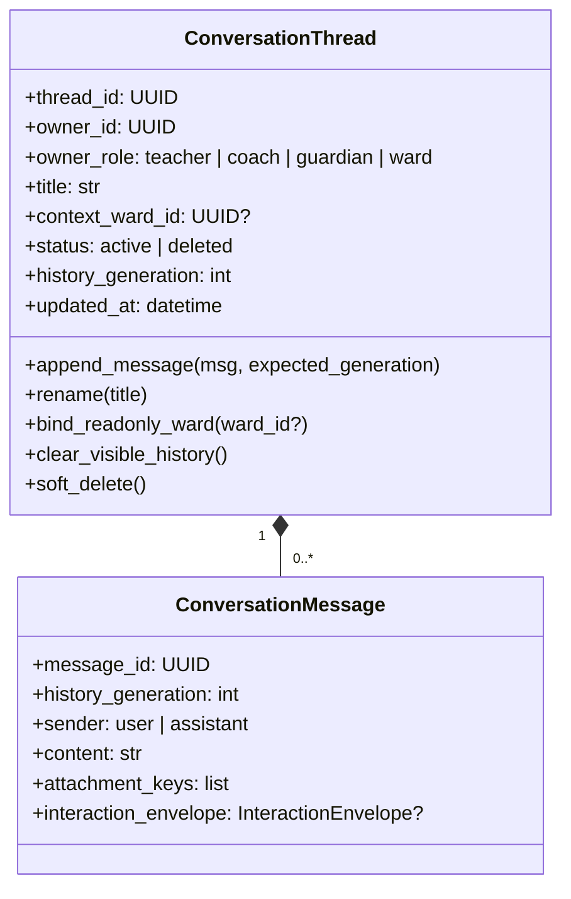
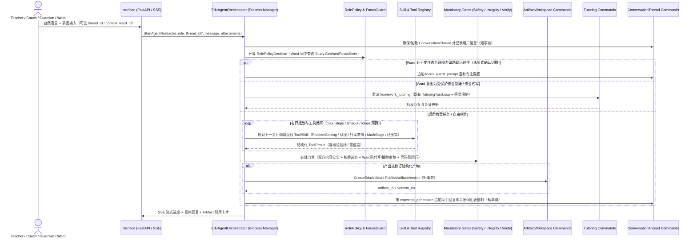
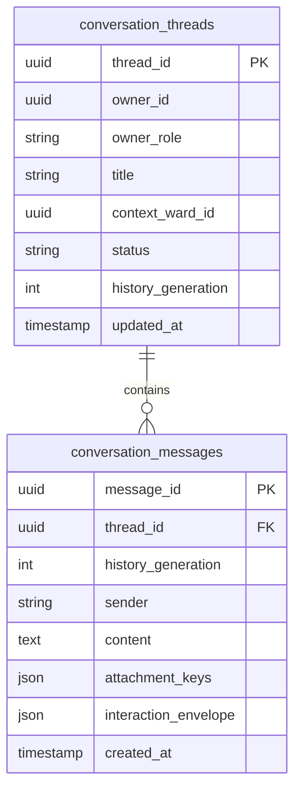

# 读学系统 — Conversation Domain & 教育通用 Agent 编排设计

> 状态：目标演进设计（取代原 `Companion Orchestration` 三分类路由，对齐双端统一教育通用 Agent 与 `1:N` 多对话） · 版本 v1.0 · 2026-11-28  
> 方法：[domain-driven-design skill](../../.cursor/skills/domain-driven-design/SKILL.md)  
> 关联：[DDD 系统总览](ddd-overview.md) · [ArtifactWorkspace 领域](domain-artifact-workspace.md) · [Tutoring 领域](domain-tutoring.md) · [ProblemSolving](domain-problem-solving.md) · [Agent 配置设计](design-agent.md) · [教育通用 Agent PRD](../product/prd-edu-agent.md)

全系统 Domain Inventory、Domain Map 与分层图唯一归属 [ddd-overview.md](ddd-overview.md)。本文件定义极薄的 **`Conversation`（Supporting Domain）**——负责双端多对话线程与交互信封契约——以及位于 Application 层的 **`EduAgentOrchestrator`（Process Manager）** 与代码级 **`RolePolicy`**。

---

## 一、边界与统一语言

### 1.1 职责与非目标
- **职责**：
  1. 管理双端账号（`owner_id + owner_role`）下的 **`1:N` 多对话线程（`ConversationThread`）**：默认续接最近活跃的 1 个对话，支持按需新建、切换、重命名、删除与清空可见历史（`history_generation`）；
  2. 管理每次复合目标执行的运行态投影（`AgentRun`：规划步骤、工具进度、SSE 推送与取消）；
  3. 在 Application 层通过 **`EduAgentOrchestrator`（Process Manager）** + 代码级 **`RolePolicy`** 执行 Goal-Driven Agent Loop，按角色裁剪可用 Skills/Tools 与必经 Gates，协调 `Tutoring`、`ArtifactWorkspace`、`ProblemSolving`、`Study`、`Memory` 与 `Evaluation`；
  4. 守卫**关闭词汇表交互信封协议**，防止模型直接发明前端 UI 协议。
- **非目标**：
  - **绝不成为拥有业务规则的“上帝 Domain”**：不拥有作业答案保护状态机（归 [Tutoring](domain-tutoring.md)）、不拥有产物版本链与核验规则（归 [ArtifactWorkspace](domain-artifact-workspace.md)）、不拥有客观求解器（归 [ProblemSolving](domain-problem-solving.md)）；
  - 原 `planning` / `reflection` 路由与 Handoff 状态机彻底移除。

### 1.2 上下游契约

| 方向 | Domain / 契约 | 集成方式 | 说明 |
| :--- | :--- | :--- | :--- |
| 上游 | `Identity & Relationship` | Authorization ACL | 校验 `owner_id`、`owner_role`（`teacher \| coach \| guardian \| ward`）；成人显式携带 `context_ward_id` 时强制校验 `verify_ward_access` |
| 下游（写委派） | `Tutoring` | 强护栏 Skill 委派（`homework_tutoring`） | Ward 作业/答疑意图直接委派既有 `tutoring_workflow` 执行答案保护与《独立解题凭证》 |
| 下游（写委派） | `ArtifactWorkspace` | Application Command 调用 | 编排产出或修订多形态教育产物时调用 `Create/Publish/ReviseEduArtifact` |
| 下游（只读） | `ProblemSolving` | Tool ACL | 求解、整页批改核验与变式出题自解自验 |
| 下游（只读） | `Study` | `GetWardFocusState` ACL | 读取 Ward 当前 Sprint 专注态，驱动专注态软守护；并承接观察求助邀请 `HelpOfferReady.v1` |
| 下游（只读） | `Memory` & `Evaluation` | `MemoryBundle` / `GetRecentReportSummary` ACL | 仅在成人显式绑定 `context_ward_id` 时**严格只读**读取学生近期卡点与实况摘要，**零隐式写回** |

### 1.3 统一语言

| 术语 | 本域中的含义 | 明确不是 |
| :--- | :--- | :--- |
| `ConversationThread` | 本域唯一聚合根，代表归属某账号/角色的一条独立对话线程（支持 `1:N`） | 业务学习会话（`TutoringSession`）或教育产物（`EduArtifact`） |
| `ConversationMessage` | 线程内单条可见消息记录（含文本、私有附件引用、关闭词汇表 `interaction_ref` 或 `artifact_ref`） | 领域事实账本或模型原始草稿 |
| `AgentRun` | 单次用户输入在 `EduAgentOrchestrator` 内的有界执行实例（运行态进度与可取消句柄） | 新的业务 Domain 或持久化聚合根 |
| `RolePolicy` | 代码级强制的角色能力与护栏策略，按 `teacher \| coach \| guardian \| ward` 锁定工具白名单与必经 Gates | 前端隐藏按钮或可被 Prompt 覆盖的软提示 |
| `EduSkill` | 封装某类教育任务编排契约与输出结构的标准能力包（配置归 Admin，业务归各 Domain） | 独立业务 Domain |
| `FocusBoundaryState` | Ward 是否处于进行中 Sprint 或存在未完成受保护作业题的只读快照 | 强制锁屏或硬封禁状态 |

---

## 二、Domain Model

### 2.1 Aggregate Map
本域仅拥有 **1 个写聚合根**（`ConversationThread`），与 `EduArtifact`、`TutoringSession` 均无共享事务或直接对象引用，仅通过只读 ID（`artifact_id`、`context_ward_id`）松耦合。

### 2.2 Aggregate Root Summary

本域拥有 **1 个 Aggregate Root**：

| Aggregate Root | Consistency boundary | Business responsibility |
| :--- | :--- | :--- |
| `ConversationThread` | 单条对话线程的归属（`owner_id` + `owner_role`）、`title`、可选成人只读 `context_ward_id`、状态（`active \| deleted`）、`history_generation`、可见消息追加与最后活跃时间 | 守卫账号与角色归属隔离、成人绑定学生校验前置、可见历史代际递增（丢弃旧代迟到回调）与软删除终态 |

### 2.3 Entity & Value Object Inventory

| Object | Kind | Identity | Behavior and invariant responsibility |
| :--- | :--- | :--- | :--- |
| `ConversationMessage` | Entity（归属 `ConversationThread`） | `message_id` | 线程内 append-only 消息，记录 `sender_role`、`history_generation`、正文、授权附件键与关闭词汇表 `interaction_envelope`（含可选 `artifact_id`） |
| `InteractionEnvelope` | Value Object | None | 关闭词汇表投影：`kind` 仅允许 `text \| text_visual \| pronounce \| artifact_card \| focus_guard_prompt \| help_offer`；模型不得直接构造 |
| `RolePolicyDecision` | Value Object | None | 给定角色、专注态与显式绑定关系后产出的不可变执行许可：允许工具集、必经 Gate 清单与是否允许只读学生上下文 |

### 2.4 Aggregate Internal UML & Lifecycle



**生命周期**：`[*] --> active (CreateConversationThread)`；`active --> active (Append / Rename / BindWard / ClearVisibleHistory)`；`active --> deleted (DeleteConversationThread，终态，拒绝迟到写入，绝不级联删除已保存 EduArtifact、Tutoring 教学事实或 Memory)`。

### 2.5 Domain Service：`RolePolicy`（代码级强制，不可被配置或 Prompt 绕过）

| 策略项 | `teacher` / `coach` / `guardian`（成人策略） | `ward`（学生策略） |
| :--- | :--- | :--- |
| 独立使用前提 | **无需绑定学生**即可直接开启多对话使用工作台（满足 G4 教师独立使用场景） | 绑定自身 Ward 身份 |
| `solve_and_verify` Tool | 允许（核验结论与推导可直接展示与编排） | 仅内部私有基线，**禁止向 Ward 透出最终答案与完整解法** |
| `batch_grade_worksheet` / `generate_lesson_pack` | 允许（批改存疑标待复核；出题强制自解自验） | **禁止（Tool 白名单硬剔除）** |
| `read_ward_learning_context` Tool | 仅当线程显式绑定 `context_ward_id` 且通过 `verify_ward_access` 时**严格只读** | 仅隐式读取自身答疑必要上下文 |
| `creative_studio` Skill（画图/故事/卡片） | 允许 | 允许，但**必经 `ward_anti_ghostwriting_gate` + 未成年人安全 Gate**；专注态偏题先温和提醒 |
| `interactive_math_stage` Skill | 允许（含解题动态演示） | 允许，但作业上下文必经视觉防泄题检查 |
| 写回 `Memory` 权限 | **永不自动写回**学生客观能力画像 | 仅作业答疑写教学事实；自由创作经 `ArtifactWorkspace` 写独立 `Interest Signal` |

---

## 三、Application 层：`EduAgentOrchestrator` 与 Commands

### 3.1 Goal-Driven Agent Loop 时序图（Process Manager）



#### Sequence Diagram Participant Inventory

| Participant | Canonical type | Owned responsibility |
| :--- | :--- | :--- |
| Teacher / Coach / Guardian / Ward | Actor | 发起对话、新建/切换线程、下达复合教育或创作目标 |
| Interface (FastAPI / SSE) | Interface | 鉴权、参数与 `verify_ward_access` 校验、SSE 推送与错误映射 |
| `EduAgentOrchestrator` | Process Manager | 事务外执行有界 Agent Loop、动态规划与受权 Tool/Skill 调度 |
| `RolePolicy & FocusGuard` | Domain Service / ACL | 代码级裁剪工具白名单、强制 Gate 清单与 Ward 专注态检查 |
| `Skill & Tool Registry` | Infrastructure Adapter | 托管类型化 Tools/Skills，执行超时与预算隔离 |
| `Mandatory Gates` | Gate (Code + Heterogeneous Judge) | 强制执行内容安全、答案保护、防代写、核验诚实与脚本预运行 |
| `ArtifactWorkspace Commands` | Command | 短事务创建/发布/修订 `EduArtifact` |
| `Tutoring Commands` | Command | 短事务执行 Ward 受保护作业答疑与解题凭证 |
| `ConversationThread Commands` | Command | 短事务管理多对话线程、消息追加与 `history_generation` 守卫 |

### 3.2 State-change Trigger Matrix

| Trigger and source | Interface / entrypoint | Receiving Command / PM | Aggregate / domain method | Local domain event | Outbox / next action | Consistency, idempotency, failure |
| :--- | :--- | :--- | :--- | :--- | :--- | :--- |
| 用户新建对话 | `POST /v1/conversations` | `CreateConversationThread` | `ConversationThread.create()` | `ConversationThreadCreated` | 返回 `thread_id` | 短事务；幂等键 `owner_id + command_id`；越权 `context_ward_id` 返回 `403` |
| 用户重命名 / 切换只读关联孩子 | `PATCH /v1/conversations/{id}` | `UpdateConversationThread` | `rename()` / `bind_readonly_ward()` | `ConversationThreadUpdated` | 刷新列表 | 短事务；仅成人角色允许绑定 `context_ward_id` |
| 用户删除对话 / 清空历史 | `DELETE /v1/conversations/{id}` | `DeleteConversationThread` / `ClearThreadHistory` | `soft_delete()` / `clear_visible_history()` | `ConversationThreadDeleted` / `HistoryCleared` | 递增 `history_generation` 作废在途旧回调 | 短事务；**绝不删已保存 `EduArtifact`、教学事实或 `Memory`**；删除幂等 `204` |
| 用户发起对话或复合任务 | `POST /v1/agent/turns` | `StartAgentRun` → `EduAgentOrchestrator` | `ConversationThread.append_message()` + `RolePolicy` | `AgentRunStarted` | SSE 推送规划与执行进度；委派 `Tutoring` / `ArtifactWorkspace` | `command_id` 幂等；迟到写入校验 `thread_id + history_generation` |
| 用户取消在途长任务 | `POST /v1/agent/runs/{id}/cancel` | `CancelAgentRun` | 更新运行态取消信号 | `AgentRunCancelled` | 终止后续模型/工具调用 | 幂等返回 `200`，已提交数据不回滚 |
| Study 推送卡壳求助邀请 | Outbox Consumer (`HelpOfferReady.v1`) | `PresentHelpOffer` | 追加 `help_offer` 信封至活跃 Ward 线程 | `HelpOfferPresented.v1`（Outbox） | 通知 `Study` 已呈现 | 幂等键 `offer_id + version`；不抢占正在进行的答疑回复权 |

### 3.3 现有代码收编边界与 Skill / Tool 四层归属

#### 1. 现有服务端编排器与 `tutoring` 的代码去留（顶层收编、内核分级保留）

| 现有服务端模块（`duxue-server/app/application/`） | 演进归宿 | 原因 |
| :--- | :--- | :--- |
| `process_managers/companion_coordinator.py` | **升级 / 替换为 `EduAgentOrchestrator`** | `planning`/`reflection` 退场后不再需要固定三分类路由，演进为双端统一 Process Manager |
| `workflows/guardian_experience.py`、`workflows/guardian_mentor.py`、`process_managers/mentor_courseware_orchestrator.py` | **逐步收编进 `EduAgentOrchestrator` 并下线旧编排器** | 本质即通用 Agent 下的「单题直讲」与「动态课件」Skill，避免维护多套平行顶层编排器 |
| `workflows/tutoring_workflow.py`、`workflows/tutor_loop.py`、`contexts/tutoring/domain/` | **保留，下沉为强护栏 Skill（`homework_tutoring`）** | 保留经 1600+ 单测与 39+ 离线基准打磨的答案保护状态机、多图隔离与独立泄露裁判，零破坏复用 |

#### 2. Skill / Tool 的四层归属（绝不新建“Skill Domain”或“Agent Domain”）

| 归属层次 | 代码与配置位置 | 负责内容 |
| :--- | :--- | :--- |
| **① 定义、Prompt、Schema 与预算** | `duxue-server/app/agent_specs/` + `duxue-admin` | 所有 Tool / Skill / Gate 的声明、JSON Schema、Prompt 与模型槽位（唯一可编辑配置源） |
| **② 策略与统一注册调度** | `contexts/conversation/domain/role_policy.py` + `app/application/process_managers/` | `RolePolicy` 纯规则裁剪工具白名单与强制 Gate；`Skill/Tool Registry` + `EduAgentOrchestrator` 执行有界 Loop |
| **③ 业务能力所有权（Tool 仅作薄封装）** | 各业务 Domain（`ProblemSolving` / `Tutoring` / `ArtifactWorkspace` / `Memory` / `Evaluation` / `Study`） | 求解与核验归 `ProblemSolving`；作业启发归 `Tutoring`；产物创建/修订归 `ArtifactWorkspace`；学情与专注态只读查询分别归 `Memory`/`Evaluation`/`Study` ACL |
| **④ 纯无状态外部能力适配** | `duxue-server/app/infrastructure/` + `app/application/ports/` | 生图模型、搜索、Headless 预运行、OSS 读写等基础设施适配器 |

---

## 四、CQRS Query 侧与 Interface 契约

### 4.1 Queries
- **`ListConversationThreads`**：按 `(owner_id, owner_role, status='active')` 以 `(updated_at DESC, thread_id DESC)` 稳定分页，返回 `thread_id`、`title`、可选 `context_ward_id`、`last_message_preview` 与 `updated_at`。
- **`GetConversationMessages`**：按 `thread_id` 与当前 `history_generation` 分页读取可见消息与 `interaction_envelope`（强一致）。
- **`GetAgentRunStatus`**：只读查询当前 `run_id` 的规划步骤、已调用 Skill 与阶段进度。

### 4.2 Interface Contracts（终端无关，兼容 `duxue-app` 与未来 Web 工作台）

```text
# 多对话线程管理（默认 1 个活跃对话，按需新建/切换多个）
GET    /v1/conversations                         → ListConversationThreads (200 OK)
POST   /v1/conversations                         → CreateConversationThread (201 Created)
GET    /v1/conversations/{thread_id}/messages    → GetConversationMessages (200 OK)
PATCH  /v1/conversations/{thread_id}             → UpdateConversationThread (200 OK)
DELETE /v1/conversations/{thread_id}             → DeleteConversationThread (204 No Content)

# 统一 Agent 对话与执行流
POST   /v1/agent/turns                           → StartAgentRun (200/202，可选 thread_id，缺省自动续接默认对话或新建)
GET    /v1/agent/runs/{run_id}/events            → SSE 流式推送规划步骤、工具进度与最终交互信封
POST   /v1/agent/runs/{run_id}/cancel            → CancelAgentRun (200 OK)
```

---

## 五、Infrastructure Design Card

### 5.1 Ports & Adapters

| Port | Concrete Adapter | 协议 / 依赖 | 约束与降级 |
| :--- | :--- | :--- | :--- |
| `ConversationThreadRepository` | `PgConversationRepository` | PostgreSQL | 单聚合一仓储；按 `owner_id + owner_role` 强隔离 |
| `AgentRunStorePort` | `RedisAgentRunStore` | Redis（短 TTL 运行态与 SSE 通道） | 仅存运行态进度与取消标志，不作业务事实权威 |
| `WardContextReadPort` | `AuthorizedWardContextAdapter` | 进程内受权 Query ACL（`Memory` + `Evaluation`） | 强校验 `verify_ward_access`，只读脱敏摘要，无写方法 |
| `WardFocusStatePort` | `StudyFocusStateAclAdapter` | 进程内受权 Query ACL（`Study`） | 查询不可用时默认保守提醒，不静默放宽作业保护 |
| `AgentConfigPort` | `AdminBundleConfigAdapter` | Admin 不可变配置快照（[design-agent.md](design-agent.md)） | Prompt/Schema/模型归 Admin；`RolePolicy` 硬边界由代码锁定 |

### 5.2 Entity-Relationship Diagram



- **索引与兼容**：列表索引 `(owner_id, owner_role, status, updated_at DESC, thread_id DESC)`；消息分页索引 `(thread_id, history_generation, created_at ASC, message_id ASC)`。既有 `conversation_threads` 表（单 Ward 线程 + `history_generation` 迁移 `20261030_30`）通过增量迁移补齐 `owner_id`、`owner_role`、`title`、`context_ward_id` 与 `status`，平滑兼容老数据。

### 5.3 安全、防绕过与可观测性
- **防绕过不变量**：
  - 严禁靠关键词或正则做语义判断（作业识别、代写判别、偏题识别一律交由模型或独立 Judge 裁决）；
  - Ward 新建/切换/删除对话只隔离短期聊天上下文，**绝不重置**进行中 `Sprint` 专注态，也**绝不解除**既有作业题的答案保护审查；
  - 客户端切换 `thread_id` 时丢弃旧线程迟到响应，防止跨线程串台。
- **可观测性**：OpenTelemetry + Grafana + Langfuse 为每次 `AgentRun` 记录 `run_id`、`thread_id`、`owner_role`、`context_ward_bound`、`planned_steps`、`invoked_skills[]`、`gate_verdicts[]` 与分阶段耗时/Token 成本。

---

## 六、验收场景（Acceptance Scenarios）

```gherkin
Given Teacher（未绑定任何学生）打开工作台
When Teacher 在对话 A 批改几何作业并生成动态课件，随后点击「新建对话」在对话 B 备课分数除法教案
Then 两条 ConversationThread 上下文完全隔离，均持久化可切换
And 两个对话各自产出的 EduArtifact 可独立保存至「我的资源库」，删除对话 A 不影响已保存课件

Given Guardian 在对话 C 显式关联已绑定的 Ward，下达“结合孩子本周卡点出 2 道巩固题”
When EduAgentOrchestrator 调用 read_ward_learning_context 与 generate_lesson_pack
Then 成功只读该 Ward 近期卡点并产出经自验的变式题，且该 Ward 的 Memory 与 TutoringSession 写入次数为 0

Given Ward 正在进行 20 分钟数学 Sprint 专注挑战
When Ward 在当前对话或新建对话中语音说“帮我画一个奥特曼打怪兽的故事”
Then RolePolicy 仍通过 Study.GetWardFocusState 识别为专注态，先返回 focus_guard_prompt 温和提醒专注
And 若 Ward 明确确认切换自由探索，进入创作链路生成 creative_work

Given Ward 发起“帮我写一篇 400 字环保作文，明天要交”
When EduAgentOrchestrator 执行创作链路与 ward_anti_ghostwriting_gate
Then 独立 Judge 判定为课内作业任务，阻断整篇成品输出，切换为启发共创引导

Given Ward 在有在途请求时切换至另一对话或删除当前对话
When 旧 AgentRun 迟到返回结果
Then 服务端按 thread_id + history_generation 丢弃迟到写入，端侧不向当前对话串台展示旧回复
```
