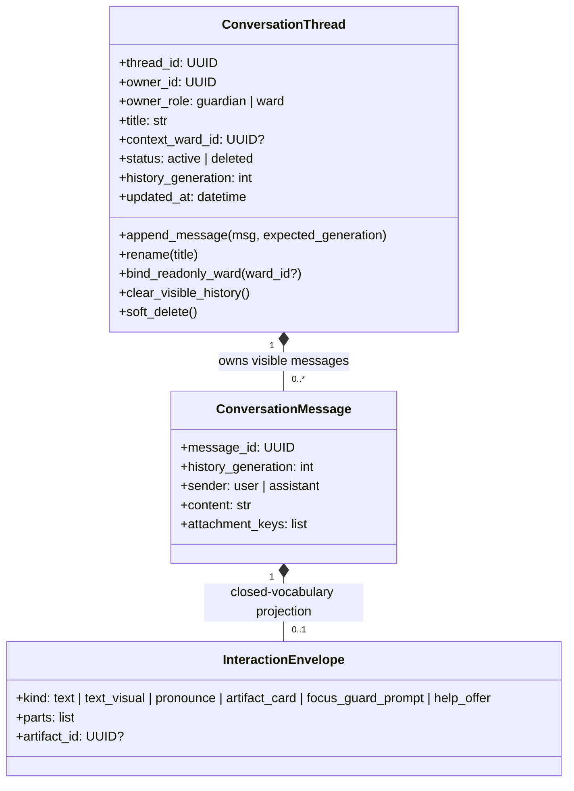
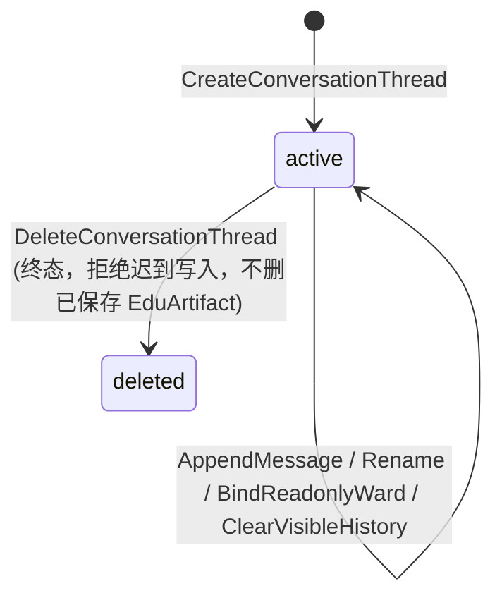
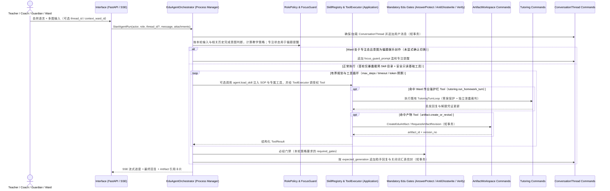
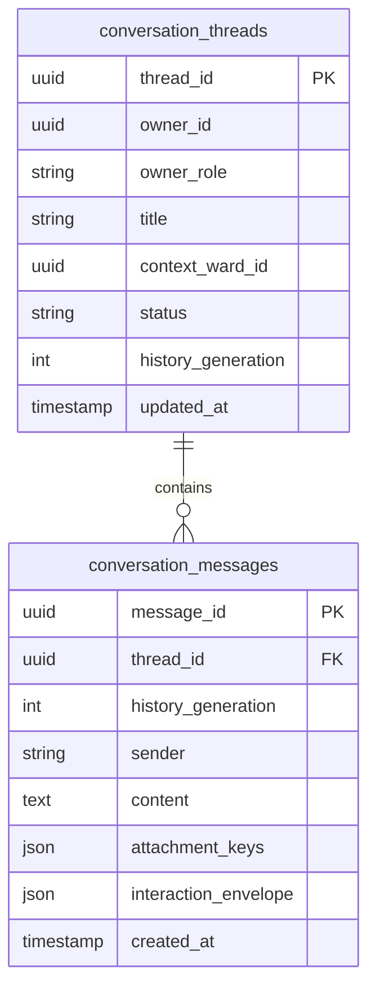

# 读学系统 — Conversation Domain & 教育通用 Agent 编排设计

> 状态：目标演进设计（取代原 `Companion Orchestration` 三分类路由，对齐双端统一教育通用 Agent 与 `1:N` 多对话） · 版本 v1.1 · 2026-11-28  
> 方法：[domain-driven-design skill](../../.cursor/skills/domain-driven-design/SKILL.md)  
> 关联：[DDD 系统总览](ddd-overview.md) · [ArtifactWorkspace 领域](domain-artifact-workspace.md) · [Tutoring 领域](domain-tutoring.md) · [ProblemSolving](domain-problem-solving.md) · [Agent 配置设计](design-agent.md) · [教育通用 Agent PRD](../product/prd-edu-agent.md)

全系统 Domain Inventory、Domain Map 与分层图唯一归属 [ddd-overview.md](ddd-overview.md)。本文件定义极薄的 **`Conversation`（Supporting Domain）**——负责双端 `1:N` 多对话线程与交互信封契约——以及位于 Application 层的 **`EduAgentOrchestrator`（Process Manager）** 与代码级 **`RolePolicy`**。

---

## 一、边界与统一语言

### 1.1 职责与非目标
- **职责**：
  1. 管理双端账号（`owner_id + owner_role`）下的 **`1:N` 多对话线程（`ConversationThread`）**：默认续接最近活跃的 1 个对话，支持按需新建、切换、重命名、删除与清空可见历史（`history_generation`）；
  2. 管理每次复合目标执行的运行态投影（`AgentRun`：规划步骤、工具进度、SSE 推送与取消）；
  3. 在 Application 层通过 **`EduAgentOrchestrator`（Process Manager）** + 代码级 **`RolePolicy`** 执行 Goal-Driven Agent Loop，按角色裁剪可用 Skills/Tools 与必经 Gates，协调 `Tutoring`、`ArtifactWorkspace`、`ProblemSolving`、`Study`、`Memory` 与 `Evaluation`；
  4. 守卫**关闭词汇表交互信封协议**，防止模型直接发明前端 UI 协议。
- **非目标**：
  - **绝不成为拥有业务规则的“上帝 Domain”**：不拥有作业答案保护状态机（归 [Tutoring](domain-tutoring.md)）、不拥有产物版本链与核验规则（归 [ArtifactWorkspace](domain-artifact-workspace.md)）、不拥有客观求解器（归 [ProblemSolving](domain-problem-solving.md)）；
  - 原 `planning` / `reflection` 路由与 Handoff 状态机彻底移除。

### 1.2 上下游契约

| 方向 | Domain / 契约 | 集成方式 | 说明 |
| :--- | :--- | :--- | :--- |
| 上游 | `Identity & Relationship` | Authorization ACL | 校验 `owner_id`、`owner_role`（`guardian \| ward`）；成人显式携带 `context_ward_id` 时强制校验 `verify_ward_access` |
| 下游（写委派） | `Tutoring` | 强护栏 Tool 委派（`tutoring.run_homework_turn`） | Ward 作业/答疑意图委派既有 `tutoring_workflow` 执行答案保护与《独立解题凭证》 |
| 下游（写委派） | `ArtifactWorkspace` | Application Command 调用 | 编排产出或修订多形态教育产物时调用 `Create/Publish/ReviseEduArtifact` |
| 下游（只读） | `ProblemSolving` | Tool ACL | 求解、整页批改核验与变式出题自解自验 |
| 双向 | `Study` | `GetWardFocusState` ACL + `HelpOfferReady.v1` / `HelpOfferPresented.v1` | 读取 Ward 当前 Sprint 专注态驱动软守护；接收并回执观察求助邀请 |
| 下游（只读） | `Memory` & `Evaluation` | `MemoryBundle` / `GetRecentReportSummary` ACL | 仅在成人显式绑定 `context_ward_id` 时**严格只读**读取学生近期卡点与实况摘要，**零隐式写回** |

### 1.3 统一语言

| 术语 | 本域中的含义 | 明确不是 |
| :--- | :--- | :--- |
| `ConversationThread` | 本域唯一聚合根，代表归属某账号/角色的一条独立对话线程（支持 `1:N`） | 业务学习会话（`TutoringSession`）或教育产物（`EduArtifact`） |
| `ConversationMessage` | 线程内单条可见消息实体（含文本、私有附件引用、关闭词汇表 `interaction_envelope`） | 领域事实账本或模型原始草稿 |
| `AgentRun` | 单次用户输入在 `EduAgentOrchestrator` 内的有界执行实例（Redis 运行态进度与取消句柄） | 新的业务 Domain 或持久化聚合根 |
| `RolePolicy` | 代码级强制的角色能力与护栏策略，按 `guardian \| ward` 锁定工具白名单与必经 Gates | 前端隐藏按钮或可被 Prompt 覆盖的软提示 |
| `EduSkill` | 统一声明式教育技能 SOP（元数据 + Markdown `instructions`），详细契约见 [design-agent.md §4.5](design-agent.md#45-skill-契约与渐进式激活教育通用-agent-一等对象) | 独立业务 Domain |
| `FocusBoundaryState` | Ward 是否处于进行中 Sprint 或存在未完成受保护作业题的只读快照 | 强制锁屏或硬封禁状态 |

---

## 二、Domain Model

### 2.1 Aggregate Map
- **图示说明**：本域仅拥有 **1 个写聚合根**（`ConversationThread`），按 DDD 规范无需绘制域内多聚合图。
- **跨聚合引用与一致性**：与 `EduArtifact`、`TutoringSession`、`Study` 均无共享事务或直接对象引用，仅通过只读 ID（`artifact_id`、`context_ward_id`、`offer_id`）松耦合；消费 `HelpOfferReady.v1` 并发布 `HelpOfferPresented.v1` 通过 Outbox 最终一致。

### 2.2 Aggregate Root Summary

本域拥有 **1 个 Aggregate Root**：

| Aggregate Root | Consistency boundary | Business responsibility |
| :--- | :--- | :--- |
| `ConversationThread` | 单条对话线程的归属（`owner_id` + `owner_role`）、`title`、可选成人只读 `context_ward_id`、状态（`active \| deleted`）、`history_generation`、可见消息追加与最后活跃时间 | 守卫账号与角色归属隔离、成人绑定学生校验前置、可见历史代际递增（丢弃旧代迟到回调）与软删除终态 |

### 2.3 Entity & Value Object Inventory

| Object | Kind | Identity | Behavior and invariant responsibility |
| :--- | :--- | :--- | :--- |
| `ConversationMessage` | Entity（归属 `ConversationThread`） | `message_id` | 线程内 append-only 消息，记录 `sender`、`history_generation`、正文、授权附件键与关闭词汇表 `interaction_envelope`（含可选 `artifact_id`） |
| `InteractionEnvelope` | Value Object | None | 关闭词汇表投影：`kind` 仅允许 `text \| text_visual \| pronounce \| artifact_card \| focus_guard_prompt \| help_offer`；模型不得直接构造 |
| `RolePolicyDecision` | Value Object | None | 给定角色、专注态与显式绑定关系后产出的不可变执行许可：允许工具集、必经 Gate 清单与是否允许只读学生上下文 |

### 2.4 Aggregate Internal UML & Lifecycle

- **图源**：本文 §2.4 Mermaid（与 §2.3 Entity Inventory 严格一致；不变量由 `ConversationThread` 聚合根与 `RolePolicy` 领域服务守卫）。



**生命周期状态图（`ConversationThread.status`）**：


### 2.5 Domain Service：`RolePolicy`（代码级强制，不可被配置或 Prompt 绕过）

- **输入 / 输出**：`(owner_role, focus_state?, bound_ward_id?) -> RolePolicyDecision`

| 策略项 | `teacher` / `coach` / `guardian`（成人策略） | `ward`（学生策略） |
| :--- | :--- | :--- |
| 独立使用前提 | **无需绑定学生**即可直接开启多对话使用工作台（满足 G4 教师独立使用场景） | 绑定自身 Ward 身份 |
| `problem_solving.solve_and_verify` | 允许（核验结论与推导可直接展示与编排） | 仅内部私有基线，**禁止向 Ward 透出最终答案与完整解法** |
| `edu.worksheet_grading` / `edu.lesson_pack` | 允许（批改存疑标待复核；出题强制自解自验） | **禁止（RolePolicy 硬剔除）** |
| `ward_context.read_summary` | 仅当线程显式绑定 `context_ward_id` 且通过 `verify_ward_access` 时**严格只读** | 仅隐式读取自身答疑必要上下文 |
| `edu.creative_studio`（画图/故事/卡片） | 允许 | 允许，但**必经 `ward.anti_ghostwriting`**；专注态偏题先温和提醒 |
| `edu.interactive_courseware` | 允许（含解题动态演示） | 允许原理演示，作业上下文必经视觉防泄题检查 |
| 写回 `Memory` 权限 | **永不自动写回**学生客观能力画像 | 仅作业答疑写教学事实；自由创作经 `ArtifactWorkspace` 写独立 `Interest Signal` |

---

## 三、Application 层：`EduAgentOrchestrator` 与 Commands

### 3.1 Goal-Driven Agent Loop 时序图（Process Manager）



#### Sequence Diagram Participant Inventory

| Participant | Canonical type | Owned responsibility |
| :--- | :--- | :--- |
| Teacher / Coach / Guardian / Ward | Actor | 发起对话、新建/切换线程、下达复合教育或创作目标 |
| Interface (FastAPI / SSE) | Interface | 鉴权、参数与 `verify_ward_access` 校验、SSE 推送与错误映射 |
| `EduAgentOrchestrator` | Process Manager | 事务外执行有界 Agent Loop、渐进式加载 Skill `instructions` 与受权 Tool 调度 |
| `RolePolicy & FocusGuard` | Domain Service / ACL | 代码级裁剪工具白名单、强制 Gate 清单与 Ward 专注态检查 |
| `SkillRegistry & ToolExecutor` | Application Infrastructure | 统一校验 Schema、角色鉴权、超时隔离与 Langfuse 树状埋点 |
| `Mandatory Edu Gates` | Gate (Code + Heterogeneous Judge) | 强制执行答案保护、防代写、核验诚实与脚本预运行（通用色情/暴力过滤直接复用上游模型 API） |
| `ArtifactWorkspace Commands` | Command | 短事务创建/发布/修订 `EduArtifact` |
| `Tutoring Commands` | Command | 短事务执行 Ward 受保护作业答疑与解题凭证 |
| `ConversationThread Commands` | Command | 短事务管理多对话线程、消息追加与 `history_generation` 守卫 |

### 3.2 State-change Trigger Matrix

| Trigger and source | Trigger class | Interface / entrypoint | Receiving Command / PM | Aggregate / domain method | Local domain event | Outbox / next action | Consistency, idempotency, failure |
| :--- | :--- | :--- | :--- | :--- | :--- | :--- | :--- |
| 用户新建对话 | User/API intent | `POST /v1/conversations` | `CreateConversationThread` | `ConversationThread.create()` | `ConversationThreadCreated` | 返回 `thread_id` | 短事务；幂等键 `owner_id + command_id`；越权 `context_ward_id` 返回 `403` |
| 用户重命名 / 切换只读关联孩子 | User/API intent | `PATCH /v1/conversations/{id}` | `UpdateConversationThread` | `rename()` / `bind_readonly_ward()` | `ConversationThreadUpdated` | 刷新列表 | 短事务；仅成人角色允许绑定 `context_ward_id` |
| 用户删除对话 | User/API intent | `DELETE /v1/conversations/{id}` | `DeleteConversationThread` | `soft_delete()` | `ConversationThreadDeleted` | 作废在途旧回调，**不删已保存产物/学习事实/记忆** | 短事务；幂等返回 `204` |
| 用户清空当前对话可见历史 | User/API intent | `POST /v1/conversations/{id}/clear` | `ClearThreadHistory` | `clear_visible_history()` | `ThreadHistoryCleared` | 递增 `history_generation` | 短事务；幂等键 `thread_id + command_id` |
| 用户发起对话或复合任务 | User/API intent | `POST /v1/agent/turns` | `StartAgentRun` → `EduAgentOrchestrator` | `append_message()` + `RolePolicy` | `AgentRunStarted` | SSE 推送进度；委派 `Tutoring` / `ArtifactWorkspace` | `command_id` 幂等；迟到写入校验 `thread_id + history_generation` |
| 用户取消在途长任务 | User/API intent | `POST /v1/agent/runs/{id}/cancel` | `CancelAgentRun` | 更新 Redis 取消标志 | `AgentRunCancelled` | 终止后续模型/工具调用 | 幂等返回 `200`，已提交数据不回滚 |
| Study 推送卡壳求助邀请 | Cross-domain event | Outbox Consumer (`HelpOfferReady.v1`) | `PresentHelpOffer` | 追加 `help_offer` 信封至活跃 Ward 线程 | `HelpOfferPresented` | Outbox 发 `HelpOfferPresented.v1` → `Study` | 幂等键 `offer_id + version`；不抢占正在进行的答疑回复权 |

### 3.3 Complete Command Cards（覆盖全部写命令）

#### 1. `CreateConversationThread`
```python
class CreateConversationThreadInput(BaseModel):
    owner_id: UUID
    owner_role: Literal["guardian", "ward"]
    command_id: str
    title: str | None = Field(default=None, max_length=80)
    context_ward_id: UUID | None = None  # 仅成人角色允许传入
```
- **授权与行为**：Ward 传入 `context_ward_id` 返回 `403`；成人传入时强制 `verify_ward_access`；短事务创建 `active` 线程，幂等键 `owner_id + command_id`。

#### 2. `UpdateConversationThread`
```python
class UpdateConversationThreadInput(BaseModel):
    owner_id: UUID
    thread_id: UUID
    title: str | None = Field(default=None, min_length=1, max_length=80)
    context_ward_id: UUID | None = None
    clear_context_ward: bool = False
```
- **授权与行为**：校验所有者与 `status=="active"`；更新 `context_ward_id` 前校验绑定权限；由用户显式指定目标学生或另开线程。指代不明时先询问；读取学情时校验目标 Ward 授权，旧消息中的学生事实不得自动归给新目标。

#### 3. `DeleteConversationThread` & `ClearThreadHistory`
```python
class DeleteConversationThreadInput(BaseModel):
    owner_id: UUID
    thread_id: UUID

class ClearThreadHistoryInput(BaseModel):
    owner_id: UUID
    thread_id: UUID
    command_id: str
```
- **规则**：`Delete` 置 `deleted` 终态并递增 `history_generation` 作废在途回调，幂等返回 `204`；`Clear` 仅递增 `history_generation` 重置短期可见列表；**两者均绝不删除 `EduArtifact`、`Tutoring` 教学事实或 `Memory`**。

#### 4. `StartAgentRun` & `CancelAgentRun`
```python
class StartAgentRunInput(BaseModel):
    owner_id: UUID
    owner_role: Literal["guardian", "ward"]
    command_id: str
    thread_id: UUID | None = None        # 缺省自动续接最近活跃线程或新建
    message_text: str = Field(max_length=4000)
    attachment_keys: list[str] = Field(default_factory=list, max_length=8)
    context_ward_id: UUID | None = None
    confirm_leave_focus: bool = False    # Ward 收到专注提醒后显式确认切换自由探索

class CancelAgentRunInput(BaseModel):
    owner_id: UUID
    run_id: UUID
```
- **事务与失败**：`StartAgentRun` 短事务落用户消息并创建 `run_id`，随后在事务外执行有界 Agent Loop；回复写回时严格校验 `thread_id + history_generation`，若线程已删或清空则丢弃迟到结果；`CancelAgentRun` 置取消标志并幂等返回 `200`。

#### 5. `PresentHelpOffer`（入站集成事件 Command）
```python
class PresentHelpOfferInput(BaseModel):
    event_id: UUID
    ward_id: UUID
    offer_id: UUID
    version: int
    prompt_text: str
    expires_at: datetime
```
- **入口与规则**：由 `HelpOfferReady.v1` Consumer 校验 schema 后调用；按 `offer_id + version` 幂等去重；已过期或当前线程存在活跃作业答疑 Run 时丢弃不抢回复权；成功呈现后同事务写 Outbox `HelpOfferPresented.v1`。

### 3.4 现有代码收编边界与 Skill / Tool 四层归属

#### 1. 现有服务端编排器与 `tutoring` 的代码去留（顶层收编、内核分级保留）

| 现有服务端模块（`duxue-server/app/application/`） | 演进归宿 | 原因 |
| :--- | :--- | :--- |
| `process_managers/companion_coordinator.py` | **升级 / 替换为 `EduAgentOrchestrator`** | `planning`/`reflection` 退场后演进为双端统一 Process Manager |
| `workflows/guardian_experience.py`、`workflows/guardian_mentor.py`、`process_managers/mentor_courseware_orchestrator.py` | **逐步收编进 `EduAgentOrchestrator` 并下线旧编排器** | 本质即通用 Agent 下的「单题直讲」与「动态课件」Skill，避免维护多套平行顶层编排器 |
| `workflows/tutoring_workflow.py`、`workflows/tutor_loop.py`、`contexts/tutoring/domain/` | **保留，封装为强护栏 Tool（`tutoring.run_homework_turn`）** | 保留经 1600+ 单测与 39+ 离线基准打磨的答案保护状态机、多图隔离与独立泄露裁判，零破坏复用 |

#### 2. Skill / Tool 的统一规范、四层归属与通用兜底模式（详细 Schema 与 5/11/4 初始清单唯一归属 [design-agent.md §4.4–4.5](design-agent.md#44-tool-契约与统一注册演进升级)）

| 归属层次 | 代码与配置位置 | 负责内容 |
| :--- | :--- | :--- |
| **① 声明、SOP、Schema 与预算** | `duxue-server/app/agent_specs/` + `duxue-admin` | 统一遵循 `tool.schema.json` / `skill.schema.json`；**Skill 仅有一种声明式形态（元数据 + Markdown `instructions`）**，强状态机能力统一封装为 `Tool`（如 `tutoring.run_homework_turn`） |
| **② 策略、注册表与统一执行中间件** | `contexts/conversation/domain/role_policy.py` + `app/application/agent/` | `RolePolicy` 纯规则锁定角色上限；`ToolRegistry` / `SkillRegistry` / `ToolExecutor`（非业务 Domain）负责启动期契约校验、渐进式加载 `instructions`、鉴权、超时与统一 Langfuse 树状埋点 |
| **③ 业务能力所有权（Tool 仅作薄封装）** | `app/application/tools/<domain>.py` → 各自 Domain Command / Query / Port | 求解与核验归 `ProblemSolving`；作业强护栏归 `Tutoring`；产物创建/修订归 `ArtifactWorkspace`；学情与专注态只读查询分别归 `Memory`/`Evaluation`/`Study` ACL |
| **④ 纯无状态外部能力适配** | `duxue-server/app/infrastructure/` + `app/application/ports/` | 生图模型、搜索、Headless 预运行、OSS 读写等基础设施适配器 |

- **不命中 Skill 时的通用兜底（Default General Mode）**：仅开放安全只读基础工具 + `agent.load_skill`（不默认开放写产物或重型求解工具），普通问答直接快速回复并支持后续轮次按需调用 `agent.load_skill` 升级；Ward 每轮先由当轮意图判定决定教学护栏，参见 [Agent 设计](design-agent.md)。

---

## 四、CQRS Query 侧与 Interface 契约

### 4.1 Queries（输入/输出契约、来源与一致性）

#### `ListConversationThreads`
- **消费方**：双端「历史对话」抽屉/列表。
- **来源与一致性**：直读 `conversation_threads`（`status='active'`），创建/重命名/删除后**强一致**。

```python
class ListConversationThreadsQuery(BaseModel):
    owner_id: UUID
    owner_role: Literal["guardian", "ward"]
    cursor: str | None = None
    limit: int = Field(default=20, ge=1, le=50)

class ConversationThreadListView(BaseModel):
    items: list[dict]                     # thread_id, title, context_ward_id?, last_message_preview, updated_at
    next_cursor: str | None
```

#### `GetConversationMessages`
- **消费方**：对话主界面消息流加载。
- **来源与脱敏**：直读 `conversation_messages`（仅当前 `history_generation`）；严禁返回模型原始草稿或隐藏推理链；**强一致**。

```python
class GetConversationMessagesQuery(BaseModel):
    owner_id: UUID
    thread_id: UUID
    before_message_id: UUID | None = None
    limit: int = Field(default=30, ge=1, le=100)

class ConversationMessagesView(BaseModel):
    thread_id: UUID
    history_generation: int
    items: list[dict]                     # message_id, sender, content, attachment_refs[], interaction_envelope?, created_at
    has_more: bool
```

#### `GetAgentRunStatus`
- **消费方**：断线后恢复执行状态与最终结果。
- **来源与一致性**：按当前账号、角色、线程及历史代际授权读取 PostgreSQL 的 Run 状态。启动时写入 running；成功时在同一事务写终态与最终消息引用。失败或取消也持久化终态。已删除或已清空的历史不可通过 Run 查询恢复。

```python
class AgentRunStatusView(BaseModel):
    run_id: UUID
    thread_id: UUID
    status: Literal["running", "completed", "cancelled", "failed"]
    result_message_id: UUID | None  # 完成时指向含回复或产物卡片的最终消息
    error_code: str | None
    updated_at: datetime
```

### 4.2 Interface Contracts（终端无关，兼容 `duxue-app` 与未来 Web 工作台）

```text
# 多对话线程管理（默认 1 个活跃对话，按需新建/切换多个）
GET    /v1/conversations                         → ListConversationThreads (200 OK)
POST   /v1/conversations                         → CreateConversationThread (201 Created)
GET    /v1/conversations/{thread_id}/messages    → GetConversationMessages (200 OK)
PATCH  /v1/conversations/{thread_id}             → UpdateConversationThread (200 OK)
POST   /v1/conversations/{thread_id}/clear       → ClearThreadHistory (200 OK)
DELETE /v1/conversations/{thread_id}             → DeleteConversationThread (204 No Content)

# 统一 Agent 对话与执行流
POST   /v1/agent/turns                           → StartAgentRun (200/202，可选 thread_id，缺省续接默认对话或新建)
GET    /v1/agent/threads/{thread_id}/results/{command_id} → 获取当前可见线程已提交的最终结果
GET    /v1/conversations/{thread_id}/ward-summary → 显式绑定且仍有权限的成人读取摘要
```

---

当前 App 在 POST 请求中通过 SSE 接收实时进度。若传输中断，客户端按原线程和命令读取已提交结果。Ward 按清空版本、成人按会话代次控制可见性。成人本轮由 edu.skill-planner 选择 Skill。通用模式可调用只读检索并根据结果继续规划。Ward 的本轮意图提议直接驱动 Skill 选择。两端共用 EduAgentOrchestrator、ToolExecutor 和 GateRunner，领域执行器负责求解、创作与核验。Admin 草稿的 skills/ 声明可以调整 SOP 并收窄角色和工具权限，服务端强制执行代码权限上限和必需门禁。

## 五、Infrastructure Design Card

### 5.1 Ports & Adapters

| Port owned by Domain/Application | Concrete adapter | Protocol / dependency | Configuration / secret boundary | Timeout, retry, rate limit | Error mapping / fallback |
| :--- | :--- | :--- | :--- | :--- | :--- |
| `ConversationThreadRepository` | `PgConversationRepository` | PostgreSQL | 复用服务端连接池 | 短事务 | 越权 `403`，不存在 `404` |
| `AgentRunStorePort` | `RedisAgentRunStore` | Redis Pub/Sub + Hash（短 TTL） | 复用服务端 Redis | 读/写 500ms 超时 | 实时进度不可用时按 run_id 查询持久状态 |
| `WardContextReadPort` | `AuthorizedWardContextAdapter` | 进程内受权 Query ACL（`Memory` + `Evaluation`） | 强校验 `verify_ward_access` | 2s 超时，无写方法 | 超时跳过只读上下文并如实提示 |
| `WardFocusStatePort` | `StudyFocusStateAclAdapter` | 进程内受权 Query ACL（`Study`） | 进程内只读 | 1s 超时 | 查询不可用时保守提醒，不放宽作业保护 |
| `AgentConfigPort` | `AdminBundleConfigAdapter` | Admin 不可变配置快照（[design-agent.md](design-agent.md)） | Prompt/Schema/模型归 Admin；`RolePolicy` 代码锁定 | 本地快照缓存 | 快照校验失败启动 fail-fast |

### 5.2 Entity-Relationship Diagram

- **图源**：本文 §5.2 Mermaid。
- **表归属与角色**：`conversation_threads` 与 `conversation_messages` 均由 `Conversation` 拥有，作为 `ConversationThread` 聚合写表并直接支撑列表与消息强一致查询。
- **外域 ID-only 引用**：`owner_id`、`context_ward_id`、`interaction_envelope.artifact_id` 均为 ID-only 引用，不建跨领域外键。



### 5.3 Persistence and Transaction

| Aggregate / Query | Repository / Store | Tables, keys, indexes, and FK policy | Transaction owner & atomic writes | Schema migration / compatibility / rollback |
| :--- | :--- | :--- | :--- | :--- |
| `ConversationThread` | `PgConversationRepository` | `conversation_threads`（PK `thread_id`；列表索引 `(owner_id, owner_role, status, updated_at DESC, thread_id DESC)`）；`conversation_messages`（PK `message_id`，FK `thread_id`，分页索引 `(thread_id, history_generation, created_at ASC, message_id ASC)`） | 各 Command 持有本地短事务；消息追加与 `updated_at` 同事务提交 | 按目标模型建表；旧测试消息无需回填或双读兼容 |

### 5.4 Async Delivery and Queries

| Event / Job | Outbox / Producer owner | Consumer adapter → Receiving Command | Idempotency key | Ordering & freshness | Retry, dead-letter, reconciliation, replay |
| :--- | :--- | :--- | :--- | :--- | :--- |
| `AgentRun` SSE 事件流 | `EduAgentOrchestrator` → Redis Pub/Sub | FastAPI SSE Endpoint | `run_id + seq` | 单 Run 严格有序；进度仅在线展示；重连查 `GetAgentRunStatus`，按最终消息引用恢复结果 | 超时自动终止并落受控错误信封 |
| `Study.HelpOfferReady.v1`（入站） | `Study` Domain Outbox | Conversation Consumer → `PresentHelpOffer` | `offer_id + version` | 过期或答疑进行中直接丢弃 | 失败按消费者重试，不阻塞正常对话 |
| `Conversation.HelpOfferPresented.v1`（出站） | `PresentHelpOffer` 本地 Outbox | `Study` Consumer → `MarkHelpOfferPresented` | `receipt_id` | 最终一致（秒级） | 指数退避重试 + 死信对账 |

### 5.5 Security, Data Governance, and Observability

| Concern | Boundary / mechanism | Redaction, retention, or deletion | Evidence / metric / alert |
| :--- | :--- | :--- | :--- |
| Authorization & Anti-Bypass | 强制校验 `owner_id + owner_role`；成人 `context_ward_id` 必经 `verify_ward_access`；Ward 新建/删对话不重置 Sprint 专注态、不解除作业保护 | 严禁关键词/正则做语义裁决；切换 `thread_id` 丢弃旧线程迟到响应 | 越权拒绝、防绕过拦截、迟到丢弃计数 |
| Data Retention & Privacy | 软删对话仅隐藏可见流，不删领域事实与已保存资产；账号注销时物理擦除 | 原始图片字节与儿童 PII 绝不进遥测 | 数据擦除审计日志 |
| Trace & Operations | OpenTelemetry + Grafana + Langfuse 标准嵌套树（`agent.turn` → `agent.skill` → `agent.tool` / `llm.request` → `agent.check`），`session_id=thread_id` | 沿用 `telemetry.py` 白名单脱敏导出 | 分阶段耗时、Skill 命中率、Gate 拒绝率与 Token 成本 |

---

## 六、验收场景（Acceptance Scenarios）

```gherkin
Given Teacher（未绑定任何学生）打开工作台
When Teacher 在对话 A 批改几何作业并生成动态课件，随后点击「新建对话」在对话 B 备课分数除法教案
Then 两条 ConversationThread 上下文完全隔离，均持久化可切换
And 两个对话各自产出的 EduArtifact 可独立保存至「我的资源库」，删除对话 A 不影响已保存课件

Given Guardian 在对话 C 显式关联已绑定的 Ward，下达“结合孩子本周卡点出 2 道巩固题”
When EduAgentOrchestrator 调用 ward_context.read_summary 与 edu.lesson_pack
Then 成功只读该 Ward 近期卡点并产出经自验的变式题，且该 Ward 的 Memory 与 TutoringSession 写入次数为 0

Given Ward 正在进行 20 分钟数学 Sprint 专注挑战
When Ward 在当前对话或新建对话中语音说“帮我画一个奥特曼打怪兽的故事”
Then RolePolicy 仍通过 Study.GetWardFocusState 识别为专注态，先返回 focus_guard_prompt 温和提醒专注
And 若 Ward 明确确认切换自由探索，进入创作链路生成 creative_work

Given Ward 发起“帮我写一篇 400 字环保作文，明天要交”
When EduAgentOrchestrator 执行创作链路与 ward.anti_ghostwriting Gate
Then 独立 Judge 判定为课内作业任务，阻断整篇成品输出，切换为启发共创引导

Given Ward 在有在途请求时从对话 A 切换至对话 B
When 旧 AgentRun 迟到返回结果
Then 服务端将结果写回 A，B 只展示自己的回复
And 若 A 已清空或删除，按状态与 history_generation 拒收旧回调
```
