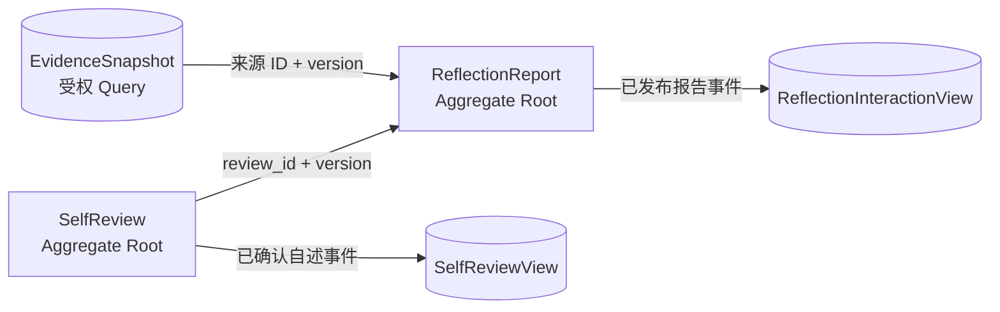
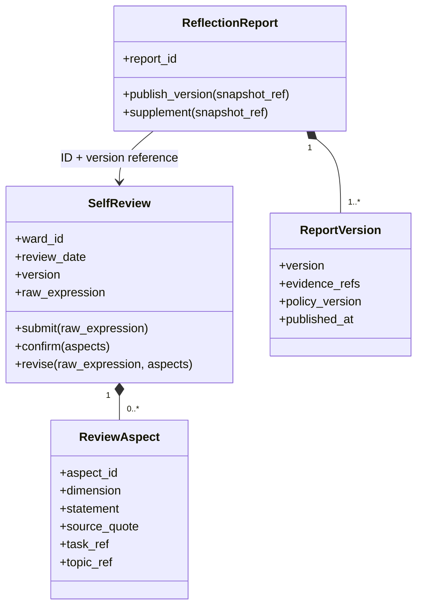
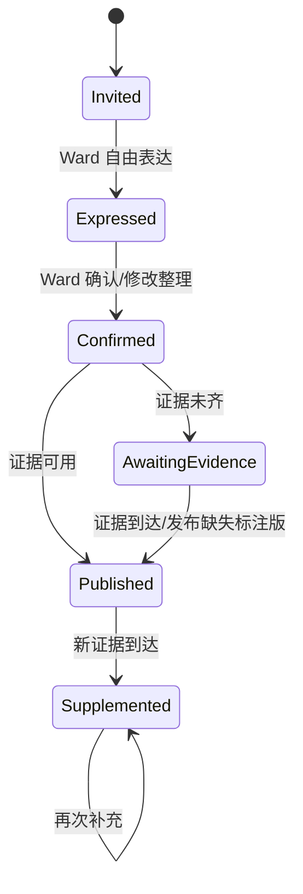
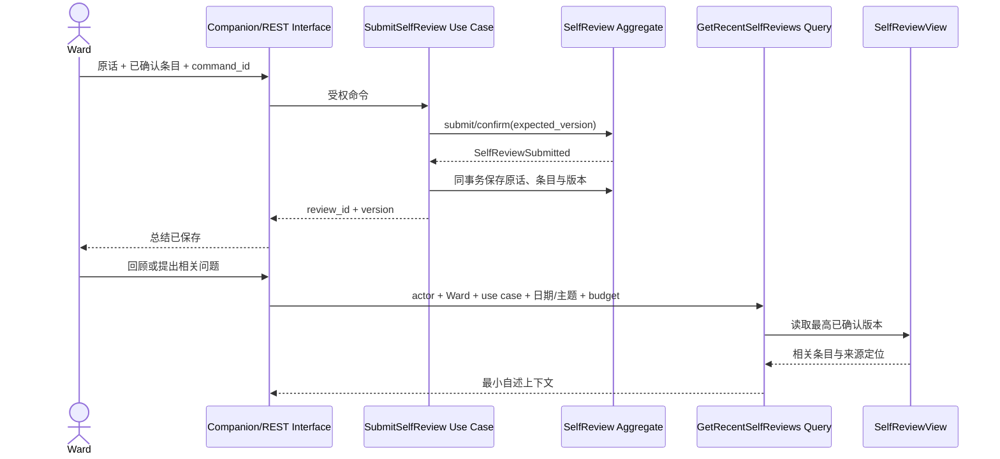
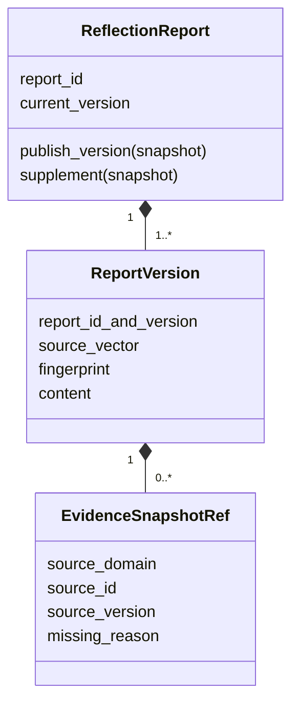
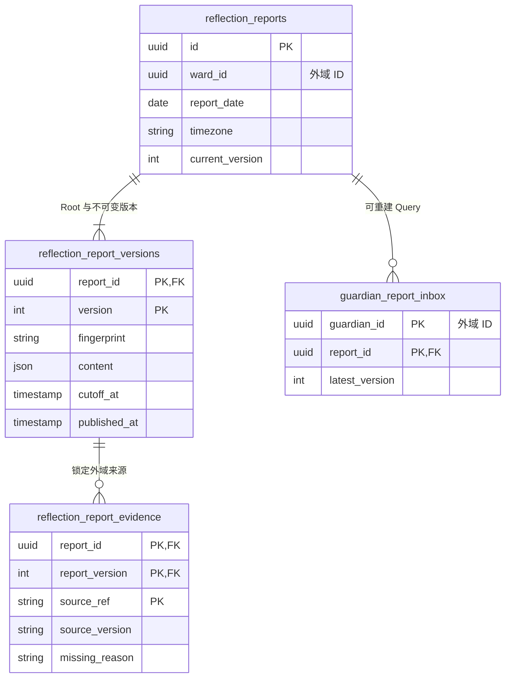
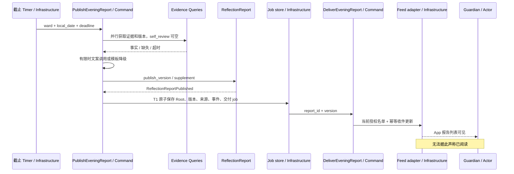

# 读学系统 — Evaluation & Reflection Bounded Context

> 状态：目标设计（现有差异见 §七） · 版本：v2.1
> 范围：Ward 今日总结、主客观证据对照、版本化复盘；当前阶段不生成或采纳“专注锦囊”。
> 关联：[系统 Context Map](ddd-overview.md) · [Companion 编排](domain-companion.md) · [Memory Context](domain-memory.md) · [Server 物理设计](design-server.md) · [复盘 PRD](../product/prd-evaluate.md)

## 一、边界与统一语言

全系统 Domain Inventory 和 Context Map 由 [DDD Overview](ddd-overview.md) 维护。Evaluation & Reflection 是核心子域，拥有 Ward 的今日自述、经确认的自述整理和复盘报告版本；不拥有任务、答疑原始对话、摄像帧、行为分析结果或长期画像。

| 上下游 | 契约和边界 |
|---|---|
| Study / Planning / Tutoring → Evaluation | 受权 Query 提供当日任务、实际用时、主要问答主题及证据引用；不得修改上游 Aggregate。 |
| Behavior Analysis → Evaluation | 目标改为 `ObservationRevisionPublished.v1` + 受权不可变版本 Query，见 [Behavior](domain-behavior.md)；旧 `BehaviorSegmentGenerated.v1` 不作为零计划幂等契约；观察不等于内心状态。 |
| Evaluation → Companion / Planning / Tutoring | 提供受权 `GetRecentSelfReviews` Query；只返回与当前用途相关的 Ward 已确认条目，不发布总结副本给 Memory。 |
| Evaluation → Ward / Guardian | Ward 看原话、整理和对照；Guardian 只看授权且适合沟通的报告摘要。 |

`ReviewPrompt` 是临时提问读模型；`SelfReview` 是某日 Ward 主动表达的权威记录；`ReviewAspect` 是关联原话、可修改的一条主观陈述；`EvidenceSnapshot` 是报告锁定的外部事实引用；`ReflectionReport` 是主客观对照的已发布版本。提示和模型候选都不是 Ward 已确认的观点。

## 二、交互规则与六个正交维度

1. **开放提示**：Ward 以语音或文字回答，不用点选维度。提示来自当天任务、答疑和用时的受权摘要，如“今天关于分数比较问了几次，你觉得哪些已经弄懂？”“哪项花的时间比预想长？你觉得原因是什么？”每轮只聚焦少数值得回顾的问题；没有可靠证据时用开放式提问，不杜撰主题或归因。
2. **主观先行**：Ward 提交前不展示客观行为结论；允许“想不起来”或暂不回答，不强求填满六维。
3. **整理供确认**：保留原话及语音转写引用。模型提出简短、可编辑的整理，Ward 确认或修改后才成为正式 `ReviewAspect`；未说到的维度保持无记录，不自动写“没有问题”。一段原话可对应多条，同一维度可有多条。
4. **对照而不替代**：报告分清“孩子说”“答疑/任务记录”“观察到”。用时长、提问多不能单独推出“不懂”“分心”。迟到证据追加报告版本，不覆盖旧版。
5. **本阶段范围**：不自动生成默认锦囊，不提供采纳按钮，不向计划注入规则；Ward 自己说的“下次想怎么做”仍可保存，但不等于系统建议或计划变更。

六维是**提取框架**，不是问卷六题，也不是 `self_reviews` 上六个固定文本列：

| `dimension` | 记录什么 | 边界 |
|---|---|---|
| `understanding` 理解与疑问 | Ward 认为已理解、尚不明白的内容 | 自述认识不是能力测量 |
| `strategy` 方法与效果 | 试过的学习、求助方法及 Ward 感到的效果 | 不混入客观用时 |
| `time_help` 时间与求助调节 | 哪里耗时、何时求助、Ward 认为为何拖长 | 实际用时来自 Study；原因只来自 Ward |
| `affect` 感受与动机 | 情绪、兴趣、信心及变化 | 不靠摄像姿态推断情绪 |
| `context` 情境与约束 | 环境、身体状态、资源等条件 | 不写成稳定个人特质 |
| `next_intent` 下次意向 | Ward 自己打算继续、调整或求助的做法 | 不是自动锦囊或计划变更 |

每条整理保留 `source_quote` 或可定位的 `source_message_id + span`、可选 `task_ref/topic_ref`、`statement`、`review_version`。引用必须来自同一 Ward 的当日表达；语音转写允许 Ward 更正。模型不得补写未表达的主观内容。

## 三、领域模型与不变量

本 Domain 共有 **2 个 Aggregate Root**，只传 ID 和版本，Query 从已发布数据组装：

| Aggregate Root | 边界 | 职责 |
|---|---|---|
| SelfReview | 一个 Ward 某日的原话、整理条目和确认版本 | 管理表达、确认、修订；不将主观陈述当作客观能力事实 |
| ReflectionReport | 某日的报告、不可变发布版本及锁定证据引用 | 发布和补充客观实况及可选主客观对照；不要求先提交自述 |



`SelfReview` 和 `ReflectionReport` 各自强一致；外部证据读取和报告投影最终一致。`ReviewAspect` 与 `ReportVersion` 必须经所属 Root 修改或追加。



| 对象 | 类型 / Identity | 强一致约束 |
|---|---|---|
| `SelfReview` | Aggregate Root；`ward_id + review_date` 唯一 | 保存每次原话、来源和版本；仅所属 Ward 可确认/修改整理；每次修改递增版本并保留可追溯历史。 |
| `ReviewAspect` | `SelfReview` 内 Entity；`aspect_id` | 维度合法、陈述关联原话、可按条修改/删除；同维度多条及零条均合法。 |
| `ReflectionReport` | Aggregate Root；`report_id` | 发布不可变 `ReportVersion`；每版锁定自述版本、外部证据引用与策略版本。 |
| `ReportVersion` | `ReflectionReport` 内 Entity；`report_id + version` | 证据、措辞和发布时间不可原地改写；明确标注缺失和 freshness。 |

Entity Inventory 只列影响身份、版本或来源不变量的状态：`ReviewAspect` 的本地 ID 使 Ward 能针对一条整理修改；`ReportVersion` 的复合 ID 使补充只追加。`source_quote/span` 是来源定位值对象；`EvidenceSnapshotRef` 是来源 ID、版本、时间和缺失状态组成的值对象。两者均无独立生命周期，也不持有其他 Context 的 Aggregate 对象。

`ReviewPrompt`、`EvidenceSnapshot` 和 `ReflectionInteractionView` 是 Query / Projection，不回写 Aggregate。`SelfReview` 与 `ReflectionReport` 分属独立事务边界，靠 ID 和版本引用；报告失败不回滚 Ward 原话。不存在 `FocusKit` 或 `ActionAdoption` Aggregate / Projection。

## 四、触发、用例与跨 Context 流程

| 触发 | 入口 → Application Use Case | Domain 行为 / 本地事件 | 后续与失败处理 |
|---|---|---|---|
| Ward 请求今日总结 | Companion/REST → `GetReviewPrompt` Query | 无写入 | 来源失败时返回开放提示与缺失状态。 |
| Ward 表达并确认整理 | Companion/REST → `SubmitSelfReview` | `SelfReview.submit/confirm` → `SelfReviewSubmitted` | 同事务保存原话、条目和版本；按命令 ID 去重；模型失败保留原话。 |
| Ward 修改原话或整理 | Companion/REST → `ReviseSelfReview` | `SelfReview.revise` → `SelfReviewRevised` | 乐观版本冲突为 409；旧版留痕，当前版本立即可读。 |
| 自述已提交且证据可用（可选对照，非晚间交付前置） | Worker → `GenerateReflection` | `ReflectionReport.publish_version` → `ReflectionReportPublished` | 锁定输入版本，校验通过再发布；失败保留 pending。 |
| 迟到证据到达 | Consumer → `SupplementReflectionReport` | `ReflectionReport.supplement` → `ReflectionSupplementPublished` | 按证据 ID + 版本去重，追加版本，失败重试/对账。 |



`Confirmed` 属于 SelfReview，`AwaitingEvidence / Published / Supplemented` 属于报告流程；图展示可选自述对照历程，不表示跨 Aggregate 原子事务；零自述晚间交付见 §九。跨 Context 链路是上游查询/事件 → Evaluation adapter → Use Case → 本地 Aggregate → Outbox / Projection。总结召回则直接经过 Evaluation 的受权 Query，不通过 Memory 消费或结算。这里无需 Saga：报告处理失败可重试且不撤销 Ward 自述。

一次确认与后续受权召回的参与者如下：

| 参与者 | DDD 类型 | 职责 |
|---|---|---|
| Ward | Actor | 表达、检查并确认整理 |
| Companion/REST | Interface | 鉴权、解析命令，不做领域判断 |
| `SubmitSelfReview` | Use Case | 装载 Root、事务与幂等 |
| `SelfReview` | Aggregate Root | 验证原话、条目来源及版本 |
| `SelfReviewSubmitted` | Domain Event | 本 Context 内已确认的自述事实 |
| `GetRecentSelfReviews` | Query | 校验访问用途，读取相关当前确认版本 |
| `SelfReviewView` | Read Model | 提供少量条目、原话定位与版本 |



跨 Context 报告证据的 Outbox 失败保留待发并退避重试；未知 schema 进入死信/人工对账，Projection 可由已发布版本重建。今日总结的当前版本在 Evaluation 本地事务提交后即可查询。查询失败返回缺失状态，调用方不使用旧版或未经确认的候选补齐。报告生成的模型调用须在候选校验后发布；模型超时保留原话或已发布报告。

## 五、查询与接口契约

| Query / View | 消费者、一致性 | 内容 |
|---|---|---|
| `GetReviewPrompt` / `ReviewPromptView` | Ward；来源最终一致 | `prompt_text`、`evidence_refs`、`missing_sources`；提示不持久化为 Ward 观点。 |
| `GetSelfReview` / `SelfReviewView` | Ward；提交后强一致 | 原话、候选/已确认条目、来源引用、版本与修改入口。 |
| `GetRecentSelfReviews` / `RecentSelfReviewsView` | Ward 本人、受权 Companion/Tutoring；Planning 仅在 Ward 明确请求相关计划时；修订提交后强一致 | 按 `ward_id`、日期范围、主题/任务关联与当前用途筛选最高已确认版本；返回有限条目及 `review_id/version/date/dimension/statement/source_quote或span`，标记为 Ward 自述；未说到的维度为空。Guardian 不通过此 Query 读取原话。 |
| `GetReflectionReport` / `ReflectionInteractionView` | Ward/Guardian；报告最终一致 | `status`、主客观分轨、各项来源/版本/freshness、缺失原因、补充版本；Guardian 脱敏。 |

`GetRecentSelfReviews` 输入 `actor_id/actor_role`、`ward_id`、`use_case`、日期范围、可选 `task_ref/topic_ref` 与 item/token 预算；先以受控关联和日期缩小候选，再在需要时判断语义相关性，不靠关键词或正则替代语义判断。只读主库当前确认版本；无相关条目返回空列表和明确的 freshness/缺失状态，越权拒绝，不回退旧版或全文。目标命令由 Companion Turn 或 REST 承接，至少包含 `ward_id`、`review_date`、`raw_expression`、`source_message_id`、`expected_version`、`command_id`；确认整理时传逐条 `aspect_id/dimension/statement/source_quote或span`。提交返回 `review_id/version/status`，不返回默认建议；未授权为 403/404、版本冲突为 409、无有效表达为 422。可选自述对照交互未提交时为 `locked`，证据未到为 `awaiting_evidence`；这不限制 §九的零输入晚间实况单发布。旧 `feeling/reflection` 客户端需保留兼容窗口。

## 六、基础设施映射

| 端口 / adapter | 持久化、可靠性与失败映射 |
|---|---|
| `SelfReviewRepository` → SQLAlchemy | `self_reviews` 每 Ward/日期唯一，保存当前版本；`self_review_versions` 按 `review_id + version` 留存不可变原话与提交来源；`self_review_aspects` 按 `review_id + review_version` 关联零到多条整理，`aspect_id` PK、合法维度及来源定位。提交/修订在本 Context 的同一事务；六维只由条目的 `dimension` 表达。 |
| `ReflectionReportRepository` → SQLAlchemy | 报告及不可变版本/证据引用，按报告 ID + 版本唯一；失败不覆盖已发布版。 |
| `ReviewEvidenceQueryPort` → 受权 Query ACL | Study/Tutoring/Behavior 返回来源 ID、版本、观测时间；超时或缺失返回 `missing_sources`，不跨 Context 直接 join ORM。 |
| `ReflectionTextPort` → 模型 adapter | 只提出开放提示、整理候选和报告措辞；结构及引用校验后进入 Ward 确认流程。超时降级为开放提示或原话待整理，不能自动确认。 |
| `RecentSelfReviewsQuery` → 受权 Query ACL | 校验 actor、Ward、use case、日期范围与条目预算；只返回当前确认版本和相关条目，禁止跨 Ward、旧版默认召回或 Guardian 原话读取。 |

当前范围不因确认或修订今日总结向 Memory 发布 `self_review.confirmed`，也不创建 `daily_review` Episode。未来若有明确的跨日 Signal 用途，再定义最小来源引用、证据契约和修订失效规则；近期召回直接使用本 Context 的 Query。Memory 的边界见 [Memory Context](domain-memory.md)。

原话和转写属于未成年人敏感内容：Ward 可看，Guardian 只看授权报告摘要；模型请求、日志最小化并脱敏。删除 Ward 时清理原话、条目和报告；历史 Memory 对应证据按既有删除规则清理，边界见 [Memory Context](domain-memory.md)。至少监测提示来源缺失率、整理确认/修改率、证据等待时长、报告补充率和模型失败率；trace 只关联受控 ID 和版本，不记原话明文。

## 七、现有实现与迁移次序

当前实现已增加 `self_review_versions`、`self_review_aspects`、自由表达候选整理与 Ward 确认/修订接口；App 支持语音或文字表达、查看原话引用并修改候选条目。复盘提示从当天答疑题目和任务用时生成开放式问题，不代替 Ward 作归因。`GetRecentSelfReviews` 仅返回当前确认版本，在同任务的答疑、计划请求中按需使用；旧 `feeling/reflection` 路径暂留兼容，但不再新投递 `self_review.submitted`。历史记录不猜测六维，旧 Memory 事实按原有审计/删除规则处理。报告证据版本化仍是后续工作，不能将本次自述版本视为客观报告版本。

本次退役 `focus_kits`：先移除 REST/Companion 创建与采纳路径及客户端建议字段，再用前向迁移删除表。旧记录不迁成 Ward 的下次意向；如需留档，迁移前由运维导出。降级只恢复空表结构，不恢复数据。旧 `focus_kit.adopted` 事实保留在历史账本供审计/删除，今后不再生产。旧版 [复盘 PRD](../product/prd-evaluate.md) 和 [Server 物理设计](design-server.md) 的锦囊段落是待同步的历史规划，以本文当前阶段范围为准。

## 八、验收场景

```gherkin
Given 今天的答疑集中在分数比较，且数学任务用时明显长于计划
When Ward 请求今日总结提示
Then 系统提出与主题及用时有关的开放问题并带来源引用
And Ward 用自己的话回答，不需要选择选项

Given Ward 只说“分数比较我懂了，但写作业时有点累”
When 系统整理自述
Then 只提出 understanding 和 affect 条目并关联对应原话
And 其他维度留空，Ward 确认前不写为已确认学习事实

Given Ward 已提交自述而客观分析尚未完成
When 查询复盘视图
Then 显示自述及 awaiting_evidence，不编造归因或默认锦囊

Given 报告第一版已发布，随后新的答疑事实到达
When 系统补充报告
Then 新版引用新增证据版本，旧版仍可追溯
```

## 九、零输入晚间交付（目标扩展）

> 2026-11-01 设计草案，未实现。本节扩展既有 ReflectionReport，不另造同义“日报” Aggregate。客观报告不依赖 SelfReview；前文以自述确认开始的时序只适用于可选主客观对照。自述版本、观察版本、报告版本是三个不同来源的版本，不能互相替代。

### 9.1 边界与模型增量

Evaluation 接收 Behavior 的已发布观察版本，受权 Query 读取 Tutoring 的题目、启发过程及微验证结果，Study/Planning 只提供可选执行/任务上下文。报告不反写这些领域。模型负责摘要措辞，不计算时长、不判定微验证通过、不把自述转成客观事实。

本 Domain 仍是 §三的 **2 个 Aggregate Root：SelfReview 与 ReflectionReport**。前者只拥有孩子原话、整理与确认修订；后者只拥有报告发布版本及来源快照。零输入交付扩展沿用 ReflectionReport，不新增“日报”聚合根。

本节只补充发布约束：self_review_ref 可空；证据引用、策略版本和 source_vector 必须锁定；相同 fingerprint 不重复发布；旧来源不得覆盖新版；缺证据不能补正值；verified 凭证必须引用 Tutoring 已验证结果。Root、ReportVersion 与证据快照在本地事务原子保存。Repository 与身份唯一键见 §9.4，避免重复字段清单。

沿用 §三的 Entity Inventory 与内部 UML；以下补充参与决策的字段和可选关系：

| 对象 | Canonical type | Identity | 新属性/行为与不变量责任 |
|---|---|---|---|
| ReflectionReport | Aggregate Root | report_id | ward/date/timezone、current_version；publish/supplement 确保零自述、版本和发布原子性 |
| ReportVersion | Entity | report_id + version | source_vector、fingerprint、content、coverage、published_at；只能经 Root 追加 |
| EvidenceSnapshotRef | Value Object | 无 | source_domain、source_id、version、observed_at、missing_reason；指向不可变来源 |
| ReportContent | Value Object | 无 | measured_totals、evidence_backed_statements、certificate_refs、可选 subjective_section；不得把无数据编码为 0 |



没有新增跨 Aggregate 强一致约束；SelfReview 仅以可空 ID/version 引用。生命周期为未发布 → 已发布 → 追加版本，无自述时不进入 locked；有自述但行为缺失仍可发布缺失标注版。既有总结 UI 的 locked 只约束该可选交互，不约束 Guardian 晚间报告。

### 9.2 Command Cards / Trigger → Application → Domain → Event 矩阵

| Trigger → Adapter | Command / 输入 | 授权 / 前置条件 | 本地事务、Root 行为 | 事件 / 后续 | 幂等 / 失败 |
|---|---|---|---|---|---|
| Behavior 通知、教学证据变更对账 → consumer Interface / Timer Infrastructure | PublishEveningReport(ward_id, local_date, source_hints, reason, command_id) | 系统 scope；只对启用晚间交付且有授权 Ward；受权 Query 固化各域来源版本，自述可空 | 事务外读取/措辞；T 内 Report.publish_version 或 supplement；Root version + source_vector 校验 | ReflectionReportPublished/ReflectionSupplementPublished；同事务写 Guardian feed delivery job | report_id + snapshot fingerprint；重复无新版本；旧事件触发时拉当前来源但必须在 snapshot 中锁定版本，不能以旧版覆盖 |
| 本地晚间截止 → Timer Infrastructure | PublishEveningReport(..., reason=deadline) | 同上；即使无任何 Frame、无自述也执行 | 同上；模型/上游超时使用已取得事实和确定性模板 | 发布 ready 或 partial 版；缺失原因明确 | 截止 job 持久化，崩溃重试；绝不等所有模型完成才发布 |
| Report 发布 job → Worker Infrastructure | DeliverEveningReport(report_id, version, command_id) | 系统 scope；重新核验当前 Guardian 绑定，不从旧通知名单授予权限 | 无 Aggregate 修改；读取不可变版本，经 FeedPort 幂等写本域报告收件索引 | Query 可见；基础交付为 Guardian App 收件列表 | guardian_id + report_id + version；失败重试/死信；App 离线不声称已阅读；不强制依赖外部推送服务 |

发布目标：首期 Asia/Shanghai 默认 21:30，可配置；调度依据 Ward 固定本地日和 deadline，不使用服务器 `date.today()` 或 UTC 零点切业务日。截止时可能仍学习，报告明确“截至 X 时”，随后新证据补充版本。启用交付的 Ward 列表来自授权配置 Query，不以“当天已有 Frame”为调度条件。

只有报告发布涉及 Root 写，Deliver 是 Application 的可靠交付命令，收件索引为可重建 Query 数据，不新增业务 Aggregate。本地 receipt/job 状态属于 Infrastructure。没有跨域事务或补偿：发布失败不撤销孩子自述、观察或答疑。

### 9.3 Queries 与 API

```text
GetEveningReport(actor, ward_id, local_date, version?)
 -> {report_id, version, status: ready|partial, timezone, cutoff_at, published_at,
     observation: {estimated_activity_seconds?, still_seconds?, away_seconds?,
                   coverage, episodes, missing_reasons},
     tutoring: {asked_count?, verified_count?, certificates},
     subjective_section?, source_freshness, supersedes_version?}
GetGuardianReportInbox(actor, after_cursor?, limit)
 -> {items: [{report_id, ward_id, local_date, latest_version, published_at}], next_cursor}
```

`GET /api/v1/evaluation/evening-reports?ward_id=&date=&version=`；`GET /api/v1/evaluation/report-inbox?cursor=`。Ward 只能读本人，Guardian 只读当前绑定孩子的脱敏摘要；自述原话不因报告存在而向 Guardian 开放。Query 只读已发布结果；报告本地提交后可读，收件索引最终一致目标 60 秒内可见，另按最新报告对账可重建。认证失败 401、未绑定 403/404、尚未发布返回 202 `{status: pending, deadline_at}`，不能返回伪造的零时长报告；时间参数非法 422。

凭证状态取源于 Tutoring 受权 Query 的教学判定，映射为 `verified`、`in_progress`、`unverified`。无提问时为空列表；来源查询失败时为 unavailable，不写“今天没有问题”。题目与微验证按 problem/session ID 去重，不能按聊天轮数计算卡点数。

报告中的“观察学习活动”采用 Behavior 的指标名称与口径；没有基线或家长介入反馈时不展示“省下 90 分钟”“零介入已达成”。净省陪读时间、同量作业效率和干预因果属于效果实验，不由报告模型推测。

### 9.4 物理映射与 Infrastructure Design Card

图源：本文 §9.4；仅展示本次报告持久化目标，不重复自述现有表。既有 reports 保留为兼容 Query，新的 Root 暂映射独立 reflection_reports，避免旧批处理就地覆盖版本；正式命名和迁移同步 design-server。



| 项目 | 设计 |
|---|---|
| Ports/adapters | ReflectionReportRepository → PostgreSQL；ReviewEvidenceQueryPort → Behavior/Tutoring/Study/Planning/SelfReview 受权 ACL；ReportTextPort → 组件网关；FeedPort → 本域 Query store；在 bootstrap 装配 |
| 事务/索引 | unique(ward_id, report_date)、unique(report_id, fingerprint)、版本复合 PK；evidence 的复合 FK 指向版本；Root、版本、evidence、job 同事务；索引按 ward/date、published_at；inbox 每 Guardian/report 一条，仅推进更高版本 |
| 依赖超时与降级 | 来源 Query 单项 3 秒且并行、总预算 10 秒，最多一次瞬时重试；文案模型 10 秒、不在截止路径重试；失败用确定性模板，保留已有证据；模型连续 5 次服务故障熔断 60 秒 |
| 消息与 job | ObservationRevisionPublished.v1 consumer inbox 按 day/revision 去重；既有教学变更通知若未提供版本事件则每 5 分钟 Query 对账，不虚构已实现事件；发布 job 平台退避最多 8 次、死信告警，源版本/报告/收件索引对账恢复 |
| 版本冲突 | 每版 source_vector 必须逐来源不倒退；新增来源允许补齐 missing；结果候选基于过期 Root version 时重读重算，不强行覆盖。各源独立最终一致，不声称全局同时刻快照 |
| 留存/删除 | 不复制图像/全对话，仅最小摘要与受控引用；沿用报告数据治理；Ward 删除清理 Root、版本、evidence、inbox 和待办，删除 fence 防止重建；解绑后 Query 立即拒绝 |
| 安全/指标 | 日志只关联 report/day/version/event；不记自述/题面。监测截止发布率、partial 比例、晚到补充、来源缺失、收件索引延迟/失败；App 阅读和报告可用是不同指标 |
| 迁移/回滚 | 增表、双读兼容但每 Ward 单写路径；历史旧报告不伪造来源版本；新路径通过后 flag 切换，关闭旧 writer；回滚切旧读路径并保留新版本审计，不删除证据 |

### 9.5 异步发布与交付因果链

| 参与者 | Canonical type | 职责 |
|---|---|---|
| 截止 Timer、Outbox/Job、Feed adapter | Infrastructure | 时间触发、可靠派发、收件 Query 更新 |
| Behavior consumer | Interface | 校验通知 schema，调用本域 Command |
| PublishEveningReport / DeliverEveningReport | Command | 来源快照、发布事务 / 幂等交付 |
| 上游证据 Query | Query | 返回授权来源版本或缺失 |
| ReflectionReport | Aggregate Root | 追加不可变报告版本 |
| ReflectionReportPublished | Domain Event | 本地发布事实 |
| Guardian | Actor | 按当前授权读取报告 |



图源：本文 §9.5，兼作 Command–Event–Query Flow；通知和定时触发进入同一个 Command，不为转发事件建立 Process Manager。

验收：无计划/自述/图片仍到点生成缺失标注版；模型断网不阻塞事实模板；来源真实为 0 与不可用区分；无微验证不签已解出；补传追加版本、旧版可查；重复通知不重发相同版；未解绑前入 inbox、解绑后仍不能读；旧来源候选不覆盖新版本。测试分层为领域不变量、Query/API 授权契约、PostgreSQL 版本/Outbox 并发、截止故障端到端。
