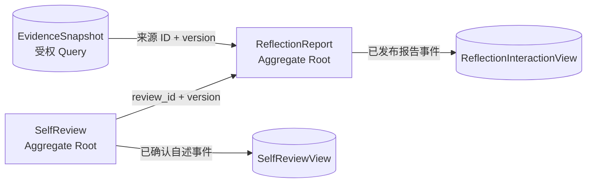
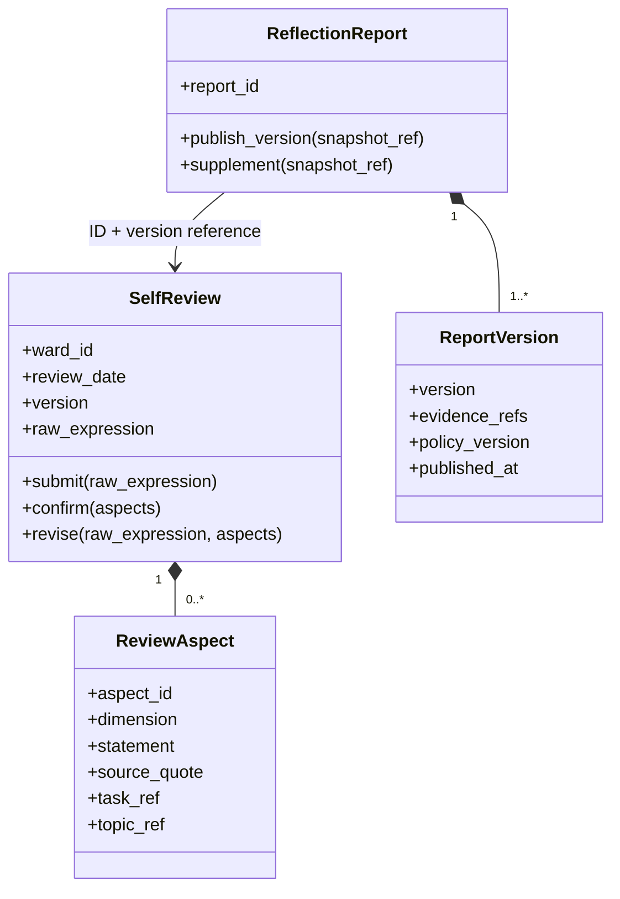
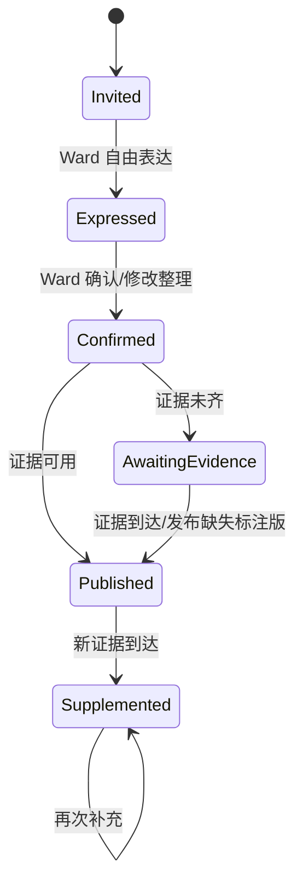
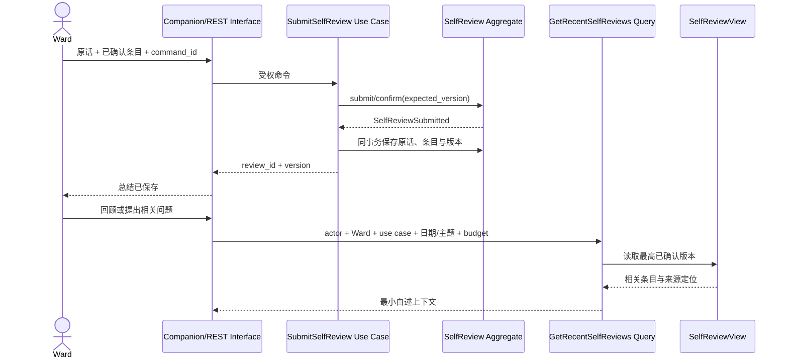

# 读学系统 — Evaluation & Reflection Bounded Context

> 状态：目标设计（现有差异见 §七） · 版本：v2.1
> 范围：Ward 今日总结、主客观证据对照、版本化复盘；当前阶段不生成或采纳“专注锦囊”。
> 关联：[系统 Context Map](ddd-overview.md) · [Companion 编排](domain-companion.md) · [Memory Context](domain-memory.md) · [Server 物理设计](design-server.md) · [复盘 PRD](../product/prd-evaluate.md)

## 一、边界与统一语言

全系统 Domain Inventory 和 Context Map 由 [DDD Overview](ddd-overview.md) 维护。Evaluation & Reflection 是核心子域，拥有 Ward 的今日自述、经确认的自述整理和复盘报告版本；不拥有任务、答疑原始对话、摄像帧、行为分析结果或长期画像。

| 上下游 | 契约和边界 |
|---|---|
| Study / Planning / Tutoring → Evaluation | 受权 Query 提供当日任务、实际用时、主要问答主题及证据引用；不得修改上游 Aggregate。 |
| Behavior Analysis → Evaluation | `BehaviorSegmentGenerated.v1` 或受权快照提供观察事实、来源版本和完成时间；观察不等于内心状态。 |
| Evaluation → Companion / Planning / Tutoring | 提供受权 `GetRecentSelfReviews` Query；只返回与当前用途相关的 Ward 已确认条目，不发布总结副本给 Memory。 |
| Evaluation → Ward / Guardian | Ward 看原话、整理和对照；Guardian 只看授权且适合沟通的报告摘要。 |

`ReviewPrompt` 是临时提问读模型；`SelfReview` 是某日 Ward 主动表达的权威记录；`ReviewAspect` 是关联原话、可修改的一条主观陈述；`EvidenceSnapshot` 是报告锁定的外部事实引用；`ReflectionReport` 是主客观对照的已发布版本。提示和模型候选都不是 Ward 已确认的观点。

## 二、交互规则与六个正交维度

1. **开放提示**：Ward 以语音或文字回答，不用点选维度。提示来自当天任务、答疑和用时的受权摘要，如“今天关于分数比较问了几次，你觉得哪些已经弄懂？”“哪项花的时间比预想长？你觉得原因是什么？”每轮只聚焦少数值得回顾的问题；没有可靠证据时用开放式提问，不杜撰主题或归因。
2. **主观先行**：Ward 提交前不展示客观行为结论；允许“想不起来”或暂不回答，不强求填满六维。
3. **整理供确认**：保留原话及语音转写引用。模型提出简短、可编辑的整理，Ward 确认或修改后才成为正式 `ReviewAspect`；未说到的维度保持无记录，不自动写“没有问题”。一段原话可对应多条，同一维度可有多条。
4. **对照而不替代**：报告分清“孩子说”“答疑/任务记录”“观察到”。用时长、提问多不能单独推出“不懂”“分心”。迟到证据追加报告版本，不覆盖旧版。
5. **本阶段范围**：不自动生成默认锦囊，不提供采纳按钮，不向计划注入规则；Ward 自己说的“下次想怎么做”仍可保存，但不等于系统建议或计划变更。

六维是**提取框架**，不是问卷六题，也不是 `self_reviews` 上六个固定文本列：

| `dimension` | 记录什么 | 边界 |
|---|---|---|
| `understanding` 理解与疑问 | Ward 认为已理解、尚不明白的内容 | 自述认识不是能力测量 |
| `strategy` 方法与效果 | 试过的学习、求助方法及 Ward 感到的效果 | 不混入客观用时 |
| `time_help` 时间与求助调节 | 哪里耗时、何时求助、Ward 认为为何拖长 | 实际用时来自 Study；原因只来自 Ward |
| `affect` 感受与动机 | 情绪、兴趣、信心及变化 | 不靠摄像姿态推断情绪 |
| `context` 情境与约束 | 环境、身体状态、资源等条件 | 不写成稳定个人特质 |
| `next_intent` 下次意向 | Ward 自己打算继续、调整或求助的做法 | 不是自动锦囊或计划变更 |

每条整理保留 `source_quote` 或可定位的 `source_message_id + span`、可选 `task_ref/topic_ref`、`statement`、`review_version`。引用必须来自同一 Ward 的当日表达；语音转写允许 Ward 更正。模型不得补写未表达的主观内容。

## 三、领域模型与不变量

两个写 Aggregate 之间只传 ID 和版本，读模型从已发布数据组装：



`SelfReview` 和 `ReflectionReport` 各自强一致；外部证据读取和报告投影最终一致。`ReviewAspect` 与 `ReportVersion` 必须经所属 Root 修改或追加。



| 对象 | 类型 / Identity | 强一致约束 |
|---|---|---|
| `SelfReview` | Aggregate Root；`ward_id + review_date` 唯一 | 保存每次原话、来源和版本；仅所属 Ward 可确认/修改整理；每次修改递增版本并保留可追溯历史。 |
| `ReviewAspect` | `SelfReview` 内 Entity；`aspect_id` | 维度合法、陈述关联原话、可按条修改/删除；同维度多条及零条均合法。 |
| `ReflectionReport` | Aggregate Root；`report_id` | 发布不可变 `ReportVersion`；每版锁定自述版本、外部证据引用与策略版本。 |
| `ReportVersion` | `ReflectionReport` 内 Entity；`report_id + version` | 证据、措辞和发布时间不可原地改写；明确标注缺失和 freshness。 |

Entity Inventory 只列影响身份、版本或来源不变量的状态：`ReviewAspect` 的本地 ID 使 Ward 能针对一条整理修改；`ReportVersion` 的复合 ID 使补充只追加。`source_quote/span` 是来源定位值对象；`EvidenceSnapshotRef` 是来源 ID、版本、时间和缺失状态组成的值对象。两者均无独立生命周期，也不持有其他 Context 的 Aggregate 对象。

`ReviewPrompt`、`EvidenceSnapshot` 和 `ReflectionInteractionView` 是 Query / Projection，不回写 Aggregate。`SelfReview` 与 `ReflectionReport` 分属独立事务边界，靠 ID 和版本引用；报告失败不回滚 Ward 原话。不存在 `FocusKit` 或 `ActionAdoption` Aggregate / Projection。

## 四、触发、用例与跨 Context 流程

| 触发 | 入口 → Application Use Case | Domain 行为 / 本地事件 | 后续与失败处理 |
|---|---|---|---|
| Ward 请求今日总结 | Companion/REST → `GetReviewPrompt` Query | 无写入 | 来源失败时返回开放提示与缺失状态。 |
| Ward 表达并确认整理 | Companion/REST → `SubmitSelfReview` | `SelfReview.submit/confirm` → `SelfReviewSubmitted` | 同事务保存原话、条目和版本；按命令 ID 去重；模型失败保留原话。 |
| Ward 修改原话或整理 | Companion/REST → `ReviseSelfReview` | `SelfReview.revise` → `SelfReviewRevised` | 乐观版本冲突为 409；旧版留痕，当前版本立即可读。 |
| 自述已提交且证据可用 | Process Manager/Worker → `GenerateReflection` | `ReflectionReport.publish_version` → `ReflectionReportPublished` | 锁定输入版本，校验通过再发布；失败保留 pending。 |
| 迟到证据到达 | Consumer → `SupplementReflectionReport` | `ReflectionReport.supplement` → `ReflectionSupplementPublished` | 按证据 ID + 版本去重，追加版本，失败重试/对账。 |



`Confirmed` 属于 SelfReview，`AwaitingEvidence / Published / Supplemented` 属于报告流程；图展示用户历程，不表示跨 Aggregate 原子事务。跨 Context 链路是上游查询/事件 → Evaluation adapter → Use Case → 本地 Aggregate → Outbox / Projection。总结召回则直接经过 Evaluation 的受权 Query，不通过 Memory 消费或结算。这里无需 Saga：报告处理失败可重试且不撤销 Ward 自述。

一次确认与后续受权召回的参与者如下：

| 参与者 | DDD 类型 | 职责 |
|---|---|---|
| Ward | Actor | 表达、检查并确认整理 |
| Companion/REST | Interface | 鉴权、解析命令，不做领域判断 |
| `SubmitSelfReview` | Use Case | 装载 Root、事务与幂等 |
| `SelfReview` | Aggregate Root | 验证原话、条目来源及版本 |
| `SelfReviewSubmitted` | Domain Event | 本 Context 内已确认的自述事实 |
| `GetRecentSelfReviews` | Query | 校验访问用途，读取相关当前确认版本 |
| `SelfReviewView` | Read Model | 提供少量条目、原话定位与版本 |



跨 Context 报告证据的 Outbox 失败保留待发并退避重试；未知 schema 进入死信/人工对账，Projection 可由已发布版本重建。今日总结的当前版本在 Evaluation 本地事务提交后即可查询。查询失败返回缺失状态，调用方不使用旧版或未经确认的候选补齐。报告生成的模型调用须在候选校验后发布；模型超时保留原话或已发布报告。

## 五、查询与接口契约

| Query / View | 消费者、一致性 | 内容 |
|---|---|---|
| `GetReviewPrompt` / `ReviewPromptView` | Ward；来源最终一致 | `prompt_text`、`evidence_refs`、`missing_sources`；提示不持久化为 Ward 观点。 |
| `GetSelfReview` / `SelfReviewView` | Ward；提交后强一致 | 原话、候选/已确认条目、来源引用、版本与修改入口。 |
| `GetRecentSelfReviews` / `RecentSelfReviewsView` | Ward 本人、受权 Companion/Tutoring；Planning 仅在 Ward 明确请求相关计划时；修订提交后强一致 | 按 `ward_id`、日期范围、主题/任务关联与当前用途筛选最高已确认版本；返回有限条目及 `review_id/version/date/dimension/statement/source_quote或span`，标记为 Ward 自述；未说到的维度为空。Guardian 不通过此 Query 读取原话。 |
| `GetReflectionReport` / `ReflectionInteractionView` | Ward/Guardian；报告最终一致 | `status`、主客观分轨、各项来源/版本/freshness、缺失原因、补充版本；Guardian 脱敏。 |

`GetRecentSelfReviews` 输入 `actor_id/actor_role`、`ward_id`、`use_case`、日期范围、可选 `task_ref/topic_ref` 与 item/token 预算；先以受控关联和日期缩小候选，再在需要时判断语义相关性，不靠关键词或正则替代语义判断。只读主库当前确认版本；无相关条目返回空列表和明确的 freshness/缺失状态，越权拒绝，不回退旧版或全文。目标命令由 Companion Turn 或 REST 承接，至少包含 `ward_id`、`review_date`、`raw_expression`、`source_message_id`、`expected_version`、`command_id`；确认整理时传逐条 `aspect_id/dimension/statement/source_quote或span`。提交返回 `review_id/version/status`，不返回默认建议；未授权为 403/404、版本冲突为 409、无有效表达为 422。报告未提交时为 `locked`，证据未到为 `awaiting_evidence`。旧 `feeling/reflection` 客户端需保留兼容窗口。

## 六、基础设施映射

| 端口 / adapter | 持久化、可靠性与失败映射 |
|---|---|
| `SelfReviewRepository` → SQLAlchemy | `self_reviews` 每 Ward/日期唯一，保存当前版本；`self_review_versions` 按 `review_id + version` 留存不可变原话与提交来源；`self_review_aspects` 按 `review_id + review_version` 关联零到多条整理，`aspect_id` PK、合法维度及来源定位。提交/修订在本 Context 的同一事务；六维只由条目的 `dimension` 表达。 |
| `ReflectionReportRepository` → SQLAlchemy | 报告及不可变版本/证据引用，按报告 ID + 版本唯一；失败不覆盖已发布版。 |
| `ReviewEvidenceQueryPort` → 受权 Query ACL | Study/Tutoring/Behavior 返回来源 ID、版本、观测时间；超时或缺失返回 `missing_sources`，不跨 Context 直接 join ORM。 |
| `ReflectionTextPort` → 模型 adapter | 只提出开放提示、整理候选和报告措辞；结构及引用校验后进入 Ward 确认流程。超时降级为开放提示或原话待整理，不能自动确认。 |
| `RecentSelfReviewsQuery` → 受权 Query ACL | 校验 actor、Ward、use case、日期范围与条目预算；只返回当前确认版本和相关条目，禁止跨 Ward、旧版默认召回或 Guardian 原话读取。 |

当前范围不因确认或修订今日总结向 Memory 发布 `self_review.confirmed`，也不创建 `daily_review` Episode。未来若有明确的跨日 Signal 用途，再定义最小来源引用、证据契约和修订失效规则；近期召回直接使用本 Context 的 Query。Memory 的边界见 [Memory Context](domain-memory.md)。

原话和转写属于未成年人敏感内容：Ward 可看，Guardian 只看授权报告摘要；模型请求、日志最小化并脱敏。删除 Ward 时清理原话、条目和报告；历史 Memory 对应证据按既有删除规则清理，边界见 [Memory Context](domain-memory.md)。至少监测提示来源缺失率、整理确认/修改率、证据等待时长、报告补充率和模型失败率；trace 只关联受控 ID 和版本，不记原话明文。

## 七、现有实现与迁移次序

当前实现已增加 `self_review_versions`、`self_review_aspects`、自由表达候选整理与 Ward 确认/修订接口；App 支持语音或文字表达、查看原话引用并修改候选条目。复盘提示从当天答疑题目和任务用时生成开放式问题，不代替 Ward 作归因。`GetRecentSelfReviews` 仅返回当前确认版本，在同任务的答疑、计划请求中按需使用；旧 `feeling/reflection` 路径暂留兼容，但不再新投递 `self_review.submitted`。历史记录不猜测六维，旧 Memory 事实按原有审计/删除规则处理。报告证据版本化仍是后续工作，不能将本次自述版本视为客观报告版本。

本次退役 `focus_kits`：先移除 REST/Companion 创建与采纳路径及客户端建议字段，再用前向迁移删除表。旧记录不迁成 Ward 的下次意向；如需留档，迁移前由运维导出。降级只恢复空表结构，不恢复数据。旧 `focus_kit.adopted` 事实保留在历史账本供审计/删除，今后不再生产。旧版 [复盘 PRD](../product/prd-evaluate.md) 和 [Server 物理设计](design-server.md) 的锦囊段落是待同步的历史规划，以本文当前阶段范围为准。

## 八、验收场景

```gherkin
Given 今天的答疑集中在分数比较，且数学任务用时明显长于计划
When Ward 请求今日总结提示
Then 系统提出与主题及用时有关的开放问题并带来源引用
And Ward 用自己的话回答，不需要选择选项

Given Ward 只说“分数比较我懂了，但写作业时有点累”
When 系统整理自述
Then 只提出 understanding 和 affect 条目并关联对应原话
And 其他维度留空，Ward 确认前不写为已确认学习事实

Given Ward 已提交自述而客观分析尚未完成
When 查询复盘视图
Then 显示自述及 awaiting_evidence，不编造归因或默认锦囊

Given 报告第一版已发布，随后新的答疑事实到达
When 系统补充报告
Then 新版引用新增证据版本，旧版仍可追溯
```
