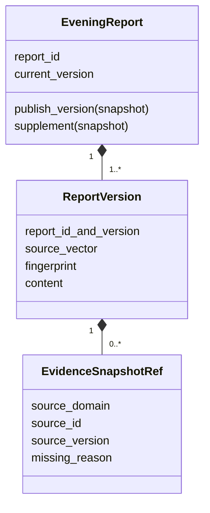
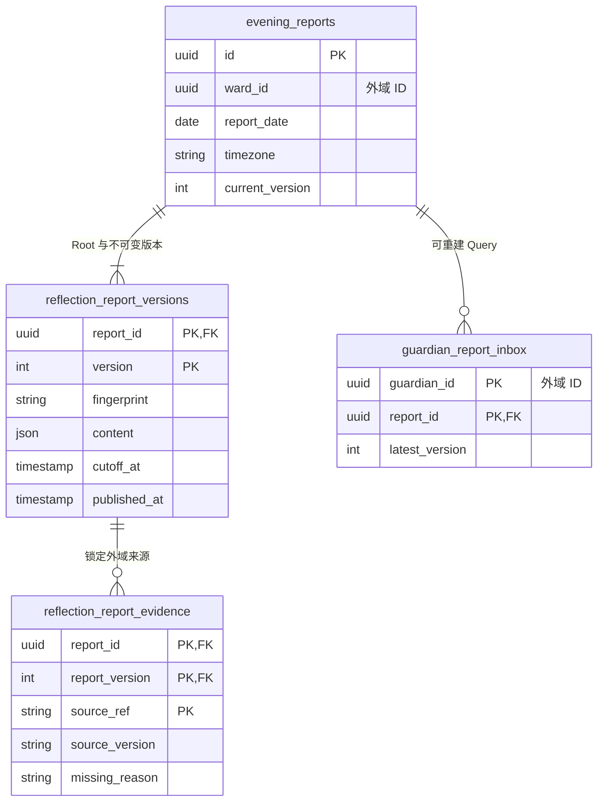
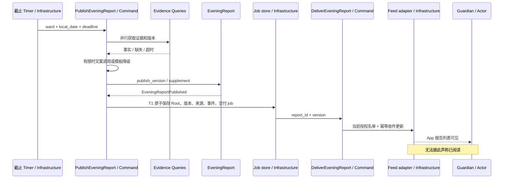

# Evaluation — 晚间客观报告

目标契约。Reflection 每日自述完整退场，移除入口、读写接口、召回与消费链路；旧测试数据无需迁移或兼容。晚间报告独立保留，产品验收见[孩子首页](../product/prd-user.md#71-孩子首页晚间客观汇总报告直接呈现)。

## 九、零输入晚间交付

### 9.1 边界与模型

Evaluation 按日读取已授权的观察与答疑证据，展示主动保存的作品。报告只在存在对话内微验证时附解题凭证；本期不核算作业和探索分钟数。

| 对象 | Canonical type | Identity | 新属性/行为与不变量责任 |
|---|---|---|---|
| EveningReport | Aggregate Root | report_id | ward/date/timezone、current_version；publish/supplement 确保版本和发布原子性 |
| ReportVersion | Entity | report_id + version | source_vector、fingerprint、content、coverage、published_at；只能经 Root 追加 |
| EvidenceSnapshotRef | Value Object | 无 | source_domain、source_id、version、observed_at、missing_reason；指向不可变来源 |
| ReportContent | Value Object | 无 | evidence_backed_statements、certificate_refs；不得把无数据编码为 0 |



报告按首次发布、后续追加版本推进；来源缺失时发布标注缺失的版本。

### 9.2 Command Cards / Trigger → Application → Domain → Event 矩阵

| Trigger → Adapter | Command / 输入 | 授权 / 前置条件 | 本地事务、Root 行为 | 事件 / 后续 | 幂等 / 失败 |
|---|---|---|---|---|---|
| Behavior 通知、教学证据变更对账 → consumer Interface / Timer Infrastructure | PublishEveningReport(ward_id, local_date, source_hints, reason, command_id) | 系统 scope；只对启用晚间交付且有授权 Ward；受权 Query 固化各域来源版本 | 事务外读取/措辞；T 内 Report.publish_version 或 supplement；Root version + source_vector 校验 | EveningReportPublished/EveningReportSupplementPublished；同事务写 Guardian feed delivery job | report_id + snapshot fingerprint；重复无新版本；旧事件触发时拉当前来源但必须在 snapshot 中锁定版本，不能以旧版覆盖 |
| 本地晚间截止 → Timer Infrastructure | PublishEveningReport(..., reason=deadline) | 同上；即使无任何 Frame也执行 | 同上；模型/上游超时使用已取得事实和确定性模板 | 发布 ready 或 partial 版；缺失原因明确 | 截止 job 持久化，崩溃重试；绝不等所有模型完成才发布 |
| Report 发布 job → Worker Infrastructure | DeliverEveningReport(report_id, version, command_id) | 系统 scope；重新核验当前 Guardian 绑定，不从旧通知名单授予权限 | 无 Aggregate 修改；读取不可变版本，经 FeedPort 幂等写本域报告收件索引 | Query 可见；基础交付为 Guardian App 收件列表 | guardian_id + report_id + version；失败重试/死信；App 离线不声称已阅读；不强制依赖外部推送服务 |

发布目标：首期 Asia/Shanghai 默认 21:30，可配置；调度依据 Ward 固定本地日和 deadline，不使用服务器 `date.today()` 或 UTC 零点切业务日。截止时可能仍学习，报告明确“截至 X 时”，随后新证据补充版本。启用交付的 Ward 列表来自授权配置 Query，不以“当天已有 Frame”为调度条件。

只有报告发布涉及 Root 写，Deliver 是 Application 的可靠交付命令，收件索引为可重建 Query 数据，不新增业务 Aggregate。本地 receipt/job 状态属于 Infrastructure。没有跨域事务或补偿：发布失败不撤销观察或答疑。

### 9.3 Queries 与 API

```text
GetEveningReport(actor, ward_id, local_date, version?)
 -> {report_id, version, status: ready|partial, timezone, cutoff_at, published_at,
     observation: {estimated_activity_seconds?, still_seconds?, away_seconds?,
                   coverage, episodes, missing_reasons},
     tutoring: {asked_count?, verified_count?, certificates},
     subjective_section?, source_freshness, supersedes_version?}
GetGuardianReportInbox(actor, after_cursor?, limit)
 -> {items: [{report_id, ward_id, local_date, latest_version, published_at}], next_cursor}
```

`GET /api/v1/evaluation/evening-reports?ward_id=&date=&version=`；`GET /api/v1/evaluation/report-inbox?cursor=`。Ward 只能读本人，Guardian 只读当前绑定孩子的脱敏摘要。Query 只读已发布结果；报告本地提交后可读，收件索引最终一致目标 60 秒内可见，另按最新报告对账可重建。认证失败 401、未绑定 403/404、尚未发布返回 202 `{status: pending, deadline_at}`，不能返回伪造的零时长报告；时间参数非法 422。

凭证状态取源于 Tutoring 受权 Query 的教学判定，映射为 `verified`、`in_progress`、`unverified`。无提问时为空列表；来源查询失败时为 unavailable，不写“今天没有问题”。题目与微验证按 problem/session ID 去重，不能按聊天轮数计算卡点数。

报告中的“观察学习活动”采用 Behavior 的指标名称与口径；没有基线或家长介入反馈时不展示“省下 90 分钟”“零介入已达成”。净省陪读时间、同量作业效率和干预因果属于效果实验，不由报告模型推测。

### 9.4 物理映射与 Infrastructure Design Card

图源：本文 §9.4，描述客观报告的目标持久化结构。



| 项目 | 设计 |
|---|---|
| Ports/adapters | EveningReportRepository → PostgreSQL；ReviewEvidenceQueryPort → Behavior/Tutoring/Study/ArtifactWorkspace 受权 ACL；ReportTextPort → 组件网关；FeedPort → 本域 Query store；在 bootstrap 装配 |
| 事务/索引 | unique(ward_id, report_date)、unique(report_id, fingerprint)、版本复合 PK；evidence 的复合 FK 指向版本；Root、版本、evidence、job 同事务；索引按 ward/date、published_at；inbox 每 Guardian/report 一条，仅推进更高版本 |
| 依赖超时与降级 | 来源 Query 单项 3 秒且并行、总预算 10 秒，最多一次瞬时重试；文案模型 10 秒、不在截止路径重试；失败用确定性模板，保留已有证据；模型连续 5 次服务故障熔断 60 秒 |
| 消息与 job | ObservationRevisionPublished.v1 consumer inbox 按 day/revision 去重；既有教学变更通知若未提供版本事件则每 5 分钟 Query 对账，不虚构已实现事件；发布 job 平台退避最多 8 次、死信告警，源版本/报告/收件索引对账恢复 |
| 版本冲突 | 每版 source_vector 必须逐来源不倒退；新增来源允许补齐 missing；结果候选基于过期 Root version 时重读重算，不强行覆盖。各源独立最终一致，不声称全局同时刻快照 |
| 留存/删除 | 不复制图像/全对话，仅最小摘要与受控引用；沿用报告数据治理；Ward 删除清理 Root、版本、evidence、inbox 和待办，删除 fence 防止重建；解绑后 Query 立即拒绝 |
| 安全/指标 | 日志只关联 report/day/version/event；不记自述/题面。监测截止发布率、partial 比例、晚到补充、来源缺失、收件索引延迟/失败；App 阅读和报告可用是不同指标 |

### 9.5 异步发布与交付因果链

| 参与者 | Canonical type | 职责 |
|---|---|---|
| 截止 Timer、Outbox/Job、Feed adapter | Infrastructure | 时间触发、可靠派发、收件 Query 更新 |
| Behavior consumer | Interface | 校验通知 schema，调用本域 Command |
| PublishEveningReport / DeliverEveningReport | Command | 来源快照、发布事务 / 幂等交付 |
| 上游证据 Query | Query | 返回授权来源版本或缺失 |
| EveningReport | Aggregate Root | 追加不可变报告版本 |
| EveningReportPublished | Domain Event | 本地发布事实 |
| Guardian | Actor | 按当前授权读取报告 |



图源：本文 §9.5，兼作 Command–Event–Query Flow；通知和定时触发进入同一个 Command，不为转发事件建立 Process Manager。

验收：无计划/图片仍到点生成缺失标注版；模型断网不阻塞事实模板；来源真实为 0 与不可用区分；无微验证不签已解出；补传追加版本、旧版可查；重复通知不重发相同版；未解绑前入 inbox、解绑后仍不能读；旧来源候选不覆盖新版本。测试分层为领域不变量、Query/API 授权契约、PostgreSQL 版本/Outbox 并发、截止故障端到端。
