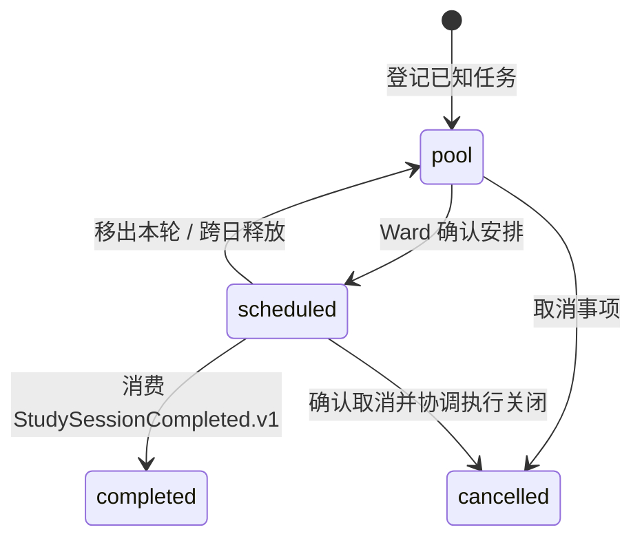

# 读学系统 — Planning Domain Design（轻量计划与任务）

> 状态：实现待验收（v2.2 · 普通计划按需提示，挑战执行归 Study）
> 更新日期：2026-11-03
> 范围：Task、PlanDraft、DailySchedule；实际执行归 Study。
> 关联：[产品规则与验收](../product/prd-schedule.md) · [Context Map](ddd-overview.md) · [Companion](domain-companion.md) · [Study](domain-study.md) · [Behavior](domain-behavior.md) · [物理设计](design-server.md)

## 一、边界与不变量

Planning 负责已知任务、安排顺序、可选估时和约定起点；Study 负责显式执行及其计时区间；Behavior 负责观察证据。普通计划仅按需提示，不常驻当前/下一项；Study 的 Sprint 才提供经授权的限时挑战投影。界面显隐不通过删除领域状态实现。

1. 有可辨认的 `title` 即可登记并生成安排草稿；`planned_minutes`、`start_at` 均可空，不能用默认30分钟或19:00补造。模型解释自然语言，领域仅校验协议、归属、版本与结构。
2. Ward 独占安排确认权。自然语言整理为草稿后确认；明确含义的结构化快捷动作可一步确认。Guardian 输入仅产生带来源的候选，不自动变成正式安排。
3. 确认安排不等于开始执行。`scheduled` 只表示已安排；`active/paused` 来自 StudySession，不能从计划推断。未知开始、结束或耗时允许为空。
4. 不要求未安排原因；不要求每项精确钟点。不因任务超时自动改期、标失败或开启下一项。普通任务的起点/时长齐全也不构成 Sprint 开启授权。
5. 任务、卡片、版本、动作归属均由服务端验证，模型不伪造 ID。减少交互不取消唯一目标绑定、幂等、乐观并发与历史保护。
6. `plan_date` 为上海本地日，时间戳以 UTC 保存；跨日不改写历史执行事实或认定完成。

## 二、领域模型

| Root | Identity / 主要字段 | 职责 |
|---|---|---|
| Task | task_id、ward_id、title、source、可空 planned_minutes、status、version | 已知学习事项；状态为 pool / scheduled / completed / cancelled，开始与暂停不改变安排状态 |
| PlanDraft | draft_id、ward_id、plan_date、version、items、基准日程/任务版本 | 待确认的安排或修订；项含真实 task_id 或待创建项引用、title、order_index、可选时长/起点 |
| DailySchedule | schedule_id、ward_id、plan_date、version、按序 items | 已确认的当日安排；保留已完成项和历史版本供回看 |

时长意图需区分 `completion_estimate`（预计完成耗时）与 `timebox`（打算投入一段时间），并记录 Ward 原估或系统建议被接受的来源。`timebox` 也不自动等于 Sprint：还需 Ward 明确选择挑战并授权开始，执行记录归 Study。`Task.duration_kind/duration_source` 及 Sprint 的物理映射见 [Server 设计](design-server.md)，迁移为 `20261103_32`；旧记录类型留空，不回填成孩子估时或挑战。

`confirm_enabled` 要求至少一项可辨认目标、本次拟提交项均合法、目标明确、归属与基准版本有效；缺可选时间不阻塞。多项输入有不明确项时说明待处理项，可由 Ward 明确选择只确认完整部分，不能静默丢项。

取消不等于物理删除；已有学习记录必须保留。清理无记录误建候选仍需目标、版本与权限校验。跨日释放经 Study 协调放弃遗留显式会话，不由 Planning 越域修改会话表；历史日程保留，未完成项按需可查，不自动展示欠账列表。

## 三、输入、确认与执行协作

### 3.1 安排入口

`POST /companion/turn` 经受控模型提取意图与字段。优先复用已明确绑定的 Task；多候选且涉及修改、取消或完成时需澄清目标。只缺时长或钟点不创建阻塞澄清槽。

- “先数学再英语”：创建/修订顺序草稿，不填精确起止。
- “七点开始数学，预计四十分钟”：保存显式起点与完成预估；后项依顺序承接，不把预计结束推导为后项的承诺钟点。
- “英语改后面”：修订未开始项的顺序；已有执行历史不可覆写。
- 时间存在明确矛盾时展示简短解释与可选调整，不能静默覆盖用户明确钟点。

确认卡直接展示领域校验后的草稿快照与修改摘要，使用简短固定提示，不额外调用模型生成审阅文案。自然语言的意图、字段提取及必要追问仍由 `planning.intake` 负责；模型候选话术不替代最终草稿，也不代表安排已确认。

`ConfirmPlanDraft` 只提交已审阅版本，不重跑模型。事务校验 draft / schedule / task 版本与授权，原子保存 Task / DailySchedule / Outbox；新项可在确认事务创建，须按草稿项身份去重。`confirmation_id` 重试返回同一结果；旧版本返回409与最新投影。草稿、拒绝或失败不能发布已确认事实。

### 3.2 快捷动作与开始

`quick_ignite` 保留为目标结构化动作名：绑定服务端签发的候选/交互、目标及版本，时长可空。`[先做数学]` 只确认安排；`[开始数学]` 才含显式开始授权。动作语义由服务端允许集合确定，客户端不能靠任意 payload 指定越权目标。

需要合并安排和开始时，先原子提交安排，再用同一命令关联的幂等 Study 命令请求开始；安排与开始结果分别回执。开始失败时保留已安排事实，不能显示已开始；重试不得创建重复会话。已有 active/paused 会话时复用或明确执行切换，不自动建立并行计时。

`PlanConfirmed.v1` 只代表安排事实，不自动开启会话。明确的当前开始表达走 Study 的开始命令，不从文本反推更早开始时刻。视觉证据不能用于暗中创建或完成任务会话。开始普通 StudySession 也不自动开启 Sprint 或置顶任务。

挑战入口只向 Study 传递受权目标引用/主题、用户选择的目标时长和明确动作；Planning 不拥有 Sprint 状态，不因挑战到时消费任务完成事件。挑战可无 Task，不能为凑齐计划模型而强制建任务。

### 3.3 暂停、继续、换项和完成

- 暂停/继续交给 Study；Task 仍为 scheduled。
- 换项时暂停当前会话，保留当前任务未完成；只有明确开始授权才开启目标项。重复命令幂等，失败返回实际已提交结果。
- “这次先到这里”关闭本次执行为未完成，不发布完成任务事件；后来可开启新会话继续同一 Task。
- “写完了”经 Study 显式完成命令结算；Planning 消费 `StudySessionCompleted.v1` 幂等更新 Task。无 active/paused 会话时由明确完成命令调用 Planning 的 `declare_completion`，发布 `TaskCompletionDeclared.v1`，计时保留未知，不创建零时长会话。
- 用户未点完成且无明确声明时，保持未确认完成；离座、换书、timebox 到点不触发完成。

执行规则唯一归属 [Study](domain-study.md)，已贯通命令与按需界面，待本轮验收。

## 四、Query 与交互投影

| Query / View | 用途与投影边界 |
|---|---|
| GetIgnitionCandidates | 返回2～3个可选入口，保留来源；常做学科为建议，不伪装成当天作业 |
| GetPlanningTaskPool / 今日已知作业投影 | 按需返回全部相关已知事项、来源与完成声明；首屏不展开，未选中项不丢失 |
| GetFocusStrip（旧首页接口，目标取消默认消费） | 原任务/会话组合仅供按需详情，不再驱动首页当前/下一项；有无时间均不转成挑战，挑战投影由 Study 提供 |
| GetPlanDraft | 当前拟提交项、差异和用户明确提供的可选时间；确认动作绑定当前版本 |
| GetConfirmedSchedule | Ward/授权 Guardian 只读当前安排及历史；Guardian 不得修改 |
| 任务/会话详情 | 按需返回有来源的开始、区间计时、可选估时及缺口；不可用伪默认值填空 |

默认无任务条、仅主动 Sprint 展示限时卡的规则见 [PRD §三](../product/prd-schedule.md#三前台展示与入口)，不在领域另设简化状态机。历史卡只读，不能重放过期动作。跨设备恢复必须重读最新投影；用户收起计时不会暂停会话。

Companion 的 `plan_confirm_list` 承载安排确认；新增 `quick_ignite` 等动作须同步协议版本与 App allow-list，不能直接发入不支持的客户端。App 可通过现有 Study 操作入口承接执行命令，不由 Planning 发明新的交互 kind。

## 五、时间数据与下游

1. Planning 向 Study 提供显式约定钟点和顺序。仅显式约定钟点可调度 StartCue；前项预估推算的时间不得触发下一项邀请。顺序项仅在用户询问或主动操作时提供，不自动置顶、开始或呈现下一项。
2. Planning 向 Evaluation 提供可选估时、意图类型、来源和任务范围。完成耗时、显式会话计时、视觉活动分别保留；同口径且证据足够才比较，产品口径见 [PRD §4.3](../product/prd-schedule.md#43-估时与回顾可选)。历史建议仅按需提供，不默认纠偏。
3. Behavior 提供独立观察证据，不修改 Task / StudySession。主动邀请须经 Companion 回复权与去重控制；采用 [PRD §3.4](../product/prd-schedule.md#34-主动引导的边界)，无新鲜证据不声称看见，忽略后不跨入口重试。

## 六、验收与落地

产品场景与验收唯一归属 [PRD §六](../product/prd-schedule.md#六验收标准)。实施需补充领域与协议测试：可空时间、确认不开始、显式开始、暂停换项后的区间保留、无计时完成声明、幂等/旧版本/目标歧义、跨日释放、未完成项按需可查、默认无常驻任务条、普通任务与 Sprint 授权隔离、挑战到时不触发任务完成。

本轮实现及实际测试记录见[进行中 spec](../../.agent/specs/lightweight-planning-focus-sprint.md)。旧活动草稿由迁移32失效，旧任务/日程/会话历史保留；旧来源不明钟点不自动触发新邀请。

## 约定到时提醒（2026-11-04，本轮待验收）

产品规则唯一归属[计划PRD §4.3.1](../product/prd-schedule.md#431-记事与约定提醒)。Task增加可空`end_reminder_mode`，取值scheduled/elapsed/off；空值与off均不授权到时提醒，历史不回填。模型只提议，操作白名单及Python契约约束闭集；草稿/确认卡保留方式，确认时写Task，取消使用off显式覆盖。Task查询返回此字段。迁移`20261104_34`新增可空列，部署前须升级数据库。

Study负责提醒投影：scheduled按Ward明确钟点加planned_minutes，elapsed只按本次active StudySession的执行区间计算剩余时长，不累计暂停；无计划也可查询elapsed提醒。完成/取消不再排，缺少执行区间不猜开始。到时不完成任务，不生成学习质量结论。已排本地通知须由客户端刷新替换；跨设备离线期间不能保证撤回。
