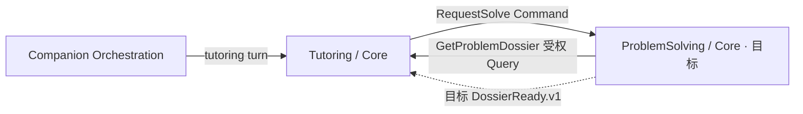
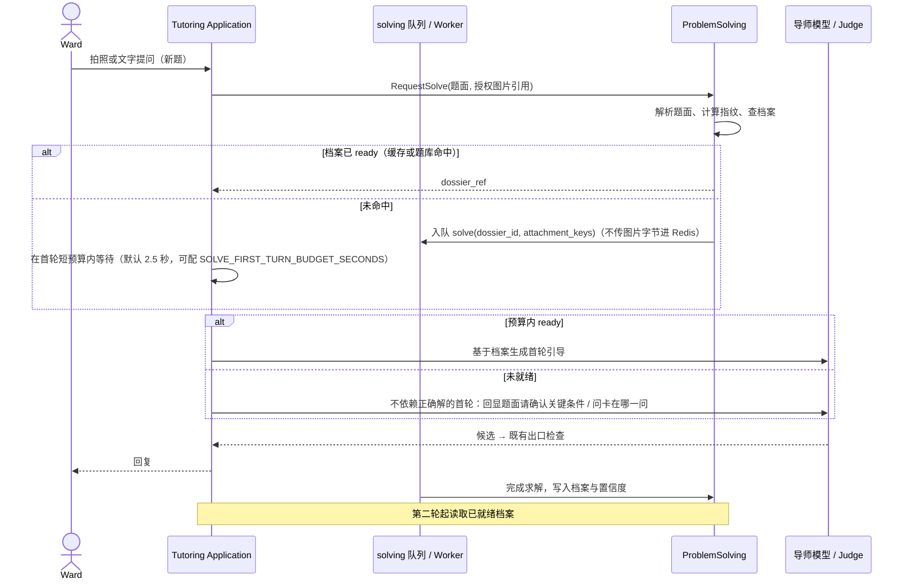
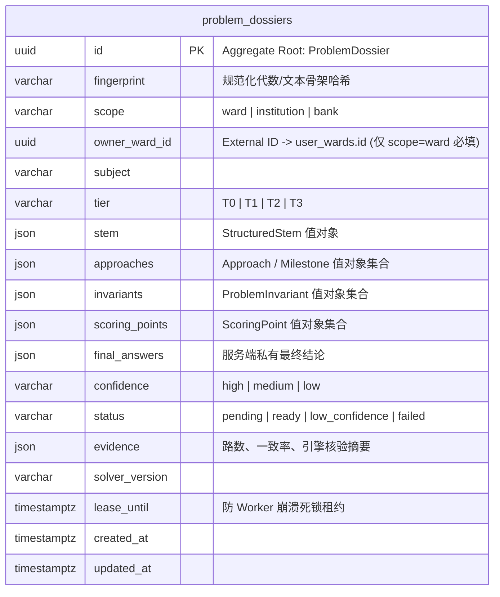

# 读学系统 — ProblemSolving Domain Design（解题与辅导分链路）

> 状态：**代码已实现（迁移 37），待线上队列部署与真实模型分层评测校准**（2026-11-17）。实现进度与兼容边界见 [§八 现状与实现进度](#八现状与实现进度)。
> 本文唯一维护：解题链路与辅导链路的分工、难度分档与升级规则、题目档案 `ProblemDossier` 模型、置信度门禁、`solving` 队列部署边界。
> 引用而不复述：答案保护与出口检查见 [Tutoring](domain-tutoring.md)；确定性算子协议与执行器隔离见 [数学与多学科核验](tutoring-math.md)；全系统领域清单见 [DDD Overview](ddd-overview.md)；评测数据与运行方式见 [离线评测](eval-offline.md)。

## 一、问题与目标

高考级题目要求系统先拿到**可信的私有正确解**，才能可靠地引导、判对错和防泄露。提升解题标准会增加复杂度，但不应摊到每一轮回复上：

| | 解题（求出正确解） | 辅导（每轮引导） |
|---|---|---|
| 频率 | 每道题 1 次 | 每道题 5~15 轮 |
| 需要 | 强推理、多路求解、工具核验、题库检索 | 读私有解，定位学生进度，给下一步 |
| 延迟 | 可以几十秒，可以异步 | 越快越好 |
| 复用 | 同一道题可跨学生复用（受 §5.3 范围约束） | 只属于当前学生 |

当前实现把两者耦合：导师每轮开 Thinking，相当于每轮隐式重新解题；蓝图在候选回复之后才生成，新题第一轮用不上。

**目标：**

1. 复杂度集中在"每题一次、异步、可缓存"的解题链路；每轮辅导的关键路径变短、变轻。
2. 按难度逐级升级，只有难题付高成本。
3. 解不出或不确定时诚实降级，绝不以模型心算冒充已核验。
4. 遵守"方案简单"：逻辑上新增一个 Domain，物理上只多一个 Celery 队列，不拆微服务、不引入新消息总线。

**非目标：**不改变答案保护规则；不向学生或家长展示私有解；不建设通用 Python 沙箱（另行评估，见 [tutoring-math §5](tutoring-math.md#5-基础设施与验收)）；不按学科拆服务；不建设专用 OCR 或按图类型的专用读图解析器。

### 1.1 核心策略：把"正确指导"拆成四个可验证的判断

正确指导一道难题，系统必须同时做对四个判断。当前四个判断都在导师的同一次调用里边想边说，任何一个出错都会直接变成错误的教学，而且无法单独度量是哪一个出错：

| 判断 | 当前做法 | 已出现的失败（见 [Tutoring 笔记](../../.agent/notes/tutoring.md)） | 本设计的做法 |
|---|---|---|---|
| ① 题读对了吗 | 导师每轮顺带读图 | 重试时把学生答案 32 读成 34；新图沿用旧图结论 | 读题单独一次，由多模态模型直接读原图；关键条件独立复读比对，不一致请学生确认（§3.1） |
| ② 题解对了吗 | 导师每轮边教边推理 | 生物题武断断言两种成分互斥；压轴题单次推理易错 | **先解后教**：每题一次私有解，经独立验证并带置信度（§4） |
| ③ 学生走到哪、错在哪 | 导师凭语义判断 | 把正确的 90−37=53 判为算错；把学生的等价式误判为新答案 | 对照私有解的里程碑定位；能计算的用确定性引擎判等价；无法确定不判错（§3.2、§4.4） |
| ④ 下一步给什么 | 导师自行决定 | 一次铺开多个选项的分析 | 从私有解路线取下一个里程碑，导师只负责教学表达 |

五条架构策略：

1. **先解后教。**"知道正确解"和"怎么教"分到两个组件。导师不再即兴解题，只在已验证的解上做教学；这是提高指导正确率的主要来源，而不是提示词调优。
2. **验证，而不是相信一次生成。**验证比生成可靠：多路独立求解是否一致、确定性引擎能否核验、题库是否有已知答案。正确性来自这些相互独立的检查，而不是同一个模型更用力地想一次。
3. **按置信度说话。**系统要知道自己什么时候不确定。只有高置信才允许说"对/错"，不确定时只引导思路并如实说明（§4.3、§4.4）。宁可少判，不能教错。
4. **算力随难度伸缩。**简单题一次求解即可，只有验证不通过的难题才升级到多路共识和题库检索（§4.2）。成本和延迟只花在需要的题上。
5. **能力随模型升级自动提升。**读题、求解、比对、教学都是可替换的模型槽位：换更强的多模态或推理模型，相应判断直接变准，不需要重写流水线。因此不建 OCR 或专用读图解析器这类会被模型能力淘汰的手工环节；确定性引擎只保留在模型本质上不可靠、且结果可被精确核验的地方（精确计算、符号等价、守恒配平）。

这四个判断也正好对应 §七 的分层评测：每个判断可以单独评测、单独换模型、单独看是否变好。

## 二、领域边界

ProblemSolving 是 **Core Domain**，拥有"这道题的正确解是什么、有多可信"的规则；Tutoring 拥有"怎么教、能说到哪一步"的规则。

| | ProblemSolving | Tutoring |
|---|---|---|
| 关心 | 一道题本身 | 一个学生的一次辅导 |
| 聚合根 | `ProblemDossier`（按题目指纹） | `TutoringSession`（不变） |
| 生命周期 | 可跨会话、跨学生共享 | 随会话与 Ward |
| 不拥有 | 学生作答、对话、答案披露 | 正确解的产出与置信度 |

**不变量：**

- 档案只能经受权只读 Query 被 Tutoring 读取；**读到档案永远不解除 `Disclosure="protected"`**，也不自动触发 `ConfirmUnderstanding`。
- 档案不含 `ward_id`、学生手写作答、姓名或对话内容。
- 档案中的结论只有经确定性引擎或多路共识验证后才能标记为可判定（§4.3）；单路模型输出最多是 `low` 置信度。



## 三、两条链路

```text
              ┌──────────── 解题链路（每题一次，异步，可复用）──────────────┐
 拍照/文字 ─▶ │ ① 读题：多模态模型直接读原图 → 结构化题面；关键条件复读比对│
   │          │ ② 题目指纹 → 查档案/题库 ──命中──▶ 直接得到已验证档案     │
   │          │ ③ 难度分档 T1/T2 → 求解（单路或多路 + 工具 + 共识）       │
   │          │ ④ 写入 ProblemDossier：题面·路线·锚点·采分点·置信度        │
   │          └──────────────────────────────┬─────────────────────────────┘
   │                                         │ status: pending / ready / low_confidence / failed
   ▼                                         ▼
 ┌──────────── 辅导链路（每轮，同步，轻量）──────────────────────────────┐
 │ 读档案 → 定位学生在哪个里程碑 → 生成下一步（轻模型）                  │
 │ → 学生作答与锚点比对（确定性等价性检查）                              │
 │ → 泄露裁判对照私有解判断 → ApplyTutorTurn 提交                        │
 └────────────────────────────────────────────────────────────────────────┘
```

### 3.1 新题首轮时序



首轮不依赖正确解的回复本身符合启发原则，同时让学生确认题面，可以顺带纠正读图错误。题面确认的结果回写档案的结构化题面版本（§4.1）。

读题规则：

- 由多模态模型读完整原图，输出结构化题面；看不清的局部用既有 `inspect_image` 裁剪放大后再读。不引入 OCR 或按图类型的专用解析器。
- 对决定结果的关键条件（数值、符号、图中标注、小问要求），做一次独立复读（新的调用，不带上一次的读题结果和历史结论；可配置为不同模型），两次结果一致才写入题面。
- 两次不一致或模型自报看不清时，请学生确认该处条件，不硬猜。
- 复读与比对属于"验证"策略，不是读图手段；模型读图越准，复读不一致的比例越低，这一环节的成本自然下降。

### 3.2 每轮辅导读取档案

- 导师上下文注入档案的路线、当前里程碑和常见误区，不注入原始求解草稿。
- 学生给出中间结果时，先与锚点做确定性等价性比对（复用 `MathEnginePort`），或通过 `verify_derivation_chain` 验证预设路线外的合法新奇解法，再由模型组织教学语言。
- **防误杀红线**：绝不把整套中间里程碑塞给 `leak-judge`（避免轻量裁判把已知条件或学生已算出的前置步误判成泄题）；仅当档案 `status == "ready"` 且 `confidence == "high"` 时，才将最终得数 `verified_final_answers` 注入裁判输入。私有解不进学生可见内容，也不进公开 Trace 正文。
- 导师是否仍需开 Thinking、用多大预算，由 Admin 配置决定；分链路后预期可降低，**需评测验证后再改**（§七）。

## 四、领域模型

### 4.1 聚合根汇总与持久化 ER 图

ProblemSolving 域共拥有 **1 个写聚合根：`ProblemDossier`**（强一致性边界为单道规范化题目的求解状态、结构化题面、验证路线、采分点与置信度；不持有学生对话或个人作答进度）。



> 图源：本文 §4.1 Mermaid；`tutoring_problems.dossier_id` 在 `Tutoring` 域表内以 ID 外键引用本表。

| 字段 | 说明 |
|---|---|
| `dossier_id` | 主键 |
| `fingerprint` | 由规范化结构化题面骨架（剥离标点空白、归一 `\frac{a}{b}` 等确定性格式）计算；不含学生作答与图片字节 |
| `scope` | 复用范围：`ward` / `institution` / `bank`，见 §5.3 |
| `owner_ward_id` | 仅 `scope="ward"` 时必填；跨人共享范围（`institution`/`bank`）强制为空 |
| `stem` | 多模态模型读出的结构化题面（已知、求、小问列表、图中关键信息的文字描述），带 `stem_version` 与关键条件复读结果 |
| `subject`、`tier` | 学科与当前分档 |
| `approaches` | 解题路线与里程碑；沿用现有 `SolutionBlueprint` 的 `Approach`/`Milestone` 值对象 |
| `invariants` | 跨路线不变量（沿用 `ProblemInvariant`） |
| `scoring_points` | 采分点：步骤、关键结论、分值；用于诊断与部分给分 |
| `final_answers` | 各小问最终结论，仅服务端可读 |
| `confidence` | `high` / `medium` / `low`，见 §4.3 |
| `status` | `pending` / `ready` / `low_confidence` / `failed` |
| `evidence` | 求解路数、各路是否一致、引擎核验记录摘要、题库来源引用；不存模型原文 |
| `solver_version` | 配置摘要与流水线版本，用于失效与重算 |

状态转移：`pending → ready | low_confidence | failed`；`low_confidence → ready`（升级 T2 后达成共识）；任一状态在 `stem_version` 变化或 `solver_version` 失效时可重新进入 `pending`。

### 4.2 难度分档与升级

| 档位 | 适用 | 解题方式 | 额外耗时 |
|---|---|---|---|
| **T0 直答** | 事实、词义、读音，无推理层次 | 不建档案 | 0 |
| **T1 标准** | 常规计算与中等题 | 单路求解 + 确定性工具核验锚点 | 低，多数可赶上首轮预算 |
| **T2 难题** | 高考解答题、压轴题、T1 未通过 | 题库检索 + 多路求解取共识 + 工具交叉验证 + 采分点 | 高，异步 |
| **T3 超出能力** | T2 仍不一致、关键条件读不清 | 不产出可判定结论 | — |

升级规则：

- 起步分档由一次轻量分类给出（复用现有 `depth` 判断，并补学科与题型）；事前分类可能出错，**升级以实际验证结果为准**。
- T1 出现以下任一情况即升 T2：锚点核验未通过、引擎返回 `unknown` 且该里程碑属可计算类型、模型自报不确定。
- T2 多路结论不一致或关键锚点仍无法核验，状态置为 `low_confidence`，Tutoring 按 T3 行为处理。
- 分档、升级原因和耗时写入 `evidence`，供评测按档统计。

### 4.3 置信度判定

**求解器**指专门求解的模型调用，与导师分开：

- **目标不同**：只求正确，可以写出完整解法、开大推理预算、调用工具；输出只进档案，不受答案保护和回复长度约束。
- **上下文独立**：只看题面和原图，不看对话历史和学生作答，避免被学生的错误思路或历史结论带偏。
- **多路之间独立**：T2 的每一路是独立调用，可配置不同模型或指定不同解法路线，不共享中间结果。

没有一个工具能判定"整道高考题解对了"。判定按可验证程度分四种方式，强度从高到低：

| 方式 | 做法 | 适用 | 工具 |
|---|---|---|---|
| 已知答案 | 检索出同一道题（核对数值与设问一致）的官方答案与评分细则 | 历年真题、常见变式 | 自建或授权题库（目标，未建） |
| 代回原题检验 | 把求出的结论代回题目条件，用确定性引擎检查是否全部满足；范围类结论再在边界外搜反例 | 求值、求解、求范围、配平、遗传比例 | 既有 `math_executor`（SymPy/mpmath 及量纲、守恒、遗传算子，见 [tutoring-math §3](tutoring-math.md#3-内部交互协议)） |
| 关键步骤核验 | 对路线中可计算的中间结论逐个核验（求导、化简、方程组、公式量纲） | 有计算环节但整体无法代回的题，如物理建模、证明中的计算步骤 | 同上，`verify_derivation_chain` |
| 多路共识 | 多路独立求解，比较最终结论和关键中间结论是否一致 | 证明的逻辑、物理过程选择、生物与文综主观题 | 无确定性工具；主观题另需课标与评分细则依据（目标，未建） |

工具只证明它检查过的那部分：代回检验能证明"这个答案满足条件"，不能证明"没有漏解"；反例搜索没找到不等于恒成立；共识只提高可信度，不是证明。因此置信度按实际通过的方式给出：
| 置信度 | 条件 |
|---|---|
| `high` | 题库命中带官方答案；或 ≥2 路独立求解结论一致，且最终结论代回检验通过或可计算锚点全部经引擎核验 |
| `medium` | 多路一致但存在 `conceptual_rubric` 类里程碑无法确定性核验 |
| `low` | 单路结果、多路不一致、或锚点核验失败 |

现有 `_verify_milestone_anchor` 在非等价性检查中"结果非空即 verified"，不满足本表；迁移时必须改为与 `canonical_target` 做等价性比对（§八）。

### 4.4 置信度门禁（由代码强制，不靠提示词）

| Tutoring 行为 | 允许条件 |
|---|---|
| 确认学生"这一步局部算式对/错" | 档案 `ready` 且相关锚点已核验；或本轮数学引擎返回任意 `status="ok"` 局部计算记录 |
| 确认学生"整题最终答案/最优性是对的" | 档案 `ready` 且 `allows_verdict_assertion()`；或整页批改视觉+计算全部通过；或 `candidate.math_claims` 显式引用了验证性算子（`equivalent`/`solve`/`solve_system`/`solve_inequality` 或 `checked_scope="equivalence"`）且 `status="ok"`。局部算式 `evaluate`（如算出某条路径和 `19`）**不得**解锁整题终值/最优性肯定 |
| 断言学生"这一步错了" | 同上；`unknown` 不能判错（沿用 tutoring-math 不变量） |
| 基于路线给下一步提示 | 档案 `ready` 或 `low_confidence`；后者须避免断言结论 |
| 无档案 / `pending` / `failed` | 档案模式下始终显式挂载 `_dossier_gate(status="absent", allows_verdict_assertion=False)`，绝不因缺省绕过门禁 |

门禁只能收紧既有答案保护，不能放宽。选择题、判断题的逐项确认政策仍以 [Tutoring 出口检查](domain-tutoring.md#42-出口检查) 为准。

## 五、接口与数据边界

### 5.1 Command Cards、状态触发矩阵与受权 Query

| Command | 触发源与调用方 | 事务与幂等键 | 加载聚合与领域行为 | 失败与恢复行为 |
|---|---|---|---|---|
| `RequestSolve` | Tutoring Application（新题受理阶段） | 本地短事务；幂等键 `fingerprint + scope + owner_ward_id` | 命中 `ready`/`low_confidence` 或未过期 `pending` 直接返回；未命中创建 `ProblemDossier.create_pending(scope="ward")`（租约 90s）或对过期租约 `renew_lease()`，提交后投递 `solving` 队列 | 入队异常不影响当轮辅导，租约到期后下次请求自动抢占重算 |
| `ConfirmStem` | Tutoring Application（学生确认或纠正模糊题面） | 本地短事务；校验 `owner_ward_id == ward_id` | 加载 `ProblemDossier.confirm_stem()`，递增 `stem_version`、重算 `fingerprint`、置回 `pending` 并重投递 `solving` 队列 | 越权抛 `PermissionError`；不存在抛 `ValueError` |
| `ExecuteDossierSolve` | `solving` Celery Worker 适配器（`duxue.solve_problem_dossier`） | 模型与引擎调用在事务外完成；落库为本地短事务 | 执行 T1 单路求解 + `verify_milestone_anchor` 等价校验；未过升 T2 执行高风险图片独立复读 + 2 路异构解法共识（`T2_algebraic` / `T2_alternative`），调用 `complete_solve()` 或 `mark_failed()` | 超预算或不一致置 `low_confidence`（绝不无限重试）；Worker 崩溃由 `lease_until` 超时自愈 |

**Trigger → Application → Domain → Event/Query Matrix：**

| Trigger 类别 | 入口与所有者 | Application 职责 | Domain 动作 | 后续效果 |
|---|---|---|---|---|
| 学生发起新推理题提问 | Tutoring Workflow | 授权校验后调用 `RequestSolve`，并在短预算（默认 `2.5s`）内按需轮询 `GetProblemDossier` | 创建或续租 `ward` 范围 `pending` `ProblemDossier` | 投递 Celery `solving` 队列（仅传 `dossier_id` 与对象键，图片字节不进 Redis） |
| 异步求解任务到达 | Celery `solving-worker` | 读取授权图片，事务外调用求解模型与 `MathEnginePort`，调用 `ExecuteDossierSolve` | `DossierConfidencePolicy` 裁决分档升级与 `high`/`medium`/`low` 置信度，更新 `ProblemDossier` 状态 | 持久化 `ready` / `low_confidence` 档案，后续辅导回合通过 `GetProblemDossier` 立即可读 |
| 学生确认/更正题面条件 | Tutoring Workflow | 校验归属后调用 `ConfirmStem` | `ProblemDossier.confirm_stem()` 递增 `stem_version` 并重置 `pending` | 重新触发异步求解 |

受权 Query 与无持久化求解复用：
- `GetProblemDossier(ward_id, dossier_id)`：校验 `scope == "bank"` 或 `owner_ward_id == ward_id` 后返回辅导只读投影（路线、里程碑、锚点、采分点、置信度，合并传入的该学生个人 `milestone_progress`），不含原始求解草稿；`TutoringProblem` 仅存 `dossier_id` 与该学生自己的 `milestone_progress`。
- `GetProblemDossier.find_bank_ready(stem)`：按新旧指纹定位候选，用存储的题面重新计算新版指纹比对，只读查询 `scope == "bank"` 且 `status == "ready"` 的全局公共题库档案，绝不读取任何 `scope == "ward"` 的学生私有档案。
- `solve_and_verify_problem(...) -> VerifiedSolution`：抽离在数据库事务外运行的纯求解与核验内核（T1 单路锚点核验 $\rightarrow$ 按 `DossierConfidencePolicy` 升 T2 双路异构共识与图片复读），由持久化 `ExecuteDossierSolveCommand` 与无数据库写入的 [Guardian 导师视角解析](topic-edu-agent.md#14-对话载体与交互协议) 同源复用。

### 5.2 题组

多小问共享一份档案，`stem` 记录全部小问，`approaches` 按小问组织。现有 `ProblemGroupContext` 中"继承前问已核验结论"的规则改为读取档案中前问的 `final_answers` 与学生在 Tutoring 内的确认记录；"同一会话至多一道 `open` 小题"的不变量仍归 Tutoring。

### 5.3 复用范围与隐私

| scope | 复用范围 | 来源 |
|---|---|---|
| `ward` | 仅当前 Ward | 首期默认 |
| `institution` | 同一机构内 | B2C 晚托场景，同班作业共用；需机构侧授权开关 |
| `bank` | 全局 | 仅来自已授权题库的题目 |

- **隐私与防脏提取硬隔离**：学生拍照/文字提问动态提取生成的档案，代码硬编码锁死为 `scope="ward"` 并绑定 `owner_ward_id`（严禁从学生上传流自动晋升为 `institution`/`bank` 跨人共享，防止把某位学生手写填空的错解或姓名混入公共题干）。`bank`/`institution` 只能来自纯净空白原卷或授权题库导入。
- 删除 Ward 数据（`DELETE /wards/{id}/data`）时物理擦除其全部 `scope="ward"` 档案；`bank` 范围档案不含个人数据，不随单个 Ward 删除。
- 题库的数据授权须单独确认，代码许可不能代替数据授权。

## 六、Infrastructure Design Card 与部署运行

| 基础设施维度 | 契约说明 |
|---|---|
| **Ports & Adapters** | `ProblemSolverModelPort` → `QwenProblemSolverGateway`（复用 Admin 发布包中的 `tutoring.blueprint-planner` 受控 Thinking 组件，物理剥离 `reasoning_content`，上下文不含学生历史对话）；确定性核验复用 `MathEnginePort` → Unix Socket 独立容器 `MathEngineAdapter` |
| **Persistence & Transactions** | `SqlProblemDossierRepository` 映射 `problem_dossiers` 表（Alembic 迁移 `20261117_37_problem_dossiers.py`）；所有 LLM 与容器计算均在 DB 事务外执行，状态写回为毫秒级本地短事务；幂等并发由 `(fingerprint, scope, owner_ward_id)` 索引与 `lease_until` 租约保护 |
| **Async Delivery** | 独立 Celery 队列 `solving`（任务 `duxue.solve_problem_dossier`，`docker-compose.yml` 独立 `solving-worker -Q solving -c 2`，`docker-compose.math.yml` 挂载只读 `math-socket`）；Broker 消息仅传 `dossier_id` 与 OSS `attachment_keys`，严禁图片 Base64 进 Redis |
| **Security & Observability** | `GetProblemDossier` 强校验 `owner_ward_id`；客户端 API、SSE、`TutoringMessage` 与公开 Trace 载荷绝不序列化 `final_answers` 或思维链；按档位记录任务耗时与置信度分布 |

运行约束（初始值，可配置校准）：

- 首轮短预算等待默认 `2.5 秒`（`SOLVE_FIRST_TURN_BUDGET_SECONDS`），避免阻塞首轮响应；T2 封顶 2 路异构独立求解（`T2_algebraic` + `T2_alternative`），仅在带图且升级 T2 时执行 1 次独立图片复读，超预算或不一致置为 `low_confidence` 而不是无限重试。
- 同一 `fingerprint + scope + owner_ward_id` 在租约期内只允许一个求解任务；Worker 异常退出后租约到期自动允许抢占恢复。
- 求解失败不影响辅导可用性：辅导退回"无档案"审题引导行为。

## 七、评测映射

架构分层与 [离线评测](eval-offline.md) 的三层评测一一对应，每层可单独消融：

| 评测层 | 被评对象 | 关键指标 |
|---|---|---|
| L1 解题能力 | ProblemSolving 档案 | 按官方评分细则的卷面得分率；按学科 × 题型 × 档位分层；置信度校准（`high` 档的实际正确率） |
| L2 诊断能力 | 锚点比对与采分点给分 | 对判错率、漏判率、首错定位准确率、与教师给分一致性 |
| L3 辅导效果 | Tutoring 每轮 | 学生独立解出率、泄露率、单轮 P50/P90 延迟、单题成本 |

需要验证后才能落地的假设：

1. 分链路后导师降低 Thinking 预算，单轮延迟下降且 L3 质量不降。
2. T1 在首轮预算内的就绪比例足够高，首轮无档案的体验可接受。
3. `high` 置信度档案的实际正确率达到可判对错的要求（目标在评测中确定，教师金标校准）。

## 八、现状与实现进度

已落地实现（2026-11-17 ~ 2026-11-23）：

1. **锚点真实等价验证**：`verify_milestone_anchor` 对非 `equivalence` 操作强制将引擎输出与 `canonical_target` 做确定性比对，杜绝“非空即 `verified`”。
2. **`ProblemSolving` 领域与持久化（迁移 `37`）**：已落地 `ProblemDossier` 聚合根、结构化骨架指纹、`DossierConfidencePolicy`、`problem_dossiers` 表、`tutoring_problems.dossier_id` / `milestone_progress` 以及 Ward 数据擦除联动（`scope="ward"` 硬隔离）。
3. **提交后可靠投递 + `stem_version` 防旧覆盖 + 统一后置精准建档**：
   - `RequestSolveCommand` 与 `ConfirmStemCommand` 在真实异步投递路径通过 SQLAlchemy `after_commit` 钩子投递 `solving` 队列（回滚时清空），避免 Worker 抢跑读空；`ExecuteDossierSolveCommand` 写回前按 `expected_stem_version` 重新校验，拒绝旧题面求解结果覆盖已确认的新版本。
   - `TutoringWorkflow._resolve_active_dossier()` 改为纯只读查询（已有 `problem_row.dossier_id` 或只读查 `ward`/`bank` 缓存）；新题建档统一收口至 `apply_work()`，仅在通过出口审核且为单题/题组推理题（排除纯常识、闲聊及整页多题基础批改）时建档入队。
4. **代码级置信度门禁与防误杀边界**：无档案首轮显式挂载 `_dossier_gate(status="absent")`，并将局部步骤算式核验与整题终值/最优性肯定权限拆分；仅在 `ready + high` 置信度下向 `leak-judge` 提供 `verified_final_answers`（不传中间里程碑）。
5. **`ready + high` 续轮前台算力降档**：续轮命中 `ready + high` 档案时，前台 `QwenTutorTurnGateway` 自动关闭 Thinking 提速（内部控制标记在上下文组装阶段剥离，不透传给模型，且平滑兼容旧配置快照）。
6. **`tutoring-blueprint` 拓扑补边与证据扩展（保 12 节点兼容旧快照）**：`START` 两条出边改为互斥条件（`needs_extract` / `has_verified_stem`），将 `bank_lookup`、T0 短路与整页批改误入短路（`select → finish [worksheet_batch]`）统一收口到 `select` Gate，`finish` 补充输出 `stem_version`、`target_subproblems`、`verified_assertions` 与 `coverage`。可用 `scripts/upgrade_tutoring_reliability.py` 一键生成包含新版 `tutoring-blueprint` 与精简 3 节点 `tutoring.model_loop` 的 Admin 升级包。

待后续按需演进：
- 真实模型离线评测对导师 Thinking 预算下调的对照验证（§七 假设 1~3）；
- 授权纯净题库（`scope="bank"`）与机构空白原卷（`scope="institution"`）管理侧导入工具。

### Admin 内部解题工作流

十二节点版本从测试或正式环境当前完整配置导出升级（旧发布包向后兼容，不改变既有兼容指纹）。配置文件中的节点 ID 对应执行回放，节点的 `ref` 对应可独立配置的 Agent 或 Gate。T1 与 T2 彻底分轨（取消 T1→T2 自动升级）：T1 锚点被确定性引擎 `contradicted` 证伪时切异构备用 Agent（`tutoring.blueprint-backup`），超时仅原地重试最多 1 次；T2 采用 `primary`（`tutoring.blueprint-planner`）与 `alternative`（`tutoring.blueprint-backup`）**并发异构**求解，并做确定性证伪淘汰与三态比对（`consistent` / `contradicted` / `incomparable`）。有图题改为**按需复读**（仅初读模糊/涂改或 T1 证伪怀疑读错数字时触发），核对完整题面转写和小问标签。复读无有效题面或转写不一致时，保留待确认状态并直接结束求解。求解 Agent 统一开放 `tutoring.science` 与 `tutoring.inspect_image` 工具权限。

| 节点后缀（前缀为 `tutoring-blueprint.`） | 类型 | 执行结果 |
|---|---|---|
| `extract` | 模型 Agent | 首次读题与分级（T0/T1/T2，可调 `inspect_image`，关闭 thinking）；Guardian 从这里进入 |
| `select` | 代码 Gate | 题库缓存命中与 T0 直答短路、模糊图按需复读判断，以及 T1/T2 分轨路由；已有题面的求解 worker 从这里进入 |
| `reread` | 模型 Agent | 按需独立复读关键数值、符号与设问（异构视觉模型，关闭 thinking） |
| `reread_check` | 代码 Gate | 关键条件一致性核对（忽略自由文本图描述）；分歧直接短路至 `finish`，一致则恢复路由或转备用 |
| `ordinary` | 模型 Agent | T1 普通题主求解（超时原地重试最多 1 次，挂载 `science`/`inspect_image`） |
| `verify` | 代码 Gate | T1 确定性引擎四态核验（`verified` / `contradicted` / `not_applicable` / `unknown`）；仅 `contradicted` 触发按需复读或切备用 |
| `backup` | 模型 Agent | 异构备用求解（`tutoring.blueprint-backup`，携带引擎打回原因/反例约束重解，超时重试最多 1 次） |
| `verify_backup` | 代码 Gate | 异构备用解确定性引擎四态核验，随后进入 `finish` |
| `primary`、`alternative` | 并发双模型 Agent | T2 并发执行主路线（`tutoring.blueprint-planner`）与异构替代路线（`tutoring.blueprint-backup`） |
| `verify_t2` | 代码 Gate | T2 逐路确定性四态核验、证伪淘汰（单路被证伪即剔除）与三态双路比对（`consistent` / `contradicted` / `incomparable`） |
| `finish` | 固定代码 Action | 按小问检查最终答案完整性、区分充分核验与必要条件（如量纲/守恒），定级置信度并返回 `VerifiedSolution` |

并发求解在整轮剩余预算的三分之二内汇合，最长 60 秒；独立 worker 同样以 60 秒为上限。已完成的候选按实际路线数核验，超时路线记录在 `timed_out_routes`。已发出的请求可能在后台结束，迟到的候选不会进入当前结果。多小问按声明的完整标签或编号逐项匹配显式 `final_answers`；备注、重复编号和中间验算目标不能补齐缺答。

从 Admin 的当前草稿（无草稿时取当前发布）导出快照后，使用 `scripts/upgrade_blueprint_steps.py` 生成升级文件（幂等支持从旧 1 节点、8 节点或现有草稿升级），再通过 Admin 的 `config:import-upgrade` 导入。生成文件时沿用主求解模型和异构备用/复读模型名称，首次转写和复读默认关闭 thinking。配置发布、实例加载及历史快照回滚沿用 [Admin 发布流程](design-admin.md)。整卷耗时及得分需单独复测。
