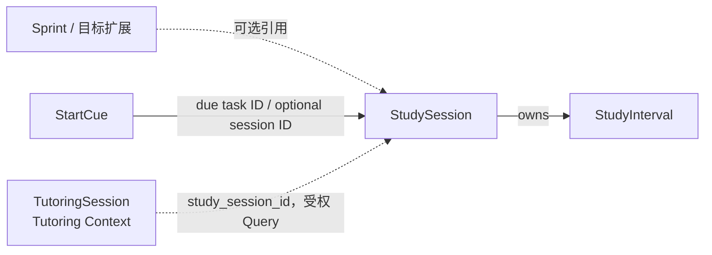
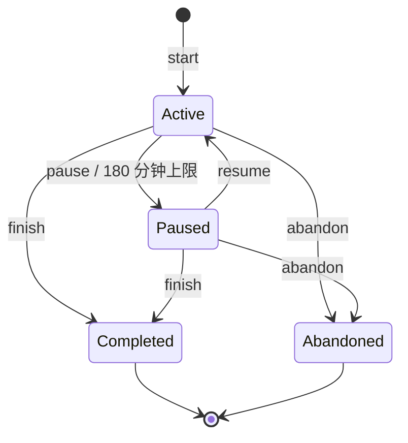
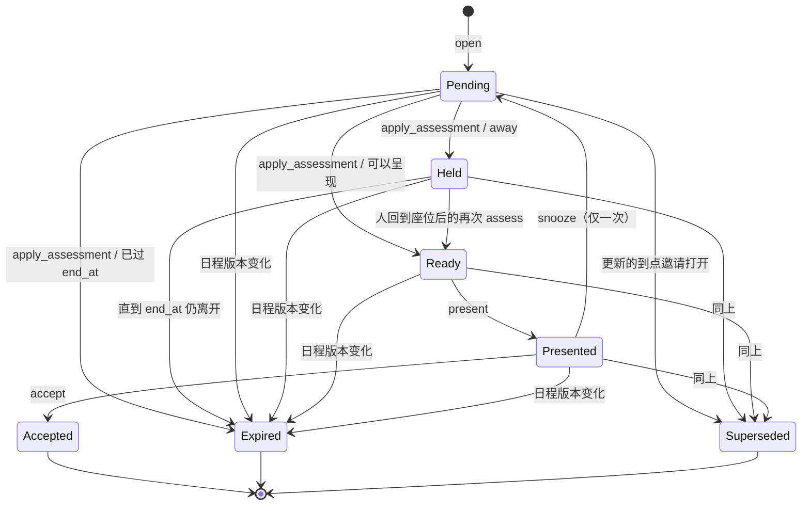
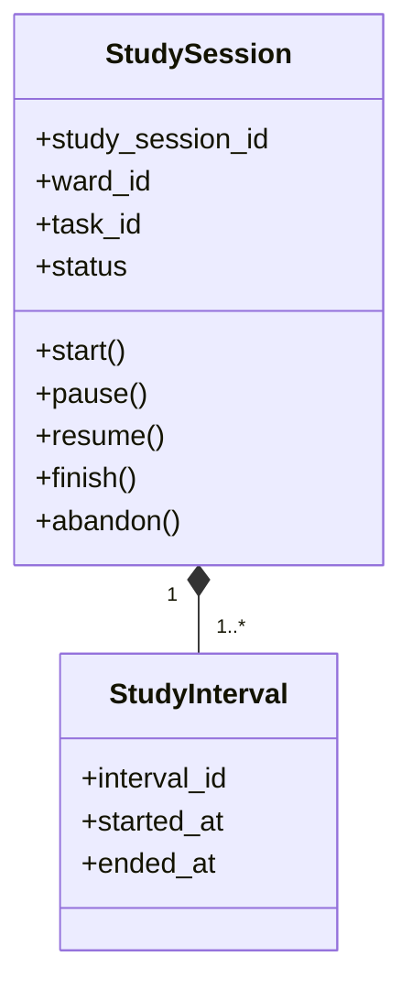
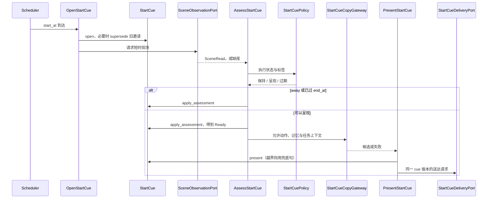
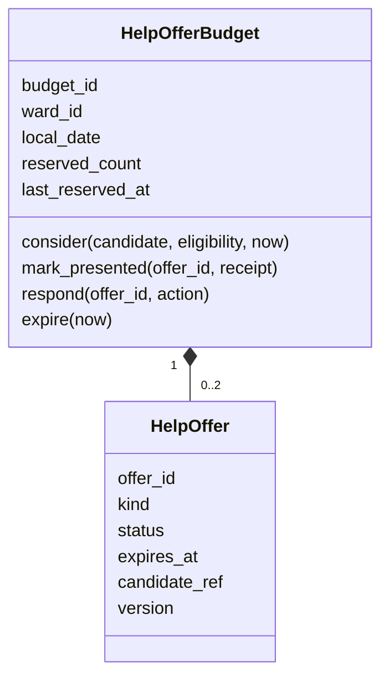
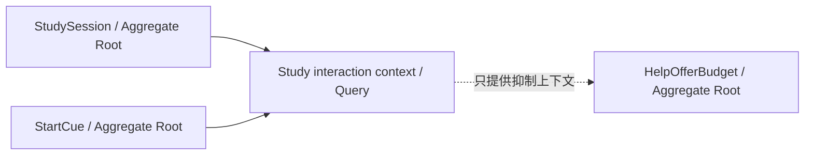
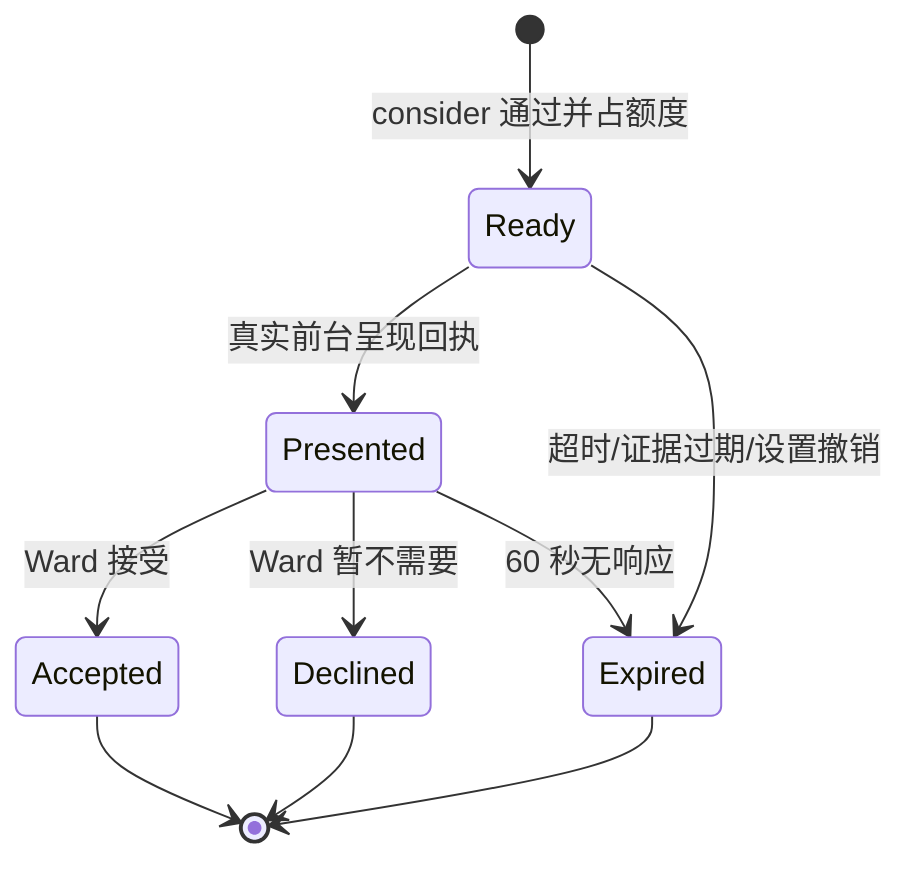
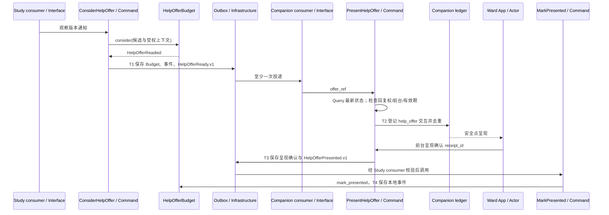
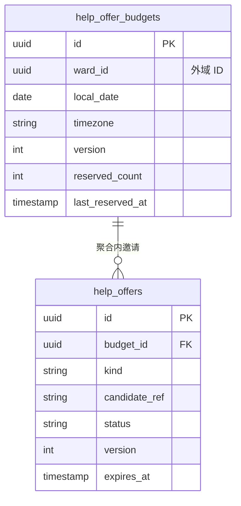

# 读学系统 — Study Domain Design

> 状态：讨论稿 · 版本：v4.0（答疑部分已拆至 [domain-tutoring.md](domain-tutoring.md)）
>
> 范围：学习执行会话（开始、暂停、完成、计时）、任务优先提醒中的到点开始邀请（`StartCue`），以及学习完成事实。
>
> 关联：[系统 Context Map](ddd-overview.md) · [Tutoring 辅导答疑](domain-tutoring.md) · [Companion 编排](domain-companion.md) · [Memory Context](domain-memory.md) · [Planning](domain-planning.md) · [Server 物理设计](design-server.md) · [陪伴 PRD](../product/prd-companion.md)

Context Map 与分层图只在 [ddd-overview.md](ddd-overview.md) 维护。答疑、`TutoringSession`、`ProblemRecord`、发音与 `TutoringTurnLoop` 只在 [domain-tutoring.md](domain-tutoring.md) 维护。Thread/Run、Harness 驱动、`WorkflowInteractionView` 和 SSE 只在 [domain-companion.md](domain-companion.md) 维护。Episode、Signal 与 Profile 只在 [domain-memory.md](domain-memory.md) 维护。物理表、留存和删除只在 [design-server.md](design-server.md) 维护。

## 一、边界与语言

### 1.0 轻量计划配套调整（2026-11-03 已实现待验收）

产品展示与时间口径以 [计划 PRD](../product/prd-schedule.md) 为准。保留本域完整状态和区间记录，普通任务/会话不驱动常驻首页任务条；仅明确开启的限时 Sprint 展示挑战卡。展示开关不修改执行事实。

- `PlanConfirmed.v1` 本身不开始会话；明确开始动作才由本域开始/复用会话。安排确认与执行结果分别回执。
- 只为 Ward 明确约定的钟点打开 `StartCue`；不为按前项预计时长推算的后项钟点打开邀请。下文已有时间槽调度描述需按此收敛，明确钟点的既有邀请策略仍适用。
- 暂停后换项保留原任务与执行区间；“本次先到这里”结束执行但不标完成，之后可新开会话继续同一任务。不自动并行计时或自动完成/开始下一项。
- 没有 active/paused 会话时的明确完成声明已由 `TaskExecutionService` 转交 Planning `declare_completion`，发布 `TaskCompletionDeclared.v1`；开始与耗时保留未知，不创建会话或发布伪造的 `StudySessionCompleted.v1`。有显式会话时仍保留执行事件。
- 无线上任务/会话也能使用观察与答疑；视觉只作为独立证据，不能暗中创建或完成显式会话。

本 Context 拥有 `StudySession`、`StudyInterval` 与 `StartCue`：显式执行事实与开始邀请；目标扩展 `Sprint` 拥有主动专注挑战，独立于普通任务完成状态。它不拥有答疑（见 [Tutoring](domain-tutoring.md)）、Thread/Run、长期画像、稳定 Signal、已确认日程，也不拥有帧或摄像行为结论。

核心不变量：

- 显式任务执行计时只由 `StudySession` 的区间记录；Sprint 的本轮计时独立记账，不与会话时长相加。单次执行达到 180 分钟自动暂停，不自动完成；只有 Ward 的完成命令才能 `finish()`。
- 无任务会话不能完成任务，也不发布 `StudySessionCompleted.v1`。
- 暂停、断线、取消 Run 都不结束学习会话。
- `StartCue` 只邀请开始。它不自动 `start()`、不修改 `start_at`、不通知 Guardian。

| 术语 | 本 Context 中的含义 | 明确不是 |
|---|---|---|
| `StudySession` | 一次学习执行。可以不绑定已确认任务 | Thread、计划草稿、摄像片段 |
| `StartCue` | 一张开始邀请。已排进当日计划的某项任务到了开始时间，孩子还没有在做它 | 学习会话、计划修订、分心告警、家长催促 |
| `SceneRead` | 这次邀请采用的现场标签 | 帧、`BehaviorSegment`、专注分 |
| `StartCuePolicy` | 按当前执行和现场标签决定说不说，以及允许哪些动作 | 文案生成、记忆解读、日程冲突校验 |

非目标：Study 不私自发明交互 `kind`；不做实时监工。到点邀请不是分心打分，也不把摄像结论写入本 Context。答疑与发音不属于本 Context，见 [Tutoring](domain-tutoring.md)。

### 1.1 到点邀请的控制模型

到点邀请是固定流程加一次结构化文案调用，不是 `TutoringTurnLoop`，也不是按现场循环选工具。

| 决策 | 选择 | 原因 | 拒绝的方案 | 验证 |
|---|---|---|---|---|
| 谁拥有邀请 | `StartCue` 与 `StartCuePolicy` | 孩子还没在做刚到点的那一项，这是执行事实 | 放进 Planning，或由 Companion 决定说不说 | 刚到点的任务已有进行中或暂停会话则不打开；前一项仍在进行仍会打开 |
| 谁决定动作集合 | `StartCuePolicy` | 能否开始、暂停、再提醒一次是执行不变量 | 模型按记忆自选按钮或改 `start_at` | 集合外动作被拒绝，改用策略兜底句 |
| 谁写给孩子的那句话 | 事务外的一次文案调用 | 说法要用到记忆和当前任务上下文 | 按标签写死唯一文案；多轮 Agent 自行决定催几次 | 调用失败或越界时仍呈现兜底句，且只呈现一次 |
| 谁送达 | Companion | 回复权与 `kind` 属于入口协议 | Study 直接推送或在答疑半轮中插话 | 未登记 `kind` 前动作不可用 |

调度器只触发用例。现场端口没有帧时，用例得到 `no_observation`，不调用视觉分类。

## 二、领域模型



本 Domain 的目标设计共有 **4 个 Aggregate Root**；StudySession/StartCue 已有实现，HelpOfferBudget 为未实现扩展，Sprint 已实现待验收。统一边界如下：

| Aggregate Root | 边界 | 职责 |
|---|---|---|
| StudySession | 一次显式执行及其计时区间 | 管理开始、暂停、继续、完成、放弃；不以视觉观察自动完成任务 |
| StartCue | 一次到点开始邀请及允许动作 | 询问是否开始到点任务；不改排期、不拥有其他会话 |
| HelpOfferBudget | 一个 Ward 一个本地晚上的干预额度及所属邀请 | 原子限制递梯子/温和回归邀请的次数、间隔和生命周期，见 §九 |
| Sprint（已实现待验收） | 一个 Ward 明确开启的一轮限时挑战及区间 | 记录目标持续时间、实际开始与暂停/到时/提前结束，不代表 Task 完成或专注成功，见 §2.4 |

各 Root 只通过 ID 或受权 Query 关联。TutoringSession 归 Tutoring，仅引用 study_session_id。

### 2.1 `StudySession`

StudySession 保证执行区间不重叠、关闭后停止计时；task_id 可空，但无任务会话不能发布完成任务的事实。StudyInterval 是其内部 Entity，SessionWindow 是值对象；字段与合法转移见下方 Entity Inventory、状态图和命令契约。

`finish()` 只接受 Ward 的完成命令。单次执行达到 180 分钟时，调度适配器调用 `PauseStudySession`，会话进入 `paused`，不自动完成。`abandon()` 表示 Ward 退出且不完成；不发布 `StudySessionCompleted.v1`。



#### 无任务会话

学习答疑可以不挂在任何任务上。此时 `StudySession.task_id` 为空，问答照常进行，不修改任何 `Task`，也不能把这次会话完成成某项任务。

任务进行中孩子问了无关问题时的回答与回任务提醒，由 [Tutoring](domain-tutoring.md#21-tutoringsession) 决定；不结束原来的任务会话。

### 2.2 `StartCue`

`StartCue` 是一张开始邀请。计划里的数学写着 19:00 开始，到了 19:00 数学还没有进行中或暂停中的学习会话，就留下这一张，问孩子要不要现在开始。前一项若还在进行，邀请照样留下，卡片上同时给出「继续前一项」和「暂停前一项并开始数学」。

它记下这次邀请的任务、开始和结束时间、当时的现场标签，以及孩子可以点的按钮。孩子接受、推迟、过了结束时间，或后一项到点把这张换掉，邀请就关闭。同一个孩子同时只有一张还开着的邀请。

`StartCue` 没有子实体。现场标签和允许动作都是值对象，因此不另画聚合内部类图；生命周期见下面的状态图。

StartCue 保证同一 Ward 同时只有一张未关闭邀请、最多推迟一次，且动作必须属于已保存的 CueAllowance。没有观察时不得声称看见书桌；接受后才允许按授权动作开始/暂停会话。其身份与幂等映射见命令和持久化契约，避免在此重复字段清单。

`SceneRead.label` 只取 `already_working`、`settling_in`、`other_activity`、`away`、`unclear`、`no_observation`。没有设备、没有观察授权或没有帧，由端口在分类前返回缺席，标签为 `no_observation`，`gap_reason` 只取 `no_device`、`lease_denied`、`no_frames`。分类失败、空结果或无法归类，映射为已有的 `unclear`，不再另设失败标签。`away` 表示看见空座位。



同一 Ward 已有未关闭邀请时，`open()` 在同一事务里先 `supersede()` 旧邀请。旧邀请上的任务如果孩子还没在做，它的 `due_task_id` 就记入新邀请的「更早还没开始」列表，不另发一张卡片。

`StartCuePolicy` 是无状态领域服务。它只看三件事：除了刚到点的这项，有没有另一条进行中或暂停的会话（不挂任务的会话也算有）、`SceneRead.label`、是否已经推迟过。它不读记忆，不调用模型，不解释任务标题。

| 执行 | 现场 | 处置 | 允许动作 |
|---|---|---|---|
| 没有其他进行中或暂停的会话 | `away` | 保持，先不呈现 | 无 |
| 没有其他进行中或暂停的会话 | 其余标签 | 呈现 | `start_due_task`、尚未用过的 `snooze_once` |
| 另有进行中或暂停的会话 | `away` | 保持，先不呈现 | 无 |
| 另有进行中或暂停的会话 | 其余标签 | 呈现 | `continue_current`、`pause_current_and_start_due`、尚未用过的 `snooze_once` |
| 任意 | 已过 `end_at` 仍未呈现 | 过期 | 无 |

兜底主按钮：没有其他会话时是 `start_due_task`；有其他会话时是 `continue_current`。`unclear` 与 `no_observation` 仍然呈现，兜底句只陈述到点事实，不描述书桌。`no_observation` 的 `scene_claim_allowed=false`。

允许动作没有改期、自动开始和通知家长。孩子说「先做完当前这项」只关闭这次邀请或推迟一次，不修改 Planning 的 `start_at`。已开始执行的正式计划修订仍由 Planning 拒绝。

### 2.3 实体清单

| 对象 | 类型 | Identity | 参与决策的状态 | 行为 | 不变量 |
|---|---|---|---|---|---|
| `StudySession` | Aggregate Root | `study_session_id` | `ward_id`、`task_id?`、`status`、`version` | `start`、`pause`、`resume`、`finish`、`abandon` | 结束后不计时；无任务不可完成 |
| `StudyInterval` | Entity | `interval_id` | `started_at`、`ended_at?`、`end_reason?` | 由 Root 开关 | 同时只有一个未关闭区间 |
| `StartCue` | Aggregate Root | `start_cue_id` | `ward_id`、`due_task_id`、`status`、`schedule_version`、`snooze_count`、`version` | `open`、`apply_assessment`、`present`、`accept`、`snooze`、`expire`、`supersede` | 每名 Ward 同时只有一张未关闭邀请；动作不得超出已保存的允许集合 |
| `SceneRead` | Value Object | 无 | `label`、`gap_reason?` | `validate()` | `no_observation` 必有缺口原因；`away` 不是缺口 |
| `CueAllowance` | Value Object | 无 | 允许动作、兜底主按钮、兜底句、`scene_claim_allowed` | `admits(action)` | 无其他会话时不含暂停或继续；已提醒过一次后不含再推迟 |



这张图只含 `StudySession` 与 `StudyInterval`。`StartCue` 没有子实体，见 2.2。`StartCuePolicy` 是领域服务，不属于任何一个聚合。

### 2.4 Sprint（主动专注挑战，已实现待验收）

产品开启条件、首页显隐与反馈唯一归属 [计划 PRD §4.4](../product/prd-schedule.md#44-专注挑战sprint)。本域负责运行事实，不把普通安排或有时长的 StudySession 隐式转换为挑战。

| 字段 / 状态 | 契约 |
|---|---|
| sprint_id / ward_id / version | 真实身份、本人授权、乐观版本；动作带 command_id 去重 |
| topic / task_id? / study_session_id? | 学习主题、可选任务/会话关联；允许无任务挑战，不为启动挑战补造任务会话 |
| target_duration_minutes / planned_start_at? | 正的目标运行时长、可选约定起点；不复用任务完成预估来暗中授权挑战 |
| started_at / intervals / elapsed | 实际开始及运行区间；显式暂停不累计，累计达到目标后截断，不把休眠/调度延迟算为额外完成挑战时长 |
| ready / active / paused / elapsed / ended / cancelled | 准备、运行、暂停、到时、提前结束、取消；结束原因不等于专注成功/失败 |

- `StartSprint` 校验 Ward 明确授权、目标时长与最新版本，记录服务端实际起点后进入 active。同一 Ward 最多一轮 active/paused Sprint；重复开始返回已有结果，开始新一轮须先明确处理旧轮。
- 未来约定保留 ready；到点只可提示开始，不自动 active。普通 StartCue 的接受仅开启任务会话，不能暗中替代挑战授权。
- `PauseSprint` / `ResumeSprint` / `EndSprint` 只改变本轮挑战；暂停或结束整个任务会话、声明作业完成须另由明确 StudySession 命令承接。取消或提前结束不记失败。
- 到时由幂等命令转为 elapsed，停止本轮计时；任何读取/恢复也须核算到时，不能只依靠客户端后台定时器。不会 `finish()` 原 StudySession，不发布 `StudySessionCompleted.v1`，不自动启动下一项。
- `GetSprintView` 只返回本人已核实的当前版本与允许动作；仅 active/paused 且未结束的本轮可驱动首页挑战卡。ready、elapsed、ended、cancelled 或未知均不驱动常驻卡。跨本地日终止遗留挑战并记录 day_rollover，不能恢复旧卡或自动重开；不改变任务完成状态。收起仅改变客户端可见性，恢复时重查版本。
- 到时反馈由 Companion 在回复安全点最多呈现一次，App 不可触达或消息晚到时不强制补弹，不插入答疑半轮。客户端领取成功后若恰逢新一轮答疑或退后台，须暂存该提示，在当前轮结束且回到前台后呈现；不能因请求代次变化丢弃已经领取的提示。新动作/交互需同步协议与 App allow-list，不能复用任务完成动作代替结束挑战。
- Sprint 计时与显式学习会话、视觉观察是不同来源，Evaluation 不可相加或将到时算作成功专注。若需要观察佐证，独立引用覆盖与活动证据。

#### 口述挑战预览（已实现，待本轮验收）

`POST /sprints/preview` 仅Ward可用，请求为content及可选previous（topic、target_minutes），不读取任务池、历史对话或改变Thread/Run；它是独立只读整理用例，不是StartSprint命令。`study.sprint-intake.system.v1` / `sprint-intake`工作流通过模型解释当前口述及本轮明确草稿，JSON schema与Python双校验，禁止关键词/数字正则推断语义。

响应status闭集为ready / needs_duration / clarify / cancelled，携带topic、target_minutes与展示message。主题缺省时使用通用“专注挑战”，时长缺失不补默认值；题量/页码/钟点不作持续时长。取消与不明由模型给出结构化判断，模型异常返回可重试502，不伪造候选。

预览没有任何领域写入，不建立Task/StudySession/Sprint。客户端确认后才调用既有Sprint创建/开始命令，使用稳定command_id与现有单轮/版本约束；运行状态读取服务端。客户端代次隔离取消/重新口述后的迟到结果，并将ASR回调绑定录音时的模式，防止取消后误投普通对话。完整展示规则只链接 [用户 PRD §6.2](../product/prd-user.md#62-专注挑战口述只读确认明确开始)。本次无需迁移。

迁移 `20261103_32`、服务端命令/API、按需首页及 Companion v2 挑战动作已实现，物理映射见 [Server 设计](design-server.md)。验证记录见[进行中 spec](../../.agent/specs/lightweight-planning-focus-sprint.md)。验收覆盖普通任务时间齐全不触发挑战、授权与时长缺失、重复开始/并发单轮约束、暂停继续计时、收起与多端恢复、延迟调度到时、提前结束、反馈去重和任务完成隔离。

## 三、应用用例

模型调用和工具调用发生在 Use Case 事务之外。完成校验通过后，Use Case 才打开本地短事务。全部写用例校验 Ward、会话版本和 `command_id`；同一 `command_id` 返回原结果，同键不同载荷拒绝。

| 触发 | 入口 | Use Case | 领域动作 | 本地事件 | 后续 | 幂等与失败 |
|---|---|---|---|---|---|---|
| Ward 开始学习 | Companion `RunInvocation` | `StartStudySession` | `start()` | `StudySessionStarted` | `StudySessionView` | `command_id`；无 `task_id` 时不发布完成事件 |
| 暂停或 180 分钟 | Ward 命令或 Scheduler | `PauseStudySession` | `pause()` | `StudySessionPaused` | 关闭当前区间 | 重复暂停无新区间 |
| Ward 继续 | Companion `RunInvocation` | `ResumeStudySession` | `resume()` | `StudySessionResumed` | 打开新区间 | 已结束后拒绝 |
| Ward 完成学习 | `StructuredWardCommand` | `FinishStudySession` | `finish()` | `StudySessionFinished` | 有 `task_id` 时同事务写 `StudySessionCompleted.v1` | 无任务会话拒绝完成 |
| Ward 退出且不完成 | 受权退出命令 | `AbandonStudySession` | `abandon()` | `StudySessionAbandoned` | 不发布完成事件 | 不回滚已提交答疑事实 |
| 调度器到达 `start_at` | Scheduler | `OpenStartCue` | `open()`；若已有未关闭邀请则对旧邀请 `supersede()` | `StartCueOpened`，可能还有 `StartCueSuperseded` | 向现场端口要一段短观察 | 幂等键见 2.2。刚到点的这项已有进行中或暂停会话则不开；前一项仍在进行仍打开 |
| 观察到达、观察超时，或推迟后再次到期 | Scheduler / 观察回调适配器 | `AssessStartCue` | `StartCuePolicy` 后 `apply_assessment()` | `StartCueHeld` 或 `StartCueReadied` | `Ready` 时才在事务外起草文案 | 缺席直接成为 `no_observation`，不调用分类 |
| 文案已通过允许集合校验 | `AssessStartCue` 的后续 | `PresentStartCue` | `present()` | `StartCuePresented` | 请求 Companion 送达 | 动作越界或声称看见了不存在的现场时，改用兜底句再提交；送达失败不回滚 |
| 孩子点卡片，或从首页开始了该任务 | `StructuredWardCommand` 或 `StartStudySession` | `AcceptStartCue` | `accept()`；需要时同一事务 `pause()` / `start()` | `StartCueAccepted`，以及对应的会话事件 | `StudySessionView` | 过期、版本冲突或动作不在允许集合中则拒绝 |
| 孩子点「等一下」 | 受权动作 | `SnoozeStartCue` | `snooze()` | `StartCueSnoozed` | 稍后再 `AssessStartCue` | 第二次推迟拒绝 |
| 新的 `PlanConfirmed.v1` 或到达 `end_at` | 消费适配器或 Scheduler | `ExpireStartCue` | `expire()` | `StartCueExpired` | 已呈现的卡片由 Companion 撤回 | 重复过期返回原结果 |

`StudySessionCompleted.v1` 在 `FinishStudySession` 的同一事务中写入 Outbox，不发布 `LearningFactRecorded.v1`。答疑互动事实由 [Tutoring](domain-tutoring.md#三应用用例) 发布。

### 3.1 `OpenStartCue` 到呈现

文案调用发生在事务外。`AssessStartCue` 提交并得到 `Ready` 之后，应用层才调用一次文案端口。校验通过后，`PresentStartCue` 另开短事务。`away` 停在 `Held`，不调用文案端口。

```python
class StartCueCopyCandidate(BaseModel):
    primary_action: Literal[
        "start_due_task",
        "continue_current",
        "pause_current_and_start_due",
        "snooze_once",
    ]
    secondary_action: Literal[
        "start_due_task",
        "continue_current",
        "pause_current_and_start_due",
        "snooze_once",
    ] | None = None
    text: str
    mentions_scene: bool
```

`primary_action` 与 `secondary_action` 都必须落在已保存的 `CueAllowance` 内，且二者不同。`scene_claim_allowed=false` 时 `mentions_scene` 必须为假。校验失败只再试一次，仍失败则用策略的兜底句和兜底主按钮调用 `present()`。记忆只进入这次文案调用的上下文，不进入 `StartCuePolicy`。



| 参与者 | 标准类型 | 职责 |
|---|---|---|
| `Scheduler` | Infrastructure | 到点、观察超时、`end_at` 和推迟到期时调用用例 |
| `OpenStartCue` / `AssessStartCue` / `PresentStartCue` | Use Case | 授权、短事务、幂等；文案调用留在事务外 |
| `StartCue` | Aggregate Root | 拒绝第二张未关闭邀请、第二次推迟和集合外动作 |
| `StartCuePolicy` | Domain Service | 决定保持、呈现或过期，并给出允许动作 |
| `SceneObservationPort` | Infrastructure | 返回 `SceneRead` 或缺席；不把帧写入 Study |
| `StartCueCopyGateway` | Infrastructure | 一次结构化文案调用 |
| `StartCueDeliveryPort` | Infrastructure | 请 Companion 在有回复权时呈现；失败只重试送达 |

孩子接受时，`AcceptStartCue` 在同一事务中处理邀请和会话：`start_due_task` 调用新会话的 `start()`；`pause_current_and_start_due` 先 `pause()` 当前会话再 `start()` 到点任务；`continue_current` 只 `accept()`，不改变会话。`StartStudySession` 若开始的就是这张邀请的 `due_task_id`，同一事务 `accept(start_due_task)`。这些用例都不发布 `LearningFactRecorded.v1`，也不调用 `GuardianAlertPort`。

## 四、Query

| Query / View | 消费者与新鲜度 | 来源 |
|---|---|---|
| `GetStudySession` / `StudySessionView` | Ward；用例提交后强一致 | `StudySession` 与区间 |
| `GetStartCue` / `StartCueView` | Ward；`PresentStartCue` 提交后强一致 | `StartCue` 的状态、允许动作、到点任务与更早未开始任务的 ID |

`StartCueView` 在读取时经 Planning 受权查询填入任务标题，标题不写回 `StartCue`。`GetStudySession` 也供 [Tutoring](domain-tutoring.md) 作受权 Query 使用，返回 `status`、`ward_id`、`task_id`。Guardian 不通过这些 Query 读取进行中的到点邀请。

## 五、跨 Context 契约

| 事件 | 生产者 | 消费者 | 幂等 | 失败 |
|---|---|---|---|---|
| `StudySessionCompleted.v1` | `FinishStudySession`，且存在 `task_id` | Evaluation；Planning `CompleteTask`（把该 Task 标为 `completed`，见 [Task 状态](domain-planning.md#二领域模型)） | `study_session_id + version` | 无任务完成不发布；重复完成返回原结果。Study 不写 `Task` |

Study 消费已有的 `PlanConfirmed.v1`。除准备可执行计划外，`ExpireStartCue` 使仍未关闭、且 `schedule_id + schedule_version` 对不上的 `StartCue` 过期。幂等键沿用 `schedule_id + version`。

`SceneWindow` 是对 Behavior Analysis 的受权查询，不是 Integration Event。`SceneObservationPort` 把缺席译成本 Context 的 `no_observation`。已确认的 `start_at`、`end_at` 与任务标题来自 Planning 的受权查询；Study 不保存日程正文作为第二事实源。标题只进入文案调用。`MemoryBundle` 同样只进入文案调用。

卡片的 `kind` 为 `start_cue`，`object_ref` 指向 `GetStartCue`。动作命令为 `start_due_task`、`continue_current`、`pause_current_and_start_due`、`snooze_once`。这些必须先登记在 [Companion Interaction Protocol](domain-companion.md#52-companion-interaction-protocol)，Study 不私自增加 `kind`。Companion 在当前 Run 仍有回复权时排队，答疑轮次结束后再呈现。送达以 `start_cue_id + version` 去重。

`StartCue` 不发布 `LearningFactRecorded.v1`。一次未开始不进入 Memory。

信封、SSE 和 Run 生命周期的失败语义以 Companion 为准。Fact 入账与 Episode 结算以 Memory 为准。

Tutoring 经受权 Query 读取 `StudySession`，不订阅 Study 的 Domain Event；Study 不读取 Tutoring 的 Aggregate。

## 六、基础设施映射

| Port | Adapter | 超时与失败 |
|---|---|---|
| `StudySessionRepository` | SQLAlchemy | 用例本地短事务；版本冲突返回 `conflict` |
| `StudyOutbox` | Study Outbox | 保存 `StudySessionCompleted.v1`；去重键 `study_session_id + version` |
| `StartCueRepository` | SQLAlchemy | 每名 Ward 至多一张未关闭邀请；版本冲突返回 `conflict` |
| `SceneObservationPort` | Behavior / Device ACL | 超时或无帧映射为 `no_observation`；分类无可用标签映射为 `unclear`；不重试到改变标签 |
| `StartCueCopyGateway` | 模型 Gateway 的一次结构化调用 | 超时或候选非法时使用策略兜底句；不做工具循环 |
| `StartCueDeliveryPort` | Companion 送达适配器 | 按 `start_cue_id + version` 重试；失败不改变 `StartCue` |

Study Repository 不保存完整 transcript，也不保存帧。到点邀请的关联 ID 使用 `start_cue_id + schedule_id + schedule_version`。缺口原因只进入审计，不进入 Ward 文案。授权边界是当前 Ward。

## 七、验收场景

```gherkin
Given 已排进当日计划的任务到达 start_at，且该任务没有进行中或暂停的 StudySession，现场端口没有帧
When OpenStartCue 与 AssessStartCue 完成
Then SceneRead 为 no_observation
And 不调用视觉分类
And 呈现的句子不声称看见书桌
And 不发布 LearningFactRecorded.v1
And 不调用 GuardianAlertPort

Given 现场标签为 away
When AssessStartCue 完成
Then StartCue 进入 Held
And 不调用文案端口
And 在 end_at 仍无人时 ExpireStartCue 将其过期

Given 另有一条进行中或暂停的会话，且现场不是 away
When PresentStartCue 提交
Then 允许动作只有 continue_current、pause_current_and_start_due，以及至多一次 snooze_once
And 文案候选若带有改期动作则被拒绝并改用兜底句

Given Ward 已经对这张邀请 snooze 过一次
When 再次提交 snooze_once
Then SnoozeStartCue 拒绝
And StartCue 仍保持原状态

Given Ward 接受 pause_current_and_start_due
When AcceptStartCue 提交
Then 当前会话暂停，到点任务的新会话开始
And StartCue 进入 Accepted
And Planning 的 start_at 不变

Given StudySession 已 Active 且连续计时达到 180 分钟
When 调度适配器调用 PauseStudySession
Then 会话进入 paused，当前区间关闭
And 不自动 finish，不发布 StudySessionCompleted.v1

Given StudySession 没有 task_id
When Ward 调用 FinishStudySession
Then 命令被拒绝，不发布 StudySessionCompleted.v1
```

## 九、观察触发的求助邀请（目标扩展）

> 2026-11-01 设计草案，未实现。触发证据见 [Behavior Analysis](domain-behavior.md)，不是 StartCue 的新状态，也不依赖 Plan 或 StudySession。本文本节唯一拥有邀请策略与生命周期；Companion 只拥有交互协议和实际送达。

### 9.1 边界与语言

`HelpOffer` 是“要不要一起看看”的一次求助邀请，不是遇到难题的诊断、任务开始命令或 TutoringSession。邀请有两种 `kind`：`offer_help` 针对持续停滞，`invite_return` 针对连续可见活动偏离。前者询问“这题需要一点提示吗？”，后者询问“要不要回到刚才这一步？”。接受后分别聚焦提问入口或让孩子继续纸面学习；都不自动发题、开会话或改任务。默认 shadow，获授权观察并由 Ward 在 App 开启陪伴模式后才真实呈现。正式运行支持卡片与可选轻声提示；App 不可触达时保持静默，不能声称已经完成干预。

Study 的 `HelpOfferPolicy` 只接收 Behavior Query 的停滞/活动偏离候选和受权上下文快照，不直接解释图片；校验本人开启、具有有效陪伴通道、观察够新、当前在桌、无答疑 Run/确认操作/主动休息、无 StartCue 待呈现、未达频次上限。没有授权、通道缺席或 Query 失败即跳过且不占额度。StartCue 有优先权，两种邀请共享 Companion 安全呈现点。

### 9.2 聚合规则与对象关系

本域四个 Aggregate Root 的边界已在 §二统一说明。HelpOfferBudget 将同一晚的频次、间隔与 HelpOffer 子实体放在一个事务边界内。`consider`、`mark_presented`、`respond`、`expire` 是唯一修改入口；默认最多两次 reserve、间隔至少 20 分钟，同时只能有一个活动邀请。同一连续候选不因观察 revision 变化而重复邀请，过期或关闭后不能复活。

频次和间隔均为实验默认值，锁定 policy_version；reserve 即消耗本晚额度，不因失败自动返还，避免重试造成重复打扰。`CandidateRef` 的 range 与上次邀请重叠时认为同一候选，即使 revision 不同也不重新邀请；只有可靠活动恢复后形成的新候选才可能再邀请。

| 对象 | Canonical type | Identity | 决策属性 / 行为 | 不变量责任 |
|---|---|---|---|---|
| HelpOfferBudget | Aggregate Root | budget_id | policy、reserved_count、last_reserved_at；consider/respond/expire | 额度、间隔、单个活动邀请、同停滞去重 |
| HelpOffer | Entity | offer_id | kind、candidate_ref、status、expires_at、presented_at、version；通过 Root 转移状态 | Root 控制合法响应和过期 |
| CandidateRef | Value Object | 无 | day/revision/range、fresh_until | 来源可追溯，不随新报告覆盖 |
| EligibilitySnapshot | Value Object | 无 | observed_at、setting_version、interaction_state_version | 快照过期时不允许据此呈现 |



新增 Root 与现有 StudySession/StartCue 仅经 ID/受权上下文关联，不组成大 Aggregate：





### 9.3 Command Cards 与触发矩阵

共用输入 `actor/system_scope, command_id, expected_version`；每条只改本域 Root，Domain Event 和需要的 Outbox 同事务保存。模型只在 Behavior 侧评估帮助机会；Study 用确定性策略决定是否允许干预。两类邀请使用受控短句，不生成“你走神了”“你不会做”等心理归因。

| Trigger → Adapter | Command / 额外输入 | 授权 / 前置条件 | 本地事务与行为 | 事件 / 后续 | 幂等与失败 |
|---|---|---|---|---|---|
| ObservationRevisionPublished.v1 → Study consumer Interface | ConsiderHelpOffer(day_id, revision) | 系统 scope；schema 校验；Query 读取当前候选/设置/交互上下文；证据过期跳过 | Budget.consider，expected_version 防并发超额 | HelpOfferReadied；Outbox HelpOfferReady.v1 | inbox + day/revision；不同 revision 由 range 再去重；查询失败不邀请 |
| Companion 回执事件 → Study consumer Interface | MarkHelpOfferPresented(offer_id, presented_at, receipt_id) | schema、同 Ward/offer、回执签发来源合法；呈现发生在有效期内 | Budget.mark_presented | HelpOfferPresented；更新 Query | receipt_id 唯一；迟到回执只记真实呈现审计，不复活已关闭邀请 |
| Ward 点击 → HTTP Interface | RespondHelpOffer(offer_id, action=accept/decline) | Ward 本人；expected offer version；未过期且已呈现 | Budget.respond | HelpOfferAccepted/Declined；offer_help 接受后聚焦 VoiceComposer；invite_return 接受后收起邀请回纸面 | command_id 唯一；409 刷新，禁止自动重放；重复同命令返回原响应 |
| 到期计时/设置关闭 → Timer Infrastructure | ExpireHelpOffers(budget_id, now) | 系统 scope | Budget.expire | HelpOfferExpired；Query 关闭按钮 | 每 Root/version 幂等；不撤回已发生的呈现事实 |

### 9.4 Query、协议和异步送达

`GetHelpOffer(actor, ward_id, offer_id) -> {offer_id, version, kind, status, text, allowed_actions, expires_at}`：只供 Ward 本人和 Companion 系统使用，Root 提交后可读；不对 Guardian 展示孩子的实时状态。`GET /api/v1/study/help-offers/{id}`、`POST /api/v1/study/help-offers/{id}/respond`，后者输入 `{action, expected_version, command_id}`。403/404 授权失败、422 非法动作、409 过期或版本冲突。

动作还需携带 Companion 签发的 `presentation_receipt`。若前台确认事件尚未被 Study 消费，RespondHelpOffer 可先验证该回执、在同一 Budget 事务调用 mark_presented 再 respond，避免“孩子已点击但异步回执未到”的竞态。回执绑定 Ward/offer/version/presented_at、短有效期且不可伪造；随后重复回执无副作用。expected_version 对准回执引用的邀请版本，已被其他命令关闭的邀请仍拒绝。

`HelpOfferReady.v1` payload：`{ward_id, budget_id, offer_id, offer_version, expires_at, source_revision_ref, kind}`；公共 envelope、schema_version、event_id、occurred_at 必填。Companion consumer 调自己的 `PresentHelpOffer` Command：按 offer_id + version 去重，重新 Query 有效邀请与最新观察/设置/Run 状态；只在有效陪伴通道和回复安全点写入登记过的交互，实际通道规则见 §9.6。当前没有安全点或未建立有效陪伴通道就等待，过期丢弃。初次送达/实际显示时均检查 expires_at，避免离线缓存迟到弹出。

Companion 保存交互消息与待发布回执同事务；`HelpOfferPresented.v1` payload 为 `{ward_id, offer_id, offer_version, receipt_id, presented_at, medium}`，由 App 前台呈现确认后签发，不将入队或写消息当作孩子已看到。Study inbox 按 receipt_id 去重。用户点击是新授权动作，走 Study Command；Companion 不自动构造孩子的提问。回执可区分 card_rendered 与 speech_completed，前者证明卡片已显示、后者证明播报已完成，二者均不证明孩子听见或理解；同一 offer 的第二种媒介回执只补充审计，不再次转移 Presented 状态或增加额度。

两事件允许重复/乱序；待呈现版本失效即丢弃，回执不改变已终结 Root。瞬时失败沿用 Outbox 退避，死信后对账；过期邀请不重放。跨域没有全局事务，不承诺 exactly-once 物理显示，客户端也按 offer_id 去重，前后台切换不重复播报。

| 参与者 | Canonical type | 职责 |
|---|---|---|
| Study/Companion consumers、HTTP | Interface | 翻译事件、鉴权、调用所属 Command |
| Consider / Respond / Present / MarkPresented | Command | 本域授权、事务与 Query Port 协调 |
| HelpOfferBudget | Aggregate Root | 邀请、额度、响应状态 |
| Companion 交互账本 | Aggregate Root | 仅负责本域交互登记与去重，既有模型见 Companion 设计 |
| Outbox / App foreground receipt | Infrastructure / Actor | 可靠交付 / 真实呈现确认 |
| HelpOfferReadied / HelpOfferPresented | Domain Event | Study 本地事实 |



图源：本文 §9；上述时序仅为目标扩展，不表示既有账本已有这些方法。

### 9.5 Infrastructure Design Card

| 项目 | 设计 |
|---|---|
| Ports/adapters | HelpOfferBudgetRepository → PostgreSQL；Observation/Settings/InteractionQueryPort → 所属域授权 Query ACL；Publisher → 平台 Outbox；均在 bootstrap 装配 |
| 超时/失败 | Query 2 秒、最多一次瞬时重试；失败跳过，不用旧快照猜；DB 锁超时 3 秒，冲突重读至多 3 次；跨域消息按平台退避/死信。固定文案与预置短语音无在线生成依赖，无语音模型熔断需求 |
| 持久化 | help_offer_budgets 唯一(ward_id, local_date)；help_offers PK offer_id、FK budget_id；Root/version 乐观锁、同事务写额度与 Entity；每 Root 一个 Repository |
| 迁移/恢复 | 先增表、Companion kind 与 App allow-list、前台回执，再 shadow 后受控启用；回滚关 flag/过期邀请，保留审计。旧 StartCue 不迁移为求助邀请 |
| 授权/删除 | 图片不复制到邀请；仅保留来源引用。Ward 删除时清理预算/邀请，取消待送达，重放检查删除 fence。设置撤销后客户端/送达端立即抑制 |
| 指标/trace | shadow 拟触发数、实际呈现/接受/拒绝/过期数、限流与抑制原因、重复去重；关联 offer/day/command/event ID；不记录题面明文 |



ER 图源：本文 §9.5；budgets/offer 表分别支撑 Root/Entity，没有新增 Query 表。其余 Study 表见既有物理设计，本图仅画本次扩展；物理迁移前须同步 design-server。

验收：同晚并发多个候选也不超额度；旧版本重复通知不重复邀请；正常思考静止只产生拟候选而不作诊断；答疑 Run 中不插话；断网补传不当前提醒；后台未触达不算已帮助；拒绝/忽略不追问；点击接受后不自动开题、不自动完成任务。Domain 测策略、PostgreSQL 测并发与 inbox/Outbox、协议测试测 App 前台去重及过期拒绝。


### 9.6 “卡壳递梯子”和温和回归的实际执行

持续状态如何累计、模型判定依据、代码如何自动启动邀请，分别见 [Behavior §2.5](domain-behavior.md#25-持续状态累计与帮助机会判定) 和 [§3.2](domain-behavior.md#32-目标代码调用链谁启动递梯子与回归邀请)。本节只定义实际干预。

两种触发共用 HelpOfferBudget，不各自额外申请两次额度：

| 场景 | Behavior 提供的证据 | Study 允许的动作 | 实际交互与后续 |
|---|---|---|---|
| 疑似卡壳超时 | 连续约 4 分钟 still_with_material、覆盖充分，语义评估支持 offer_help；不能据此确定真的遇到难题 | 邀请一次求助 | 卡片和可选轻声“这题需要一点提示吗？”；接受后使用 VoiceComposer 拍题/说卡点，既有 Tutoring 分步启发与微验证接手 |
| 持续活动偏离 | 连续约 2 分钟 other_visible_activity，模型结合多帧和可选学习上下文支持 invite_return；转头、单次停笔、查资料或原因不明不触发 | 一次自主回归邀请 | 卡片和可选轻声“要不要回到刚才这一步？”；可接受或暂不需要，不给分心标签，不通知家长 |
| 阅读、正常思考或原因不明 | reading_material、uncertain、unknown 或存在采集缺口 | 不干预 | 保持观察，不用静止时长代替语义判断 |
| 已进入主动休息、离座、正在答疑或有确认操作 | 最新受权状态表明不适合介入 | 抑制或使待呈现邀请过期 | 不追问、不积压到后来突然播报 |

具体例子：19:00—19:04 连续停笔且学习材料仍在使用，Day 更新产生 offer_help 候选；Study 通过频次和现场检查；Companion 在安全点询问；孩子回应需要后主动拍题；Tutoring 引导下一步并记录验证状态。若 19:04:15 已恢复书写，送达前重查应丢弃邀请。对活动偏离使用相同链路，只更换候选 kind 与邀请动作。

“走神提醒”在此对应 **可选择、无指责的回归邀请**，仍遵循产品禁止实时分心红字、扣分和蜂鸣警告的边界。视觉不写入“孩子走神”事实，模型无把握就不提醒。

Companion 的 `support-channel`（目标协议）补齐实际触达：

- Ward 无需创建计划或点击学习开始，在 App 打开一次陪伴模式即可建立本人设备的短租约通道；`card` 仅显示卡片，主动开启 `handsfree` 才可播报。App 保持可运行的陪伴界面；不依赖网关播放声音，也不假设操作系统允许后台出声。
- 该通道是可失效的运行时能力租约，不新增业务 Aggregate。绑定 Ward/device/channel，租约 90 秒、每 30 秒心跳；切后台、关闭陪伴模式或断开后禁止新的播报。SSE 只送已授权、未过期交互引用，不传桌面图片。
- App 内预置两句对应 prompt_id 的短语音，离线可播放，无须临时调 TTS。用户允许声音、App 在前台、无正在播放/录音/答疑输出、邀请和最新观察仍有效时，只播放一次；静音、不可播放或未开启 handsfree 则保留卡片，并标记 speech_suppressed，不能算已播报。
- App 按 offer_id 持久化去重；断线重连可恢复有效卡片，不重播已尝试的语音。播放完成才回 `speech_completed`；异常中断记失败，不为获取回执反复播音。卡片显示单独回 card_rendered。
- 邀请在有效期内无人回应即过期；孩子继续学习、忽略或暂不需要均不追加催促。接受只改变本次邀请，之后是否恢复可观察活动供实验统计，不能直接宣称“已提升专注”或“难题已解决”。

通道 API、呈现回执及动作协议由 [Companion](domain-companion.md#522-关闭的-kind-清单) 唯一维护。交付约束：**无在线可运行 App/出声通道，只能保证记录和晚间报告，不能保证即时递梯子。** 正式验收必须覆盖纸质作业中不看屏幕、音频开关、前后台切换、断线重连与播放失败；shadow 阶段只验证拟触发，不冒充已完成干预。
