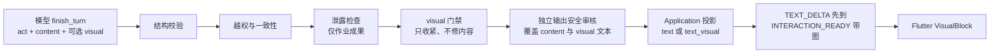
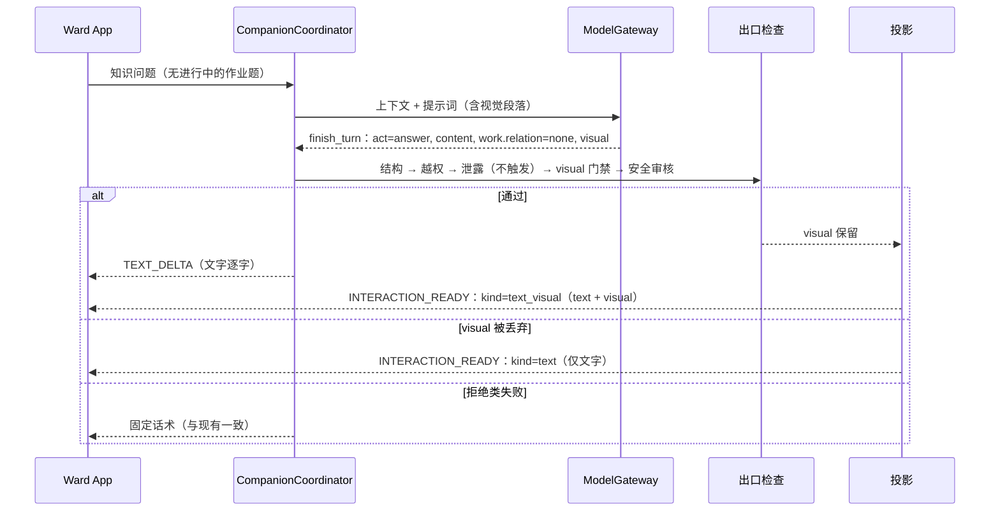

# 读学系统 — 答疑表达设计：有逻辑、图文并茂

> 状态：草案 v0.1，**未实现**，数字均为待校准的假设 · 范围：`tutoring.turn` 面向孩子的 `content` 的结构（逻辑性）与可选配图（视觉化）。
>
> 关联：[Tutoring Domain](domain-tutoring.md)（契约 `tutor-turn.v2`、出口检查） · [Companion 交互协议](domain-companion.md#52-companion-interaction-protocol) · [AI Component](infra-ai-components.md) · [答疑离线评测](eval-offline.md) · [App 端设计](design-app.md)
>
> 单一事实源：契约字段、出口检查、交互 `kind` 仍以上述文档为准。本文只写表达层的设计；实现落地时，把契约与协议的变更同步回它们，本文只保留设计理由与验收。

## 一、目标与非目标

**问题。** 现在 `tutoring.turn.system.v4` 对 `content` 的约束只有一句"简短中文，可含 Markdown 或 LaTeX，不超过 1200 字"。回答长什么样完全由模型自由发挥：同一类问题有时一大段、有时多级列表；`guide` 可能一次抛出多个问题；解释流程、对比、层级关系时只有文字，孩子要自己在脑中画图。

**目标。**

1. **逻辑性**：每种 `act` 的回答有稳定、简短的结构，因果用句子讲，一轮只推进一件事。
2. **图文并茂**：对"解释概念、过程、对比、层级、关系"的知识问答，可以附一张简单的图，帮助孩子建立结构。
3. 不削弱既有保护：答案保护、泄露检查、独立输出安全审核、孩子端的稳定性。

**非目标。**

- **不让模型输出 HTML 或任何可执行的片段；不把"任意 SVG"作为默认配图路径。** 常规配图由模型表达语义、客户端绘制（§五.1–5.7）。大气循环这类"自由示意图"先走**审定图库**，只有图库与结构化图型都覆盖不了时，才考虑**受限 SVG**，且须过严格的清洗与校验（§五.8）。
- 不做通用 Generative UI。[交互协议](domain-companion.md#522-关闭的-kind-清单)明确没有 `generative_ui`、`custom_widget`；本设计只增加一个**关闭词汇表**里的展示部件。
- 不在 `guide` 或任何作业成果相关的回合里配图（红线，§五.4）。
- 不证明"配图提升学习效果"。离线评测不测学习效果（见 [eval-offline §一](eval-offline.md)），本设计只给出可验证的前置指标与线上观察方案（§九）。

## 二、设计来源与取舍

思路参考了仓库内 `z-presentation-kit/`（对一个商用 Agent 产品呈现层的整理）。它有四条可借鉴的做法，也有明显不适用的部分：

| 做法 | 本项目的取舍 |
| --- | --- |
| 回答规则 + 长度预算，把"逻辑清晰"变成可检查的约束 | **借鉴**，但目标读者是中小学生，预算是"几十字"而不是"50–70 行"；按 `act` 分别定（§四） |
| 显式的"何时该配图"触发策略（解释、对比、>3 个并列项、层级、流程） | **借鉴**，再加本项目的红线：只在不属于作业成果时配图 |
| 复杂度预算（≤5 节点、≤3 层、≤2 色系）与静态 lint | **借鉴**，变成契约的校验约束，不再 lint SVG |
| 模型直接写 SVG/HTML，由浏览器渲染 | **HTML 不采用**：Flutter 不是浏览器，执行模型生成的代码与"候选不可信"原则冲突。**SVG 不作默认路径**：`flutter_svg` 能渲染 SVG 1.1，但 CSS 支持不完整，模型算坐标易溢出、重叠，输出 token 多、延迟高；仅作为自由示意图的受限后备（§五.8） |

注意：该 kit 的规则含对原产品提示词的引用，**只借思路，提示词一律自行改写**，不直接拷贝原文进产品。

## 三、总体结构：两层，各自独立可用

```text
逻辑层  回答形状（content 的结构）   纯文本，所有 act 都适用，不依赖任何新契约字段
视觉层  可选配图（visual）            仅 act=answer 且 work.relation=none，结构化，原生绘制
```

两层独立上线：逻辑层只改提示词与评测；视觉层才动契约、协议与 App。视觉层失败（校验不过、客户端不识别）时丢弃图，文字照常展示，孩子不会因此得到更差的回答。



## 四、逻辑层：回答形状

**形状**指 `content` 由哪几部分、按什么顺序、多长组成。它与配图无关。

### 4.1 原则：约束不变量，不规定句式

先规定"不变量"，把具体句子留给模型，避免每轮千篇一律，也避免限制 `guide` 根据孩子回答灵活诊断。硬骨架（"第一句必须是……"）不作为首选；是否需要，由 §九 的对照实验决定。

通用不变量（所有 `act`）：

- 面向孩子的口吻，句子短；因果、先后用连贯的句子表达，不用圆点列表拆碎。只有真正并列的 3 个以上同类项才用列表。
- 不用标题层级；不出现"如上所述"这类指代（孩子可能只看这一屏）。
- 一轮只推进一件事。

### 4.2 按 `act` 的形状

| `act` | 形状（期望） | 不变量 |
| --- | --- | --- |
| `answer` | 结论 → 一句原因 → 一个贴近生活的例子 →（可选）一个追问 | 先结论，不反问、不让孩子先猜（与现有规则一致） |
| `guide` | 复述或回应孩子刚才的想法 → **一个**最小问题或一个提示 | 问题与 `work.next_subgoal` 一致；不列完整步骤；不给最终答案 |
| `chat` | 1–2 句自然回应 | 不排版 |
| `clarify` | 一句说明为什么要确认 → 候选或补充要求 | 同一对象最多问一次（既有规则） |
| `redirect` | 一句温和的话 | 回任务提醒由系统补（既有规则） |
| `pronounce` | `content` 一句导语；内容在 `pronounce.lesson` | 不变 |
| `safety` | 由代码换成固定话术 | 不变 |

**长度上限**按 `act` 与年级分层设定。**初始数值不在本文拍板**：先用 §十 第 0 步对现有输出做统计，再据分布设定，避免凭感觉写死一个会误伤正常回答的阈值。

### 4.3 落地方式

1. **提示词**：在 `tutoring.turn.system` 升版（下一个版本号）里，把上表写成简短的"回答形状"段落，配 1–2 个短示例。示例比长规则更省 token 也更有约束力。
2. **确定性 lint**：对 `content` 做只读检查（§七），结果进 trace 与评测，不触发 fallback。
3. **评测**：用确定性指标度量，见 §九。

`follow_up_question` 字段与正文的关系需要先核对现有投影方式：形状里的"追问"应出现在哪里，避免孩子看到两个问题。这是待确认项（§十二）。

## 五、视觉层：结构化配图

### 5.1 为什么是"语义描述 + 客户端绘制"

模型最擅长表达"有哪些概念、什么关系"，最不擅长计算像素坐标。把布局和绘制交给客户端：

- 安全：没有任何可执行或可样式化内容进入孩子端；每个字段都能校验、限长、过滤。
- 一致：颜色、字号、深浅色、无障碍由 Flutter 主题统一；不会出现暗色模式文字消失。
- 可检查：图里的每个字都是显式字段，能进入安全审核和作答保护的关键词兜底。
- 可降级：校验失败只丢这张图。

### 5.2 契约：`visual` 子对象

沿用 v2 的做法：必填仍只有 `act` 与 `content`；`visual` 是只属于特定 `act` 的可选子对象，不适用即丢弃，不拒绝。

```python
class VisualNode(BaseModel):
    id: str                       # 本图内唯一，仅用于引用
    label: str                    # 短文本，纯文本，无 Markdown/URL/HTML
    detail: str | None = None     # 更短的补充，可省

class VisualEdge(BaseModel):
    src: str                      # 必须是已有 node.id
    dst: str
    label: str | None = None

class VisualPayload(BaseModel):
    kind: Literal["steps", "compare", "layers", "relation"]
    title: str | None
    alt: str                      # 必填：一句话说清图的内容，同时供读屏
    # 各 kind 使用的字段不同，由 discriminated union 约束，下表为预算
```

首期图型与预算（数值为初始假设，随评测校准）：

| `kind` | 用途 | 数据形态 | 预算 |
| --- | --- | --- | --- |
| `steps` | 先后顺序、流程、过程变化 | 有序节点，线性 | 2–5 个节点 |
| `compare` | X 和 Y 的区别 | 2–3 列，每列若干条属性 | ≤3 列、≤4 行，行标题可选 |
| `layers` | 包含、层级、组成 | 嵌套节点 | ≤3 层，每层 ≤4 个节点 |
| `relation` | 概念之间的关系、有分支的流程 | 节点 + 有向边 | ≤6 个节点、≤8 条边 |

通用限制：`label` 与 `detail` 的字数上限、不含 URL、HTML、Markdown 标记；`alt` 必填；边只能引用存在的节点；节点 `id` 不重复。**超预算或结构非法时丢弃整张图，不截断、不猜测修复**，因为截断可能改变含义。

分期：首期只做 `steps` 与 `compare`；`layers`、`relation` 在前两种的渲染与评测稳定后再加。数据趋势类沿用 App 已有的 `fl_chart`，不放进 `visual`。

### 5.3 何时配图（触发策略）

**谁来判断：在同一次主调用里由主模型提议，由代码门禁否决，不增加额外的 LLM 调用。**

| 判断 | 谁做 | 理由 |
| --- | --- | --- |
| "这个解释是否有结构、值得配图""选哪种图型" | 主模型（语义判断，写进同一次 `finish_turn`） | 需要理解问题，规则难穷举；放在同一次调用里没有额外延迟和成本 |
| "这一轮允许不允许出现图" | 代码（§5.4） | 涉及作业保护与安全，必须确定性，不交给模型 |
| 孩子明确要求"画个图" | 代码把它作为**提示信号**放进本轮上下文（与 `expected_act` 同类），模型仍要给出合法的 `visual`，门禁照常生效 | 明确请求是强信号，但不能绕过红线 |

不引入单独的"是否配图"分类器调用：它会多一次往返、增加延迟和成本，且与主模型的判断可能不一致。若评测显示召回过低，先补**确定性特征**作为提示（如"为什么/怎么/区别/过程/循环"等问法）或补提示词示例，而不是加一次 LLM 调用；这些特征只做提示，不替代模型判断，更不能替代门禁。

提示词中给模型的判断规则（简化）：

- **该配**：解释"是什么、怎么运作、为什么"；两者对比；多于 3 个并列项；有先后顺序的过程；层级或组成关系。
- **不该配**：词义或一句话能说清的问答；少于 3 个元素；孩子问的是作业题；对话在闲聊。
- **数量**：每轮最多一张；不确定就不配。

### 5.4 红线与门禁（代码执行，不依赖模型自觉）

| 条件 | 处理 |
| --- | --- |
| `act != answer` | 丢弃 `visual` |
| `work.relation != none` | 丢弃 `visual` |
| 本轮有未完成的作业题（`has_open_problem`）或 `permit.answer_protected` | 丢弃 `visual`，**即使模型自述 `relation=none`**；模型的"与作业无关"自述只会收紧，不会为配图放宽 |
| 结构非法、超预算 | 丢弃 `visual`，文字照常 |
| `visual` 的文字含答案标记 | 丢弃 `visual`（沿用现有关键词兜底） |
| 独立输出安全审核 | `visual` 的 `title`、`label`、`detail`、`alt` **与 `content` 一并送审**；不通过则整轮按现有规则处理 |

这样一来：配图只会出现在"确定是知识问答"的回合，配图本身不可能成为作业答案的旁路，也不会绕过安全审核。

### 5.5 协议投影

`companion-interaction.v1` 规定 `kind` 由 Application 产出、模型不得发明，且新增 `kind` 要同步 App 白名单。因此：

- 模型只返回 `visual` 子对象，**不返回 `kind`、按钮、动作**。
- 通过门禁后，由 Application 投影为 `kind=text_visual`，`parts = text + visual`；这是对协议的一次**关闭词汇表内的新增**，需先改协议文档与 App allow-list。
- 旧客户端遇到未知 `kind` 已规定降级为 `text`（协议原文），所以灰度期不会炸，只是没有图。
- 发音走 `object_ref` 拉取目标 View，是因为播放器与音频需要二次请求；`visual` 是只读展示且体积有限，**首期内联在 part 里**。是否随消息写入 journal（历史回看是否保留图）是待定项（§十二）。

### 5.6 流式时序

沿用协议 §5.2.4：`TEXT_DELTA` 先逐字出现；校验通过后，最终 `INTERACTION_READY` 才携带完整交互（含 `visual`），App 此时一次性渲染（可加简单淡入）。`TEXT_DELTA` 不携带图的任何内容。这样没有半张图，也没有流式重绘闪烁。

### 5.7 Flutter 渲染

- 组件：`VisualBlock(visual)`，按 `kind` 分发到各自的渲染器；放在伴学答疑的消息气泡之内，位于对应文字之后。
- 绘制：Flutter 原生 widget 与 `CustomPaint`；颜色与字体取自 `ThemeData`，一张图最多一个强调色加中性色；字号随系统文字缩放。
- 布局：`steps` 窄屏纵向、宽屏可横向；`compare` 为等宽列；`layers` 为嵌套容器；`relation` 先用适用于 ≤6 节点的简单分层或环形布局，是否引入 `graphview` 等库作为实现期决定，不在本文预设。
- 无障碍：`Semantics` 标签为 `alt` 加线性化描述（例如"第一步……第二步……"）。
- 降级：`visual` 不可解析或 `kind` 不识别 → 不渲染图，文字保持；不报错、不弹窗。

### 5.8 自由示意图：大气循环、水循环这类图

结构化图型（节点、列、层级、关系）表达不了"地球剖面、弯曲的环流箭头、分区标注"这类**插画式示意图**，而学生恰恰会问到（大气环流、水循环、光合作用、地层结构）。

**Flutter 能渲染 SVG。** `flutter_svg` 支持 SVG 1.1，已有 `colorMapper` 可按主题替换颜色；但其 README 指出 **CSS 不完整支持**，应使用属性（presentation attributes）而非内联样式。动画、脚本、滤镜、`foreignObject` 等不在支持范围内；是否能渲染某个具体 SVG，需用其官方提供的 `vector_graphics_compiler` 兼容性检查命令实测，不能凭印象判断。所以"能渲染"只回答了第一半，更要紧的是**这张图谁来画、质量谁来保证、会不会不安全**。

按风险从低到高分三档，**自上而下优先，只有上一档覆盖不了才用下一档**：

| 档 | 做法 | 优点 | 代价与风险 |
| --- | --- | --- | --- |
| T1 结构化图型 | §5.2 的 `steps`/`compare`/`layers`/`relation` | 最安全、最省 token、主题一致 | 只表达关系，不是插画 |
| T2 **审定图库** | 预先制作并审校课程常见示意图（SVG 或 `vector_graphics` 预编译资源），模型只返回 `figure_ref`（来自授权候选清单，类似 `history_ref`）和可选的高亮项 | 质量稳定、可经教研审校、无生成延迟、版权可控、无注入面 | 要有人制作与维护；只覆盖有限主题；清单要随提示词给模型（可按年级与学科裁剪） |
| T3 **受限 SVG** | 模型按受限方言生成 SVG，服务端清洗后给客户端渲染 | 覆盖面最广，能应付长尾 | 质量不稳定、输出 token 多、延迟高、校验面最大 |

**为什么优先 T2：** 大气环流这类图是教材级内容，对准确性要求高；让模型现场画，错一个气流方向就是错误知识，而配图不承担证据责任（图没有审稿环节）。图库让图本身可审校，模型只负责"选对哪一张"，这与现有"模型提议、代码授权"的思路一致。`figure_ref` 必须出自本轮授权清单，否则丢弃。

**T3 受限 SVG 的约束**（如决定做，须同时满足）：

- **方言白名单**：标签只允许 `svg`、`g`、`rect`、`circle`、`ellipse`、`line`、`polyline`、`polygon`、`path`、`text`；属性白名单；**禁止** `script`、`style`、`class`、`href`/`xlink`、`image`、`foreignObject`、`filter`、事件属性、外部引用。清洗是**删除而不是修复**，删到只剩白名单后仍不合法则整张丢弃。
- **固定画布**：统一 `viewBox` 与安全区，按手机宽度设定（不沿用 kit 的 680），文字最小字号、标签长度、元素数量均设上限。
- **颜色只用调色板**：由 `colorMapper` 映射到主题，保证深浅色可读；不允许任意十六进制随意搭配。
- **箭头不依赖 `marker`**：该特性在 `flutter_svg` 的支持情况需实测，默认用显式 `path` 画箭头头部。
- **文字不依赖自动换行**：SVG 文本不换行，标签要短；所有文字节点进入独立输出安全审核，并计入 `alt` 的一致性检查。
- **标注为"示意图"**：App 在图下加固定小字，说明图用于帮助理解，不作为标准答案或考试依据。
- **同样受 §5.4 门禁约束**：只在知识问答出现，绝不用于作业题。

**成本是 T3 最大的问题：** 一张带弯曲箭头和标注的示意图，SVG 文本可能是数百到数千 tokens，按 40–60 tokens/秒估算，可能多等数秒到数十秒，不应放在孩子等待的主回复里。更合理的做法是**主回复先给文字，图作为可选的后续**（例如孩子点"画一张图"后再单独生成，并带进度提示）。这需要在交互协议里增加一个允许动作，属于协议变更，只能走评审，**首期不做**。

**结论：** 学生想要大气循环图，首选"图库里有就直接选，没有就退回文字加 `steps`/`relation` 的简化示意"；受限 SVG 作为长尾后备，等 T1、T2 稳定并有真实"想要图却画不出来"的数据后再评估，不作为默认能力。

## 六、提示词预算（估算，需实测）

当前 `tutoring.turn.system.v4` 为 2,462 字符，按中文约 0.9 token/字、英文与符号约 0.35 token/字符估算约 **1,400 tokens**。增量估算：

| 方案 | 内容 | 新增 | 相对增幅 |
| --- | --- | --- | --- |
| 逻辑层 | 回答形状段 + 1–2 个短示例 | 约 150–250 tokens | 约 +10% 至 +18% |
| 视觉层最小 | 触发规则 + `steps`/`compare` + 1 个示例 | 约 450–500 tokens | 约 +30% 至 +35% |
| 视觉层标准 | 触发规则 + 4 种图型 + 预算 + 1 个示例 | 约 800–850 tokens | 约 +55% 至 +60% |

**压缩手段：**

1. **条件拼接**：Application 在调用前就知道 `has_open_problem` 与 `permit.answer_protected`；这些轮次不附上视觉段落（门禁也会丢弃），增量为 0。预计可把平均增幅降到视觉层的一半左右。
2. 示例优于长规则；预算类约束放在校验层（pydantic 截止），不在提示词里反复强调。
3. 视觉段落放在静态部分之后，保持固定前缀，不破坏提示缓存。

更值得关注的是**输出**：一张 5 节点的图约 60–150 tokens，配图轮次会增加 1–3 秒生成时间。这对孩子体验比输入变长更敏感，所以必须在评测里单独记录延迟，且"不确定就不配"是默认。

以上均为估算：没有量过完整输入（envelope、`permit`、`recent_utterances`、图片）的实际 token 构成。实现前先做一次实测（§十 第 0 步）。

## 七、出口检查如何归类

沿用 [domain-tutoring §4.2](domain-tutoring.md) 的"拒绝类 vs 规范化类"原则：

| 类别 | 项目 | 行为 |
| --- | --- | --- |
| 拒绝类（不变） | 作业答案保护、泄露判官、独立输出安全审核 | 不通过则回退，不写事实 |
| 规范化类（新增） | `visual` 不适用、超预算、结构非法、含答案标记 | 丢弃 `visual`，文字照常展示，只记原因 |
| 规范化类（新增） | `content` 的形状 lint（超长、一轮多个问题、列表比例过高、`$` 未配对、裸 HTML） | **只记录，不回退**；严重的确定性清洗（如去掉裸 HTML）留待实现期决定 |

形状 lint 绝不能成为新的 fallback 来源：这正是 note 114/115/119 反复出现的故障模式（与安全无关的不一致把可展示的回答换成固定话术）。

## 八、关键流程与时序



## 九、评测与度量

遵循 [eval-offline](eval-offline.md)：离线只做冒烟，不做 hill climbing，v1 不引入 LLM judge，不测学习效果。因此：

**离线（确定性，可进 CI）**

| 层级 | 指标 |
| --- | --- |
| guardrail | `guide`/作业成果/有进行中作业题的回合里**没有**保留 `visual`；`visual` 文字泄露为 0；现有答案保护用例不退化 |
| secondary | 配图轮次的 `visual` 结构通过率；配图触发的精确率与召回（正例：解释类、对比类；反例：词义、闲聊、作业题）；形状 lint 违规率；`content` 字数分布；`guide` 一轮问题数 |
| primary | 既有 outcome 通过率不低于改动前（包括 `fallback` 原因分布不新增 `visual` 或形状相关原因） |

数据集：新增"应配图""不应配图""有进行中作业题但孩子问了知识问题"三类用例；按现有流程先 `proposed`，人工复核后才 `confirmed`。样本小，结论只作冒烟，区间过宽时按评测文档的做法明示。

**需要人工或线上才能回答的问题（明确不在离线范围）**

- 孩子是否更容易看懂？
- 是否更少追问"没懂"？
- 延迟增加是否可接受？

建议先做小范围人工评审（20–30 条真实问答，一组有图一组无图，由教研视角看）；若合规允许再看线上的"同一问题重复追问率"、答疑轮数等。LLM 评分作为后续选项，须先有人工校准集，且必须把长度与年龄适配设为扣分项（LLM 评审天然偏爱更长更有条理的回答）。

## 十、实施路径

| 步骤 | 内容 | 退出条件 |
| --- | --- | --- |
| 0 | **现状度量**：用评测数据与可获得的真实输出，统计 `content` 字数、问题数、列表比例；实测完整输入 token 构成 | 得到形状阈值的依据；得出视觉段落的实际增幅 |
| 1 | **逻辑层**：提示词升版（含形状段）、形状 lint（只记录）、评测指标；与代码分两次评测以便归因 | 既有 outcome 不退化；形状指标有改善或至少不恶化 |
| 2 | **前端先行**：手写 `visual` JSON，在 App 里实现 `steps`、`compare` 渲染与降级、无障碍；不碰后端 | 视觉走查通过；窄屏与深色可用 |
| 3 | **契约与协议**：`visual` 子对象、门禁、投影 `text_visual`、协议文档与 App 白名单；安全审核覆盖 | §十一 验收场景全绿 |
| 4 | **提示词视觉段 + 评测**：条件拼接、触发用例 | guardrail 为 0 违规；记录延迟 |
| 5 | **扩展图型**：`layers`、`relation`，评估是否需要布局库 | 同步骤 4 的指标 |

每一步按项目约定走 spec，测试全绿才算完成；契约与协议变更与文档同一 commit。步骤 3 依赖 `tutor-turn-contract-v2` 完成，**不要把 `visual` 并入 v2 的当前改动**，避免再引入一次契约变更。

## 十一、验收场景（实现时转为测试）

```text
Given 孩子问知识问题，没有进行中的作业题
When  模型返回 act=answer、work.relation=none，附合法的 steps 图
Then  出口检查通过，投影为 text_visual，图与文字一起展示

Given 孩子正在做作业题，同时问了一个知识问题
When  模型返回 act=answer、work.relation=none，附 visual
Then  visual 被丢弃，文字回答照常展示，不触发 fallback

Given act=guide
When  模型附 visual
Then  visual 被丢弃；不影响 hints_given 等计数与事实写入

Given visual 的 edge 引用了不存在的节点，或节点数超预算
When  出口检查执行
Then  整张图被丢弃，文字照常展示，记录原因；不重试

Given visual.label 或 alt 含违规内容
When  独立输出安全审核执行
Then  按现有规则处理，不得只检查 content

Given 旧版 App 不认识 text_visual
When  收到该交互
Then  降级为 text，只显示文字

Given content 超长、含两个问题或 $ 未配对
When  形状 lint 执行
Then  只记录，回答照常展示，不触发 fallback
```

## 十二、风险与待定项

**风险**

- 图可能泄露解法：由门禁（只在知识问答、无进行中作业题时允许）和安全审核覆盖，不依赖模型自觉。
- 词汇表天花板：模型想表达的图不在词汇表内时，退化为纯文字，不报错。
- 渲染器工作量：每个图型的布局、换行、窄屏适配都有成本，所以分期、先做最小集合。
- 延迟：配图轮次生成变慢；以"不确定就不配"与条件拼接缓解，评测中单独记录。
- "配图有帮助"尚无证据，只有对 WorkBuddy 等产品的观感；需要 §九 的人工评审，不要在没有证据时扩大范围。

**待定项**

1. `visual` 是否写入 `CompanionMessage` journal（影响历史回看是否保留图）；若不写，需明确"历史里只有文字"。
2. 新 `kind` 命名与是否用 `part` 扩展代替新 `kind`（`text_visual` 与现有 `text_media` 对应）。
3. `follow_up_question` 与正文追问的现有投影方式，避免孩子看到两个问题。
4. 年级分层的形状阈值，是否需要按年级分层，取决于 §十 第 0 步的统计。
5. `relation` 图的布局实现（自研简单布局或引入库）。
6. 形状 lint 是否需要对严重项做确定性清洗。
7. 审定图库（T2）：由谁制作与审校、首批覆盖哪些学科与主题、资源格式（SVG 或 `vector_graphics` 预编译）、`figure_ref` 清单如何按年级学科裁剪后注入提示词。
8. 受限 SVG（T3）是否做；若做，`flutter_svg` 对 `marker`、`text`、`tspan` 等的实际支持范围要先用兼容性检查实测，并决定是否增加"点击后再生成图"的协议动作。

## 十三、落地时需同步的文档

- [domain-tutoring.md](domain-tutoring.md)：契约（`visual` 子对象）、出口检查（`visual` 门禁与归类）。
- [domain-companion.md](domain-companion.md)：交互协议（新 `kind` 与 `visual` part、流式事件说明）。
- [infra-ai-components.md](infra-ai-components.md)：提示词版本、条件拼接。
- [eval-offline.md](eval-offline.md)：新增指标与用例类别。
- [design-app.md](design-app.md)：`VisualBlock` 与降级规则。
