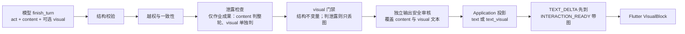
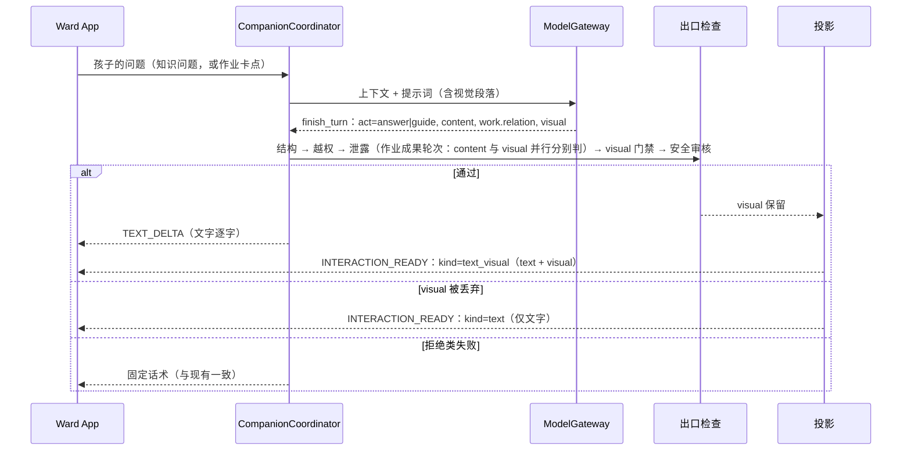

# 读学系统 — 答疑表达设计：有逻辑、图文并茂

> 状态：草案 v0.1，**未实现**，数字均为待校准的假设 · 范围：`tutoring.turn` 面向孩子的 `content` 的结构（逻辑性）与可选配图（视觉化）。
>
> 关联：[Tutoring Domain](domain-tutoring.md)（契约 `tutor-turn.v2`、出口检查） · [Companion 交互协议](domain-companion.md#52-companion-interaction-protocol) · [AI Component](infra-ai-components.md) · [答疑离线评测](eval-offline.md) · [App 端设计](design-app.md)
>
> 单一事实源：契约字段、出口检查、交互 `kind` 仍以上述文档为准。本文只写表达层的设计；实现落地时，把契约与协议的变更同步回它们，本文只保留设计理由与验收。
>
> **设计前提：教学优先**（见 [陪伴 PRD §1.2 第 7 条](../product/prd-companion.md)、[Tutoring 设计原则](domain-tutoring.md#设计原则教学优先)）。本文先写“好老师会怎么讲、会不会借助图”，再写技术如何承接。是否配图由教学需要决定，不由 `act` 或 `work.relation` 决定；代码只在**安全不变量**上否决。

## 一、目标与非目标

**问题。** 现在 `tutoring.turn.system.v4` 对 `content` 的约束只有一句"简短中文，可含 Markdown 或 LaTeX，不超过 1200 字"。回答长什么样完全由模型自由发挥：同一类问题有时一大段、有时多级列表；`guide` 可能一次抛出多个问题；解释流程、对比、层级关系时只有文字，孩子要自己在脑中画图。

**目标。**

1. **逻辑性**：每种 `act` 的回答有稳定、简短的结构，因果用句子讲，一轮只推进一件事。
2. **图文并茂**：站在老师角度，只要"用图比纯文字更有助于孩子理解"，就可以附图。两类都要支持：**通用概念图**（流程、对比、层级、关系）和**学科图**（线段图、数轴、几何图形等）。学科图在作业辅导里价值最高，不是附属品。
3. 不削弱既有保护：答案保护、泄露检查、独立输出安全审核、孩子端的稳定性。

**非目标。**

- **不让模型输出 HTML 或任何可执行的片段；不把"任意 SVG"作为默认配图路径。** 配图由模型表达语义、客户端绘制（§五）。插画式的自由示意图（如大气环流）暂不在本文范围，需要时另行设计。
- 不做通用 Generative UI。[交互协议](domain-companion.md#522-关闭的-kind-清单)明确没有 `generative_ui`、`custom_widget`；本设计只增加一个**关闭词汇表**里的展示部件。
- 不让图成为作业答案的旁路：图不得给出作业的最终答案、待填内容或完整解法（红线，§五.4）。这条红线约束的是**图的内容**，不是"哪类回合不能配图"。
- 不证明"配图提升学习效果"。离线评测不测学习效果（见 [eval-offline §一](eval-offline.md)），本设计只给出可验证的前置指标与线上观察方案（§九）。

## 二、设计来源与取舍

思路参考了仓库内 `z-presentation-kit/`（对一个商用 Agent 产品呈现层的整理）。它有四条可借鉴的做法，也有明显不适用的部分：

| 做法 | 本项目的取舍 |
| --- | --- |
| 回答规则 + 长度预算，把"逻辑清晰"变成可检查的约束 | **借鉴**，但目标读者是中小学生，预算是"几十字"而不是"50–70 行"；按 `act` 分别定（§四） |
| 显式的"何时该配图"触发策略（解释、对比、>3 个并列项、层级、流程） | **借鉴**，再加本项目的红线：图不得泄露作业答案（§5.4） |
| 复杂度预算（≤5 节点、≤3 层、≤2 色系）与静态 lint | **借鉴**，变成契约的校验约束，不再 lint SVG |
| 模型直接写 SVG/HTML，由浏览器渲染 | **HTML 不采用**：Flutter 不是浏览器，执行模型生成的代码与"候选不可信"原则冲突。**SVG 不作默认路径**：`flutter_svg` 能渲染 SVG 1.1，但 CSS 支持不完整，模型算坐标易溢出、重叠，输出 token 多、延迟高 |

注意：该 kit 的规则含对原产品提示词的引用，**只借思路，提示词一律自行改写**，不直接拷贝原文进产品。

## 三、总体结构：两层，各自独立可用

```text
逻辑层  回答形状（content 的结构）   纯文本，所有 act 都适用，不依赖任何新契约字段
视觉层  可选配图（visual）            answer / guide 均可，由教学需要决定；结构化，由客户端绘制
```

两层独立上线：逻辑层只改提示词与评测；视觉层才动契约、协议与 App。视觉层失败（校验不过、客户端不识别）时丢弃图，文字照常展示，孩子不会因此得到更差的回答。



## 四、逻辑层：回答形状

**形状**指 `content` 由哪几部分、按什么顺序、多长组成。它与配图无关。

### 4.1 原则：约束不变量，不规定句式

先规定"不变量"，把具体句子留给模型，避免每轮千篇一律，也避免限制 `guide` 根据孩子回答灵活诊断。硬骨架（"第一句必须是……"）不作为首选；是否需要，由 §九 的对照实验决定。

通用不变量（所有 `act`）：

- 面向孩子的口吻，句子短；因果、先后用连贯的句子表达，不用圆点列表拆碎。只有真正并列的 3 个以上同类项才用列表。
- 不用标题层级；不出现"如上所述"这类指代（孩子可能只看这一屏）。
- 一轮只推进一件事。

### 4.2 按 `act` 的形状

| `act` | 形状（期望） | 不变量 |
| --- | --- | --- |
| `answer` | 结论 → 一句原因 → 一个贴近生活的例子 →（可选）一个追问 | 先结论，不反问、不让孩子先猜（与现有规则一致） |
| `guide` | 复述或回应孩子刚才的想法 → **一个**最小问题或一个提示 | 问题与 `work.next_subgoal` 一致；不列完整步骤；不给最终答案 |
| `chat` | 1–2 句自然回应 | 不排版 |
| `clarify` | 一句说明为什么要确认 → 候选或补充要求 | 同一对象最多问一次（既有规则） |
| `redirect` | 一句温和的话 | 回任务提醒由系统补（既有规则） |
| `pronounce` | `content` 一句导语；内容在 `pronounce.lesson` | 不变 |
| `safety` | 由代码换成固定话术 | 不变 |

**长度上限**按 `act` 与年级分层设定。**初始数值不在本文拍板**：先用 §十 第 0 步对现有输出做统计，再据分布设定，避免凭感觉写死一个会误伤正常回答的阈值。

### 4.3 落地方式

1. **提示词**：在 `tutoring.turn.system` 升版（下一个版本号）里，把上表写成简短的"回答形状"段落，配 1–2 个短示例。示例比长规则更省 token 也更有约束力。
2. **确定性 lint**：对 `content` 做只读检查（§七），结果进 trace 与评测，不触发 fallback。
3. **评测**：用确定性指标度量，见 §九。

`follow_up_question` 字段与正文的关系需要先核对现有投影方式：形状里的"追问"应出现在哪里，避免孩子看到两个问题。这是待确认项（§十二）。

## 五、视觉层：结构化配图

### 5.1 为什么是"语义描述 + 客户端绘制"

模型最擅长表达"有哪些概念、什么关系"，最不擅长计算像素坐标。把布局和绘制交给客户端：

- 安全：没有任何可执行或可样式化内容进入孩子端；每个字段都能校验、限长、过滤。
- 一致：颜色、字号、深浅色、无障碍由 Flutter 主题统一；不会出现暗色模式文字消失。
- 可检查：图里的每个字都是显式字段，能进入安全审核和作答保护的关键词兜底。
- 可降级：校验失败只丢这张图。

### 5.2 契约：`visual` 子对象

沿用 v2 的做法：必填仍只有 `act` 与 `content`；`visual` 是可选子对象，`answer` 与 `guide` 都可携带；`act` 为 `chat`/`clarify`/`redirect`/`pronounce`/`safety` 时没有可承载图的正文，才丢弃（这是结构原因，不是教学判断）。

```python
class VisualNode(BaseModel):
    id: str                       # 本图内唯一，仅用于引用
    label: str                    # 短文本，纯文本，无 Markdown/URL/HTML
    detail: str | None = None     # 更短的补充，可省

class VisualEdge(BaseModel):
    src: str                      # 必须是已有 node.id
    dst: str
    label: str | None = None

class VisualPayload(BaseModel):
    kind: Literal["steps", "compare", "layers", "relation",
                  "segment", "number_line", "geometry"]
    title: str | None
    alt: str                      # 必填：一句话说清图的内容，同时供读屏
    # 各 kind 使用的字段不同，由 discriminated union 约束，下表为预算
```

图型分两类。**通用概念图**表达概念之间的结构；**学科图**表达题目里的数量与几何关系。两类都是首期范围，具体先后见下方分期。

通用概念图（预算为初始假设，随评测校准）：

| `kind` | 用途 | 数据形态 | 预算 |
| --- | --- | --- | --- |
| `steps` | 先后顺序、流程、过程变化 | 有序节点，线性 | 2–5 个节点 |
| `compare` | X 和 Y 的区别 | 2–3 列，每列若干条属性 | ≤3 列、≤4 行，行标题可选 |
| `layers` | 包含、层级、组成 | 嵌套节点 | ≤3 层，每层 ≤4 个节点 |
| `relation` | 概念之间的关系、有分支的流程 | 节点 + 有向边 | ≤6 个节点、≤8 条边 |

学科图（K12 作业辅导的主要视觉需求；设计提议，待教研确认图型清单）：

| `kind` | 用途 | 数据形态 | 预算 |
| --- | --- | --- | --- |
| `segment` | 线段图：和差倍、分数、应用题的数量关系 | 若干条线段；每条有 `label`、份数或数值、可选括号（合计/差）；未知量标 `unknown=true`，不得带数值 | ≤4 条线段、≤2 个括号 |
| `number_line` | 数轴：大小比较、负数、不等式、分数与小数位置 | 范围、刻度、若干标记点或区间；未知点标 `unknown=true`，不得带数值 | ≤8 个标记 |
| `geometry` | 几何图形与辅助线：三角形、四边形、圆、角 | 点、线段、圆、角及其标注；由客户端按约束求布局 | ≤8 个点、≤10 条线段/圆 |

学科图的关键原则：**模型只表达"有哪些对象、什么数量关系"，不给像素坐标；比例、布局由客户端计算。** 几何的"约束到布局"是难点，需要在实现期用真实题目验证，验证不过的图型先退回文字，不阻塞其他图型。

通用限制：`label` 与 `detail` 的字数上限、不含 URL、HTML、Markdown 标记；`alt` 必填；边只能引用存在的节点；节点 `id` 不重复。**超预算或结构非法时丢弃整张图，不截断、不猜测修复**，因为截断可能改变含义。

分期：首期 `steps`、`compare`、`segment`、`number_line`（结构简单，且覆盖概念类与小学应用题两大需求）；第二期 `geometry`、`layers`、`relation`。数据趋势类沿用 App 已有的 `fl_chart`，不放进 `visual`。

### 5.3 何时配图（触发策略）

**判断标准：站在老师的角度，用图是否比纯文字更有助于这个孩子理解当前的问题。** 与回合的 `act`、`work.relation` 无关：好老师给孩子讲应用题，会先画线段图帮他审题；讲"水循环"，会画流程；孩子问词义，就不需要图。

**谁来判断：在同一次主调用里由主模型提议；代码只在安全不变量上否决，不增加额外的 LLM 调用。**

| 判断 | 谁做 | 理由 |
| --- | --- | --- |
| "用图是否更有助于理解""选哪种图型" | 主模型（教学判断，写进同一次 `finish_turn`） | 需要理解问题和孩子当前的卡点，规则难穷举；放在同一次调用里没有额外延迟和成本 |
| "这张图能不能给孩子看"（是否泄露作业答案、是否安全、结构是否合法） | 代码（§5.4） | 涉及作业保护与安全，必须确定性，不交给模型自觉 |
| 孩子明确要求"画个图" | 代码把它作为**提示信号**放进本轮上下文（与 `expected_act` 同类），模型仍要给出合法的 `visual`，门禁照常生效 | 明确请求是强信号，但不能绕过红线 |

不引入单独的"是否配图"分类器调用：它会多一次往返、增加延迟和成本，且与主模型的判断可能不一致。若评测显示召回过低，先补**确定性特征**作为提示（如"为什么/怎么/区别/过程/循环"等问法）或补提示词示例，而不是加一次 LLM 调用；这些特征只做提示，不替代模型判断，更不能替代门禁。

提示词中给模型的判断规则（简化）：

- **该配**：
  - 概念类：解释"是什么、怎么运作、为什么"；两者对比；多于 3 个并列项；有先后顺序的过程；层级或组成关系。
  - 学科类：题目里的数量关系说不清或孩子读不懂（线段图）；大小、位置、范围关系（数轴）；图形条件和辅助线（几何）。
  - 孩子明显卡在"想象不出来"时。
- **不该配**：词义或一句话能说清的问答；元素太少，图不比文字更清楚；对话在闲聊；图会直接给出答案（由 §5.4 兜底）。
- **数量**：每轮最多一张；拿不准用图是否真的有帮助时，不配。
- **作业题里的图只画"条件与关系"**：已知量画出来，未知量标 `unknown`，帮助孩子看清题意，不画求解结果。

### 5.4 红线与门禁（代码执行，不依赖模型自觉）

门禁只管**安全不变量**，不管教学判断。`act`、`work.relation` 在这里只决定"要做哪种检查"，不决定"能不能配图"。

| 条件 | 处理 |
| --- | --- |
| `act` 没有可承载图的正文（`chat`/`clarify`/`redirect`/`pronounce`/`safety`） | 丢弃 `visual`（结构原因） |
| 结构非法、超预算 | 丢弃 `visual`，文字照常 |
| 学科图的**结构不变量**（确定性，schema 层）：`unknown=true` 的量、点、区间、角或长度**不得带数值**，也不得在 `label`/`detail` 里写出数值 | 违反则丢弃 `visual`，文字照常。这是挡住"图上直接标出答案"最便宜、最可靠的一道，不依赖模型 |
| **按作业成果处理**（`relation=same\|new`，或 `answer_protected=true`）：**文字**（`content`）是否给出最终答案、待填内容或完整解法 | 现有泄露检查，**不变**：判定泄露、超时或结果非法都按泄露处理（fail-closed），整轮回退 |
| 同上：**图**（`visual`）是否给出最终答案、待填内容或完整解法 | **与文字分开判断**，见下方"图的泄露判断"。判定泄露、超时或结果非法，一律**只丢弃 `visual`**，文字照常展示 |
| `visual` 的文字含答案标记 | 丢弃 `visual`（沿用现有关键词兜底） |
| 独立输出安全审核 | `visual` 的 `title`、`label`、`detail`、`alt` **与 `content` 一并送审**；不通过则整轮按现有规则处理 |

**图的泄露判断：**

- **为什么分开、为什么只丢图：** 红线要保证的是"孩子看不到作业答案"。图泄露时丢掉图，这条已经满足，没必要连累正常的文字回答；把图的误判升级成整轮 fallback，会把可展示的回答换成固定话术，正是 v2 要消除的故障模式（note 114/115/119）。文字泄露仍整轮回退，行为与现状一致。fail-closed 在**图这一层**保持：判不准就不给孩子看这张图。
- **判官输入：** 把 `visual` 序列化成一段文字（`kind`、各节点或线段的 `label` 与数值、`unknown` 标记、关系、`alt`），连同 `task_title`、`problem_summary` 交给判官。现有 `LeakJudgePort.leaks(text, task_title, problem_summary)` 只收文本，所以接口可以不变，序列化放在调用方；但**判官提示词需要扩展**到能判断"图中的已知量和关系是否已构成完整解法或最终答案"，按 AI Component 约定新增或升版提示词，不在运行时拼接。
- **延迟：** 文字判官与图判官互不依赖，**并行**发出；只有"作业成果轮次且带 `visual`"才多这一次调用，其余轮次没有额外开销。
- **能力边界：** `problem_summary` 是摘要而非原题，判官对"图是否已构成完整解法"的识别能力有限，这是评测要专门验证的点（§九），不假设它可靠。判官不稳定时的退路是只允许画"条件图"（只画题面已知量，未知量标 `unknown`），而不是回到禁止作业轮次配图。
- **不做"数值必须出自题面"的确定性检查：** 线段图里的"3 份"可能来自题面的"3 倍"，字面上不在题面里，这类检查会误杀合法的图；`problem_summary` 也不是原文，没有可对照的权威来源。已知量是否正确、是否越过条件，交判官判断，并作为人工复核样例持续观察。

模型的 `relation=none` 自述仍只会收紧：判断为与作业无关的轮次不做答案泄露检查，但安全审核照常。

这样一来：好老师会用的图（包括作业辅导中的线段图、数轴、几何条件图）都可以出现；图本身不可能成为作业答案的旁路，也不会绕过安全审核。**这条红线管图的内容，不管回合类型。**

### 5.5 协议投影

`companion-interaction.v1` 规定 `kind` 由 Application 产出、模型不得发明，且新增 `kind` 要同步 App 白名单。因此：

- 模型只返回 `visual` 子对象，**不返回 `kind`、按钮、动作**。
- 通过门禁后，由 Application 投影为 `kind=text_visual`，`parts = text + visual`；这是对协议的一次**关闭词汇表内的新增**，需先改协议文档与 App allow-list。
- 旧客户端遇到未知 `kind` 已规定降级为 `text`（协议原文），所以灰度期不会炸，只是没有图。
- 发音走 `object_ref` 拉取目标 View，是因为播放器与音频需要二次请求；`visual` 是只读展示且体积有限，**首期内联在 part 里**。是否随消息写入 journal（历史回看是否保留图）是待定项（§十二）。

### 5.6 流式时序

沿用协议 §5.2.4：`TEXT_DELTA` 先逐字出现；校验通过后，最终 `INTERACTION_READY` 才携带完整交互（含 `visual`），App 此时一次性渲染（可加简单淡入）。`TEXT_DELTA` 不携带图的任何内容。这样没有半张图，也没有流式重绘闪烁。

### 5.7 Flutter 渲染

- 组件：`VisualBlock(visual)`，按 `kind` 分发到各自的渲染器；放在伴学答疑的消息气泡之内，位于对应文字之后。
- 绘制：Flutter 原生 widget 与 `CustomPaint`；颜色与字体取自 `ThemeData`，一张图最多一个强调色加中性色；字号随系统文字缩放。
- 布局：`steps` 窄屏纵向、宽屏可横向；`compare` 为等宽列；`layers` 为嵌套容器；`relation` 先用适用于 ≤6 节点的简单分层或环形布局，是否引入 `graphview` 等库作为实现期决定，不在本文预设。
- 无障碍：`Semantics` 标签为 `alt` 加线性化描述（例如"第一步……第二步……"）。
- 降级：`visual` 不可解析或 `kind` 不识别 → 不渲染图，文字保持；不报错、不弹窗。

## 六、提示词预算（估算，需实测）

当前 `tutoring.turn.system.v4` 为 2,462 字符，按中文约 0.9 token/字、英文与符号约 0.35 token/字符估算约 **1,400 tokens**。增量估算：

| 方案 | 内容 | 新增 | 相对增幅 |
| --- | --- | --- | --- |
| 逻辑层 | 回答形状段 + 1–2 个短示例 | 约 150–250 tokens | 约 +10% 至 +18% |
| 视觉层最小 | 触发规则 + `steps`/`compare` + 1 个示例 | 约 450–500 tokens | 约 +30% 至 +35% |
| 视觉层标准 | 触发规则 + 4 种概念图 + 预算 + 1 个示例 | 约 800–850 tokens | 约 +55% 至 +60% |
| 视觉层含学科图 | 在标准之上加 `segment`/`number_line`/`geometry`，各带 1 个示例 | 未估算，实测后补 | 待测 |

**压缩手段：**

1. **条件拼接**：只在"有可能用图"的轮次附上视觉段落，不再按作业保护状态整体关闭。可由确定性特征决定（题型含数量关系、问法含"为什么/区别/过程"、孩子要求画图等）；纯闲聊、词义类、发音类轮次不附，增量为 0。这些特征只决定"是否把规则交给模型"，是否真的配图仍由模型判断。按图型分段注入（概念图段、学科图段）也能进一步缩短。具体增幅待 §十 第 0 步实测。
2. 示例优于长规则；预算类约束放在校验层（pydantic 截止），不在提示词里反复强调。
3. 视觉段落放在静态部分之后，保持固定前缀，不破坏提示缓存。

更值得关注的是**输出**：一张 5 节点的图约 60–150 tokens，配图轮次会增加 1–3 秒生成时间。这对孩子体验比输入变长更敏感，所以必须在评测里单独记录延迟，且"不确定就不配"是默认。

以上均为估算：没有量过完整输入（envelope、`permit`、`recent_utterances`、图片）的实际 token 构成。实现前先做一次实测（§十 第 0 步）。

## 七、出口检查如何归类

沿用 [domain-tutoring §4.2](domain-tutoring.md) 的"拒绝类 vs 规范化类"原则：

| 类别 | 项目 | 行为 |
| --- | --- | --- |
| 拒绝类（不变） | 作业答案保护、**对 `content` 的**泄露判官、独立输出安全审核 | 不通过则回退，不写事实 |
| 规范化类（新增） | `visual` 不适用、超预算、结构非法、`unknown` 量带数值、含答案标记、**被图泄露判官判为泄露（含超时、结果非法）** | 丢弃 `visual`，文字照常展示，只记原因 |
| 规范化类（新增） | `content` 的形状 lint（超长、一轮多个问题、列表比例过高、`$` 未配对、裸 HTML） | **只记录，不回退**；严重的确定性清洗（如去掉裸 HTML）留待实现期决定 |

形状 lint 绝不能成为新的 fallback 来源：这正是 note 114/115/119 反复出现的故障模式（与安全无关的不一致把可展示的回答换成固定话术）。

## 八、关键流程与时序



## 九、评测与度量

遵循 [eval-offline](eval-offline.md)：离线只做冒烟，不做 hill climbing，v1 不引入 LLM judge，不测学习效果。因此：

**离线（确定性，可进 CI）**

| 层级 | 指标 |
| --- | --- |
| guardrail | 作业成果轮次里，孩子最终看到的 `content` 与保留下来的 `visual` **泄露最终答案为 0**；`unknown` 量带数值为 0；现有答案保护用例不退化 |
| secondary | 配图轮次的 `visual` 结构通过率；配图触发的精确率与召回（正例：解释类、对比类、应用题审题、数轴/几何类；反例：词义、闲聊、一句话能说清的问题）；形状 lint 违规率；`content` 字数分布；`guide` 一轮问题数 |
| primary | 既有 outcome 通过率不低于改动前（包括 `fallback` 原因分布不新增 `visual` 或形状相关原因） |

数据集：新增"应配图（概念类）""应配图（学科类，含作业卡点）""不应配图""配图会泄露答案的诱导"四类用例；按现有流程先 `proposed`，人工复核后才 `confirmed`。样本小，结论只作冒烟，区间过宽时按评测文档的做法明示。

**需要人工或线上才能回答的问题（明确不在离线范围）**

- 孩子是否更容易看懂？
- 是否更少追问"没懂"？
- 延迟增加是否可接受？

建议先做小范围人工评审（20–30 条真实问答，一组有图一组无图，由教研视角看）；若合规允许再看线上的"同一问题重复追问率"、答疑轮数等。LLM 评分作为后续选项，须先有人工校准集，且必须把长度与年龄适配设为扣分项（LLM 评审天然偏爱更长更有条理的回答）。

## 十、实施路径

| 步骤 | 内容 | 退出条件 |
| --- | --- | --- |
| 0 | **现状度量**：用评测数据与可获得的真实输出，统计 `content` 字数、问题数、列表比例；实测完整输入 token 构成 | 得到形状阈值的依据；得出视觉段落的实际增幅 |
| 1 | **逻辑层**：提示词升版（含形状段）、形状 lint（只记录）、评测指标；与代码分两次评测以便归因 | 既有 outcome 不退化；形状指标有改善或至少不恶化 |
| 1.5 | **教学需求盘点**：请教研按学科和年级列出"好老师会画图"的典型题型，确定学科图的首批清单（线段图、数轴、几何等），并收集真实题目作为样例 | 得到图型清单与样例集；§5.2 的学科图表格据此定稿 |
| 2 | **前端先行**：手写 `visual` JSON，在 App 里实现 `steps`、`compare`、`segment`、`number_line` 渲染与降级、无障碍；不碰后端 | 视觉走查通过；窄屏与深色可用；真实题目样例能画清楚 |
| 3 | **契约与协议**：`visual` 子对象、门禁（含图泄露判官及其提示词、学科图 `unknown` 结构不变量）、投影 `text_visual`、协议文档与 App 白名单；安全审核覆盖 | §十一 验收场景全绿 |
| 4 | **提示词视觉段 + 评测**：条件拼接、触发用例 | guardrail 为 0 泄露；记录延迟 |
| 5 | **第二期图型**：`geometry`（先验证"约束到布局"能否稳定画对真实题目）、`layers`、`relation` | 同步骤 4 的指标 |

每一步按项目约定走 spec，测试全绿才算完成；契约与协议变更与文档同一 commit。步骤 3 依赖 `tutor-turn-contract-v2` 完成，**不要把 `visual` 并入 v2 的当前改动**，避免再引入一次契约变更。

## 十一、验收场景（实现时转为测试）

```text
Given 孩子问知识问题，没有进行中的作业题
When  模型返回 act=answer、work.relation=none，附合法的 steps 图
Then  出口检查通过，投影为 text_visual，图与文字一起展示

Given 孩子正在做作业题，同时问了一个与作业无关的知识问题
When  模型返回 act=answer、work.relation=none，附合法的 visual
Then  不做答案泄露检查，visual 与文字一起展示（安全审核照常）

Given 孩子在做应用题卡在审题，当前 answer_protected=true
When  模型返回 act=guide、work.relation=same，附 segment 线段图：已知量取自题面，未知量标 unknown
Then  文字泄露检查与图泄露检查（并行、分别判定）都通过，图与文字一起展示；不影响 hints_given 等计数与事实写入

Given 同上场景
When  模型返回的 segment 图里，unknown=true 的线段带了数值
Then  结构不变量检查丢弃 visual，文字照常展示，记录原因；不触发 fallback

Given 同上场景，content 通过文字泄露检查
When  图泄露判官判定 visual 已给出最终答案，或判官超时、结果非法
Then  只丢弃 visual，文字照常展示，不整轮回退，记录原因

Given 同上场景
When  文字泄露检查判定 content 泄露
Then  整轮按现有规则回退（与没有 visual 时一致）

Given act=chat、clarify、redirect、pronounce 或 safety
When  模型附 visual
Then  visual 被丢弃（无可承载图的正文），不触发 fallback

Given visual 的 edge 引用了不存在的节点，或节点数超预算
When  出口检查执行
Then  整张图被丢弃，文字照常展示，记录原因；不重试

Given visual.label 或 alt 含违规内容
When  独立输出安全审核执行
Then  按现有规则处理，不得只检查 content

Given 旧版 App 不认识 text_visual
When  收到该交互
Then  降级为 text，只显示文字

Given content 超长、含两个问题或 $ 未配对
When  形状 lint 执行
Then  只记录，回答照常展示，不触发 fallback
```

## 十二、风险与待定项

**风险**

- 图可能泄露解法：作业成果轮次由三道检查覆盖——`unknown` 量不得带数值（确定性）、对 `visual` 单独的泄露判官（概率性，判不准只丢图）、安全审核，不依赖模型自觉。判官看到的是 `problem_summary` 而非原题，对图的识别能力有限，需要在评测里专门验证；若不稳定，退一步只允许画"条件图"，而不是禁止所有作业轮次配图。
- 图泄露判官新增一次模型调用：仅在"作业成果轮次且带 `visual`"时触发，与文字判官并行；评测里记录它的误判率（合法图被丢）与漏判率（泄露图被放行），前者影响体验，后者影响红线。
- 学科图的几何布局：由约束求布局可能画错或画不清，直接影响教学可信度。首批只上结构简单的图型，`geometry` 经真实题目验证后再放。
- 词汇表天花板：模型想表达的图不在词汇表内时，退化为纯文字，不报错。
- 渲染器工作量：每个图型的布局、换行、窄屏适配都有成本，所以分期、先做最小集合。
- 延迟：配图轮次生成变慢；以"不确定就不配"与条件拼接缓解，评测中单独记录。
- "配图有帮助"尚无证据，只有对 WorkBuddy 等产品的观感；需要 §九 的人工评审，不要在没有证据时扩大范围。

**待定项**

1. `visual` 是否写入 `CompanionMessage` journal（影响历史回看是否保留图）；若不写，需明确"历史里只有文字"。
2. 新 `kind` 命名与是否用 `part` 扩展代替新 `kind`（`text_visual` 与现有 `text_media` 对应）。
3. `follow_up_question` 与正文追问的现有投影方式，避免孩子看到两个问题。
4. 年级分层的形状阈值，是否需要按年级分层，取决于 §十 第 0 步的统计。
5. `relation` 图的布局实现（自研简单布局或引入库）；`geometry` 的"约束到布局"如何实现与验证。
6. 形状 lint 是否需要对严重项做确定性清洗。
7. 学科图的首批图型清单与年级学科覆盖（见 §十 第 1.5 步），以及教研是否认可 `segment`/`number_line` 的表达方式。
8. 图泄露判官的提示词：是新增一个独立提示词，还是升版现有 `tutoring.leak-judge`；以及是否需要把原题（而不只是 `problem_summary`）交给判官，需要权衡隐私最小化与判断能力。

## 十三、落地时需同步的文档

- [domain-tutoring.md](domain-tutoring.md)：契约（`visual` 子对象）、出口检查（`visual` 门禁与归类）。
- [domain-companion.md](domain-companion.md)：交互协议（新 `kind` 与 `visual` part、流式事件说明）。
- [infra-ai-components.md](infra-ai-components.md)：提示词版本、条件拼接。
- [eval-offline.md](eval-offline.md)：新增指标与用例类别。
- [design-app.md](design-app.md)：`VisualBlock` 与降级规则。
