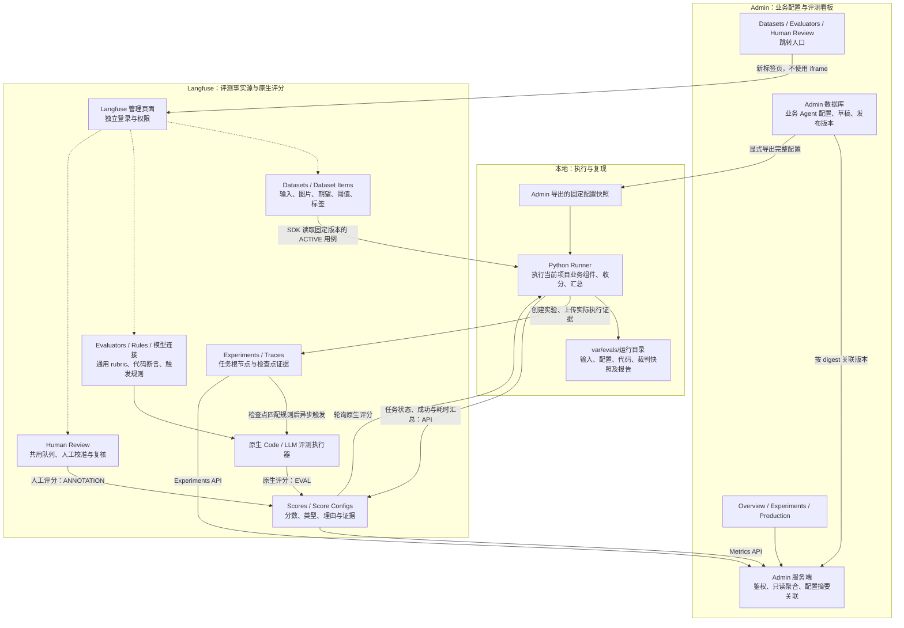
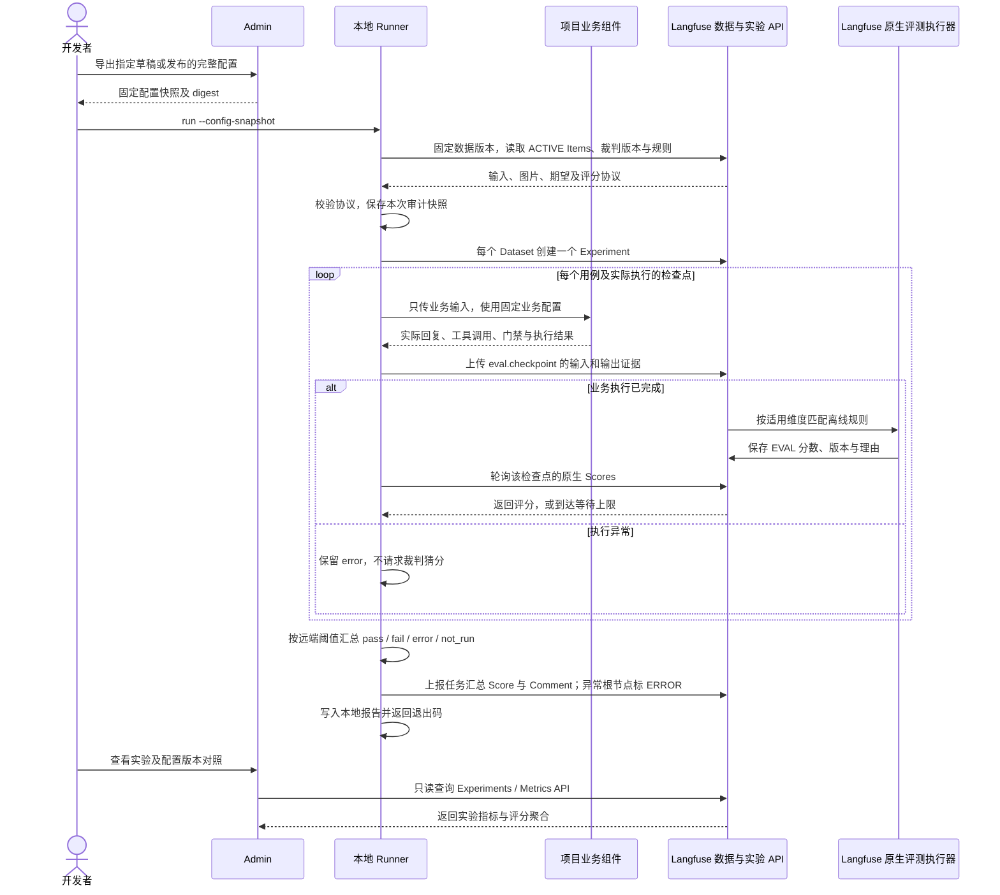

# 读学系统 — 离线评测

> 更新：2026-11-15。本文维护评测架构、职责边界、执行及结果协议。教学规则见 [Tutoring Domain](domain-tutoring.md)，页面、鉴权与指标口径见 [Admin 设计](design-admin.md#evaluation--langfuse)。

## 执行模式

默认 `python -m evals run` 使用下述 Langfuse 托管用例和原生评分。用户另行授权的 Omni-Edu 本地批次使用 **`python -m evals.local`**：只读取仓库文件、使用本地评分适配器，不连接 Langfuse Dataset、Evaluator、Scores，也不上传遥测。两条入口显式分开，不在云端出错时自动切换。原有托管用例不受本地批次变更影响。

本地模式的用例/逐例要求唯一维护在 `duxue-server/evals/data/omni-edu-v1/`；评分执行复用既有 `evals/grading.py`、`evals/semantic.py`，模型和业务/独立裁判提示词取自固定 Admin 配置快照。内部完整解题另使用版本化的 evaluation-only `evals/local/solve-prompt.txt`，模型及参数沿用快照导师；该提示不进入生产配置或 Ward 链路。本地批次不复制在线 Evaluator 定义，也不把结果写回线上用例。

下列 Langfuse 单源及原生评分规则针对**默认托管模式**，不适用于上述显式本地模式。

## 事实源与边界

- **Langfuse Dataset** 维护用例、图片、检查点要求、适用评分维度和通过阈值；按目的分为教学正确性、引导逻辑性、答案保护与安全、编排与工具、判官校准五类。
- **Langfuse Evaluator** 维护确定性代码与独立 LLM 裁判定义，同类评测只维护一份定义；Rule 决定触发对象、适用维度与采样率。新运行使用 `offline-evaluation` 环境的 `eval.checkpoint`，规则兼容历史 `sdk-experiment`。
- **Langfuse Score Config** 维护同名指标的类型、范围和人工标注口径。自动评分来源为 `EVAL`，运行状态汇总为 `API`，人工标注为 `ANNOTATION`，不互相覆盖。
- **Git** 维护执行器、传输协议、测试和只读迁移快照。`evals/bootstrap/2026-11-11/` 不再维护；`evals/langfuse/` 的定义文件仅是初始化/审计快照，不是第二套在线评分器。
- **本地 runner** 执行待测代码、上传证据、关联 Experiment、收取分数。它不调用本地语义 grader，不重算云端确定性分数，不把缺分当通过。
- **Admin** 维护业务 Agent 配置、草稿与发布版本；评测页面只聚合 Langfuse 结果并关联配置版本。Dataset、Evaluator 与 Human Review 跳转 Langfuse，不自建用例、评分或复核库。

迁移基线为 **41 个用例、64 个检查点**；归档两例后，截至更新日为 **39 个 ACTIVE 用例、57 个检查点**，实时数量以 Langfuse 为准。归档仅影响后续默认执行，不删除或重写历史实验。

小规模故障集只支持回归分析；自动通过不等于线上正确率或学习效果，语义评分仍为 `uncalibrated`、`quality_passed=null`。

## 架构与职责交互



- **配置与评分各有唯一归属**：业务主模型、备用与生产门禁的配置来自 Admin；离线独立裁判的模型连接、Prompt 和代码来自 Langfuse。生产门禁是被测业务链路的一部分，不能代替独立质量评分。
- **Admin 的评测接口只读**：通过服务端调用 Langfuse API，凭证不下发浏览器；不负责启动本地 runner，也不保存第二份用例或判分结果。人工复核实际发生在 Langfuse。
- **Test Case 就是 Dataset Item**：在 Dataset 内维护，不设独立一级菜单。Overview/Experiments 读取实验结果；Production 按线上环境查询并排除实验，避免混算。
- **本地结果是审计副本**：Git 初始化快照和 `var/` 报告均不反向覆盖云端维护数据。自动入人工复核队列尚未实现，图中人工评分不代表自动派单已接通。

## 执行与评分时序



独立裁判异步执行，runner 等待后汇总，不在本地重复判分。每次执行先固定输入与配置；规则和裁判版本同时留档，评分版本不符即报错。低分不能触发自动重抽；`resume` 只补收原观测的迟到分数。

## 用例单元

一个 Dataset Item 对应一个完整场景，内部可有多个检查点，不按文件形式另建 Dataset。

| 执行类型 | 输入及历史 |
|---|---|
| `single_turn` | 固定历史和显式上下文，只评最后决策点 |
| `episode` | 学生脚本 + 本次实际生成回复；前一检查点未通过则后续记 `not_run` |
| `judge` | 固定候选及生产判官输入，对照人工标签；参考答案不注入生产判官 |
| `conversation_replay` | 每个检查点使用原始历史，不用新回复替换历史；被拒候选与可见消息分开 |

保留原始表达、ASR、来源、覆盖范围与标签。只有窗口证据时不得声称完整线程；缺失状态标 `missing`，不能伪造观察值。外部素材的 system 和末条示范不进入生产输入，不自动作为 gold；`proposed` 不因自动通过升级为 `confirmed`。

## Dataset Item 协议

```json
{
  "id": "稳定UUID：由case_id生成",
  "input": {
    "schema_version": "duxue-dataset.v1",
    "record": {"id": "case-id", "type": "single_turn", "checks": []},
    "assets": {"problem.png": {"media": "Langfuse媒体引用", "sha256": "内容摘要"}}
  },
  "expectedOutput": {
    "reference_problem": null,
    "checks": {
      "check-1": {
        "deterministic": [{"id": "route", "field": "outcome", "op": "eq", "expected": "hint_like"}],
        "case_criteria": ["只引导一个可执行的下一步，不代算最终答案"],
        "reference_response": null,
        "evaluators": {
          "eval.deterministic_pass": {"equals": true},
          "eval.teaching_correctness": {"min": 4},
          "eval.guidance_logic": {"min": 4},
          "eval.case_requirements": {"equals": true},
          "eval.answer_protection": {"equals": true},
          "eval.safety": {"equals": true}
        }
      }
    }
  },
  "metadata": {"case_id": "case-id", "category": "guidance-logic", "label_status": "proposed"}
}
```

示意省略了 `record` 的来源、消息和输入快照；其执行结构沿用 `dialogue-eval.v2`（[schema](../../duxue-server/evals/dialogue.py)）。每个检查点的 `id` 必须与 `expectedOutput.checks` 一一对应。期望、rubric、参考回复只交给评估器，不能进入业务模型输入。

图片以 Langfuse 媒体引用保存，runner 下载后校验 SHA-256；缺图或摘要不符即 `error`。媒体、题面和逐轮历史要实际传给裁判，不能仅传文件名。

确定性断言只检查协议事实：字段比较支持 `eq/in/not_in/set_eq/lte/gte`；工具支持 `tool_called/parameter_match/no_forbidden_tools`。例如：

```json
[
  {"id":"called","assert":"tool_called","with_name":"calculate"},
  {"id":"argument","assert":"parameter_match","tool":"calculate","param":"operation","equals":"multiply"},
  {"id":"forbidden","assert":"no_forbidden_tools","forbidden":["raw_sql_query"]}
]
```

字段类型和可用操作由协议校验；工具采集缺失不等于调用列表为空。答案泄露、教学语义和意图含义不做关键词或正则判断。效率预算目前只有已测量的 `latency_ms`，不虚构 token/轮数；新增预算须先有可靠采集。

## Evaluator 与评分

复用六个核心 Evaluator：

| 名称 | 类型 | 输出 |
|---|---|---|
| `eval.deterministic_pass` | Code | 全部声明断言通过；有工具断言时另输出 `eval.tool_correctness` |
| `eval.teaching_correctness` | LLM | 教学知识、计算、事实正确性，1–5 |
| `eval.guidance_logic` | LLM | 步骤衔接、提示适量、可执行性，1–5 |
| `eval.case_requirements` | LLM | 当前用例全部额外语义要求是否满足 |
| `eval.answer_protection` | LLM | 实际交付是否符合答案保护 |
| `eval.safety` | LLM | 实际交付是否符合安全要求 |

标签型判官/路由检查只调确定性 Evaluator；生成教学回复的检查点启用独立语义评估。通用 rubric 在云端定义；逐例特殊要求保存在 Dataset `case_criteria`，不要复制通用 Prompt。

业务主模型、备用与生产泄露判官来自 Admin 导出的固定完整配置。离线独立裁判使用 Langfuse 已保存的模型连接与定义，**不读取配置包内旧 `evals.semantic-judge` 作为第二份裁判**。现有生产门禁 Evaluator 与其规则保留，不替代质量评分。

为让 Scores 默认可见，连接默认环境与任务执行上下文均固定为 `offline-evaluation`；任务根节点和检查点均在 SDK 初始化后显式覆盖其强制的 `sdk-experiment`，汇总分使用此环境。Langfuse 默认隐藏内部实验环境，因此仅修改连接默认值不足。历史记录保留原环境，不改写原生评分来源或数值；此前手动添加的 `Environment=sdk-experiment` 过滤需清除一次。

每个检查点上传 `eval.checkpoint`：`input` 是当前证据，`output.response` 是实际交付，`output.evaluation` 含确定性规则、逐例语义要求、参考回复、实际观察值和采集完整性。metadata 中 `eval_*: yes` 表示维度适用且执行完成，供规则筛选；执行失败不触发自动评分。

LLM 映射为 `input → input`、`output.response → output`、`output.evaluation → metadata`。Code 读取 `output.evaluation`。规则采样率为1，按检查点要求执行；原生分数保留裁判版本、理由和证据。人工复核使用现有共用队列，自动入队尚未实现。

## Omni-Edu 本地文件评测

本批修复后的全量结果、执行中断恢复口径及未通过项复核见[2026-11-16评测记录](eval-omni-2026-11-16.md)。

### 数据与审核口径

入口：[`evals/data/omni-edu-v1/README.md`](../../duxue-server/evals/data/omni-edu-v1/README.md)。固定上游 Hugging Face revision `67b2607f7bd01185c2c47087aa7591e435b77ac6`；完整 69,999 条原始快照仍在 ignored `var/evals/datasets/omni-edu-v1/`，本批只复制所选原始记录及图片。

| 主目的 | 本批数量 | Dataset 归属 |
|---|---:|---|
| 学科完整解题 | 42 | teaching-correctness |
| 学生作答诊断 | 72 | teaching-correctness |
| 教学引导 | 96 | guidance-logic |

语数外各30，其他六科各20。210个任务、234个检查点，其中12个三轮脚本、18个图文任务；开发168/封存42，按题目家族隔离。原题文字精确去重，并对语义家族建议作复核，不宣称经过教师完整近重复认证。阅读材料和题组仍按一个来源任务计数。

当前有 **138个高考同等层级 proposed 标签**（解题21、诊断52、引导65），经模型辅助审阅和明确的助手内容复核，**教师确认数为0**。语文26/数学28/英语27/物理8/化学6/生物16/政治8/历史5/地理14；总数达到至少105，物理/化学/政治/历史未达到各科一半，不能宣称九科高考覆盖同等充分。上游部分试题适用历史课程范围，不据此认证现行考试大纲全覆盖。

为保持高中九科场景的可比性，本批题面来自所选学科题目；72条诊断的学生尝试及96条辅导请求/脚本为**显式合成改编**，不能声称是Omni-Edu原生真实师生对话。`category`表示本项目测试目标，原始类别保留在 `sources/` 中。学生正确、错误、证据不足各24条；证据不足脚本明确声明尚未写出推理，不把完整正确答案误标为信息不足。选择/判断题不要求导师逐项确认候选项对错。

`selection.json`维护配额、来源引用及审核依据；`sources/`保存原system、题面、原assistant及改编记录；两个目的目录保存`dialogue-eval.v2`执行记录；`assets/`为选中图片的本地审计镜像；`manifest.json`记录文件哈希。原system、末条assistant及诊断制作依据仅供追溯/评分，不能进入被测请求；已明确提交的合成学生答案属于合法输入证据。参考材料仍未经教师认证，评分要求允许合理异解并要求独立核验。合成制作模型的诊断意见仅留在来源记录，不作为评分指令，避免把错误意见或逐项确认选项的要求传给裁判。

### OSS 图片引用

本批18张图片使用自有阿里云 OSS，未上传 Langfuse 原生媒体。`assets.oss.json`为稳定引用事实源，构建器同步生成`manifest.assets`及各`manifest.tasks[].assets`映射；消息中的`images`继续保存逻辑文件名，由映射解析为OSS对象，避免把存储协议塞进题面。引用示例：

```json
{
  "provider": "oss",
  "bucket_alias": "eval",
  "key": "evals/omni-edu-v1/images/<完整SHA256>.jpg",
  "sha256": "<完整SHA256>",
  "content_type": "image/jpeg",
  "size_bytes": 12345
}
```

`eval`映射到服务端`.env`的`OSS_BUCKET_NAME`（兼容`OSS_BUCKET`），使用既有OSS凭据和公网endpoint，独立于摄像bucket。上传显式设置对象private和防覆盖；已存在的对象只回读核验，不修改权限或覆盖。注册引用前逐张回读核对长度及完整SHA256。使用[OSS防覆盖请求头](https://www.alibabacloud.com/help/en/oss/developer-reference/prevent-objects-from-being-overwritten-by-objects-that-have-the-same-names-2)，凭据、临时签名URL不写入Dataset。

实际`run`在模型调用前只下载筛选任务所需图片到本次输出的`resolved-assets/`，核验后传给导师和本地裁判；OSS不可访问、缺图或摘要错误即停止，不回退到本地镜像。原有运行命令不变。静态`validate`和`--preflight-only`不访问OSS，不证明远端对象当前可读取；可单独执行：

```bash
# 回读本批全部OSS图片并核验，不调用模型或Langfuse
.venv/bin/python -m evals.local.assets check --data evals/data/omni-edu-v1

# 幂等上传所选图片，全部回读通过后重建引用及manifest
.venv/bin/python -m evals.local.assets upload --data evals/data/omni-edu-v1
```

本地图片镜像继续用于来源审计；托管迁移及执行见下一节。

### Omni-Edu 托管迁移（2026-11-16）

以当前有效清单迁移 **209项/233检查点**：已在后续数据修订中删除缺少passage的`omni-geography-015`，本次不恢复旧210快照。新增到已有[teaching-correctness](https://us.cloud.langfuse.com/project/cmvfvorj601l6ad0jhvajth4c/datasets/cmwbz8j5y006jad0jzj4jffaq/items) **113项**（42完整解题、71诊断），[guidance-logic](https://us.cloud.langfuse.com/project/cmvfvorj601l6ad0jhvajth4c/datasets/cmwbz8jdl008sad0e3wv51oni/items) **96项**。这两个Dataset原有13项未变；当前总数分别为118/104，其中本批以`metadata.batch=omni-edu-v1`区分。

托管输入沿用`duxue-dataset.v1`，`input.execution_target`明确`solve`或`tutoring`；期望、参考与逐例要求保留在expectedOutput，不注入模型输入。元数据保留学科、三类能力、层级审核、来源uid/commit/记录哈希、题目家族、split和本地manifest摘要。原始源记录仍留本地sources作审计。英语010原题面带答案解析的问题用`review_required=true`及`known_issues`显式标记，未静默改题或改历史分。

42个`solve`任务复用evaluation-only完整解题适配器，评分只要求确定性、教学正确性和逐例要求三个原生维度；167个辅导任务复用生产答疑和适用原生维度，保持云端评分执行，不回退本地评分。托管转换器`evals.platform.omni`生成固定ID的待导入payload；完整input/expectedOutput/metadata摘要用于回读及重复迁移检查，远端人工修改或归档不能被旧包覆盖。导入后托管用例在Langfuse维护，本地包保留供审计和显式本地实验使用，不自动双向同步。

本批17张图片仍为`input.assets`中的OSS稳定对象引用，未新增Langfuse原生媒体。托管执行器先从OSS下载验SHA256，模型请求及评分证据使用运行时生成的24小时HTTPS签名链接；签名链接和凭据不写入Dataset。过期Trace外链不会自动续签；Dataset对象引用需要执行器解析，不能当作网页长期图片缩略图。原有历史原生媒体入口继续兼容。外链形式与原生媒体的区别见[Langfuse官方说明](https://langfuse.com/docs/observability/features/multi-modality#external-media-urls)。

只执行本批的本地命令（会调用模型并写Experiment，**迁移时未执行此命令**）：

```bash
MATH_ENGINE_MODE=subprocess .venv/bin/python -m evals run \
  --batch omni-edu-v1 --config-snapshot <本地完整配置快照.json> \
  --workers 2 --out var/evals/omni-hosted-run
```

可叠加`--dataset`或`--case`筛选，`--batch`同字段多值为并集，跨字段为交集。此处subprocess用于非生产本机评测；模型和数学工具授权仍由快照决定。

迁移已完成209项云端逐条摘要/协议回读、原有13项不变、17图字节校验和临时HTTPS读取验证；迁移审计在`var/evals/omni-langfuse-migration-20261116/`的plan/receipt/verification及remote导出中。迁移本身没有运行模型、修改Evaluator/Rule或上传本地历史成绩。后续实际托管评测及评分版本调整见[运行记录](eval-omni-langfuse-2026-11-16.md)。

**已发现的视觉评分限制**：导师模型收到了OSS图片，但核对云端原生裁判实际调用发现，当前证据中的签名URL仍是序列化文本，没有形成图像内容块。17个OSS图文任务须单列`needs_image_evidence`；保留原始分数，不能据此声称完成视觉质量验收，也不回退本地裁判或自动上传Langfuse原生媒体。当前教学政策的自动评分仍未经人工校准。

如果DashScope因账户状态报`Arrearage`，应保留已经完成的有效结果，记录受影响和未完成集合；恢复后校验冻结代码、配置、Dataset及裁判版本，仅统一补跑该集合。Langfuse可能将LLM裁判自动暂停，充值后仍需在控制台重新激活；运行前的预检会拒绝暂停的裁判，不绕过该检查。

### 独立启动

以下命令均从 `duxue-server/` 执行。静态校验只需要项目开发环境；真实运行需要项目 `.env` 中的模型凭据及**本地完整配置快照**，不需Langfuse凭据，不读取在线Admin发布。现有设置模块会读取`.env`的必要配置，但本地评测不连接业务数据库。

```bash
# 只校验本地文件，不联网、不调用模型
.venv/bin/python -m evals.local validate --data evals/data/omni-edu-v1

# 固定配置与图片能力预检，不调用模型；输出目录必须是新目录
.venv/bin/python -m evals.local run --data evals/data/omni-edu-v1 \
  --config-snapshot <本地完整配置快照.json> \
  --out var/evals/omni-preflight --preflight-only

# 先跑一个开发用例；会调用导师、必要门禁和本地独立质量裁判
.venv/bin/python -m evals.local run --data evals/data/omni-edu-v1 \
  --config-snapshot <本地完整配置快照.json> \
  --case omni-math-021 --out var/evals/omni-one

# 专门跑高考层级、数学、教学正确性子集；筛选条件取交集
.venv/bin/python -m evals.local run --data evals/data/omni-edu-v1 \
  --config-snapshot <本地完整配置快照.json> \
  --dataset teaching-correctness --subject math --level gaokao_equivalent \
  --out var/evals/omni-math-gaokao

# 日常开发只跑开发集；正式评估时可另选holdout，或不加split跑全部210
.venv/bin/python -m evals.local run --data evals/data/omni-edu-v1 \
  --config-snapshot <本地完整配置快照.json> \
  --split development --samples 3 --workers 2 --out var/evals/omni-dev

# 全部本地210任务，每例一次采样
.venv/bin/python -m evals.local run --data evals/data/omni-edu-v1 \
  --config-snapshot <本地完整配置快照.json> \
  --samples 1 --workers 2 --out var/evals/omni-all
```

支持重复 `--dataset/--subject/--level/--case/--split`；同字段为并集、字段间为交集。`--samples`指定重复采样，`--workers`限制1至8；不同采样全部计入结果，不低分重抽。`--allow-incomplete`仅用于明确接受配额缺口的开发子集，不覆盖结构错误；完整本批不需此参数。输出不能放在输入数据目录内。

配置中需有`tutoring.turn`、备用、生产门禁及`evals.semantic-judge`等既有组件；本地质量裁判须与导师/备用型号不同。含图子集要求导师、备用与质量裁判都声明支持图片，实际图片字节传入请求，缺图/不支持为error。若快照授权数学工具，本地须按[部署说明](../deployment.md#数学执行器与配置升级)准备计算执行器并设置`MATH_ENGINE_SOCKET`；未运行执行器时如实保留unknown/失败，不冒充已核验。

### 执行和结果

解题目标调用evaluation-only无状态适配器，给出完整解答，记录模型参数与独立解题提示词哈希；不走Ward答案披露策略，也不冒充生产辅导通过。诊断/引导复用生产`run_tutor_turn()`和现有本地`SemanticGrader`。多轮使用实际前序导师回复，数据库上下文为显式注入，不证明生产数据库状态机闭环；脚本未要求学生实际完成最终答案，不能外推“独立解出率”。

每次运行保存配置快照、数据副本、代码哈希、评分模型/提示词身份、逐任务实际交付与评分理由，以及`results.json`。按学科、高考层级、Dataset、执行目标、开发/封存集分报；任务、重复采样、检查点分母独立。缺图、未被业务兜底处理的执行异常、评分异常或缺分为error；业务兜底作为无有效帮助的fail处理。前序失败后的多轮检查点为not_run。质量分仍uncalibrated，不能以自动通过宣称高中九科稳定可靠。

校验/运行错误退出2，有质量失败或样本执行错误退出1，全通过退出0。`--preflight-only`只生成预检与复现资料，不生成伪造的评测分数。确定性重建使用`.venv/bin/python -m evals.local.prepare --data evals/data/omni-edu-v1`，读取已审阅recipe和本地source，不调用模型或重新标注；内容编辑后须重建manifest并重新校验。

## 托管模式运行、复现与结果

在 `duxue-server/` 下执行：

```bash
# 全部当前云端用例；必须明确指定业务配置快照
.venv/bin/python -m evals run --config-snapshot <Admin导出的完整快照.json>

# 指定目的/用例（参数可重复），或固定 Dataset 历史时刻
.venv/bin/python -m evals run --config-snapshot <快照.json> \
  --dataset guidance-logic --case pedagogy-remainder-next-step \
  --version 2026-11-11T15:00:00Z --out var/evals/my-run

# 只收取迟到分数，不重跑业务模型
.venv/bin/python -m evals resume --out var/evals/my-run

# 只读云端快照，供审计；不是新的维护源
.venv/bin/python -m evals snapshot --out var/evals/dataset-export

# 首次导入/恢复空项目；稳定ID，不覆盖云端编辑
.venv/bin/python -m evals migrate

# 无网络校验历史初始化快照；不代表当前云端数据已验证
.venv/bin/python -m evals validate
```

一次运行每例采样一次；需要重复采样则建立不同 run，不能因分低重抽到通过。可用 `--workers` 控制并发、`--score-timeout` 设置等待上限。运行前校验远端协议和 Evaluator，失败不回退本地数据或本地裁判。旧的 `run-judges/run-episodes/run-conversations` 已由统一 `run` 替代。

每个 Dataset 建立一个 Experiment，同次运行共享 `run_id`。这使同一批用例在不同代码/配置下的结果可比较，并可追到原始 Dataset Item、执行轨迹和评分。多轮检查点是任务下的独立 observation，避免把不同轮评分混在一起。

### 任务、检查点与查看范围

```text
Experiment：一次运行在一个 Dataset 上的结果
└── Experiment Item：本次执行的一个 Dataset Item
    └── 任务根节点：experiment-item-task
        ├── API 汇总：eval.status、eval.task_success、eval.latency_ms
        └── 检查点：eval.checkpoint（可有多个）
            └── EVAL 评分：确定性、教学正确性、引导逻辑等适用维度
```

- 任务根节点的 Scores 主要是汇总；详细判分在对应 `eval.checkpoint` 的 Scores / Comment。`output.response` 包含实际 `message`、`visual`、`lessons`，不能只看正文判断裁判是否有依据。
- 每个已创建 observation 的检查点另有 API 来源 `eval.status`，Comment 首行显示 ✅通过 / ❌不通过 / ⚠️评分或执行异常 / ⏸️未执行，逐项列出维度、实际值、当次 Dataset 的通过阈值和原始裁判理由。数值范围1–5不代表通过线，阈值取自本次固定输入；不硬编码为4。原生 EVAL 分数及理由保持原样，派生状态只做展示和筛选，不算第二次独立评分。任务根节点复用同一摘要格式。
- 新运行自动生成检查点状态；`resume --out <原目录>`也会为已完成检查点补齐展示，使用目录内固定的`datasets.json`与结果，不重跑模型，不使用后来修改的云端阈值。重复收分更新同一派生状态ID；尚未执行且无observation的检查点只在任务摘要显示，不伪造观测。Langfuse Cloud 原生表格不配置自定义阈值颜色，使用状态文字和图标表达；正常质量不通过仍保持`DEFAULT`，不冒充系统`ERROR`。
- 状态 Score 的 metadata 使用 `scope=task/checkpoint` 区分层级；Admin 的任务状态计数仅查询`scope=task`，避免把同一任务的多个检查点重复统计。Langfuse Scores中可以按`name=eval.status`及分类值`fail/error`筛选，再结合所属observation查看摘要。
- 汇总 Comment 写入失败维度、原生裁判理由及检查点 observation ID；它是索引与摘要，不产生第二份独立质量评分。Session 未绑定时为空，不影响 Experiment 关联。
- 同一 Dataset Item ID 可以出现在多个 Experiment，执行结果用 `experiment_id + trace_id + observation_id` 定位；比较时核对输入版本、业务配置和裁判版本，不能只按用例 ID 判断是哪次运行。
- 数值 Score 只是评分值，是否通过还取决于 Dataset 的阈值。例如教学正确性 `3` 是有效分数，但在 `min=4` 时仍为 fail。自动裁判理由本身也可能错误，人工复核不能省略。

默认结果目录：`duxue-server/var/evals/langfuse-<时间>/`（不入 Git）。

| 文件 | 内容 |
|---|---|
| `manifest.json` | Experiment 链接、数据版本时刻、配置摘要、Git SHA、工作区是否有改动 |
| `datasets.json` / `config-snapshot.json` | 本次固定输入及完整业务配置 |
| `code-snapshot.json` | 本地 Python 执行代码与摘要，补充未提交工作区的复现信息 |
| `evaluators.json` / `evaluation-rules.json` | 本次云端裁判定义、版本与规则审计快照 |
| `checkpoints/<observation_id>.json` | 执行后立即保存定位信息，用于排查与收分 |
| `<item_id>.json` | 每例实际回复、检查点、原始分数和解释 |
| `results.json` | 全量结果与 pass/fail/error/not_run 数量 |

### 状态与统计口径

| 状态 | 含义 | 任务根节点 level | 任务成功 Score |
|---|---|---|---|
| `pass` | 所有必需检查点及评分均通过 | `DEFAULT` | `True` |
| `fail` | 正常得到判分，但至少一项未达要求 | `DEFAULT` | `False` |
| `error` | 执行异常、缺少有效证据/评分或版本不符 | `ERROR`，附 `statusMessage` | 不生成 |
| `not_run` | 前置检查未通过等原因导致未执行 | `DEFAULT` | 不生成 |

`eval.status` 始终记录已进入任务执行的用例结果；执行前预检失败直接中止，不伪造运行或评分。执行/收分异常在任务返回前同步到根节点，正常评分得到的 fail 不标为系统错误。

- **Item Count**：该 Experiment 已记录的用例数，不是通过数，也不保证每例的所有后续轮次都执行过。后来归档用例不会改写历史数量。
- **Error Count**：平台观测异常统计，依赖任务根节点的 `ERROR` 上报，不等于 `eval.status=fail` 的数量。通过数、质量失败数、执行错误数和未执行数分别报告。
- **历史与收分**：`resume` 更新迟到评分及汇总 Score，不改写已结束观测的异常级别。状态映射修复前的旧实验可能仍显示 Error Count 为0；不能套用新运行口径解释旧数据。

评分仅接受本次 observation 的 `EVAL` 来源及预期 Evaluator 版本；缺分、重复分、非法类型、版本漂移为 `error`。状态优先级为 `error > fail > not_run > pass`，逐项失败仍保留；必须全部检查点通过才算整例通过。返回码0要求全部通过且版本未漂移。

`eval.status`、`eval.task_success` 是 runner 对云端结果的机械汇总，不是新 Evaluator；其 Comment 记录失败项、原生裁判理由及检查点 observation ID，便于从任务根节点追溯。执行/评分错误不记为教学失败或成功。`eval.latency_ms` 排除评分等待。未知成本与尚无权重的 Overall Score 留空。Admin 按真实数据聚合，不使用生产门禁放行率填充质量指标。

`resume` 仅补收已有观测的迟到评分；已经中断的后续多轮仍为 `not_run`，不会悄悄补跑模型。历史本地报告不与新的评分口径直接混算。自动评分不能替代人工校准，不能把此次冒烟通过当作发布门槛。

## 验证范围

### 节点级执行证据

评测每个已执行检查点在调用业务前打开`eval.execution`观测，使用与Admin调试共用的请求局部`Recorder`采集，在评分前保存`duxue-execution.v1`。output包含`events`和`catalog`（执行当时经过Workflow的nodes/edges/version以及最小组件展示定义）。不含可编辑Prompt副本或凭证，图的事实源仍是本次固定配置。事件保留父子ID、实际节点/条件边、输入输出、状态、起止时间、耗时；重复执行生成独立事件。模型事件含实际消息、提供商原始输出、模型/组件版本、异常类型及已知Token；代码异常被业务捕获为fallback时，前面的失败事件继续保留。超长文本明确标记truncated，未知对象只记类型，不展开服务/连接。

线上在已采样且Langfuse启用的对话入口，以及没有外层采集器的通用Workflow入口记录同协议的`agent.execution`，已存在调试/评测Recorder时复用而不重复包裹。原有模型与业务OTEL spans保留；执行证据与当次Trace关联。未发生的分支不伪造事件，未执行的检查点不生成execution，历史数据缺证据不推断补写。Admin的查看与组件/基线口径见[批次工作台](design-admin.md#批次失败工作台与历史执行图2026-11-14)。

无网络协议与执行测试在 `tests/unit/evals/`，云端 Code 初始化快照测试在 `tests/test_langfuse_deterministic.py`；真实调用单独运行，不混进 pytest。

Runner 验证组件执行及证据传递，不是数据库状态机全链路测试。含图用例需实际验证原生裁判收到附件。外部教学素材共8例保留 `pedagogical-action-v1` 与 `subject-competence-v1` 批次、原始来源与 proposed 标签；此前本地8例通过仅是历史结果，不预设迁移后评分仍全通过。

当前已确认的兼容限制：Langfuse Cloud 对现有 DashScope 自定义模型连接拒绝 JPEG 原生评测；图片已保留，相关语义分数缺失记 error，不能把纯确定性通过当作整例通过。修复需确认支持视觉的云端连接；不会删除图片或回退本地裁判。

### 独立本地对话回归

少量明确授权的本地开发任务可用 `scripts.run_local_dialogues` 直接消费标准 `dialogue-eval.v2` 文件，不要求 Omni manifest，不经过云端 Dataset/Evaluator，也不作为云端缺分的自动降级。任务只允许 `single_turn` / `episode`，拒绝云端专用评分器；复用既有 `run_sample` / `run_episode`、生产 `run_tutor_turn` 和本地 `SemanticGrader`，不另造业务链路。执行器要求质量评分模型与导师主、备模型均不同。

从 `duxue-server/` 运行（配置必须是明确导出的完整快照，输出目录必须尚不存在）：

```sh
MATH_ENGINE_MODE=subprocess .venv/bin/python -m scripts.run_local_dialogues \
  --data evals/data/visual-delivery-v1 \
  --config-snapshot var/visual-delivery-20261117/config-v8.json \
  --out var/evals/visual-delivery-new-run
```

“本地离线评测”指本地任务、回放与评分产物；真实模型仍调用 DashScope，需要网络和密钥。脚本禁用 Langfuse/OTEL，保存输入、配置、源码与输入 SHA256、逐任务结果及总结果，绝不覆盖已有批次。每项采样一次，任何检查点 fail/error/not_run 均不算整项通过。

[视觉交付任务](../../duxue-server/evals/data/visual-delivery-v1/README.md)来自两次生产故障题意和真机调试脚本的合成重构，标记 `proposed/uncalibrated`。标准输入中的作业标题保持中性，不能把“主动配图”等评分目标塞入被测上下文。后续轮使用实际生成的前轮回答；不含原作业图片，因此不覆盖 OCR、原图作答审核、麦克风/ASR，也不能将 SVG 结构语义评分称为像素级视觉验收。真机渲染截图单独留证。少量开发回归通过不代表发布门槛或全量稳定性。

### 视觉交付云端用例

2026-11-17 经用户授权，将[视觉交付任务](../../duxue-server/evals/data/visual-delivery-v1/README.md)的两项合成多轮用例同步到 [guidance-logic](https://us.cloud.langfuse.com/project/cmvfvorj601l6ad0jhvajth4c/datasets/cmwbz8jdl008sad0e3wv51oni/items)，该集由104增至106项。主维度是借图推进学生理解；正确性、保护与安全作为同项检查维度，不跨Dataset重复计数。

| case_id | Dataset item ID | 检查点 |
|---|---|---|
| square-proactive-visual | db1b2547-08f0-597f-9774-38eafca4629e | 主动配图、颜色区分共用角点 |
| lamps-requested-visual | 95712fdc-fd17-5edb-a6a0-2b3afaa65a57 | 明确请求配图、双侧端点追问 |

每项两轮，`episode/generated_history`保留真实前轮回复。沿用`duxue-dataset.v1`投影，将评分要求从输入移入expectedOutput，保留图形语义rubric与两项确定性断言；使用已有六个原生评分维度。状态为ACTIVE、proposed/uncalibrated，以`metadata.batch=visual-delivery-v1`筛选。本次仅新增用例，未执行云端Experiment，未把已有本地pass写成云端分数，也未修改评分器或恢复暂停批次。云端后续编辑为托管事实源，仓库JSON保留为独立本地回归输入，不自动双向同步。

逐字段回读验证与原104项不变审计在ignored `duxue-server/var/evals/visual-delivery-cloud-20261117/`。图形审核仍是SVG结构语义审核，非渲染像素验收。
