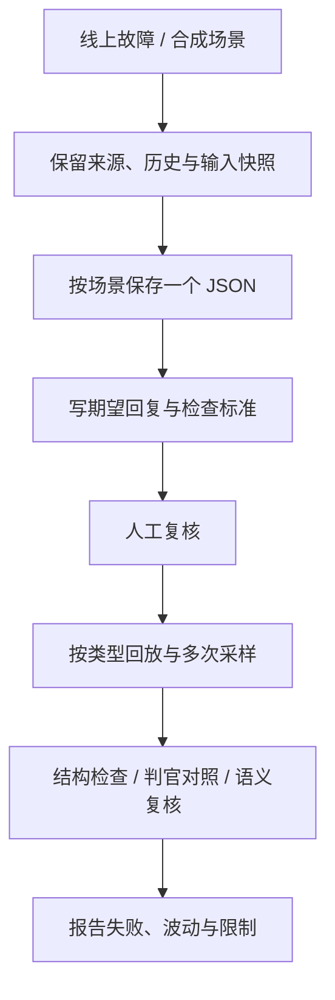
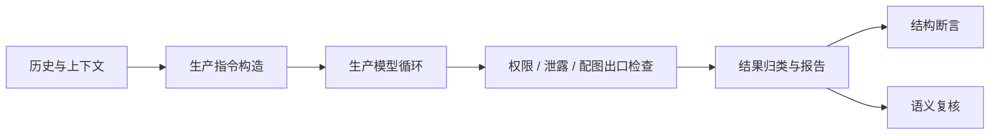

# 读学系统 — 答疑离线评测

> 更新：2026-10-30 · v1.9
> 本文维护评测方法、目录和数据契约。教学行为规则见 [Tutoring Domain](domain-tutoring.md)，组件配置规则见 [Agent 配置设计](design-agent.md)。

## 一、用途与当前状态

- 复现线上故障，检查模型、提示词、契约和出口检查的回归。
- 单步与合成多轮复用生产答疑路径；独立判官评测调用生产判官。
- 小规模故障集用于冒烟和回归分析，通过率不能外推为线上正确率或学习效果。

| 类型 | 执行器状态 |
| --- | --- |
| 主流程单步 | 已有 schema 与 runner |
| 独立泄露判官 | 已有加载器与 runner |
| 合成多轮 | 已有 schema 与 runner |
| 真实对话回放 | 已接入 schema、加载器、runner；回复语义待人工复核 |

**当前边界：** `conversation_replay/` 使用固定历史回放，独立于单步、合成多轮统计。主回复输出参考正文与 `criteria` 供人工语义复核，自动结构检查通过时仍标记 `pending_review`，不自动算作完整通过。

## 二、方法与评测单元



| 场景 | 评测单元 | 历史处理 |
| --- | --- | --- |
| 单轮故障 | 一个决策点 | 固定此前历史和注入上下文 |
| 判官边界诊断 | 一个候选及审核上下文 | 固定输入，对比人工标签 |
| 合成连续教学 | 一段脚本对话 | 本次生成的回复进入下一轮 |
| 真实多轮故障 | 一段有来源的对话，可含多个检查点 | `fixed_history`：各检查点使用原始历史 |

- 一例一文件中的“一例”按真实场景定义；多轮问题保留整段对话。
- 真实对话保留原始表达、ASR 和轮次；合成变体另存，标明 `synthetic`。
- 只有窗口证据时标记 `coverage: observed_window`，不能声称是完整线程。
- 原始回复、被拒候选、实际展示回复、期望回复分别记录。
- 完成脱敏后保存可复现输入；无法还原的状态注明缺失或推断，不能当作真实快照。

## 三、目录与文件规范

```text
duxue-server/
├── evals/
│   ├── data/
│   │   ├── scene_routing/           # 意图路由，单步
│   │   ├── real_regression/         # 真实单步故障
│   │   ├── answer_protection/       # 答案保护
│   │   ├── pronunciation_context/   # 发音与指代
│   │   ├── visual/                  # 图文行为
│   │   ├── fact_vs_reasoning/       # 事实与推理边界
│   │   ├── teaching_quality/        # 教学行为
│   │   ├── safety/                  # 主组件安全动作
│   │   ├── leak_judge/              # 独立判官
│   │   ├── multi_turn/              # 合成多轮
│   │   └── conversation_replay/     # 真实对话，固定历史
│   └── __main__.py                  # 统一 CLI
└── var/
    ├── eval-assets/                 # 本机图片，不入库
    └── evals/                       # 候选导出和报告，不入库
```

- 配置：`<类型或主类别>/<id>.json`；一个 JSON 对象、两空格缩进、文件名与 `id` 一致。
- 同类场景使用通用执行器，不为单个故障新写 Python runner。
- 不同类型可以有不同 schema；同一类型遵循同一契约。
- `tags` 表达交叉维度，`review_batch` 表达复核批次；批次不表示已经确认。
- 维护用例不使用聚合数组或 JSONL；临时导出、运行日志和报告可使用各自格式。
- 图片仅引用资源名；不提交图片、data URL、密钥、签名 URL、身份信息或存储路径。来源 trace/observation ID 只作排查引用。
- 单步缺图记 `skipped`；判官缺资源记无有效裁决，不能算通过。

| 批次 | 内容 |
| --- | --- |
| `seed-v1` | 固定种子：单步与合成多轮 |
| `first-image-v1` | 首图场景的独立判官用例 |
| `answer-feedback-v1` | 已提交答案反馈的真实对话 |

## 四、数据契约

以下用 TypeScript 对象记法描述 JSON 结构：`?` 为可省略，`|` 为可选类型，`T[]` 为数组；注释标默认值或约束。实际配置仍是标准 JSON，不写类型或注释。

- 下列结构覆盖配置字段；共享类型只定义一次。
- 各类型以链接的 schema/加载器为执行依据；新增字段先更新对应契约及测试。
- AI 新写的期望为 `proposed`；`confirmed` 必须有复核人及具体期望；改期望后重新复核。未确认时 `reviewed_by` 为空。

### 4.1 共享类型

适用：单步、合成多轮；`LabelStatus`、`Source` 也用于其他类型。

```typescript
type LabelStatus = "proposed" | "confirmed" | "needs_decision";
type Source = "real" | "synthetic";
type Outcome = "answer" | "hint_like" | "chat" | "clarify"
             | "redirect" | "pronounce" | "blocked" | "fallback";
type Intent = "planning" | "tutoring" | "reflection" | "unclear";
type AssetName = string; // 本机资源名，jpg/jpeg/png/webp；格式由 schema 校验

interface Utterance {
  author: "ward" | "companion";
  text?: string;           // 默认 ""
  images?: AssetName[];    // 默认 []
}

interface ProblemContext {
  summary?: string | null;           // 默认 null
  active_subgoal?: string | null;    // 默认 null
  substantive_attempts?: number;     // 整数，默认 0
  hints_given?: number;              // 整数，默认 0
  evidence_summary?: string | null;  // 默认 null
}

interface Context {
  problem?: ProblemContext | null;  // 默认 null：无开放作业题
  task_title?: string | null;        // 默认 null
  task_active?: boolean;            // 默认 false
  tutoring_intent?: string | null;   // 默认 null
  focus_agent_type?: string | null;  // 默认 null
}

interface Expect {
  outcome_in?: Outcome[];                   // 默认 []：不限
  outcome_not_in?: Outcome[];               // 默认 ["fallback"]
  lesson_source_contains_any?: string[];    // 默认 []
  lesson_source_contains_all?: string[];    // 默认 []
  min_lessons?: number | null;              // 整数 >= 1；默认 null
  content_contains_any?: string[];          // 默认 []，旧字面断言
  content_not_contains?: string[];           // 默认 []，旧字面断言
  intent_in?: Intent[];                     // 默认 []
  visual?: "present" | "absent" | null;      // 默认 null
  visual_kind_in?: ("steps" | "compare" | "segment" | "number_line" | "svg")[];
  visual_not_contains?: string[];           // 默认 []，旧字面断言
}
```

- `visual_kind_in` 默认 `[]`；文本断言只比较字面，不能替代语义判断。
- `tutoring.turn` 不使用 `intent_in`；意图用例只应设置意图断言。
- `Expect` **没有** `response.message`、`criteria`；这两个字段属于真实对话契约。
- `confirmed` 的断言必须强于默认“不 fallback”；`needs_decision` 不作为通过依据。

### 4.2 主流程单步：已实现

定义：[schema.py](../../duxue-server/evals/schema.py)、[dataset.py](../../duxue-server/evals/dataset.py)。

```typescript
interface EvalCase {
  id: string;                               // 与文件名一致
  component: "tutoring.turn" | "companion.intent";
  conversation_id: string;                   // 真实来源标识；合成可用 synthetic
  turn_index: number;                        // 整数 >= 0
  history?: Utterance[];                     // 默认 []，最多 8 条
  student_said: string;                      // 非空，本轮学生句
  images?: AssetName[];                      // 默认 []，本轮图片
  context?: Context;                        // 默认 {}，展开为共享类型默认值
  expect?: Expect;                          // 默认 {}，包含默认禁止 fallback
  tags?: string[];                          // 默认 []
  source: Source;
  flags?: string[];                         // 默认 []，导出时的辅助标记
  review_batch?: string | null;             // 默认 null
  label_status?: LabelStatus;               // 默认 proposed
  reviewed_by?: string | null;              // 默认 null
  note?: string | null;                     // 默认 null
}
```

- schema 禁止未知字段；`id`、批次名、资源名的格式限制以源码为准。
- 历史与本轮合计去重图片不超过生产窗口限制；资源文件放 `var/eval-assets/`。
- `context.problem` 用于重建题目与 permit，不要求手填生产模型内部对象。

### 4.3 独立判官：已实现

定义：[judge_boundary.py](../../duxue-server/evals/judge_boundary.py)。

```typescript
interface LeakJudgeCase {
  id: string;                           // 非空，与文件名一致
  reference_problem: string;            // 非空，仅供标注，默认不发送给判官
  reply: string;                        // 非空，固定待审核候选
  expected_leaks: boolean;
  rationale: string;                    // 非空，标注依据
  problem?: string;                     // 非空，实际审核题目上下文快照
  image?: AssetName;                    // 可选图片资源
  expected_reason?: string;             // 非空；不泄露时为 none，泄露时不能为 none
  pair?: string;                        // 对照组标识
  component?: "tutoring.leak-judge";     // 缺省按该组件处理
  source?: Source;                      // 维护时填写；加载器未强制枚举
  review_batch?: string;                // 维护时填写；加载器未强制格式
  label_status?: LabelStatus;           // 缺省按 proposed 处理
  reviewed_by?: string | null;          // 未确认时为空
}
```

- 加载器拒绝未知字段；部分元数据类型尚未强校验，维护时仍按上面的约定填写。
- 没有 `problem` 时使用执行器默认构造的摘要，并非自动恢复原 trace。
- `--with-reference` 额外注入人工题面，属于诊断对照，报告必须区分。
- `task_title` 当前由独立执行器固定注入，配置不支持该字段；需要保留真实审核输入时使用真实对话中的 `gate.input`。

### 4.4 合成多轮：已实现

定义：[episodes.py](../../duxue-server/evals/episodes.py)、[episode_runner.py](../../duxue-server/evals/episode_runner.py)。

```typescript
interface Episode {
  id: string;                           // episode- 开头的场景标识
  title: string;
  inspired_by: "MathDial" | "SocraTeach" | "CoMTA" | "self";
  source?: "synthetic";                 // 默认 synthetic
  review_batch?: string | null;        // 默认 null
  label_status?: LabelStatus;          // 默认 proposed
  reviewed_by?: string | null;         // 默认 null
  initial_history?: Utterance[];       // 默认 []，最多 8 条
  turns: EpisodeTurn[];                // 6～10 轮
  note: string;
}

interface EpisodeTurn {
  student_said: string;                 // 非空，默认学生句
  student_on?: Partial<Record<Outcome, string>>; // 默认 {}，按上轮 outcome 选分支
  context: Context;
  expect: Expect;                       // 每轮必须有具体断言
  tags?: string[];                      // 默认 []
}
```

- 分支学生句非空；未命中分支则使用 `student_said`。
- 实际生成的回复进入后续窗口；一轮失败即停止本次会话。
- 上下文逐轮注入，未模拟完整生产数据库和业务状态迁移。
- schema 禁止未知字段；公开数据只作场景参考，不把第三方原文当作自行合成内容。

### 4.5 真实对话回放：已实现

示例：[answer-feedback-conversation.json](../../duxue-server/evals/data/conversation_replay/answer-feedback-conversation.json)。下面覆盖 v1 全部字段。定义：[conversations.py](../../duxue-server/evals/conversations.py)；执行：[conversation_runner.py](../../duxue-server/evals/conversation_runner.py)。

```typescript
interface ConversationEval {
  schema_version: "conversation-eval.v1";
  id: string;
  title: string;
  type: "conversation_replay";
  replay_mode: "fixed_history";
  source: {
    kind: "real";
    provider: string;                   // 如 langfuse
    trace_ids: string[];
    history_observation_id: string;
    coverage: "observed_window";        // v1 只声明有证据的窗口
    note: string;
  };
  review_batch: string;
  label_status: LabelStatus;
  reviewed_by: string | null;
  messages: RecordedMessage[];
  attempts: RecordedAttempt[];
  checks: (TurnCheck | GateCheck)[];
  note: string;
}

interface RecordedMessage {
  id: string;
  role: "user" | "assistant";
  content: string;                      // 原文；assistant 仅放实际展示内容
}

interface GateVerdict {
  leaks: boolean;
  reason: string;                       // 不泄露为 none；其余按生产判官原因
}

interface RecordedAttempt {
  id: string;
  after_message: string;                // 引用触发本轮的 user 消息
  trace_id: string;
  generation_observation_id: string;
  model: string;
  prompt_id: string;
  candidate: Record<string, unknown>;   // 产生时版本的完整原始候选 JSON
  gate: {
    observation_id: string;
    input: {
      task_title: string | null;
      problem: string;
      reply: string;
    };
    observed_verdict: GateVerdict;       // 原始裁决，不替换成期望
  };
  shown_to_user: boolean;
  delivered_as: string | null;          // 展示时引用 assistant 消息，否则 null
  retry_of?: string;                    // 重试时引用被替换的 attempt
  repair_feedback?: string;             // 原始重试反馈；与 retry_of 配套记录
}

interface TurnCheck {
  id: string;
  after_message: string;
  component: "tutoring.turn";
  source_observation_id: string;
  input_snapshot: {
    permit: {
      answer_protected: boolean;
      active_subgoal: string | null;
      attempt_summary: {
        substantive_attempts: number;
        hints_given: number;
        evidence_summary: string | null;
      };
    };
    task_title: string | null;
  };
  expect: {
    outcome_in: Outcome[];
    response: { message: string };       // 期望正文，允许语义等价表达
    exit_gate: GateVerdict;             // 本次新生成回复的门禁期望
    criteria: string[];                 // 必须满足的语义要求
  };
}

interface GateCheck {
  id: string;
  after_message: string;
  attempt_id: string;                   // 固定待审核的原始候选
  component: "tutoring.leak-judge";
  expect: GateVerdict & {
    criteria: string[];
  };
}
```

**期望正文：`checks[].expect.response.message`；判定要求：`criteria`。** 参考正文给出合格表达，接受语义等价输出，不逐字匹配。具体期望只维护在用例文件，文档不复制。

| 检查对象 | 输入 | 期望 |
| --- | --- | --- |
| 新生成回复 `TurnCheck` | 截至 `after_message` 的原始消息，加 `input_snapshot` | 参考回复语义、`criteria`、结果类别、`exit_gate` |
| 固定候选 `GateCheck` | `attempt_id` 对应候选的 `gate.input` | `expect.leaks/reason` 与 `criteria` |

- `fixed_history` 各检查点从原始历史独立重放；不得读取未来消息或回灌新回复。
- `after_message` 必须引用已有 user 消息；检查点与候选引用的轮次一致。
- 消息、候选、检查点分别保证 ID 唯一；`delivered_as` 引用实际展示消息；`retry_of` 引用先前候选，不成环。
- `observed_verdict` 是旧系统表现，`expect` 是目标，二者可以不同。
- 被拒候选留在 `attempts`，不冒充用户看到的消息。
- `candidate` 保留产生时的版本；生产候选契约见 [tutor_turn.py](../../duxue-server/app/application/workflows/tutor_turn.py)，此处不重复定义其 act/turn/配图协议。
- v1 只覆盖文本消息及现有输入快照；多模态、更多组件或上下文字段需扩展契约，不能假装已被该格式支持。

## 五、执行与判分边界



生产同源路径见 `tutor_loop.py`；结果归类、断言和聚合分别见 `evals/outcome.py`、`graders.py`、`runner.py`、`report.py`。评测使用配置注入上下文，绕过 HTTP 和数据库工作流，不能视为端到端验证。

| 检查 | 当前能力与边界 |
| --- | --- |
| 主流程结果 | `answer/hint_like/chat/clarify/redirect/pronounce/blocked/fallback`；意图组件按意图标签判分 |
| 结构断言 | `outcome_in/not_in`、`intent_in`、发音卡数量/原文、配图有无/类型 |
| 旧文本断言 | `content_contains_any/not_contains`、`visual_not_contains` 等只比较字面，不能证明语义正确 |
| 语义判断 | 答案正确性、泄露、是否先反馈对错、引导是否适当：人工复核或经校准的模型 Judge |
| 生产泄露 Judge | 已在主流程出口使用；独立评测统计误拦、误放及原因分类错误 |
| 新增教学质量 Judge | 尚未实现；参考回复与 `criteria` 尚无自动语义评分器 |

- 禁止用关键词、数字检测或正则裁决答案泄露、确认准确性和教学语义。字面断言通过不代表这些语义通过。
- `fallback` 默认失败，除非用例明确允许；报告中的 `content` 可能是被拒草稿，不能直接当作最终展示正文。
- `safety/` 仅覆盖主组件安全动作，不覆盖独立安全审核或 Guardian 通知。
- 判官放行与教学质量合格分开判定：未泄露的回复也可能没有回答学生的问题。

## 六、入口与运行约定

在 `duxue-server/` 使用仓库虚拟环境；联网评测需要相应模型密钥。用例校验不调用模型；运行入口会真实调用模型提供商。

| 入口 | 示例 | 说明 |
| --- | --- | --- |
| 校验 | `.venv/bin/python -m evals validate --category leak_judge` | 无模型调用；支持路径、类别、批次筛选 |
| 单步 | `.venv/bin/python -m evals run --batch seed-v1 --samples 5` | 默认 5 次采样、4 并发 |
| 判官 | `.venv/bin/python -m evals run-judges --batch first-image-v1 --samples 3` | 默认 3 次采样、4 并发 |
| 合成多轮 | `.venv/bin/python -m evals run-episodes --batch seed-v1 --samples 3` | 默认 3 次采样 |
| 导出 | `.venv/bin/python -m evals export --thread <前缀>` | 只读数据库，输出候选 JSONL，不直接写维护数据集 |
| 比较 | `.venv/bin/python -m evals compare <A.json> <B.json>` | 校验数据集哈希与复核批次一致 |
| 真实对话 | `.venv/bin/python -m evals run-conversations --path evals/data/conversation_replay --samples 3` | 固定历史；支持 `--case`、`--batch`、`--status`、`--model`、`--variant`、`--out` |

- `run` 支持组件、类别、标签、批次、状态、用例筛选；判官和多轮支持各自的批次、状态、用例筛选。
- `run --model/--variant` 必须指定 `--component`；仅影响评测进程。多轮也支持模型和 variant 对照，不修改生产配置。
- `run --min-pass` 检查 confirmed 用例全部采样通过的比例，不是默认发布门槛。
- `run-judges` 退出码只反映是否存在无有效裁决；**退出码 0 不代表没有误拦或误放**，须读报告。
- `export` 按学生句导出决策点；完整真实对话和候选链需从来源证据补齐。
- `run-conversations`：自动检查失败时退出码 1；全部自动检查通过时为 0，但仍需检查 `pending_review`，退出码不代表回复语义已通过。
- CI 保持无网络测试，真实模型采样不进 pytest。

## 七、报告、复核与复现

| 项目 | 要求 |
| --- | --- |
| 运行元数据 | 数据集哈希、批次、组件/模型/提示词版本、采样参数、代码版本与时间 |
| 单步报告 | 分开报告 confirmed/proposed；采样通过率与 Wilson 区间、用例稳定通过/波动/全失败、fallback 原因、延迟 |
| 合成多轮 | 整段通过情况和失败轮次，独立于单步统计 |
| 判官报告 | 误拦 FP、误放 FN、无有效裁决、原因分类错误；不可用不能算正确 |
| 真实对话 | 逐检查点期望、新回复、原候选裁决、本次门禁调用及结果；主回复语义标记 pending_review |
| 可比性 | 同数据、批次和运行条件下分析差异；单次波动不证明提升 |
| 发布判断 | 当前无已确认的统一百分比门槛；proposed 和结构通过率不能作为发布放行依据 |

- 复核题目、原始证据和期望，不只根据模型失败输出反推标签。
- 自动语义 Judge 上线前建立人工校准集，测误判并保留人工复核。
- 候选、图片、报告存入 `var/`。评测禁用 OTEL SDK；仍调用模型提供商，本机审计也可能记录原文，不能宣称数据完全不外传。
- 测试入口：`tests/unit/evals/`；组件调用约束：`tests/unit/ai/test_no_direct_model_calls.py`。前者不加 `__init__.py`，避免遮蔽顶层 `evals` 包。

## 八、后续

- [ ] 人工复核回复与 `criteria`，将复核结论与原始模型输出分开保存。
- [ ] 建立中文校准集后再引入自动教学语义 Judge。
- [ ] 按实际需要扩展多模态、完整线程及更多上下文快照，不改写既有来源证据。
