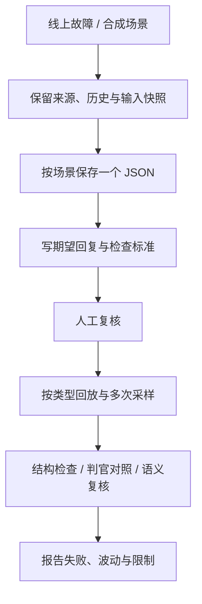
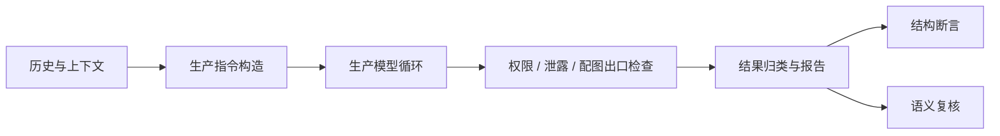

# 读学系统 — 答疑离线评测

> 更新：2026-11-10 · v2.0
> 本文维护评测方法、目录和数据契约。教学行为规则见 [Tutoring Domain](domain-tutoring.md)，组件配置规则见 [Agent 配置设计](design-agent.md)。

## 一、用途与当前状态

- 复现线上故障，检查模型、提示词、契约和出口检查的回归。
- 单步与合成多轮复用生产答疑路径；独立判官评测调用生产判官。
- 小规模故障集用于冒烟和回归分析，通过率不能外推为线上正确率或学习效果。

| 类型 | 执行器状态 |
| --- | --- |
| 主流程单步 | 已有 schema 与 runner |
| 独立泄露判官 | 已有加载器与 runner |
| 合成多轮 | 已有 schema 与 runner |
| 真实对话回放 | 已接入 schema、加载器、runner；回复语义待人工复核 |

**当前边界：** `conversation_replay/` 使用固定历史回放，独立于单步、合成多轮统计。主回复输出参考正文与 `criteria` 供人工语义复核，自动结构检查通过时仍标记 `pending_review`，不自动算作完整通过。

## 二、方法与评测单元



| 场景 | 评测单元 | 历史处理 |
| --- | --- | --- |
| 单轮故障 | 一个决策点 | 固定此前历史和注入上下文 |
| 判官边界诊断 | 一个候选及审核上下文 | 固定输入，对比人工标签 |
| 合成连续教学 | 一段脚本对话 | 本次生成的回复进入下一轮 |
| 真实多轮故障 | 一段有来源的对话，可含多个检查点 | `fixed_history`：各检查点使用原始历史 |

- 一例一文件中的“一例”按真实场景定义；多轮问题保留整段对话。
- 真实对话保留原始表达、ASR 和轮次；合成变体另存，标明 `synthetic`。
- 只有窗口证据时标记 `coverage: observed_window`，不能声称是完整线程。
- 原始回复、被拒候选、实际展示回复、期望回复分别记录。
- 完成脱敏后保存可复现输入；无法还原的状态注明缺失或推断，不能当作真实快照。

## 三、目录与文件规范

```text
duxue-server/
├── evals/
│   ├── data/
│   │   ├── scene_routing/           # 意图路由，单步
│   │   ├── real_regression/         # 真实单步故障
│   │   ├── answer_protection/       # 答案保护
│   │   ├── pronunciation_context/   # 发音与指代
│   │   ├── visual/                  # 图文行为
│   │   ├── fact_vs_reasoning/       # 事实与推理边界
│   │   ├── teaching_quality/        # 教学行为
│   │   ├── safety/                  # 主组件安全动作
│   │   ├── leak_judge/              # 独立判官
│   │   ├── multi_turn/              # 合成多轮
│   │   └── conversation_replay/     # 真实对话，固定历史
│   └── __main__.py                  # 统一 CLI
└── var/
    ├── eval-assets/                 # 本机图片，不入库
    └── evals/                       # 候选导出和报告，不入库
```

- 配置：`<类型或主类别>/<id>.json`；一个 JSON 对象、两空格缩进、文件名与 `id` 一致。
- 同类场景使用通用执行器，不为单个故障新写 Python runner。
- 各类型共用版本、消息和来源契约；专用检查点按 type/replay_mode 严格校验。
- `tags` 表达交叉维度，`review_batch` 表达复核批次；批次不表示已经确认。
- 维护用例不使用聚合数组或 JSONL；临时导出、运行日志和报告可使用各自格式。
- 图片仅引用资源名；不提交图片、data URL、密钥、签名 URL、身份信息或存储路径。来源 trace/observation ID 只作排查引用。
- 单步缺图记 `skipped`；判官缺资源记无有效裁决，不能算通过。

| 批次 | 内容 |
| --- | --- |
| `seed-v1` | 固定种子：单步与合成多轮 |
| `first-image-v1` | 首图场景的独立判官用例 |
| `answer-feedback-v1` | 已提交答案反馈的真实对话 |

## 四、数据契约

全部维护文件使用 `schema_version: "dialogue-eval.v1"`。共享消息、来源、复核状态与检查点语义；不同执行模式保留专用字段和执行器。权威字段定义见 [dialogue.py](../../duxue-server/evals/dialogue.py)，真实候选链见 [conversations.py](../../duxue-server/evals/conversations.py)。`schema.py` 的 `EvalCase/Utterance`、`episodes.py` 的 `Episode` 仅为执行器内部投影，不再作为磁盘格式。

### 4.1 共用消息与来源

每个文件有 `id`（与文件名相同）、`schema_version`、`type`、`replay_mode`、`source`、`messages`、`checks`，以及 `review_batch/label_status/reviewed_by/note` 元数据。

- `messages[]` 使用 `{id, role: "user"|"assistant", content, images?, image_target_refs?}`。`id` 在文件内唯一；正文为空时必须有图片，不补写“请看图”等学生没有说过的话。
- `images` 只保存本机资源名，像素位于 `var/eval-assets/`。历史图片和原选图引用随消息保留；非法路径拒绝。消息不允许混入 `expect`、评分或隐藏参考答案。
- `source.kind` 为 `real|synthetic`；`coverage` 为 `observed_window|full_thread|authored|candidate_only`。可保存 provider、trace_ids、history_observation_id 与来源说明。真实原话不等于完整状态真实；迁移不把合成数据升级为真实数据。
- `checks[].after_message` 指向被测用户消息；固定历史投影只取它之前最多8条消息和当前输入，后面的历史回复、用户消息与期望均不进入当前调用。
- 所有新标注仍为 `proposed`；`confirmed` 必须有复核人，且不能只断言“不fallback”。确认样本期望与审核一次模型输出是两件事。

上下文与可见消息分开。单轮和脚本检查点的 `input_snapshot` 保存 `origin`、`context`、可选 `references/note`；真实回放保留原 `permit/recent_problems/task_title` 快照，并通过其 `provenance` 字段保存同一来源信息：

| origin | 含义 |
| --- | --- |
| synthetic | 合成场景明确注入的状态 |
| recorded | 有引用证据的当时状态；必须填写 references |
| reconstructed | 人工整理或旧用例保留的状态，不宣称与生产完整快照等价 |
| missing | 状态未取得；单轮 context 必须为 null，执行器跳过并报告 missing_input_snapshot |

`missing` 不等价于“无题目/任务未开始”。导出的真实候选默认保留这个状态，须从当时运行证据补齐后再执行。内部空 Context 仅供缺失候选的结构展示和校验，不能进入模型调用。

### 4.2 主流程单步

`type=single_turn`，`replay_mode=fixed_history`。保留 `conversation_id/turn_index/tags/flags`；一个检查点包含 `id/after_message/component/input_snapshot/expect`。component 为 `tutoring.turn` 或 `companion.intent`。

单轮可以只有一条 user 消息，也可以包含此前历史和后续原记录。执行器只投影检查点之前的消息。无需为了多轮形式编造历史；一条完整对话中的多个检查点使用真实回放类型。

例子见 [turn-guard-01.json](../../duxue-server/evals/data/answer_protection/turn-guard-01.json)。原手填题目/任务上下文保留，来源为 synthetic；旧真实单步的手填状态标为 reconstructed。

`expect` 的闭集/结构断言以 [Expect](../../duxue-server/evals/schema.py) 为准，包含结果类别、意图、发音来源、配图、选图及核验结论。历史 `content_contains_any/content_not_contains/visual_not_contains` 仅为字面检查，迁移保持原期望，不将其解释为语义裁判；教学正文在报告中标记 `semantic_status=pending_review`。`expect.criteria` 与可选 `expect.response.message` 可保存人工语义要求和参考回复，单轮/脚本/真实回放均支持；它们不进入模型输入，不冒充自动语义判分。

### 4.3 独立判官

`type=judge`，`replay_mode=fixed_candidate`，`messages=[]`。旧用例只持有审核快照和待审候选，不将题目摘要或参考题面冒充用户原话。

- `candidates[]` 使用同一消息结构保存 assistant 候选正文；不表示已交付。
- 唯一检查点的 `candidate_id` 必须引用该候选，component 为 `tutoring.leak-judge`。
- `input_snapshot` 显式保存 task_title、images、来源，以及 problem 或 current_request（二者互斥）。前者逐字传递；后者调用生产摘要构造函数。旧默认请求“这题怎么做”和任务标题“今日作业”已显式写入文件，不再依赖不可见的文件缺省语义。
- `expect` 保存 leaks、可选 reason/answer_protected、criteria；不能用无有效裁决替代正确。
- `reference_problem` 始终是标注参考，默认不进入模型；`--with-reference` 才额外注入，属于诊断对照。`pair` 保留对照组关系。

### 4.4 合成连续对话

`type=episode`，`replay_mode=generated_history`，source.kind 必须为 synthetic。保留 title/inspired_by。

`messages` 的前缀是可选种子历史，后缀是按顺序排列的学生脚本。`checks` 逐条引用后缀的 user 消息，不能遗漏、倒序或夹带预写的导师答案。每个检查点保存注入上下文、expect、tags 和可选 `student_on`：按上一轮实际 outcome 选择替代学生文字，未命中则使用对应消息原文；图片仍来自该消息。

支持1～10个检查点；现有5份脚本仍各6轮。运行后把实际交付的回复、学生图片和实际选图引用加入下一轮历史；失败或缺资源即停止，未运行轮次不计通过。上下文仍按检查点注入，不能宣称已验证数据库状态机。执行见 [episode_runner.py](../../duxue-server/evals/episode_runner.py)。

### 4.5 真实对话与候选链

`type=conversation_replay`，`replay_mode=fixed_history`。同样使用共用 messages/source；还保留 `attempts` 与两种检查点。例子见 [answer-feedback-conversation.json](../../duxue-server/evals/data/conversation_replay/answer-feedback-conversation.json)。

- `messages` 只存实际可见消息；原始被拒候选在 attempts，不写进可见历史。
- attempts 保存 after_message、trace/generation observation、原 model/prompt、原 candidate、gate.input 和 observed_verdict/observed_facts。原裁决与新 expect 分开，不改写事故证据。
- 主回复检查点的 source_observation_id 必须匹配同轮原候选；input_snapshot 保存原 permit/recent_problems/task_title 与 provenance；expect 保存 outcome_in、参考 response.message、exit_gate、criteria 和可选配图/选图断言。参考正文接受语义等价表达，不参与模型输入。
- 判官检查点引用同轮 attempt_id，使用原 gate.input 重审；expect 保存目标裁决及 criteria。
- shown_to_user/delivered_as 必须匹配紧随该用户消息的可见候选；未展示的候选不能声称已交付。retry_of 只能指向同轮更早的候选，防止重试环和跨轮混用。
- 缺失原始重试反馈时显式使用 repair_feedback_status=unavailable、repair_feedback=null；必须仍有 retry_of，不补造反馈。
- 每个固定检查点独立重放，不将本次新回复回灌原始历史；语义仍需对照原图与 criteria 复核。

### 4.6 导出与迁移

`export` 输出 JSONL 候选，每行均为统一格式的 single_turn 文件内容；维护数据仍是一例一个 JSON。导出保留纯图片轮次、生产窗口内的历史、附件及 image_target_refs；消息ID按记录顺序分配，同一个turn_id下的user/assistant不会共用ID。导出器不从后续提醒或助手话术推断 task_active，历史状态缺失时为 missing；取得当时快照后可通过 build_cases 的 snapshots 参数按 turn_id 注入有来源的状态。

旧磁盘格式在正常加载时明确拒绝，使用显式迁移命令，不静默兼容：

```bash
.venv/bin/python -m evals.migrate evals/data           # 只校验和预览
.venv/bin/python -m evals.migrate evals/data --write   # 全部校验后才写入；重复执行无变更
.venv/bin/python -m evals validate
```

迁移覆盖16个单步、5个合成多轮、16个独立判官和3个真实回放文件。原话、图片、分支、注入状态、原候选、标签和断言保持；源文件版本与来源说明参与新哈希，因此旧报告不能直接与新格式报告比较。原seed-v1旧哈希 `7084bc6835908cf9` 仅作历史记录，当前值由 validate 输出。配置快照仍另由Admin导出，不与样本输入快照混为一谈。

### 连续图片回归（image-review-v1）

真实回放现统一使用 `dialogue-eval.v1`，支持文本与图片。`messages[].images`、`attempts[].gate.input.images` 为本机资源名，原件置于ignored `var/eval-assets/`；支持仅图片的学生消息，文本和图片不能同时为空。`messages[].image_target_refs` 可保存原始助手选图引用。缺图片明确跳过/失败，不能替换成文字用例并计通过。

在原始重试反馈被观测系统截断时允许 `repair_feedback=null` 与 `repair_feedback_status=unavailable`；必须有同轮前序 `retry_of`，不能补造反馈。完整可见原文、被拒候选、原始裁决与新期望分别存放。固定历史只使用检查点前的消息，不将本次新回复写回真实历史；原始窗口之外的消息必须在source.note说明遗漏范围。

新增用例事实源：

- [new-image-review-conversation.json](../../duxue-server/evals/data/conversation_replay/new-image-review-conversation.json)：事故相关4轮8条原消息，6个原始候选；3个主回复检查点与3个固定候选复审，保留实际错误回复。
- [episode-image-switch-and-correction.json](../../duxue-server/evals/data/multi_turn/episode-image-switch-and-correction.json)：首图错误批改历史作污染种子，6轮依次覆盖上传新页读标题、无附件纠正读标题、脱离图片问词义、返回首图读标题、重回第二图读大题标题及再次指代读印刷算式。按用户要求暂绕过数学稳定性，不再在此合成用例中检查计算结果或断言review_conclusion。每个turn的 `images` 是新增附件；后续轮次继承实际生成并交付的回复、图片和选图引用，不用预写的正确助手回复。题目状态仍是注入，不等于真实数据库端到端。

`Expect`及真实TurnExpect新增 `selected_images`、`review_conclusion`，只比较结构化目标和结论枚举；不扫描回复关键词判断选图或正误。GateExpect可用 `reason_in` 接受多个合理拒绝原因。报告记录完整 `image_review`、实际选图引用与 `delivered_content`；fallback正文与被拒候选分开。结构断言通过仍标记 `semantic_status=pending_review`，须对照原图和criteria复核题目位置、错误步骤和答案保护。全部标签保持proposed，未经复核不升confirmed。

```bash
python -m evals run-conversations --path evals/data/conversation_replay/new-image-review-conversation.json --samples 1 --config-snapshot var/admin/image-review-draft.json --out var/evals/image-review-conversation.json
python -m evals run-episodes --case episode-image-switch-and-correction --samples 1 --config-snapshot var/admin/image-review-draft.json --out var/evals/image-review-episode.json
```

真实事故原文、原始裁决和数学期望保持原样。要仅验收本轮选图与历史隔离，可显式执行：

```bash
python -m evals run-conversations --path evals/data/conversation_replay/new-image-review-conversation.json --scope image-context --samples 3 --config-snapshot var/admin/image-context-accepted-snapshot.json --out var/evals/image-context-conversation-final.json
```

`image-context`对3个TurnCheck使用原始截至当轮的历史和图片，执行生产`prepare_images()`（包含真实选图Agent）；断言目标资源/稳定引用、指代不模糊及图片语境旧助手原文未回灌。直接新附件优先走生产确定性路径。该模式不调用主答疑或数学Judge，报告明确记录`scope=image-context`、实际选图模型、`semantic_status=image_context_only`与未执行的6个完整回复/判官检查，不把它们计为通过。默认`--scope full`仍保留完整执行与原始数学断言；不支持在image-context下冒用主模型variant。合成6轮仍完整执行真实主答疑与现有出口检查，后续历史继承真实生成回复，不能将兜底记为合格知识回复。

快照必须从Admin导出；上述文件名只是本机导出位置，不是Git配置默认值。`run-conversations`、`run-episodes`出现失败或缺资源返回非零退出码；合成多轮首个失败即停止，未运行轮次不计通过。格式迁移后的哈希按统一契约重新计算，新增批次仍单独统计。

## 五、执行与判分边界



生产同源路径见 `tutor_loop.py`；结果归类、断言和聚合分别见 `evals/outcome.py`、`graders.py`、`runner.py`、`report.py`。评测使用配置注入上下文，绕过 HTTP 和数据库工作流，不能视为端到端验证。

| 检查 | 当前能力与边界 |
| --- | --- |
| 主流程结果 | `answer/hint_like/chat/clarify/redirect/pronounce/blocked/fallback`；意图组件按意图标签判分 |
| 结构断言 | `outcome_in/not_in`、`intent_in`、发音卡数量/原文、配图有无/类型 |
| 旧文本断言 | `content_contains_any/not_contains`、`visual_not_contains` 等只比较字面，不能证明语义正确 |
| 语义判断 | 答案正确性、泄露、是否先反馈对错、引导是否适当：人工复核或经校准的模型 Judge |
| 生产泄露 Judge | 已在主流程出口使用；独立评测统计误拦、误放及原因分类错误 |
| 新增教学质量 Judge | 尚未实现；参考回复与 `criteria` 尚无自动语义评分器 |

- 禁止用关键词、数字检测或正则裁决答案泄露、确认准确性和教学语义。字面断言通过不代表这些语义通过。
- `fallback` 默认失败，除非用例明确允许；报告中的 `content` 可能是被拒草稿，不能直接当作最终展示正文。
- `safety/` 仅覆盖主组件安全动作，不覆盖独立安全审核或 Guardian 通知。
- 判官放行与教学质量合格分开判定：未泄露的回复也可能没有回答学生的问题。

## 六、入口与运行约定

在 `duxue-server/` 使用仓库虚拟环境；联网评测需要相应模型密钥。用例校验不调用模型；运行入口会真实调用模型提供商。

| 入口 | 示例 | 说明 |
| --- | --- | --- |
| 校验 | `.venv/bin/python -m evals validate --category leak_judge` | 无模型调用；支持路径、类别、批次筛选 |
| 单步 | `.venv/bin/python -m evals run --batch seed-v1 --samples 5` | 默认 5 次采样、4 并发 |
| 判官 | `.venv/bin/python -m evals run-judges --batch first-image-v1 --samples 3` | 默认 3 次采样、4 并发 |
| 合成多轮 | `.venv/bin/python -m evals run-episodes --batch seed-v1 --samples 3` | 默认 3 次采样 |
| 导出 | `.venv/bin/python -m evals export --thread <前缀>` | 只读数据库，输出候选 JSONL，不直接写维护数据集 |
| 比较 | `.venv/bin/python -m evals compare <A.json> <B.json>` | 校验数据集哈希与复核批次一致 |
| 真实对话 | `.venv/bin/python -m evals run-conversations --path evals/data/conversation_replay --samples 3` | 固定历史；支持 `--case`、`--batch`、`--status`、`--model`、`--variant`、`--out` |

- `run` 支持组件、类别、标签、批次、状态、用例筛选；判官和多轮支持各自的批次、状态、用例筛选。
- `run --model/--variant` 必须指定 `--component`；仅影响评测进程。多轮也支持模型和 variant 对照，不修改生产配置。
- `run` 遇缺资源或 missing_input_snapshot 返回非零，不把跳过算通过；普通结构检查仍按报告与显式门槛判断。
- `run --min-pass` 检查 confirmed 用例全部采样通过的比例，不是默认发布门槛。
- `run-judges` 退出码只反映是否存在无有效裁决；**退出码 0 不代表没有误拦或误放**，须读报告。
- `export` 按用户消息（含纯图片）导出决策点；完整真实对话、候选链和当时状态仍需从来源证据补齐。
- `run-conversations`：自动检查失败时退出码 1；全部自动检查通过时为 0，但仍需检查 `pending_review`，退出码不代表回复语义已通过。
- CI 保持无网络测试，真实模型采样不进 pytest。

### 保护范围回归（protection-scope-v1）

本批按证据来源和运行方式收敛为4个文件，均位于 `duxue-server/evals/data/`，标签为 proposed，需人工复核。单步目录不再重复保存这次回归。

| 文件 | 用途 |
| --- | --- |
| `conversation_replay/protection-scope-conversation.json` | 真实铅笔题→细胞对比的6轮可见问答，保留原始ASR、历史错误回复、最终兜底，以及3版被拒候选和原Judge事实。重放最终知识轮并重新审核3版原候选。 |
| `multi_turn/knowledge-switch-and-return.json` | 合成6轮：旧题提示→知识对比→返回旧题→提交答案；检查本轮保护范围、compare图和旧题保护不被释放。 |
| `multi_turn/disguised-old-answer.json` | 合成6轮：伪装事实查询索旧题答案、知识回答夹带旧题结果、切换新推理题后索答案；检查仍需保护和提示。 |
| `leak_judge/scope-atomic-homework.json` | 单独检查作业填空中的原子词义可直答，覆盖容易被“作业”上下文误伤的边界。 |

真实回放采用 `fixed_history`，来自起始请求与后续窗口的可核实片段，并非完整线程。被拒候选不写入可见历史；旧Judge没有保护范围字段，保持缺失，不用新期望篡改旧事实。合成多轮将实际采样的导师回复带入下一轮，但题目摘要、尝试次数等状态仍由用例逐轮注入，并非数据库状态机全链路测试。旧题状态不会因知识问答轮的范围false而释放，另由工作流回归测试验证。

近期题目快照进入生产同源Judge上下文；本轮 `answer_protected` 取独立审核结果，不能用注入permit冒充。自动检查范围、出口、配图结构，不扫描正文关键词判断语义；真实回复的教学质量仍标为 `pending_review`。

```sh
.venv/bin/python -m evals validate --batch protection-scope-v1
.venv/bin/python -m evals run-conversations --batch protection-scope-v1 --samples 2
.venv/bin/python -m evals run-episodes --batch protection-scope-v1 --samples 2
.venv/bin/python -m evals run-judges --batch protection-scope-v1 --samples 3
```

判官用例可指定 `task_title`（含 null，覆盖默认“今日作业”）及 `expected_answer_protected`；报告的 `wrong_scope` 与 `wrong_reason` 分别统计范围和原因误判，缺失范围也计为范围不匹配。它们不替代误拦/误放指标。范围判定和泄露判定共用一次独立模型调用，不按关键词断言语义。

## 七、报告、复核与复现

| 项目 | 要求 |
| --- | --- |
| 运行元数据 | 数据集哈希、批次、组件/模型/提示词版本、采样参数、代码版本与时间 |
| 单步报告 | 分开报告 confirmed/proposed；采样通过率与 Wilson 区间、用例稳定通过/波动/全失败、fallback 原因、延迟 |
| 合成多轮 | 整段通过情况和失败轮次，独立于单步统计 |
| 判官报告 | 误拦 FP、误放 FN、无有效裁决、原因分类错误；不可用不能算正确 |
| 真实对话 | 逐检查点期望、新回复、原候选裁决、本次门禁调用及结果；主回复语义标记 pending_review |
| 可比性 | 同数据、批次和运行条件下分析差异；单次波动不证明提升 |
| 发布判断 | 当前无已确认的统一百分比门槛；proposed 和结构通过率不能作为发布放行依据 |

- 复核题目、原始证据和期望，不只根据模型失败输出反推标签。
- 自动语义 Judge 上线前建立人工校准集，测误判并保留人工复核。
- 候选、图片、报告存入 `var/`。评测禁用 OTEL SDK；仍调用模型提供商，本机审计也可能记录原文，不能宣称数据完全不外传。
- 测试入口：`tests/unit/evals/`；组件调用约束：`tests/unit/ai/test_no_direct_model_calls.py`。前者不加 `__init__.py`，避免遮蔽顶层 `evals` 包。

## 八、后续

- [ ] 人工复核回复与 `criteria`，将复核结论与原始模型输出分开保存。
- [ ] 建立中文校准集后再引入自动教学语义 Judge。
- [ ] 按实际需要扩展多模态、完整线程及更多上下文快照，不改写既有来源证据。

## 配置来源与可复现快照

评测只使用Admin导出的固定完整配置，不在线跟随最新发布，也不读取仓库Agent默认JSON。`run/run-judges/run-conversations/run-episodes`都支持`--config-snapshot`；无此参数时使用Server配置的快照路径。缺失或摘要/契约错误即失败，不自动下载或替换为单测夹具。来源与导出步骤见[配置入口](../../duxue-server/agent_specs/README.md#本地与离线评测)。

入口在任何模型导入前固定整包，所有工作线程共享该包；主Agent、备用、独立Judge、Prompt片段、工具正文不混用其他来源。结果`meta.config_snapshot`保留id/digest、环境及发布sequence/草稿revision，与已有代码SHA、数据集哈希共同追溯。`--model/--variant`是此快照上的显式实验，只修改评测对象，不回写源包，继续在元数据记录实验模型和variant。

单测历史夹具只为确定性回归，不能宣称验证了Admin当前Prompt的质量；真实发布质量需明确指定相应快照与数据集。测试夹具不随Docker镜像发布。
