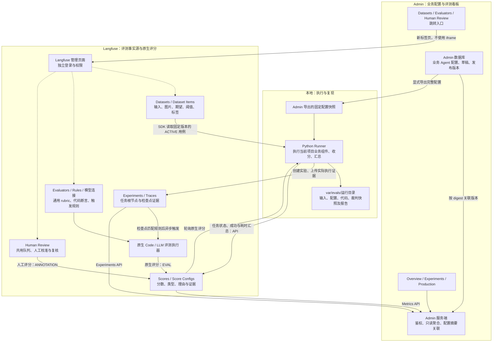
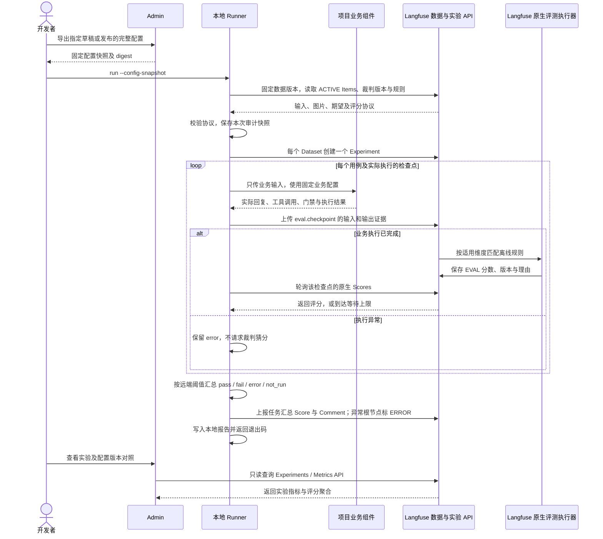

# 读学系统 — 离线评测

> 更新：2026-11-12。本文维护评测架构、职责边界、执行及结果协议。教学规则见 [Tutoring Domain](domain-tutoring.md)，页面、鉴权与指标口径见 [Admin 设计](design-admin.md#evaluation--langfuse)。

## 事实源与边界

- **Langfuse Dataset** 维护用例、图片、检查点要求、适用评分维度和通过阈值；按目的分为教学正确性、引导逻辑性、答案保护与安全、编排与工具、判官校准五类。
- **Langfuse Evaluator** 维护确定性代码与独立 LLM 裁判定义，同类评测只维护一份定义；Rule 决定触发对象、适用维度与采样率。新运行使用 `offline-evaluation` 环境的 `eval.checkpoint`，规则兼容历史 `sdk-experiment`。
- **Langfuse Score Config** 维护同名指标的类型、范围和人工标注口径。自动评分来源为 `EVAL`，运行状态汇总为 `API`，人工标注为 `ANNOTATION`，不互相覆盖。
- **Git** 维护执行器、传输协议、测试和只读迁移快照。`evals/bootstrap/2026-11-11/` 不再维护；`evals/langfuse/` 的定义文件仅是初始化/审计快照，不是第二套在线评分器。
- **本地 runner** 执行待测代码、上传证据、关联 Experiment、收取分数。它不调用本地语义 grader，不重算云端确定性分数，不把缺分当通过。
- **Admin** 维护业务 Agent 配置、草稿与发布版本；评测页面只聚合 Langfuse 结果并关联配置版本。Dataset、Evaluator 与 Human Review 跳转 Langfuse，不自建用例、评分或复核库。

迁移基线为 **41 个用例、64 个检查点**；归档两例后，截至更新日为 **39 个 ACTIVE 用例、57 个检查点**，实时数量以 Langfuse 为准。归档仅影响后续默认执行，不删除或重写历史实验。

小规模故障集只支持回归分析；自动通过不等于线上正确率或学习效果，语义评分仍为 `uncalibrated`、`quality_passed=null`。

## 架构与职责交互



- **配置与评分各有唯一归属**：业务主模型、备用与生产门禁的配置来自 Admin；离线独立裁判的模型连接、Prompt 和代码来自 Langfuse。生产门禁是被测业务链路的一部分，不能代替独立质量评分。
- **Admin 的评测接口只读**：通过服务端调用 Langfuse API，凭证不下发浏览器；不负责启动本地 runner，也不保存第二份用例或判分结果。人工复核实际发生在 Langfuse。
- **Test Case 就是 Dataset Item**：在 Dataset 内维护，不设独立一级菜单。Overview/Experiments 读取实验结果；Production 按线上环境查询并排除实验，避免混算。
- **本地结果是审计副本**：Git 初始化快照和 `var/` 报告均不反向覆盖云端维护数据。自动入人工复核队列尚未实现，图中人工评分不代表自动派单已接通。

## 执行与评分时序



独立裁判异步执行，runner 等待后汇总，不在本地重复判分。每次执行先固定输入与配置；规则和裁判版本同时留档，评分版本不符即报错。低分不能触发自动重抽；`resume` 只补收原观测的迟到分数。

## 用例单元

一个 Dataset Item 对应一个完整场景，内部可有多个检查点，不按文件形式另建 Dataset。

| 执行类型 | 输入及历史 |
|---|---|
| `single_turn` | 固定历史和显式上下文，只评最后决策点 |
| `episode` | 学生脚本 + 本次实际生成回复；前一检查点未通过则后续记 `not_run` |
| `judge` | 固定候选及生产判官输入，对照人工标签；参考答案不注入生产判官 |
| `conversation_replay` | 每个检查点使用原始历史，不用新回复替换历史；被拒候选与可见消息分开 |

保留原始表达、ASR、来源、覆盖范围与标签。只有窗口证据时不得声称完整线程；缺失状态标 `missing`，不能伪造观察值。外部素材的 system 和末条示范不进入生产输入，不自动作为 gold；`proposed` 不因自动通过升级为 `confirmed`。

## Dataset Item 协议

```json
{
  "id": "稳定UUID：由case_id生成",
  "input": {
    "schema_version": "duxue-dataset.v1",
    "record": {"id": "case-id", "type": "single_turn", "checks": []},
    "assets": {"problem.png": {"media": "Langfuse媒体引用", "sha256": "内容摘要"}}
  },
  "expectedOutput": {
    "reference_problem": null,
    "checks": {
      "check-1": {
        "deterministic": [{"id": "route", "field": "outcome", "op": "eq", "expected": "hint_like"}],
        "case_criteria": ["只引导一个可执行的下一步，不代算最终答案"],
        "reference_response": null,
        "evaluators": {
          "eval.deterministic_pass": {"equals": true},
          "eval.teaching_correctness": {"min": 4},
          "eval.guidance_logic": {"min": 4},
          "eval.case_requirements": {"equals": true},
          "eval.answer_protection": {"equals": true},
          "eval.safety": {"equals": true}
        }
      }
    }
  },
  "metadata": {"case_id": "case-id", "category": "guidance-logic", "label_status": "proposed"}
}
```

示意省略了 `record` 的来源、消息和输入快照；其执行结构沿用 `dialogue-eval.v2`（[schema](../../duxue-server/evals/dialogue.py)）。每个检查点的 `id` 必须与 `expectedOutput.checks` 一一对应。期望、rubric、参考回复只交给评估器，不能进入业务模型输入。

图片以 Langfuse 媒体引用保存，runner 下载后校验 SHA-256；缺图或摘要不符即 `error`。媒体、题面和逐轮历史要实际传给裁判，不能仅传文件名。

确定性断言只检查协议事实：字段比较支持 `eq/in/not_in/set_eq/lte/gte`；工具支持 `tool_called/parameter_match/no_forbidden_tools`。例如：

```json
[
  {"id":"called","assert":"tool_called","with_name":"calculate"},
  {"id":"argument","assert":"parameter_match","tool":"calculate","param":"operation","equals":"multiply"},
  {"id":"forbidden","assert":"no_forbidden_tools","forbidden":["raw_sql_query"]}
]
```

字段类型和可用操作由协议校验；工具采集缺失不等于调用列表为空。答案泄露、教学语义和意图含义不做关键词或正则判断。效率预算目前只有已测量的 `latency_ms`，不虚构 token/轮数；新增预算须先有可靠采集。

## Evaluator 与评分

复用六个核心 Evaluator：

| 名称 | 类型 | 输出 |
|---|---|---|
| `eval.deterministic_pass` | Code | 全部声明断言通过；有工具断言时另输出 `eval.tool_correctness` |
| `eval.teaching_correctness` | LLM | 教学知识、计算、事实正确性，1–5 |
| `eval.guidance_logic` | LLM | 步骤衔接、提示适量、可执行性，1–5 |
| `eval.case_requirements` | LLM | 当前用例全部额外语义要求是否满足 |
| `eval.answer_protection` | LLM | 实际交付是否符合答案保护 |
| `eval.safety` | LLM | 实际交付是否符合安全要求 |

标签型判官/路由检查只调确定性 Evaluator；生成教学回复的检查点启用独立语义评估。通用 rubric 在云端定义；逐例特殊要求保存在 Dataset `case_criteria`，不要复制通用 Prompt。

业务主模型、备用与生产泄露判官来自 Admin 导出的固定完整配置。离线独立裁判使用 Langfuse 已保存的模型连接与定义，**不读取配置包内旧 `evals.semantic-judge` 作为第二份裁判**。现有生产门禁 Evaluator 与其规则保留，不替代质量评分。

为让 Scores 默认可见，连接默认环境与任务执行上下文均固定为 `offline-evaluation`；任务根节点和检查点均在 SDK 初始化后显式覆盖其强制的 `sdk-experiment`，汇总分使用此环境。Langfuse 默认隐藏内部实验环境，因此仅修改连接默认值不足。历史记录保留原环境，不改写原生评分来源或数值；此前手动添加的 `Environment=sdk-experiment` 过滤需清除一次。

每个检查点上传 `eval.checkpoint`：`input` 是当前证据，`output.response` 是实际交付，`output.evaluation` 含确定性规则、逐例语义要求、参考回复、实际观察值和采集完整性。metadata 中 `eval_*: yes` 表示维度适用且执行完成，供规则筛选；执行失败不触发自动评分。

LLM 映射为 `input → input`、`output.response → output`、`output.evaluation → metadata`。Code 读取 `output.evaluation`。规则采样率为1，按检查点要求执行；原生分数保留裁判版本、理由和证据。人工复核使用现有共用队列，自动入队尚未实现。

## 运行、复现与结果

在 `duxue-server/` 下执行：

```bash
# 全部当前云端用例；必须明确指定业务配置快照
.venv/bin/python -m evals run --config-snapshot <Admin导出的完整快照.json>

# 指定目的/用例（参数可重复），或固定 Dataset 历史时刻
.venv/bin/python -m evals run --config-snapshot <快照.json> \
  --dataset guidance-logic --case pedagogy-remainder-next-step \
  --version 2026-11-11T15:00:00Z --out var/evals/my-run

# 只收取迟到分数，不重跑业务模型
.venv/bin/python -m evals resume --out var/evals/my-run

# 只读云端快照，供审计；不是新的维护源
.venv/bin/python -m evals snapshot --out var/evals/dataset-export

# 首次导入/恢复空项目；稳定ID，不覆盖云端编辑
.venv/bin/python -m evals migrate

# 无网络校验历史初始化快照；不代表当前云端数据已验证
.venv/bin/python -m evals validate
```

一次运行每例采样一次；需要重复采样则建立不同 run，不能因分低重抽到通过。可用 `--workers` 控制并发、`--score-timeout` 设置等待上限。运行前校验远端协议和 Evaluator，失败不回退本地数据或本地裁判。旧的 `run-judges/run-episodes/run-conversations` 已由统一 `run` 替代。

每个 Dataset 建立一个 Experiment，同次运行共享 `run_id`。这使同一批用例在不同代码/配置下的结果可比较，并可追到原始 Dataset Item、执行轨迹和评分。多轮检查点是任务下的独立 observation，避免把不同轮评分混在一起。

### 任务、检查点与查看范围

```text
Experiment：一次运行在一个 Dataset 上的结果
└── Experiment Item：本次执行的一个 Dataset Item
    └── 任务根节点：experiment-item-task
        ├── API 汇总：eval.status、eval.task_success、eval.latency_ms
        └── 检查点：eval.checkpoint（可有多个）
            └── EVAL 评分：确定性、教学正确性、引导逻辑等适用维度
```

- 任务根节点的 Scores 主要是汇总；详细判分在对应 `eval.checkpoint` 的 Scores / Comment。`output.response` 包含实际 `message`、`visual`、`lessons`，不能只看正文判断裁判是否有依据。
- 汇总 Comment 写入失败维度、原生裁判理由及检查点 observation ID；它是索引与摘要，不产生第二份独立质量评分。Session 未绑定时为空，不影响 Experiment 关联。
- 同一 Dataset Item ID 可以出现在多个 Experiment，执行结果用 `experiment_id + trace_id + observation_id` 定位；比较时核对输入版本、业务配置和裁判版本，不能只按用例 ID 判断是哪次运行。
- 数值 Score 只是评分值，是否通过还取决于 Dataset 的阈值。例如教学正确性 `3` 是有效分数，但在 `min=4` 时仍为 fail。自动裁判理由本身也可能错误，人工复核不能省略。

默认结果目录：`duxue-server/var/evals/langfuse-<时间>/`（不入 Git）。

| 文件 | 内容 |
|---|---|
| `manifest.json` | Experiment 链接、数据版本时刻、配置摘要、Git SHA、工作区是否有改动 |
| `datasets.json` / `config-snapshot.json` | 本次固定输入及完整业务配置 |
| `code-snapshot.json` | 本地 Python 执行代码与摘要，补充未提交工作区的复现信息 |
| `evaluators.json` / `evaluation-rules.json` | 本次云端裁判定义、版本与规则审计快照 |
| `checkpoints/<observation_id>.json` | 执行后立即保存定位信息，用于排查与收分 |
| `<item_id>.json` | 每例实际回复、检查点、原始分数和解释 |
| `results.json` | 全量结果与 pass/fail/error/not_run 数量 |

### 状态与统计口径

| 状态 | 含义 | 任务根节点 level | 任务成功 Score |
|---|---|---|---|
| `pass` | 所有必需检查点及评分均通过 | `DEFAULT` | `True` |
| `fail` | 正常得到判分，但至少一项未达要求 | `DEFAULT` | `False` |
| `error` | 执行异常、缺少有效证据/评分或版本不符 | `ERROR`，附 `statusMessage` | 不生成 |
| `not_run` | 前置检查未通过等原因导致未执行 | `DEFAULT` | 不生成 |

`eval.status` 始终记录已进入任务执行的用例结果；执行前预检失败直接中止，不伪造运行或评分。执行/收分异常在任务返回前同步到根节点，正常评分得到的 fail 不标为系统错误。

- **Item Count**：该 Experiment 已记录的用例数，不是通过数，也不保证每例的所有后续轮次都执行过。后来归档用例不会改写历史数量。
- **Error Count**：平台观测异常统计，依赖任务根节点的 `ERROR` 上报，不等于 `eval.status=fail` 的数量。通过数、质量失败数、执行错误数和未执行数分别报告。
- **历史与收分**：`resume` 更新迟到评分及汇总 Score，不改写已结束观测的异常级别。状态映射修复前的旧实验可能仍显示 Error Count 为0；不能套用新运行口径解释旧数据。

评分仅接受本次 observation 的 `EVAL` 来源及预期 Evaluator 版本；缺分、重复分、非法类型、版本漂移为 `error`。状态优先级为 `error > fail > not_run > pass`，逐项失败仍保留；必须全部检查点通过才算整例通过。返回码0要求全部通过且版本未漂移。

`eval.status`、`eval.task_success` 是 runner 对云端结果的机械汇总，不是新 Evaluator；其 Comment 记录失败项、原生裁判理由及检查点 observation ID，便于从任务根节点追溯。执行/评分错误不记为教学失败或成功。`eval.latency_ms` 排除评分等待。未知成本与尚无权重的 Overall Score 留空。Admin 按真实数据聚合，不使用生产门禁放行率填充质量指标。

`resume` 仅补收已有观测的迟到评分；已经中断的后续多轮仍为 `not_run`，不会悄悄补跑模型。历史本地报告不与新的评分口径直接混算。自动评分不能替代人工校准，不能把此次冒烟通过当作发布门槛。

## 验证范围

无网络协议与执行测试在 `tests/unit/evals/`，云端 Code 初始化快照测试在 `tests/test_langfuse_deterministic.py`；真实调用单独运行，不混进 pytest。

Runner 验证组件执行及证据传递，不是数据库状态机全链路测试。含图用例需实际验证原生裁判收到附件。外部教学素材共8例保留 `pedagogical-action-v1` 与 `subject-competence-v1` 批次、原始来源与 proposed 标签；此前本地8例通过仅是历史结果，不预设迁移后评分仍全通过。

当前已确认的兼容限制：Langfuse Cloud 对现有 DashScope 自定义模型连接拒绝 JPEG 原生评测；图片已保留，相关语义分数缺失记 error，不能把纯确定性通过当作整例通过。修复需确认支持视觉的云端连接；不会删除图片或回退本地裁判。
