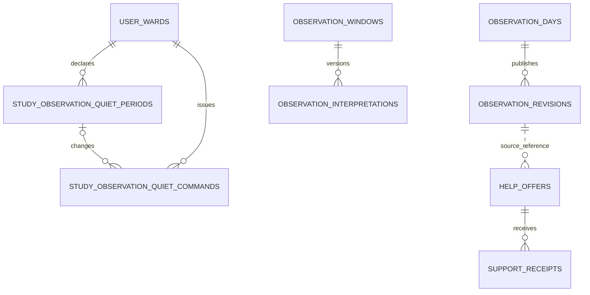
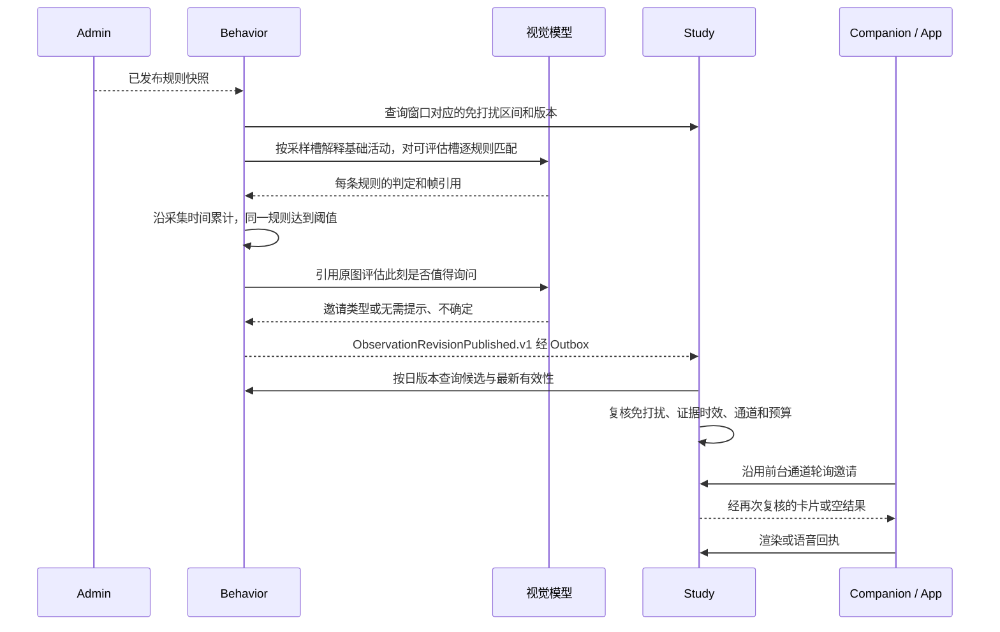
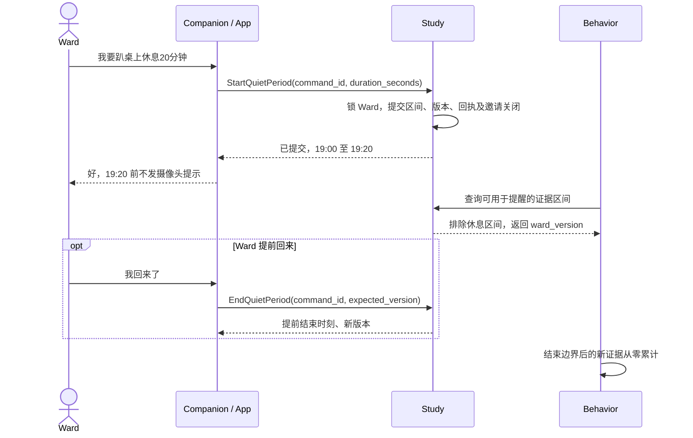

# 摄像头行为提醒与 Ward 临时免打扰

**状态：2026-11-21 已实现并在测试 PostgreSQL 联调，Admin 为待发布草稿，现场验收进行中。** 适用于由摄像头触发的两类邀请：提供一点帮助、邀请回到学习。现有实现有固定活动类别、时长阈值、前台通道、邀请额度和回执。本方案增加可发布的自然语言规则，以及独立于任务的临时免打扰。当前实现基线见[行为观察](domain-behavior.md)、[学习执行](domain-study.md)和[管理台](design-admin.md)。

## 1. 产品行为与领域归属

管理员在「行为观察与帮助」中选择邀请类型，描述可见行为并填写持续时长。Ward 无需创建任务即可说「我要去上厕所 15 分钟」「我想趴桌上休息 20 分钟」「再休息 5 分钟」或「我回来了」。系统保存成功后，用当地时间明确回复截止时刻。到点静默恢复资格；从恢复后的新画面开始计时。

| 参与方 | 负责的决策与写入 |
|---|---|
| Admin | 管规则草稿、校验、发布、版本差异与环境指针。运行时由各实例加载已发布快照。 |
| 采集网关与接入服务 | 沿用按采集时刻、摄像头及座位归属接收的证据。换座或无法确定归属会中断连续性。 |
| Behavior | 窗口聚合管理一次输入及解释，观察日聚合发布当日证据版本。模型解释画面，领域规则计算连续时间，再形成有证据的邀请候选。 |
| Study | 管 Ward 的摄像头提醒免打扰区间及开始、延长、结束命令；沿用邀请预算和生命周期，决定此刻能否预留或呈现邀请。普通学习任务、计时会话和 Sprint 各自沿用原有语义。 |
| Companion / App | 使用现有对话与语音入口理解意图，向 Study 提交已鉴权的结构化请求；确认成功后回复，前台展示卡片、可选播音并发送回执。 |
| Evaluation | 继续读取带版本的客观观察摘要。免打扰是 Ward 对提示的选择；私人原因不进入晚报、记忆或运营日志。 |

本方案假设「休息」仅关闭摄像头引发的提醒。原有授权、采集时段与客观观察继续生效。「停止拍摄」使用独立的采集控制，产品文案应明确区分。聊天原话仍受既有对话历史与删除规则约束。

## 2. Admin 规则格式

沿用完整发布包，在 `files` 下增加 `policies/observation-support.json`。管理台把规则分成「提供帮助」和「邀请回来」两组，组内顺序表示同时符合时的优先级。每行只需编辑行为描述和持续秒数；ID 在创建时生成，编辑、排序和重新发布均保留。下列为提议格式。

```json
{
  "schema_version": 1,
  "groups": {
    "offer_help": [
      {
        "id": "material-still",
        "assessment_rule": "面前有学习材料，持续保持同一姿势，画面中看不到书写、翻页或移动学具。画面不清或无法判断时标为不确定。",
        "min_continuous_seconds": 240
      }
    ],
    "invite_return": [
      {
        "id": "playing-with-objects",
        "assessment_rule": "持续把玩玩具、文具或纸张，例如反复抛接橡皮。正常书写、翻页、整理作业或按题目操作学具不计入。无法区分用途时标为不确定。",
        "min_continuous_seconds": 120
      }
    ]
  }
}
```

- 两组必填，可为空。ID 全包唯一；描述去除首尾空白后必须非空。建议 v1 每组最多 8 条、描述最多 500 字、持续时间为 15–3600 的整数秒；这些是拟议产品限制，便于控制推理成本和采样分辨率。前后端共用同一校验契约，拒绝未知字段。
- 行为描述作为模型输入数据，动作只能来自所在组的已注册邀请类型。模型看懂“把玩橡皮”不等于应该打扰；过阈值后仍复用二次机会评估，有明确证据才形成候选。「邀请回来」还需要已有学习背景。两组同时符合时，建议帮助优先，每条证据时段最多形成一次可用邀请。
- 页面可查看固定送达条件：近期证据、Ward 主动开启、前台有效、当前空闲，每 Ward 每当地日最多两次、间隔至少 20 分钟。首版这组条件沿用 Study 代码；管理员调整的是视觉描述与时长。
- 草稿保存不改变运行实例。发布沿用 Admin 草稿修订冲突检查、完整包校验、不可变发布与加载回执。详情区分「草稿」「环境已发布」「实例已加载」，并能用授权样例查看命中区间、不确定原因和预计提醒时刻。Admin 不直接读取业务图片表。

## 3. 表结构与一致性边界

时间点使用 PostgreSQL `timestamptz`，服务端按 UTC 比较；展示及每日额度用 Ward 配置时区。UUID 沿用现有业务库类型。Admin 库与业务库通过发布 ID、摘要作逻辑关联，各自提交事务。

### 3.1 配置、视觉证据与邀请（复用）

| 所属库／表 | 主键或唯一键 | 本次读写内容 |
|---|---|---|
| Admin：`agent_drafts`、`agent_releases`、`agent_environments` | 沿用草稿 ID、发布 ID、环境指针 | 规则文件随完整 bundle JSONB 保存、发布与回滚。无需另建在线规则表。 |
| 业务：`accepted_evidence`、`observation_windows` | 接收序号；窗口唯一键为 Ward、摄像头、归属版本、窗口起点 | 保留原始输入出处。窗口 manifest 增加规则摘要；改变输入或策略后采用新 input_version。 |
| `observation_interpretations` | `(window_id, input_version)` | 扩展现有 cells/provenance JSON。每个采样槽保留基础活动，另记逐规则判断、引用帧 ID，并记录发布 ID、策略摘要、模型与提示词版本。旧记录缺字段表示“未评此规则”。 |
| `observation_days`、`observation_revisions` | `(ward_id, local_date)` 唯一；`(day_id, revision)` 主键 | 快照增加候选的规则 ID、动作、连续区间、最新采集时刻、规则摘要与免打扰版本。归并和二次评估共用日版本发布入口，日快照与 Outbox 同事务。 |
| `observation_jobs`、`support_assessments` | job key 唯一；评估 fingerprint 主键 | 固定本次配置与证据输入。评估键含 Ward、归属、规则摘要、区间、证据版本、免打扰版本；推理在事务外执行，写回前再校验。 |
| `help_offer_budgets`、`help_offers` | 预算主键 `(ward_id, local_date)`；邀请 ID | 候选 JSON 保存来源日版本及策略、免打扰版本；增加 nullable `closed_reason`，记录休息、证据过期等关闭原因。取消已预留邀请沿用当日已占额度，避免反复预留。 |
| `support_channels`、`support_receipts`、现有 Outbox/Inbox | Ward 通道唯一；回执 ID；事件和消费者去重键 | 复用前台租约、卡片或语音回执、事件重试和死信。投递请求与实际呈现分别计数。 |

### 3.2 Study 新增两张业务表

| 表 | 字段、类型与约束 | 职责与索引 |
|---|---|---|
| `study_observation_quiet_periods` | `id uuid PK`，`ward_id uuid FK user_wards`，`starts_at timestamptz NOT NULL`，`scheduled_until timestamptz NOT NULL`，`ended_at timestamptz NULL`，`version bigint NOT NULL` | 每次休息一行。有效区间为左闭右开，终点取 ended_at 和 scheduled_until 的较早者。要求开始早于计划终点，提前结束时刻处于区间内。索引 `(ward_id, starts_at DESC)`；同 Ward 命令串行，数据库再以 Ward + 有效时间范围的 GiST 排斥约束防重叠（迁移核验 btree_gist 支持）。 |
| `study_observation_quiet_commands` | `ward_id uuid FK user_wards`，`command_id uuid`，`request_digest char(64)`，`action varchar`，`period_id uuid NULL FK`，`ward_version bigint NOT NULL`，`result jsonb NOT NULL`，`created_at timestamptz NOT NULL`；主键 `(ward_id, command_id)` | 开始、延长、提前结束的幂等回执。索引 `(ward_id, ward_version DESC)`。首次状态变更加一，期限自然经过由时间比较生效。result 保存该命令当时返回的区间与版本；无需保存休息原因。 |

Study 聚合以 Ward 为一致性边界，区间是其具名历史记录。写命令先取同一个 Ward 事务锁，再读最近版本与区间，更新区间、写命令回执、通过 Study 自己的邀请策略关闭待呈现邀请并记 Outbox。邀请预留、呈现授权和回执复核也使用这把锁。初始版本为 0；查询用主库读取最近版本和时间交集。数据库约束负责时间合法性，应用端负责语义与授权。



Ward 删除流程纳入两张新表，先删命令再删区间；沿用原有删除围栏，阻止迟到任务恢复已删除数据。区间历史至少覆盖在线证据重算与幂等重试窗口；超过保留期的历史证据仅用于获授权的报告或回放，永不补发实时邀请。

## 4. 数据交互

### 4.1 视觉证据 → 规则 → Ward 提醒



视觉输出示例（一个有图的采样槽）：

```json
{
  "activity": "other_visible_activity",
  "rule_matches": [
    {"rule_id": "playing-with-objects", "verdict": "matched", "evidence_frame_ids": ["f1"]}
  ]
}
```

窗口 manifest 指定槽边界、适用规则和合法帧集合。每个待评估槽对每条启用规则返回一个 `matched | not_matched | uncertain`；遗漏、重复、未知 ID 或越界引用按契约失败处理，有限重试后记不确定。缺帧由程序标为 missing。连续时间按已覆盖槽求和，绝不跨缺帧、不确定、不同规则版本、归属变化或休息边界拼接。碰到部分覆盖休息的槽，保守跳过整槽。基础活动独立输出，全天统计不重复累计多条规则。

二次模型判断、原图引用和动作类型须同时通过校验；模型输出与规则所在组不一致时放弃该候选。最近有效证据超过 60 秒即结束实时路径。相同连续区间的多规则命中按第 2 节优先级选一次，沿用同区间去重和每日共享额度。新规则独立于原有粗标签执行；即使基础标签相同，两条具体描述也可能得到不同判定。

### 4.2 Ward 声明休息 → 屏蔽旧提醒 → 恢复



Companion 通过同源意图模型区分休息请求、谈论过去、引用题目与暂停 Sprint。明确请求直接提交；时长不明、多个动作冲突时简短澄清。对话上下文允许在答疑中插入休息指令并保留原题。ASR 终稿或已接收消息生成稳定 command_id，客户端超时用同一 ID 重试。模型提议动作，服务端确定 Ward、有效时刻和版本。

| Study 命令／查询（拟新增内部契约） | 输入与事务结果 |
|---|---|
| `StartQuietPeriod` | 本人身份、command_id、duration_seconds、expected_version。起点取服务端受理时刻。已在休息时，“休息 N 分钟”取当前截止与 now+N 的较晚值；答复实际截止。 |
| `ExtendQuietPeriod` | 对有效区间从原截止追加 N 分钟；已过期时返回当前状态，请 Ward 明确是否重新开始。 |
| `EndQuietPeriod` | 提前结束设 ended_at；已经到期直接返回“已恢复”。自然到期无需定时任务，断网与重启后语义相同。 |
| `GetObservationQuietState(as_of, range?)` | 本人读当前状态，Behavior 以受限系统身份查询指定 Ward、时间范围内的区间与版本。返回 `{active, starts_at, until, ward_version, excluded_ranges}`。 |
| `GetSupportCandidates(day_id, revision)` | Behavior 向 Study 提供脱敏候选、证据截至时刻及是否仍有效；按本域接口读取，消费者无需直接查询 Behavior ORM。 |

命令统一返回 `{command_id, period_id, ward_version, active, effective_until}`；时间为带偏移的 ISO 8601。幂等查找先于版本判断，同键同请求重返原回执，同键异参或过时版本返回 409；无授权拒绝，时长非正或超限返回 422。建议单次及距当前剩余时长上限均为 24 小时，产品可在实施前调整。客户端重连另取当前状态，避免把旧操作回执当成当前状态。普通聊天请求继续走现有 Companion 入口；业务身份来自鉴权上下文。

### 4.3 并发、离线和失效

- **休息撞上模型回调。** Behavior 在调用前获取排除区间和版本，休息期间跳过提醒匹配和二次评估，只处理客观观察。回调归并前复核，快照版本有变则重算资格；即使旧事件已入队，Study 仍在自己的事务内核对当前版本、候选区间与最近结束边界。任何与休息重叠或属于恢复前的候选都不会预留或送达。Study 状态读失败时只继续客观观察。
- **手机已取到旧卡片。** 回包携带允许呈现的 Ward 版本、邀请版本和有效期。当前设备发起休息立即隐藏卡片并取消待播，确认响应更新本地版本；休息请求失败后重新拉取。其他前台设备通过失效事件或下一次轮询撤卡；播音前必须在线再授权，过期、断网或版本不符就放弃。服务端提交后可拒绝后续授权，已播放声音无法撤回；多设备失效传播和授权到播音之间仍有短暂竞态，须用实机测量。
- **重复、乱序、补传。** 新增 `ObservationQuietPeriodChanged.v1`，包含 event_id、ward_id、ward_version、period_id 和有效区间，消费者按 event_id 去重、按版本拒绝回退。事件用于失效和刷新，最终送达同步读 Study。原观察事件保留事件名与版本，通过候选 Query 扩展新字段；任务重试沿用持久队列、退避和死信。迟到帧允许修订客观报告，过时证据不能送出实时提醒。
- **版本切换。** 每个评估任务绑定完整发布 ID 与规则文件摘要。规则摘要变化时关闭旧规则的待送达资格并重新累计，旧任务只按原版本留审计。建议以每次发布的新 release sequence 作激活代次、环境指针切换事务的时间作生效时刻，回滚通过重新发布原规则生成新 sequence；将这对值随快照分发并保存在 manifest 和候选中。与规则无关的发布保留上次规则激活代次。窗口按采集时间切分；同摘要回滚也开启新的激活代次。候选、缓存键、任务键和发送前检查均带代次。切换中实例尚未确认同一代次时维持 shadow，避免新旧 worker 混发。
- **失败恢复。** 模型超时或无有效证据时不邀请；Admin 加载失败沿用最后兼容快照，无法核实当前提醒策略时暂停实时邀请。免打扰命令提交失败时明确告知 Ward 未生效。Ward 的主动提问、真实邀请总开关和退出前台的行为保持各自现有契约。

## 5. 迁移、发布与验收

1. 增量迁移业务 PostgreSQL，创建两张 Study 表、索引、排斥约束和邀请关闭原因列。扩展 JSON 读写器先兼容历史快照；旧回放标明固定规则版本。先验证临时 PostgreSQL 的迁移与并发，再依仓库规范核查目标业务库实际迁移版本。
2. 扩展 Admin 包编译器、调试执行器和 Workflow 页面。首次发布将原两类提醒各映射为一条有依据的描述，保持原阈值；“玩弄物品”只是更具体的规则示例，替换原有其他活动语义须显式审阅。旧包按照既有能力运行；只有兼容新契约的包可以开启描述规则模式。测试库与正式库分别升级。
3. 接入模型逐规则证据、Study 命令、Companion 输入与 App 撤卡。先 shadow 对照旧策略，用有授权、独立人工标注的多晚样本统计分规则误报、漏报、不确定率、延迟和推理成本。规则过阈值数、拟邀请数、被休息抑制数、实际呈现回执分别统计，只记录必要标识。达到现有观察验收门槛后按 Ward opt-in 启用。回退时关闭真实邀请、回到兼容快照；已受理的休息一直履约到结束。
4. 验收以真实触点为准。以下用例纳入服务端、Admin、Flutter 与实机回归。

| 场景 | 通过条件 |
|---|---|
| 规则发布、编辑、回滚 | 草稿不生效；运行与调试能定位同一发布；描述或时长修改后旧累计不串入新规则。 |
| 匹配玩具与正常学具操作 | 同一粗标签下，规则能区分明确把玩、正常操作及不确定；人工样本独立评价。两个规则重叠最多一次邀请。 |
| 稀疏图像、模型失败 | 中断、缺帧、归属变化、非法引用和不确定结果均不能补齐阈值；模型故障不影响已受理免打扰。 |
| 19:00 休息 20 分钟，阈值 120 秒 | 19:00–19:20 零新邀请；19:20 第一帧不触发，最快在完整覆盖 120 秒且评估通过后才可提示。 |
| 去厕所 15 分钟，无学习任务，跨午夜 | 当场确认真实截止时刻；无需建任务；跨午夜、重启、切前后台仍尊重区间。 |
| 延长、提前回来、双设备重试 | 同一消息追加一次；过期版本冲突后刷新；提前回来从实际结束时重新计时。 |
| 休息与推理、预留、呈现竞争 | 锁与版本覆盖各交错顺序；旧任务、晚回包、过期音频授权不产生新提醒。已呈现卡片可撤，已呈现与已播完分别记回执。 |
| 权限、删除与降级 | 他人不可修改 Ward 状态；关闭采集或退出通道后不提示；按 Ward 删除、状态读取失败、无兼容规则包均有回归。 |

当前代码入口可对照[固定阈值](../../duxue-server/app/contexts/behavior_analysis/domain/support.py)、[现有视觉协议](../../duxue-server/app/contexts/behavior_analysis/domain/model_contracts.py)、[邀请命令](../../duxue-server/app/application/commands/help_offers.py)及[前台面板](../../duxue-app/lib/features/support_companion_panel.dart)。

## 6. 已实现的入口与验证边界

- 规则保存在 Admin 发布包的 `policies/observation-support.json`。现有完整包可通过 [升级工具](../../duxue-server/scripts/upgrade_observation_rules.py)生成导入草稿，在「行为观察与帮助」编辑两组的描述、顺序与秒数。保留既有发布兼容性。当前实现为保守起见，在任意新发布激活或回滚后重新累计；在线实例从环境 generation 和生效时刻识别切换，离线回放绑定完整包摘要。
- Ward 对话支持开始休息、延长和提前结束。接口为 `GET/POST /study/observation-quiet`；当前语音解析沿用分钟字段的 1–180 分钟契约，显式接口支持秒数、单次和总剩余最多 24 小时。当前设备收到提交回执后撤下旧卡片；其他前台通道轮询刷新，播放前在线复核。可见原话沿用 Companion 的对话历史策略。
- [Study 命令](../../duxue-server/app/application/commands/observation_quiet.py)通过 PostgreSQL 事务锁与区间排斥约束串行维护同一 Ward 的休息边界。推理、预留、呈现分别检查边界。跨域消费者使用[已发布观察日查询](../../duxue-server/app/application/queries/observation_day.py)。新增总线事件沿用已有 Outbox/Inbox；恢复资格无需定时任务，客户端轮询是跨设备撤卡机制。
- 测试业务库 `duxue-test` 由迁移 38 推进至 40。摄像头提醒的业务回归使用 `OBSERVATION_TEST_POSTGRES=1 ENV_FILE=.env`；集成用例在已迁移业务表上开启可回滚事务，观察回归在同库的隔离 schema 中验证。两种方式均保留原有业务数据。[PostgreSQL 用例](../../duxue-server/tests/integration/test_observation_quiet_rules.py)
- 测试 Admin 工作草稿 revision 14 已校验。真实模型对合成空白图的四个槽分别给出两条规则结果，整分钟为 unknown，未产生邀请。该调试只验证运行契约。两类邀请的真实误报/漏报、手机音频、跨设备撤卡延迟和多晚 shadow 仍按[观察验收清单](../../.agent/specs/realtime-behavior-observation.md)执行。
