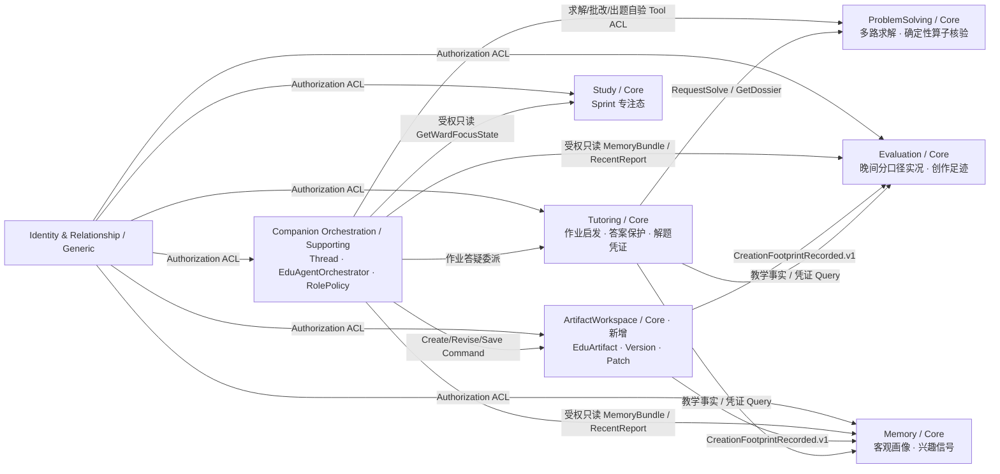
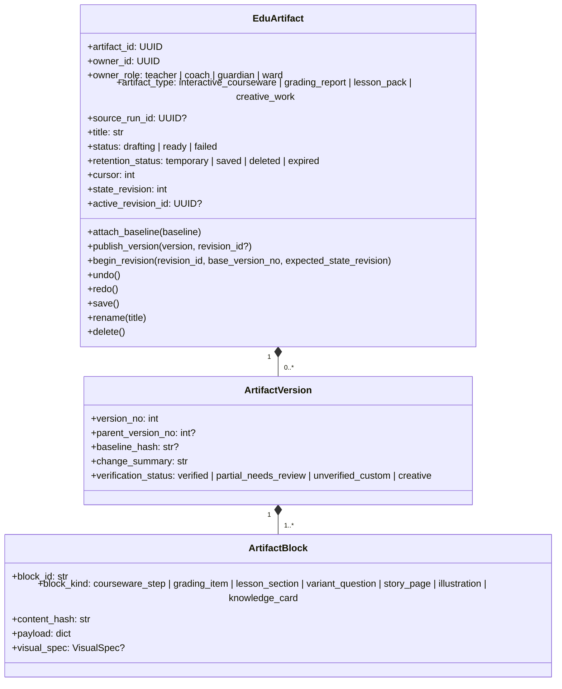
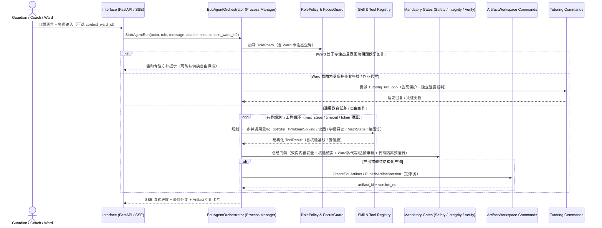
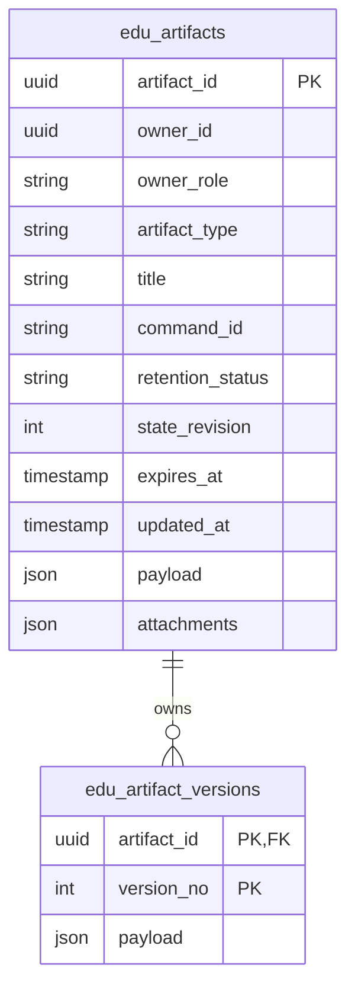

# 读学系统 — 教育通用 Agent 与统一产物工作区技术设计

> 状态：目标架构设计（评审稿 v1.0 · 2026-11-27）  
> 方法：[domain-driven-design skill](../../.cursor/skills/domain-driven-design/SKILL.md)  
> 关联：[产品需求 PRD](../product/prd-edu-agent.md) · [DDD 系统总览](ddd-overview.md) · [Agent 配置设计](design-agent.md) · [ProblemSolving](domain-problem-solving.md) · [Tutoring](domain-tutoring.md) · [导师深度课件专题（既有基线）](topic-mentor-courseware.md)

本文定义读学系统从“单点导师动态课件 + 学生三场景固定路由”演进为**「双端统一的教育通用 Agent + 多形态可修订产物工作区（`EduArtifact`）」**的 DDD 领域边界、核心聚合、Agent 编排架构、跨域契约与平滑迁移路径。

---

## 一、系统级领域演进与边界

遵循 [domain-driven-design skill](../../.cursor/skills/domain-driven-design/SKILL.md) 铁律：**不把 AI Agent 本身当成 Domain**。Agent 循环与工具调度属于 Application 层的 **Process Manager**，由 [design-agent.md](design-agent.md) 的配置与门禁契约约束；真正拥有独立业务语义与强一致性不变量的新业务边界，是**「教育产物工作区（`ArtifactWorkspace`）」**。

### 1.1 Domain Inventory 变更清单（对照 [ddd-overview.md](ddd-overview.md)）

| Domain | 演进状态 | 职责变化说明 |
| :--- | :--- | :--- |
| **`Planning`** | **退场（Retire）** | 移除线上任务池、排期草稿与确认流程；保留历史数据只读归档窗口后下线 |
| **`Evaluation`** | **聚焦客观交付** | 移除 Ward 结构化自述（`SelfReview` / `reflection` 对话）；聚焦《伴学闭环实况单》（作业专注 vs 自由探索分口径）、《独立解题凭证》与新增「好奇心与创作足迹」 |
| **`Study`** | **保留轻量化** | 保留可选主动专注挑战（`Sprint`）与观察求助邀请（`HelpOffer`）；向 Agent 编排提供只读 `GetWardFocusState` ACL |
| **`ProblemSolving`** | **核心升级（无状态核验内核）** | 保持 Core Domain 边界不变；作为通用 Agent 的受权确定性 Tool，统一服务答疑、**整页批改核验**、**动态课件基线**与**出题自解自验** |
| **`Tutoring`** | **聚焦受保护教学** | 专职 Ward 作业答疑的答案保护许可、独立泄露裁判与《独立解题凭证》；原 `MentorCourseware` 聚合平滑迁入/泛化为 `ArtifactWorkspace` 的 `EduArtifact` |
| **`ArtifactWorkspace`** | **新增（Core）** | 承接双端所有多形态可版本化教育产物（`EduArtifact`）：动态课件、批改诊断单、教案/变式卷、Ward 绘本/画作/知识卡片；守卫版本不可变、局部 Patch、Undo/Redo、核验诚实与生命周期 |
| **`Companion Orchestration`** | **升级为 `EduAgent` 编排层** | 去除 `planning`/`reflection` 固定三路由；演进为受 **Role Policy** 驱动的统一对话线程与 Goal-Driven Agent Loop（`EduAgentOrchestrator`） |
| **`Memory & Understanding`** | **边界不变** | 继续只消费客观学习事实与 `Interest Signal`（新增自由创作兴趣信号）；向 Guardian 端 Agent 提供**显式受权、严格只读**的 `MemoryBundle` 查询 |
| **`Identity & Relationship` / `Device & Ingestion` / `Behavior Analysis`** | **不变** | 沿用现有认证、Guardian-Ward 绑定鉴权与 L0 桌面观察采集 |

### 1.2 演进后 DDD Domain Map（局部核心关系）



### 1.3 统一语言（Ubiquitous Language）

| 术语 | 本设计中的含义 | 明确不是 |
| :--- | :--- | :--- |
| `RolePolicy` | 按登录角色（`teacher` / `coach` / `guardian` / `ward`）声明的工具白名单、必经门禁、学情读取权限与专注边界策略；其中成人角色（`teacher`/`coach`/`guardian`）无需先绑定学生即可独立使用工作台 | 前端 UI 隐藏开关或可被 Prompt 覆盖的软提示 |
| `AgentRun` | 一次用户复合指令在 `EduAgentOrchestrator` 内的有界执行实例（含规划步骤、工具调用预算与进度投影） | 新的业务 Domain 或数据库持久化聚合根 |
| `EduSkill` | 封装某一类教育任务编排契约与输出结构的标准能力包（如批改诊断、动态课件、备课出题、绘本共创） | 写死在独立微服务里的孤立流水线 |
| `EduArtifact` | `ArtifactWorkspace` 唯一聚合根，代表一份可版本化、可对话局部修订、可 Undo/Redo、可保存的教育产物（`MentorCourseware` 的超集泛化） | 单条聊天消息或一次性静态文件 |
| `ArtifactType` | 产物形态枚举：`interactive_courseware`、`grading_report`、`lesson_pack`、`creative_work` | 无类型任意 HTML/JSON 堆砌 |
| `FocusBoundaryState` | Ward 当前是否处于专注态（进行中 Sprint 或存在未完成受保护作业题）的只读快照 | 强制锁屏或禁止使用的硬封禁状态 |

---

## 二、`ArtifactWorkspace` Domain Model（承接并泛化 `MentorCourseware`）

### 2.1 Aggregate Root Summary

`ArtifactWorkspace` 拥有 **1 个写聚合根**：

| Aggregate Root | Consistency boundary | Business responsibility |
| :--- | :--- | :--- |
| `EduArtifact` | 单份教育产物的归属（`owner_id` + `owner_role`）、产物形态（`artifact_type`）、不可变核验基线表、不可变版本链（`versions`）、激活指针（`cursor`）、单调 `state_revision`、保留状态（`retention_status`）与至多 1 个活跃修订槽位 | 守卫所有者权限隔离、版本不可变、Undo/Redo 指针合法性、CAS 并发防迟到覆盖、核验诚实红线与跨角色产物类型约束 |

### 2.2 Entity & Value Object Inventory

| Object | Kind | Identity | Behavior and invariant responsibility |
| :--- | :--- | :--- | :--- |
| `ArtifactVersion` | Value Object | `version_no`（聚合内单调递增） | 不可变版本快照：持有 `parent_version_no`、`baseline_hash?`、`change_summary`、`verification_status`（`verified \| partial_needs_review \| unverified_custom \| creative`）与有序 `blocks[]` |
| `ArtifactBlock` | Value Object | `block_id`（聚合内稳定寻址键） | 最小可寻址内容单元，按 `artifact_type` 承载对应类型化载荷：课件步骤（含 `VisualSpec`）、逐题批改项（含手写定位/错因/复核标记）、教案/变式题（含自验状态）、故事页/画作/知识卡 |
| `ArtifactPatch` | Value Object | `patch_id` | 对话式局部修订补丁：`op`（`insert \| update \| delete \| split \| replace`）、`target_block_id`、`requires_reverify`、新块载荷；未修改块按内容哈希 100% 复用 |
| `VerificationBaseline` | Value Object | `baseline_hash` | 复用自 `topic-mentor-courseware.md`：冻结来自 `ProblemSolving` 的客观题面/批改基准/出题自验结果与 `confidence`；`creative_work` 允许为空 |

### 2.3 Aggregate Internal UML & Lifecycle



**核心领域不变量（由 `ArtifactInvariantPolicy` + `ArtifactVersionPolicy` 守卫）**：
1. **角色与类型约束**：`owner_role == "ward"` 禁止创建 `grading_report` 与 `lesson_pack`；Ward 产出的 `interactive_courseware` 仅限概念/原理演示，严禁包含受保护作业题的完整解题答案。
2. **核验诚实红线**：
   - `grading_report` 中任何一道手写置信度不足或等价性未证实的题目，必须标为 `needs_manual_review=true`，且整版 `verification_status` 不得标为 `verified`（降级为 `partial_needs_review`）；
   - `lesson_pack` 中的每一道新出/变式题目若未通过 `ProblemSolving` 自解自验，禁止标为 `verified`；
   - 纠错修订触发 `requires_reverify=true` 且与确定性核验矛盾时，沿用 `unverified_custom` 二次确认规则。
3. **版本链与并发 CAS**：完全继承 `MentorCourseware` 已验证的不可变版本链、单调 `version_no`、Undo/Redo 零模型调用、Undo 废弃在途修订及 `state_revision` 原子 CAS 规则。

---

## 三、Application 层：通用 Agent 编排架构（`EduAgentOrchestrator`）

`EduAgentOrchestrator` 位于 `Companion Orchestration` Application 层，是一个受 **Role Policy** 和 **Admin 配置快照（[design-agent.md](design-agent.md)）** 双重约束的 **Process Manager**。

### 3.1 Goal-Driven Agent Loop 执行模型



#### Sequence Diagram Participant Inventory

| Participant | Canonical type | Owned responsibility |
| :--- | :--- | :--- |
| Guardian / Coach / Ward | Actor | 发起自然语言/多模态目标、查看进度、修订或保存产物 |
| Interface (FastAPI / SSE) | Interface | 鉴权、参数校验、`context_ward_id` 绑定关系校验、SSE 进度与响应映射 |
| `EduAgentOrchestrator` | Process Manager | 事务外执行有界 Agent Loop、动态规划、调度受权 Tool/Skill、协调长耗时子任务 |
| `RolePolicy & FocusGuard` | Domain Service / ACL | 基于角色和 Ward 专注态裁剪可用工具集与强制门禁清单（代码硬编码底线，Admin 配置不可放宽） |
| `Skill & Tool Registry` | Infrastructure Adapter | 托管类型化输入/输出的原子 Tools 与教育 Skills，执行预算与超时隔离 |
| `Mandatory Gates` | Gate (Code + Heterogeneous Judge) | 强制执行内容安全、答案保护、作文防代写、核验诚实与动态脚本预运行审核 |
| `ArtifactWorkspace Commands` | Command | 短事务创建/发布/修订/保存 `EduArtifact` 聚合 |
| `Tutoring Commands` | Command | 短事务提交 Ward 受保护作业答疑轮次与解题凭证 |

### 3.2 Role Policy 硬边界（代码级强制，不可被配置或 Prompt 绕过）

| 策略项 | `teacher` / `coach` / `guardian`（成人策略） | `ward`（学生策略） |
| :--- | :--- | :--- |
| `solve_and_verify` Tool | 允许（结果可直接展示与编排，无需绑定学生即可独立使用） | 仅允许内部调用作为私有核验基线，**禁止向 Ward 透出最终答案与完整解法** |
| `batch_grade_worksheet` Skill | 允许 | **禁止（Tool 白名单剔除）** |
| `generate_lesson_pack` Skill | 允许（含出题自验） | **禁止** |
| `read_ward_learning_context` Tool | 仅在请求显式携带 `context_ward_id` 且通过 `verify_ward_access` 时**只读**开放 | 仅隐式读取自身必要答疑上下文 |
| `creative_studio` Skill（画图/故事/卡片） | 允许 | 允许，但**必经 `ward_anti_ghostwriting_gate` + 未成年人安全 Gate** |
| `interactive_math_stage` Skill | 允许（含解题动态演示） | 允许，但作业上下文下必经视觉防泄题检查 |
| 写回 `Memory` 权限 | **永不自动写回**学生客观能力画像 | 仅作业答疑写教学事实；自由创作通过 `CreationFootprintRecorded.v1` 写兴趣信号 |

### 3.4 现有代码收编边界与 Skill / Tool 四层归属

#### 1. `EduAgentOrchestrator` 与现有编排器 / `tutoring` 的代码去留（顶层收编、内核分级保留）

| 现有服务端模块（`duxue-server/app/application/`） | 演进归宿 | 原因 |
| :--- | :--- | :--- |
| `process_managers/companion_coordinator.py` | **升级 / 替换为 `EduAgentOrchestrator`** | `planning`/`reflection` 退场后不再需要固定三分类路由，演进为双端统一 Process Manager |
| `workflows/guardian_experience.py`、`workflows/guardian_mentor.py`、`process_managers/mentor_courseware_orchestrator.py` | **逐步收编进 `EduAgentOrchestrator` 并下线旧编排器** | 它们本质是通用 Agent 的「单题直讲」与「动态课件」Skill，避免保留多套平行顶层编排器；旧 HTTP 路由保留薄兼容层 |
| `workflows/tutoring_workflow.py`、`workflows/tutor_loop.py`、`contexts/tutoring/domain/` | **保留，下沉为 `EduAgentOrchestrator` 下的强护栏 Skill（`homework_tutoring`）** | 承载经过严格评测打磨的答案保护状态机（`TutorPermit`）、多图上下文隔离、独立泄露裁判与微验证《独立解题凭证》；不将确定性状态机揉碎成自由 Prompt，由 `EduAgentOrchestrator` 在 Ward 作业意图下直接委派 |

#### 2. Skill / Tool 的四层归属（不新建“Skill Domain”或“Agent Domain”）

| 归属层次 | 代码与配置位置 | 负责内容 |
| :--- | :--- | :--- |
| **① 定义、Prompt、Schema 与预算** | `duxue-server/app/agent_specs/` + `duxue-admin` | 所有 Tool / Skill / Gate 的声明、JSON Schema、Prompt 与模型槽位（唯一可编辑配置源） |
| **② 策略与统一调度注册表** | `contexts/companion/domain/role_policy.py` + `app/application/process_managers/` | `RolePolicy` 纯规则裁剪工具白名单与强制 Gate；`Skill/Tool Registry` + `EduAgentOrchestrator` 执行有界 Loop |
| **③ 业务能力所有权（Tool 仅作薄封装）** | 各业务 Domain（`ProblemSolving` / `Tutoring` / `ArtifactWorkspace` / `Memory` / `Evaluation` / `Study`） | 求解与核验归 `ProblemSolving`；作业启发归 `Tutoring`；产物创建/修订归 `ArtifactWorkspace`；学情与专注态只读查询分别归 `Memory`/`Evaluation`/`Study` ACL |
| **④ 纯无状态外部能力适配** | `duxue-server/app/infrastructure/` + `app/application/ports/` | 生图模型、搜索、Headless 渲染预运行、OSS 读写等基础设施适配器，不归属业务 Domain |

### 3.3 核心 Trigger → Application → Domain → Event 矩阵

| Trigger | Interface | Command / PM | Aggregate / Policy | Local / Integration Event | 一致性与失败策略 |
| :--- | :--- | :--- | :--- | :--- | :--- |
| 用户发起对话/复合任务 | `POST /agent/turns`（SSE） | `EduAgentOrchestrator` | `RolePolicy` + 委派 `EduArtifact` / `Tutoring` | 视分支触发 | `command_id` 幂等；单步超时降级可读状态，不落脏数据 |
| Agent 产出新产物 | Orchestrator 内部调用 | `CreateEduArtifact` + `PublishArtifactVersion` | `EduArtifact` + `ArtifactInvariantPolicy` | `EduArtifactPublished` | 短事务 + CAS；核验不通过降级标注或拒绝 `verified` |
| 用户对产物发起局部修订 | `POST /artifacts/{id}/revisions` | `RequestArtifactRevision` → Orchestrator | `EduArtifact.begin_revision()` | `ArtifactRevisionRequested` | 并发冲突返回 `409`；仅重算受影响 `block_id` |
| 用户点击 Undo / Redo | `POST /artifacts/{id}/{undo\|redo}` | `UndoArtifactVersion` / `RedoArtifactVersion` | `ArtifactVersionPolicy` | `ArtifactCursorMoved` | 强一致短事务，**零模型调用（<50ms）** |
| 用户保存/改名/删除产物 | `POST .../save` / `PATCH` / `DELETE` | `Save` / `Rename` / `DeleteEduArtifact` | `EduArtifact` | `EduArtifactSaved` / `Deleted`；若为 Ward 创作则 Outbox 发 `CreationFootprintRecorded.v1` | `expected_state_revision` CAS；删除作废在途任务 |
| Ward 自由探索结束/保存 | Outbox Consumer (`Evaluation` & `Memory`) | `RecordCreationFootprint` / `IngestInterestSignal` | `Evaluation` 晚间投影 / `Memory` 兴趣信号 | — | 幂等键 `artifact_id + version_no`；**严格与作业专注时长及学业掌握度隔离** |

---

## 四、CQRS Query 侧与 Interface 契约（兼容 App 与未来 Web 工作台）

所有接口保持**终端无关、资源化设计**，同时服务 `duxue-app`（手机/平板）与未来 Web 工作台：

```text
# 统一 Agent 对话与执行流（支持 SSE 进度推送）
POST   /v1/agent/turns                      → StartAgentRun（携带 role 鉴权、attachments、可选 context_ward_id）
GET    /v1/agent/runs/{run_id}/events       → SSE 订阅规划步骤、工具进度与最终结果
POST   /v1/agent/runs/{run_id}/cancel       → 取消在途长任务

# 统一产物工作区（平滑兼容 /guardian/courseware 旧路径）
GET    /v1/artifacts?saved=true&type=…      → ListSavedEduArtifacts（我的资源库 / 我的作品）
GET    /v1/artifacts/{id}                   → GetEduArtifactView（当前 cursor 版本、核验状态、Undo/Redo 控件）
POST   /v1/artifacts/{id}/revisions         → RequestArtifactRevision（202 Accepted）
POST   /v1/artifacts/{id}/undo              → UndoArtifactVersion（200 OK + View）
POST   /v1/artifacts/{id}/redo              → RedoArtifactVersion（200 OK + View）
POST   /v1/artifacts/{id}/save              → SaveEduArtifact（200 OK + View）
PATCH  /v1/artifacts/{id}                   → RenameEduArtifact（200 OK + View）
DELETE /v1/artifacts/{id}                   → DeleteEduArtifact（204 No Content）

# 晚间报告扩展（Evaluation Query）
GET    /v1/guardian/wards/{ward_id}/report  → 返回分口径时长（study_focus_minutes vs creative_explore_minutes）、独立解题凭证与 creation_footprints[]
```

> **向后兼容策略**：现有 `/guardian/courseware/*` 接口在迁移期作为 `/v1/artifacts/*`（固定 `artifact_type="interactive_courseware"`）的兼容适配层保留，保证已发布 App 客户端无缝运行。

---

## 五、Infrastructure Design Card 与平滑迁移路径

### 5.1 Ports & Adapters

| Port | Concrete Adapter | 约束与降级边界 |
| :--- | :--- | :--- |
| `EduArtifactRepository` | `PgEduArtifactRepository` | 单聚合一仓储端口；复用 PostgreSQL 连接池 + `state_revision` 乐观锁 |
| `ProblemVerificationPort` | `ProblemSolvingAclAdapter` | 复用既有 `solving` 队列与确定性符号/理化引擎；单题与批改共享预算，超时标低置信 |
| `WardContextReadPort` | `AuthorizedWardContextAdapter` | 强校验 `verify_ward_access(guardian_id, ward_id)`，返回脱敏/摘要化只读 DTO，无任何写方法 |
| `MediaRenderPort` | `HybridMathStageAdapter` + `ImageGenAdapter` | 动态脚本延续无凭证禁网 Headless 预运行 + 静态降级；生图适配器强制过未成年人安全审核 |
| `AgentConfigPort` | `AdminBundleConfigAdapter` | 严格遵守 [design-agent.md](design-agent.md)：Skill/Tool Prompt 与模型参数唯一归属 Admin 快照，Role Policy 硬边界由代码锁定 |

### 5.2 持久化与 ER 图（从 `mentor_coursewares` 平滑演进）

采用**增量演进、零数据丢失**策略：直接将现有 `mentor_coursewares` / `mentor_courseware_versions` 表平滑扩展（或通过 Alembic 新增 `edu_artifacts` / `edu_artifact_versions` 并做双读兼容迁移，推荐**原地增量扩展 + 别名视图**或**新表迁移回填**，在具体实施 spec 的 Gate 1 拍板）。目标逻辑 ER 如下：



- **索引**：
  - 资产库列表：`(owner_id, owner_role, retention_status, artifact_type, updated_at DESC, artifact_id DESC)`；
  - 临时产物清理：`(retention_status, expires_at)`；
  - 幂等唯一键：`(owner_id, command_id)`。
- **跨账号隔离**：所有读写均强制绑定 `owner_id` 与 `owner_role`；Ward 与 Guardian 的资产物理同表、逻辑强隔离（Ward 保存的创作足迹仅通过受权 `Evaluation` 摘要视图向已绑定 Guardian 展示只读预览）。

### 5.3 安全、治理与可观测性

- **安全与防滥用**：
  - 全部用户输入、图片内文本（视作数据而非指令）、工具输出与 `ArtifactBlock` 可见内容强制过双向安全审核；
  - Ward 端任何创作 Skill 必经 `ward_anti_ghostwriting_gate`，禁止以任何 Prompt 技巧绕过作文/作业保护；
  - 严格遵守仓库铁律：**语义判断（作业识别、代写判别、偏题识别、错因归类）一律由模型或独立 Judge 裁决，严禁写关键词/正则扫描**。
- **可观测性（OpenTelemetry + Grafana + Langfuse）**：
  - 每次 `AgentRun` 记录 `run_id`、`actor_role`、`context_ward_bound`、`planned_steps`、`invoked_skills[]`、`gate_verdicts[]`、`artifact_id`、`verification_status` 与分阶段耗时/Token 成本。
- **离线评测扩展（复用 [eval-offline.md](eval-offline.md)）**：
  - 新增四类 Langfuse Dataset 基准：整页批改准确率与存疑诚实率、变式出题自验通过率、Ward 自由创作 vs 作业代写边界对抗集、Ward 专注态软守护回归集。

---

## 六、关键验收场景（Acceptance Scenarios）

```gherkin
Given Guardian 上传一页包含 2 道错题的数学作业，并显式关联已绑定的 Ward
When Guardian 发起“批改这页作业，挑出错题做动态课件，再结合孩子最近薄弱点出 2 道巩固题”
Then EduAgentOrchestrator 自主规划并依次调用批改、受权只读学情、课件生成与出题自验 Skill
And 产出 grading_report、interactive_courseware 与 lesson_pack 三类可修订 EduArtifact
And 整个过程不向该 Ward 的 Memory 或 TutoringSession 写入任何客观学习记录

Given 一页手写作业中第 3 题字迹涂改严重，确定性核验置信度为 low
When Guardian 发起批改诊断
Then 第 3 题显式标为 needs_manual_review=true，整份 grading_report 的 verification_status 为 partial_needs_review，绝不标为 verified

Given Ward 正在进行 20 分钟数学 Sprint 专注挑战
When Ward 语音说“帮我画一个奥特曼打怪兽的故事”
Then RolePolicy 识别为专注态下的偏题娱乐创作，先温和提醒专注，不直接展开娱乐创作
And 若 Ward 坚持切换，允许进入自由探索态并生成可语音局部修改的 creative_work
And 当晚 Guardian 端实况单中，作业专注时长与自由探索时长严格分离，并在「好奇心与创作足迹」中展示该创作摘要

Given Ward 发起“帮我写一篇 400 字关于保护环境的作文，明天要交”
When EduAgentOrchestrator 调用创作链路与 ward_anti_ghostwriting_gate
Then 独立 Judge 判定为课内作业任务，阻断整篇成品输出，切换为启发共创（审题立意与提纲引导）

Given 任意既有已保存的 MentorCourseware 课件
When 系统升级至 EduArtifact 工作区后 Guardian 重新打开「我的资源库」
Then 原有课件完整可读，原有版本链、Undo/Redo 与 MathStage 3D 演示 100% 兼容不丢失
```
