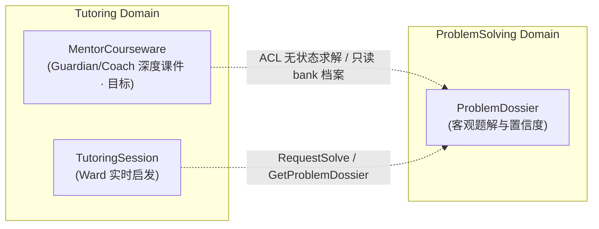
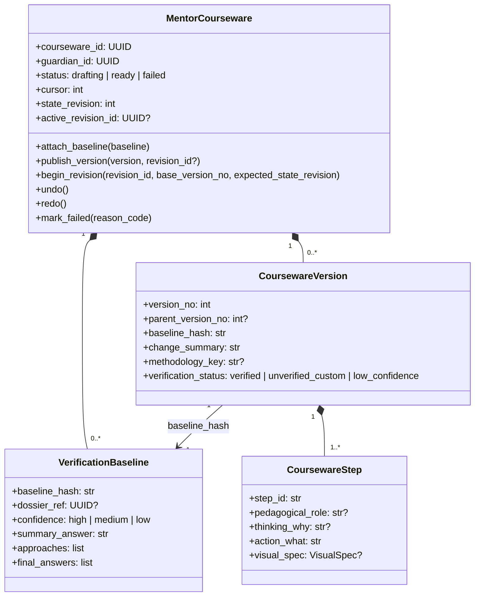
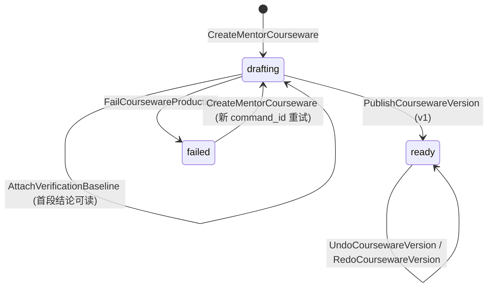
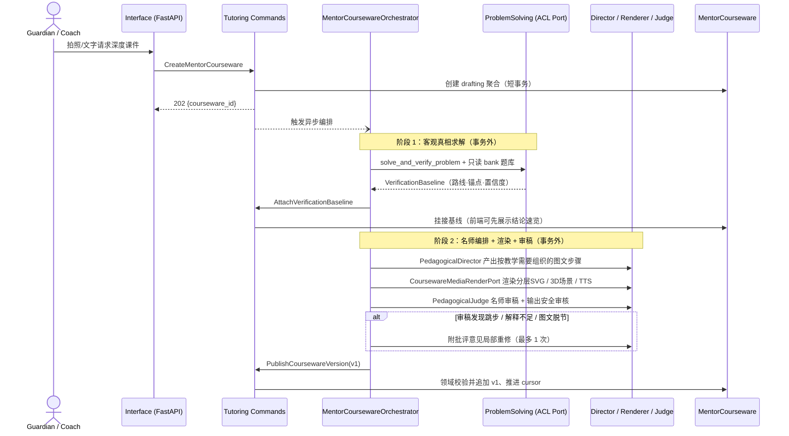

# 读学系统 — Tutoring 专题：导师视角深度课件与对话式修订

> 状态：目标设计（**未实现**；P0 / P1 / P2 分期见 [§九](#九分期演进与兼容边界)） · 版本：v1.3 · 2026-11-26
>
> 方法：[domain-driven-design skill](../../.cursor/skills/domain-driven-design/SKILL.md)
>
> 范围：面向成人导师视角（Guardian / Coach 的 `guardian_explain`）的深度可修订课件——将 `ProblemSolving` 的客观核验结果转化为「按题与学情灵活组织教学 + 图文强绑定 + 可选立体几何 3D / 动态微课」结构化课件，支持对话式局部修订（纠正、修改、删减、补充）与毫秒级 Undo / Redo。
>
> 关联：[DDD 系统总览](ddd-overview.md) · [Tutoring 主域](domain-tutoring.md) · [ProblemSolving](domain-problem-solving.md) · [Companion · 家长问答体验](domain-companion.md#guardian-问答体验2026-11-17-验收2026-11-18-扩展双视角) · [答疑表达设计](domain-tutoring-presentation.md) · [用户 PRD §7.2](../product/prd-user.md#72-家长问答体验)

本文是 [domain-tutoring.md](domain-tutoring.md) 的专题扩展，**不新增 Domain**。全系统 Domain Inventory 与 Domain Map 唯一归属 [ddd-overview.md](ddd-overview.md)；客观解题、多路共识与确定性算子核验唯一归属 [domain-problem-solving.md](domain-problem-solving.md) 与 [tutoring-math.md](tutoring-math.md)；现有成人无状态直出体验协议归属 [domain-companion.md](domain-companion.md)。

---

## 一、边界与统一语言

### 1.1 职责与非目标

- **职责**：
  1. 承接成人导师视角（`guardian_explain`）“直接给答案，但要把底层思维彻底讲通、像名师课件一样生动形象”的深度讲解需求；
  2. 将“解对题（客观真相）”与“讲透理（教学法编排）”解耦：在 `ProblemSolving` 核验基线之上，由导师根据题型、学段与当前理解需要灵活组织讲解；审题、方法、推演、自检与迁移仅是教学参考维度，不规定固定幕数、顺序或全部出现；
  3. 支持对已生成课件发起**对话式局部修订**（删减、拆细、补充类比、纠正步骤、更换解法、调整学段口吻），只重算和重渲受影响节点；
  4. 提供基于不可变版本栈的确定性 **Undo / Redo**；
  5. 以统一 `VisualSpec` 协议承载“通用 Web 绘图环境 + 预置常用组件 + 模型生成特殊演示 JS”的混合路线与静态图文降级，后续独立扩展语音同步及导出；本功能独立设计自己的协议、播放器与生命周期，不依赖知识视频功能。
- **非目标**：
  - **不改变 `ProblemSolving` 边界**：不把个人对话、教学偏好或版本修订塞入 `ProblemDossier`，不重复建设求解器或确定性数学引擎；
  - **绝不触碰学生域与记忆域**：不接受 `ward_id`，不复用 `TutoringSession` / `TutorPermitPolicy`，不发布 `LearningFactRecorded.v1` 到 `Memory`；
  - **不做端到端文生视频或数字人播报**（公式与几何精度不可控，违背核验诚实底线）；
  - **不开放整页试卷批量报答案或整篇作文代写**（沿用 [用户 PRD §7.2](../product/prd-user.md#72-家长问答体验) 红线）。

### 1.2 上下游契约

| 方向 | Domain / 契约 | 集成方式 | 说明 |
| :--- | :--- | :--- | :--- |
| 上游 | `Identity & Relationship` | Authorization ACL | 校验 Guardian / Coach 身份与成人附件对象键归属 |
| 上游 | `ProblemSolving` | ACL / Port（无状态求解核验内核 + 只读 `scope="bank"` 题库） | 获取只读 `VerificationBaseline`（题面、解法路线、锚点、采分点、置信度）；修订涉及数学纠错或换法时再次调用复核 |
| 下游 | 无跨域 Integration Event | — | 成人体验与学生学习事实严格隔离，不向 `Memory`、`Evaluation` 或 `Study` 发布任何事件 |

### 1.3 统一语言

| 术语 | 本专题中的含义 | 明确不是 |
| :--- | :--- | :--- |
| `MentorCourseware` | 一次成人导师深度讲解请求拥有的可版本化课件聚合根 | `ProblemDossier`、`TutoringSession`、单条聊天消息 |
| `VerificationBaseline` | 来自 `ProblemSolving` 的只读客观核验快照（题面、已验证路线、锚点、置信度） | 可由教学模型自由改写的草稿 |
| `CoursewareVersion` | 不可变的课件完整版本快照（`v1, v2, ...`），支持 Undo / Redo 指针切换 | 原地覆写的草稿表 |
| `CoursewareStep` | 课件内带稳定 `step_id` 的最小可寻址教学单元，承载讲解、思考依据及按需配图 | 固定句式模板或无依据的操作流水账 |
| `PedagogicalDirector` | 负责按题型、学段与讲解需要把客观解法组织为课件或局部 Patch 的教研编排 Port | 聚合根或求解器 |
| `PedagogicalJudge` | 独立教研审稿 Port，检查推理是否讲清、是否存在无依据跳步或图文脱节；不按固定章节模板评分 | 替代数学确定性核验或内容安全审核 |
| `CoursewarePatch` | 对话式修订产生的结构化增量补丁（`insert / update / delete / split / replace_method`） | 全篇重新生成的纯文本 |

---

## 二、Domain Model

### 2.1 Aggregate Map

- **图示位置**：下述 Mermaid（本专题内维护；全系统 Domain Map 见 [ddd-overview.md](ddd-overview.md#三ddd-domain-map)）。
- **写聚合与边界**：本专题新增 `MentorCourseware`（成人导师深度课件，未实现），与学生 `TutoringSession` 隔离；其他能力的聚合清单由各自设计维护。
- **一致性关系**：成人课件与学生会话不共享事务，不直接持有对方对象引用；`MentorCourseware` 仅通过只读值对象 `VerificationBaseline`（携带可选 `dossier_ref`）消费 `ProblemSolving` 的核验结果。



### 2.2 Aggregate Root Summary

本专题在 `Tutoring` Domain 中新增 **1 个写聚合根**：

| Aggregate Root | Consistency boundary | Business responsibility |
| :--- | :--- | :--- |
| `MentorCourseware` | 单份成人导师课件的生命周期状态、核验基线、不可变版本链（`versions`）、当前激活指针（`cursor`）与至多 1 个活跃修订槽位；不包含异步渲染过程日志、模型原始草稿或学生域数据 | 守卫版本不可变、Undo/Redo 指针合法性、教学步骤与图文一致性、以及核验诚实状态标记 |

### 2.3 Entity & Value Object Inventory

| Object | Kind | Identity | Behavior and invariant responsibility |
| :--- | :--- | :--- | :--- |
| `CoursewareVersion` | Value Object | `version_no`（聚合内单调递增序号） | 不可变版本快照：持有 `parent_version_no`、不可变 `baseline_hash` 与该版核验证据、`change_summary`、`verification_status`（`verified \| unverified_custom \| low_confidence`）、可选 `methodology_key`（适用时提炼核心思路）与有序 `steps` |
| `CoursewareStep` | Value Object | `step_id`（聚合内稳定寻址键） | `pedagogical_role` 为可选教学用途标签；推导步骤用 `thinking_why` 与 `action_what` 讲清依据和操作；`visual_spec` 按教学需要提供，存在时与文字绑定；不强制概念说明、过渡或总结步骤配图 |
| `VisualSpec` | Value Object | None | 判别联合：`component_scene`（结构化参数驱动预置常用组件）、`math_stage_script`（特殊演示的模型生成 JS artifact，隔离运行于 Web 数理舞台）、`layered_svg`（静态或渐进图解）；各分支带对象引用、兼容版本与已审核静态降级引用。P1 音画时间轴组合这些图形，不作为互斥图型 |
| `VerificationBaseline` | Value Object | 可选 `dossier_ref` | 冻结来自 `ProblemSolving` 的结构化题面、已验证路线、锚点、最终结论与 `confidence`；由 `AttachVerificationBaseline` 写入不可变快照；每个课件版本固定绑定自己的 `baseline_hash`，换法/纠错生成新基线而不覆盖旧版基线 |
| `CoursewarePatch` | Value Object | `patch_id` | 结构化局部修订指令：`op`（`insert \| update \| delete \| split \| replace_method`）、`target_step_id`、`requires_reverify`、新步骤载荷；用于局部重算与差异审计 |

### 2.4 Aggregate Internal UML



### 2.5 Lifecycle State Diagram



> 说明：`ready` 态发起修订时，聚合保持 `ready`（通过 `active_revision_id` 防止并发修订冲突），当前已发布版本始终可读、可 Undo/Redo；修订失败时仅释放匹配任务的 `active_revision_id` 并返回失败提示，不破坏既有版本。修订槽位固定记录 `base_version_no` 与创建后的 `state_revision`；**若用户在途修订尚未完成时主动执行 Undo/Redo，聚合在推进 `state_revision` 的同时立即清空 `active_revision_id`（废弃旧在途任务），允许用户马上基于目标版本发起新修订**。迟到任务发布时原子比较槽位、基础版本及状态修订号，任一变化均拒绝激活迟到结果（`revision_base_changed`），不截断历史或移动指针。

### 2.6 Domain Services

1. **`CoursewareInvariantPolicy`**（无状态）
   - **输入 / 输出**：`(candidate_version, baseline, is_initial_draft, patch?) -> ValidationResult`
   - **规则**：
     - 不对初版或修订版强制五幕、固定步骤数、固定顺序或方法论/变式章节；导师按教学需要选择。审稿检查解释是否清楚、推理是否连贯，不检查是否凑齐模板；
     - 对需要解释推导的步骤检查思考依据与操作是否讲清，不以可选 `pedagogical_role` 标签决定是否检查；概念说明、过渡和总结可使用自然正文。配图按需提供，存在时其对象引用和高亮须与讲解对齐；结构校验检查引用，开放语义由独立审稿判断；
     - **核验诚实规则**：若修订触发了 `requires_reverify=true`（纠正数学推导、更换解法、修改公式结论）且 `ProblemSolving` 复核未通过或与确定性引擎矛盾，禁止将 `verification_status` 标为 `verified`（拒绝发布或经用户显式确认后标为 `unverified_custom`）。
2. **`CoursewareVersionPolicy`**（无状态）
   - **输入 / 输出**：`(versions, cursor, state_revision, op) -> NextVersionState`
   - **规则**：
     - `undo` 要求 `cursor > 0`，仅回退指针，不修改任何历史版本；
     - `redo` 要求 `cursor < len(versions) - 1`，仅前进指针；
     - 当 `cursor < len(versions) - 1` 时发布新修订版本，截断 `versions[cursor+1:]` 的旧 redo 分支并追加新版本，推进 `cursor` 指向新版本；单份课件版本上限默认 20 版；`version_no` 使用独立单调计数器，截断分支后也不复用旧编号。
     - 每次成功的聚合状态变更（含开始/结束修订、发布、Undo/Redo）都原子递增 `state_revision`；重复幂等请求返回既有结果，不重复递增。
     - 发布时绑定该版不可变基线；Undo/Redo 的内容、题面、核验摘要及状态一并从目标版本投影，不能读取全局“最新基线”代替。

---

## 三、Application 层：Commands、Process Manager 与触发矩阵

### 3.1 State-change Trigger Matrix

| Trigger and source | Interface / entrypoint | Receiving Command or Process Manager | Aggregate / domain method | Local domain event | Outbox / next local action | Consistency, idempotency, failure |
| :--- | :--- | :--- | :--- | :--- | :--- | :--- |
| Guardian 发起新题课件 | `POST /guardian/courseware` | `CreateMentorCourseware` | `MentorCourseware.create()` | `MentorCoursewareCreated` | 投递异步编排任务给 `MentorCoursewareOrchestrator` | 本地短事务；幂等键 `guardian_id + command_id`；超频返回 `429` |
| Worker 完成阶段一求解核验 | Infrastructure Worker Adapter | `AttachVerificationBaseline` | `MentorCourseware.attach_baseline()` | `VerificationBaselineAttached` | 刷新只读视图（前端立刻展示“答案与题眼速览”） | 本地短事务；幂等键 `courseware_id + baseline_hash` |
| Worker 完成编排/渲染/审稿 | Infrastructure Worker Adapter | `PublishCoursewareVersion` | `CoursewareInvariantPolicy` + `CoursewareVersionPolicy` + `publish_version()` | `CoursewareVersionPublished` | 释放 `active_revision_id`；刷新只读视图 | 本地短事务；幂等键 `courseware_id + revision_id`；校验不过不落库 |
| Guardian 发起对话修订 | `POST /guardian/courseware/{id}/revisions` | `RequestCoursewareRevision` | `MentorCourseware.begin_revision()` | `CoursewareRevisionRequested` | 投递局部修订任务给 `MentorCoursewareOrchestrator` | 本地短事务；幂等键 `courseware_id + command_id`；已有在途修订返回 `409` |
| Guardian 点击 Undo / Redo | `POST /guardian/courseware/{id}/{undo\|redo}` | `UndoCoursewareVersion` / `RedoCoursewareVersion` | `CoursewareVersionPolicy` + `undo()` / `redo()` | `CoursewareCursorMoved` | 无（同步返回最新视图） | 强一致本地短事务；**零模型调用**；越界返回 `409` |
| 编排有界重试耗尽 | Infrastructure Worker Adapter | `FailCoursewareProduction` | `MentorCourseware.mark_failed()` | `CoursewareProductionFailed` | 附带纯文本降级解析引用（如有） | 本地短事务；幂等键 `courseware_id + revision_id` |

### 3.2 核心 Command Cards

#### `CreateMentorCourseware`
```python
class CreateMentorCoursewareInput(BaseModel):
    guardian_id: UUID
    command_id: str
    prompt_text: str = Field(max_length=2400)
    attachment_keys: list[str] = Field(default_factory=list, max_length=4)
    target_grade_hint: str | None = None
    media_profile: Literal["interactive", "narrated"] = "interactive"  # P0 仅开放 interactive
```
- **授权与前置**：校验 Guardian 身份、成人专属附件键前缀 `guardian/{guardian_id}/experience/`、账号级滑动窗口频控与输入安全预检。
- **事务边界**：短事务仅创建 `drafting` 聚合并记录投递任务；**模型求解、编排、渲染与审稿全部在事务外执行**。
- **幂等**：同一 `guardian_id + command_id` 重复提交返回同一 `courseware_id`；同键异载拒绝（`409`）。

#### `RequestCoursewareRevision`
```python
class RequestCoursewareRevisionInput(BaseModel):
    guardian_id: UUID
    courseware_id: UUID
    command_id: str
    instruction: str = Field(min_length=1, max_length=1200)
    base_version_no: int                       # 本次修改依据的已发布版本
    expected_state_revision: int               # 客户端读到的聚合修订号
    target_step_id: str | None = None           # 可选显式点选锚点；缺省由编排器按自然语言定位
    allow_unverified_override: bool = False     # 仅在引擎提示分歧后二次确认时允许置 True
```
- **授权与前置**：校验 `courseware.guardian_id == guardian_id`、`status == "ready"`、当前无活跃 `active_revision_id`、输入安全审核通过。
- **行为**：先原子校验 `base_version_no` 与当前版本、`expected_state_revision` 与聚合修订号，过期请求返回 `409`；随后固定任务基础版本及开始修订后的修订号，锁定 `active_revision_id`（防止并发修订互相覆盖），唤醒 `MentorCoursewareOrchestrator` 执行局部 Patch 管线。

#### `PublishCoursewareVersion`
```python
class PublishCoursewareVersionInput(BaseModel):
    courseware_id: UUID
    revision_id: UUID | None                    # v1 为 None；后续修订必填且须匹配 active_revision_id
    base_version_no: int | None                 # v1 为 None，后续修订必须匹配任务基础版本
    expected_state_revision: int                # Worker 使用开始修订后固定的修订号，不读取最新值重试覆盖
    candidate_version: CoursewareVersion
    requires_reverify: bool
    reverify_passed: bool | None
    allow_unverified_override: bool = False
```
- **入口**：仅允许由 Worker Adapter 触发，不直接暴露为公网写接口。
- **领域校验**：依次调用 `CoursewareInvariantPolicy`（教学步骤/图文一致性/核验诚实红线）与 `CoursewareVersionPolicy`（版本上限与分支截断），通过后按固定基础版本和状态修订号做原子 CAS，再提交新版本并移动 `cursor`；发生竞争返回 `409 revision_base_changed`，不自动重新基于当前版发布。

#### `UndoCoursewareVersion` / `RedoCoursewareVersion`
```python
class MoveCoursewareCursorInput(BaseModel):
    guardian_id: UUID
    courseware_id: UUID
    command_id: str                            # 重复请求不重复移动
    expected_state_revision: int                # 单调修订号，防双击及 cursor 往返后的旧请求
```
- **事务与性能**：纯本地短事务移动 `cursor`，不调用任何模型或外部服务，目标响应 `< 50ms`。

### 3.3 Process Manager：`MentorCoursewareOrchestrator`（跨 Domain 编排）

`MentorCoursewareOrchestrator` 负责事务外串联 `ProblemSolving` 与 `Tutoring` 的多步长耗时流程，按场景严格分流：



**三类场景的分流规则**：
1. **新题首版**：完整执行 `阶段 1 (ProblemSolving)` → `阶段 2 (Director + Renderer + Judge)` → `PublishCoursewareVersion`；
2. **表达类对话修订**（删减、拆细、补比喻、调年级口吻）：**跳过 `ProblemSolving`**，复用修订基础版本所绑定的不可变 `VerificationBaseline`，仅对受影响 `step_id` 生成 Patch 并局部重渲（未改动步骤的 SVG / 3D / 音频按内容哈希 100% 复用）；
3. **纠错 / 换解法类对话修订**：`Director` 标记 `requires_reverify=true`，`Orchestrator` **再次调用 `ProblemSolving`** 复核新推导与结论，再将复核结果连同候选交 `PublishCoursewareVersion` 裁决。

#### Sequence Diagram Participant Inventory

| Participant | Canonical type | Owned responsibility |
| :--- | :--- | :--- |
| Guardian / Coach | Actor | 发起深度课件请求、阅读、提出对话修订与执行 Undo / Redo |
| Interface (FastAPI) | Interface | 鉴权、参数校验、频控与 HTTP/SSE 响应映射 |
| Tutoring Commands | Command | 守卫本地短事务、幂等性并调用聚合根与领域服务 |
| `MentorCoursewareOrchestrator` | Process Manager | 事务外编排跨域求解、教研导演、媒体渲染、审稿与有界重试 |
| ProblemSolving (ACL Port) | Infrastructure (ACL) | 调用 `ProblemSolving` 无状态求解内核与只读题库，翻译为 `VerificationBaseline` |
| Director / Renderer / Judge | Infrastructure | 外部大模型编排、媒体/3D/音频渲染、独立名师审稿与安全审核适配器 |
| `MentorCourseware` | Aggregate Root | 守卫版本不可变、Undo/Redo 指针、图文一致性与核验诚实不变量 |

---

## 四、CQRS Query 侧

### 4.1 `GetMentorCoursewareView`
- **用途**：供 `GuardianQuestionPage` 渲染当前 `cursor` 对应的课件；**默认返回折叠概览防冗长**（核心结论 + 必要的思路提示 + 实际生成的步骤目录），前端按需展开步骤或翻页浏览。
- **一致性**：对 `Undo` / `Redo` 强一致（直读同一聚合存储）；对异步生成/修订最终一致（配合轮询或 SSE 状态推送）。
- **字段投影**：
  - `courseware_id`、`status`、`state_revision`、`verification_summary`（初版阶段 1 就绪可展示待发布基线；已有发布版本时始终读取当前版本的基线）；
  - `current_version`（`version_no`、`baseline_hash`、`change_summary`、`verification_status`、`methodology_key`、`steps[]`）；
  - `history_controls`（`cursor`、`total_versions`、`can_undo`、`can_redo`、`version_summaries[]`）；
  - `active_revision_pending: bool`。

### 4.2 `GetCoursewareProductionStatus`
- **用途**：只读查询 `Orchestrator` 运行阶段（`solving | directing | rendering | judging | ready | failed`）与友好进度文案，不读取或修改领域聚合内部规则。

---

## 五、Interface Contracts

```text
POST /guardian/courseware                       → CreateMentorCourseware (202 Accepted)
GET  /guardian/courseware/{id}                  → GetMentorCoursewareView (200 OK)
GET  /guardian/courseware/{id}/status           → GetCoursewareProductionStatus (200 OK)
POST /guardian/courseware/{id}/revisions        → RequestCoursewareRevision (202 Accepted)
POST /guardian/courseware/{id}/undo             → UndoCoursewareVersion (200 OK + View)
POST /guardian/courseware/{id}/redo             → RedoCoursewareVersion (200 OK + View)
```

- **向后兼容**：现有同步直出接口 `POST /guardian/experience/turn`（`mode="guardian_explain"`）保持不变，供轻量快速问答与现有离线评测回归使用；深度课件作为独立资源路径渐进灰度上线。
- **错误映射**：越权/跨账号访问统一 `403`；并发修订冲突或 Undo/Redo 越界返回 `409`；超频返回 `429 {"code": "mentor_rate_limited"}`；编排整体超时降级返回核验结论 + 纯文本解析并标注 `degraded=true`。

---

## 六、Infrastructure Mapping

### 6.1 Ports and Adapters

| Port owned by Domain/Application | Concrete adapter | Protocol / dependency | Configuration / secret boundary | Timeout, retry, rate limit | Error mapping / fallback |
| :--- | :--- | :--- | :--- | :--- | :--- |
| `ProblemVerificationPort` | `ProblemSolvingAclAdapter` | 进程内受权调用 `solve_and_verify_problem` + `SubprocessMathEngineAdapter` | 复用既有 `ProblemSolving` Admin 配置与数学执行器 socket | 共享阶段 1 预算（默认 60s），不阻塞事务 | 核验失败或超时标 `confidence="low"`，绝不伪装已核验 |
| `PedagogicalDirectorPort` | `AdminModelDirectorAdapter` | OpenAI-compatible LLM API | Admin 组件 `tutoring.mentor-director`（版本化 Prompt + Schema） | 单次 45s，结构错误最多重试 1 次 | 失败触发 `FailCoursewareProduction`，回退直出文本解析 |
| `PedagogicalJudgePort` | `AdminModelPedagogicalJudgeAdapter` | 异构 LLM API（严禁与 Director 同型号） | Admin 组件 `tutoring.mentor-pedagogical-judge` | 单次 25s，审稿打回最多重修 1 次 | Judge 不可用时记录观测告警；安全审核不可用仍 fail-closed |
| `CoursewareMediaRenderPort` | `HybridMathStageAdapter`（P0）+ `AudioTimelineAdapter`（P1）+ `HeadlessExportAdapter`（P2） | P0: 常用组件 Schema/引用校验；生成 JS 必须经静态检查、隔离 Headless 预运行与代表帧审查，具体边界见 §7.4；P1: 独立 TTS 与时间轴；P2: 同源 Web 舞台导出 | 锁定本地依赖和 runtime 版本；预运行进程无业务凭证且禁网；产物存成人私有 OSS | 预运行有独立进程墙钟/内存预算，超时由外部终止；模型修复最多一次；预算随真机原型校准 | 组件不支持可转特殊 JS；代码检查/预运行失败先有界修复，仍失败使用已审核静态图文；该步不标为动态可用 |
| `MentorCoursewareRepository` | P0: `RedisCoursewareRepository`（4h TTL）<br/>P1: `PgCoursewareRepository` | Redis / PostgreSQL | 复用服务端连接池配置 | 读写超时 2s，乐观锁版本校验 | 过期返回 `404 courseware_expired`，提示重新生成 |

### 6.2 Persistence & Entity-Relationship 边界

- **P0 阶段（无数据库表）**：沿用 [domain-companion.md](domain-companion.md#guardian-问答体验2026-11-17-验收2026-11-18-扩展双视角) 的成人无持久化边界——`MentorCourseware` 及其不可变版本栈保存在 Redis（4 小时 TTL，退出或过期自动清理），媒体大对象（音频/渲染片段）存私有 OSS 临时前缀并随生命周期清理。**因此 P0 不新增 PostgreSQL 表，不提供虚构 ER 图，也不涉及数据库迁移。**
- **P1 阶段（面向 To B2C Coach 沉淀复用课件时）**：新增 `mentor_coursewares` 与 `mentor_courseware_versions` 表（仅以 `guardian_id` 索引，无任何学生域外键），届时补齐正式 ER 图、Alembic 迁移与回滚方案，Domain 与 Application 层零改动。

### 6.3 Async Delivery、Security & Observability

- **异步执行**：复用既有 Celery 基础设施（新增独立队列或复用 `solving` 低优先级队列，Worker 仅调用 Application Command，绝不直接改存储）；长任务以 `courseware_id + revision_id` 幂等，设置租约防崩溃死锁。
- **安全与隐私**：输入与每一版输出（含 `thinking_why`、`action_what` 与 `visual_spec` 内全部可见文字）均强制经过双向内容安全审核；音频与临时素材路径严格隔离在成人账号前缀下。
- **可观测性**：沿用 OpenTelemetry + Grafana + Langfuse，为每轮记录 `courseware_id`、`version_no`、`stage_latency_ms`、`pedagogical_judge_verdict`、`reused_step_count`、`reverify_triggered` 与成本 Token 拆解。

---

## 七、端侧渲染架构：离线 Web 数理舞台（Duxue MathStage Runtime）

> **已确认路线**：通用 Web 绘图环境 + 预置常用组件 + 模型生成特殊演示代码。仅适用于成人 `MentorCourseware`；学生端规则仍由[答疑表达设计](domain-tutoring-presentation.md)维护。场景协议约束教学内容与版本管理，不要求提前枚举全部教学动作，不承诺覆盖所有教育场景。

### 7.1 分工与表达范围

| 层次 | 负责方 | 内容与边界 |
| :--- | :--- | :--- |
| 教学与核验数据 | 服务端领域/Application + 模型候选 | 题面、步骤、公式、对象语义、核验基线与版本引用结构化；教学结构按题与学段灵活决定 |
| 通用绘图环境 | 开发者维护、随 App 打包 | 本地 Canvas2D / SVG、Three.js、KaTeX、主题、播放与资源清理；提供通用图形能力，模型无需从零生成整页应用 |
| 常见图形 | 预置组件 + 模型填写参数 | 线段图、数轴、函数图、常见几何等按需建设；由可信 JS 将结构化数据绘制出来 |
| 特殊演示 | 模型生成 JS + 隔离执行环境 | 允许自行组合通用绘图库、计算与交互，表达预置组件未覆盖的过程；必须经过代码预运行和输出审核 |
| 静态降级 | 服务端发布、Flutter 展示 | 已审核 SVG/代表帧及文字公式，保留在动态 WebView 之外，供代码或设备失败时使用 |

模型根据教学需要选择常见组件或特殊 JS，不强制先进行一次失败的组件生成。组件不能表达的演示可直接选代码路径；依赖仅限锁定版本的本地库，不允许动态下载包。新增绘图库或原生能力仍需开发和发布，不能靠模型输出自动获得。

选用 Web 路线是为了交互、通用绘图库与局部修订。生成通过率、画面质量、跨设备兼容性均需样本验证，不能仅凭技术栈推断。此前的“15–30 秒生成、5–10 秒修订、1.5 MB 包体积、60fps”均为待验证的估算或性能目标，不作为现有能力；端到端预算须覆盖求解、生成、检查、审核与修复。

### 7.2 运行时与生成代码的契约

```text
ProblemSolving 核验结果
         ↓
教学步骤 + 共享对象语义 + 不可变版本
         ├── 常见图形 → component_scene → 预置组件绘制
         └── 特殊演示 → 生成 JS → 静态检查 / 隔离预运行 / 输出审核
                                      ↓
                            不可变 script artifact
         ↓
Flutter 可信宿主 → Web 舞台加载对应版本 → 交互演示
         └── 独立保留已审核静态图文，故障时可直接展示
```

`component_scene` 由预置解释器读取参数执行，不生成 JS。`math_stage_script` 本身就是模型生成的 JS，由锁定 runtime 在隔离区域加载；不再增加一个“翻译模型”，也不让这些 JS 作为 Flutter 桥接指令执行。

生成模块遵守统一生命周期：`mount(surface, context)`、`render({step_id, t_ms, parameters, camera})`、`dispose()`。`surface` 限于自己的绘图区域；`context` 只含本地绘图库、主题和显式输入，不含登录状态、原生能力或业务对象。模块可使用通用绘图库表达新演示，不限制为少数教学动作。返回的清理函数与资源注册帮助回收对象，但不能当作不可信代码一定会配合的保证。

教学步骤和共享对象使用稳定 ID；代码产物以内容哈希固定，并声明 `runtime_version`、`min_runtime_version`、所需能力、参数范围与已审核静态降级引用。文本、公式和对象说明从结构化教学数据传入；生成代码新增的可见标注仍需审核，不能以“只是画面”跳过学科检查或内容安全。

代码在指定时间与参数下重建画面，不能仅依赖运行过哪些动画回调；随机演示使用固定种子。暂停、跳步、版本切换与导出均使用同一状态输入。自由探索参数与相机状态仅为本地演示状态，不写入核验事实；切换步骤/版本时按明确默认值恢复。参数边界外不声称物理或数学关系仍成立。

### 7.3 宿主、可信舞台与不可信绘图区域

Flutter 保持导航、版本控制、图文正文、静态降级和 `VoiceComposer`。可信 Web 舞台负责布局、时间轴和组件加载，生成代码置于隔离绘图区域；不得把生成代码直接注入共享宿主页面并视为安全。具体 iframe/Worker/平台 WebView 隔离组合须经双端原型确定：绘图 API、WebGL 和各系统支持不同，不能预先声称一定能强制停止任意 JS。

宿主与可信舞台使用结构化消息；消息包含 `protocol_version`、`courseware_id`、`version_no`、`stage_instance_id` 与请求序号，丢弃旧实例/旧版本迟到消息。生成代码不得持有原生桥接接口，父层只接收限长、限频的绘图状态，不授予其写业务数据的权限。

| 方向 | 消息 | 语义 |
| :--- | :--- | :--- |
| Flutter → 舞台 | `LOAD_VERSION` | 加载指定版本与本地依赖；仅在舞台健康且完成资源清理时热切换，否则重建 |
| Flutter → 舞台 | `SEEK_STEP` / `SYNC_AUDIO_MS` | 以明确步骤、时间、参数恢复画面；P1 音频为课件自己的主时钟 |
| 舞台 → Flutter | `STAGE_READY` / `STEP_CHANGED` | 首帧或当前步骤状态，不能改变课件版本/核验事实 |
| 可信舞台 → Flutter | `REQUEST_STEP_REVISION` | 选定 step_id 提示宿主输入框；实际修改由成人操作和鉴权 API 发起 |
| 舞台 → Flutter | `STAGE_ERROR` / `HEARTBEAT` | 错误与活性线索；心跳缺失由宿主外部计时器处理，不依赖生成 JS 的异常处理 |

### 7.4 执行边界、审核与恢复

1. **平台隔离与禁网**：生成区域不共享 App 登录 Cookie、Token、存储或原生桥接，禁用外部导航、弹窗、下载、表单提交和文件访问，限定本地资源。CSP 作为附加约束，需分别约束脚本、连接、表单、对象及资源加载；它不负责 Cookie 隔离、CPU/内存预算或超时中断。代码作为受审核的本地产物加载，不将整个宿主放宽为任意字符串执行环境。最终加载方式与策略必须通过双端原型验证。
2. **代码路径必须预运行**：静态解析检查语法、禁用能力和依赖引用；不把 API 白名单当作安全证明。所有生成 JS 在无凭证、禁网、受 OS 资源预算限制的 Headless 子进程中测试初始化、关键时间点、跳步和参数边界，超时由外部终止。代表帧检查图文一致性、遮挡与学科内容，不能只检查 `console.error`。失败附诊断最多修复一次，仍失败仅发布静态降级。有限测试不证明任意参数及全部真机均正确。
3. **宿主独立监测**：首帧截止时间、操作响应和心跳均由生成区域之外的宿主计时；脚本无限循环、内存压力、WebGL context 丢失和内容进程退出都必须进入恢复路径。`window.onerror` 仅覆盖部分抛错，不能作为唯一监测。可信资源入口约束像素、几何细分与对象数量；直接绘图库调用仍可能绕过合作式计数，因此继续依赖隔离与进程恢复。
4. **恢复与降级**：宿主先显示 WebView 外的已审核静态图文，再按平台能力停止/销毁并重建舞台；不自动反复运行已失败代码，不要求在卡死页面内执行 `dispose()` 才能恢复。宿主 Undo/Redo 和输入保持独立。若设备缺少经验证的隔离/恢复能力，禁用生成代码路径，仅展示常见组件或静态结果。
5. **平台验收先于开放代码路径**：Android 验证无响应和渲染进程退出处理，涉及共享 renderer 时不能假定只影响单个 WebView；iOS 验证内容进程退出、超时后静态切换与重建。平台回调不等同于所有系统版本都支持任意时刻强制终止。先用死循环、过量分配、上下文丢失和切换版本的故障原型验证，再在验收通过的设备范围灰度。

平台能力依据：[Android WebViewRenderProcessClient](https://developer.android.com/reference/androidx/webkit/WebViewRenderProcessClient)、[Apple 内容进程终止回调](https://developer.apple.com/documentation/webkit/wknavigationdelegate/webviewwebcontentprocessdidterminate(_:))。CSP 的连接限制范围见 [MDN connect-src](https://developer.mozilla.org/en-US/docs/Web/HTTP/Reference/Headers/Content-Security-Policy/connect-src)。本文规定验收目标，不声称上述防护已实现或能保证永不白屏。

### 7.5 P2 同源视频导出

使用锁定的 runtime、库、代码哈希、字体、素材和参数，服务端 Headless Chromium 按固定时间采样同一 `render` 契约并编码 MP4；复用本课件自己的 P1 音轨。自由拖拽交互需先固定参数/视角或记录探索轨迹，才能导出。端侧与导出共用画面逻辑，但 GPU/字体/系统差异仍需对照验收，不承诺像素完全一致。

---

## 八、验收场景（Acceptance Scenarios）

```gherkin
Given Guardian 上传一道立体几何题并请求深度课件
When 系统完成 ProblemSolving 核验并进入编排阶段
Then 前端在阶段 1 结束时即可通过 GetMentorCoursewareView 看到核验结论与题眼速览
And 阶段 2 发布 v1 后，课件按题型与讲解需要组织步骤，无固定五幕或顺序要求；推导步骤讲清思考依据与操作，需要配图处提供对应 visual_spec（在验收设备上支持对应图形与交互，帧率按实测预算验收）

Given 某步动态脚本在端侧 WebView 运行期抛出异常
When 舞台通过 STAGE_ERROR 上报异常
Then 宿主展示该步已审核静态图文并按需重建舞台，宿主侧 Undo/Redo 保持可用，恢复结果按真机验收，且无外网请求产生

Given 讲解需要预置组件未覆盖的特殊演示
When 模型生成使用锁定本地绘图库的 JS
Then 经隔离预运行和输出审核通过后可发布，不要求为该题型增加专用教学操作
And 检查失败且有界修复耗尽时，展示已审核静态图文

Given 生成代码无限循环且无法发出 STAGE_ERROR
When 宿主计时或平台无响应信号触发恢复
Then 静态图文可在绘图区域外展示，故障舞台停止使用并按平台能力重建
And 未通过此故障原型验收的设备禁用生成代码路径

Given 生成代码尝试外部导航、下载或调用原生业务接口
When 在预运行或真机故障原型中执行
Then 请求被阻断，不泄露账号状态，不创建修订或改变版本

Given 课件处于 ready 且当前为 v1
When Guardian 发起修订“把变式部分删掉，第 3 步补一个生活类比”
Then Orchestrator 跳过 ProblemSolving 求解，仅重编并重渲受影响步骤，其余步骤内容与媒体哈希保持不变
And 发布 v2 后，cursor 指向 v2，can_undo 为 true

Given 课件版本链为 [v1, v2] 且当前 cursor 指向 v2
When Guardian 连续调用 Undo 再发起新修订“把第 3 步改用相似三角形”
Then Undo 在零模型调用下毫秒级回到 v1
And 新修订通过 ProblemSolving 复核后发布为 v3，旧 v2 从 Redo 分支截断，can_redo 为 false

Given 课件处于 ready 且当前为 v1（答案已由确定性引擎核验）
When Guardian 发起纠错“你算错了，答案应该是 10，按 10 改”且确定性引擎复核原解正确
Then PublishCoursewareVersion 拒绝将该修订标记为 verified
And 系统向 Guardian 返回引擎复核依据，仅在显式确认 allow_unverified_override=true 时才允许生成标记为 unverified_custom 的草稿版本

Given 用户基于 v2 发起修订，任务已固定基础版本及 state_revision
When 用户 Undo 到 v1 后旧修订任务完成，或 Undo/Redo 后又回到 v2
Then 发布时因 state_revision 不匹配拒绝激活迟到结果，不移动 cursor、不截断历史

Given v1 与 v2 绑定不同的不可变核验基线
When 用户 Undo 到 v1 或 Redo 到 v2
Then 题面、讲解、核验证据和状态都来自目标版本，不混用另一版基线

Given 任意 MentorCourseware 创建、修订或 Undo/Redo 操作
When 请求执行完成
Then 不产生任何学生域（TutoringSession / ProblemRecord）写入，也不向 Memory 发布任何 LearningFactRecorded 事件
```

---

## 九、分期演进、评测度量与兼容边界

### 9.1 入口触发与分期演进

- **入口与自适应触发**（见 [用户 PRD §7.2](../product/prd-user.md#72-家长问答体验)）：Guardian「问答」默认进入导师视角（`guardian_explain`）；由 AI 按题目复杂度自动分流——普通题直接快速讲清，有难度或需空间/动态过程讲通的题先返回常规核验回复并提供「生成深度课件」按钮（后续按实测耗时决定是否自动直出）。
- **模型选型与预算**：主力在现有 DeepSeek / Qwen 体系内按“正确性 → 可靠性 → 速率”异构选型（生成与审稿避免同型号）；若评测中发现特定场景确需更强模型再据实评估。初期以质量与实测耗时分布为主，暂不设严苛超时与频控。

| 期别 | 核心交付 | 复用与新增 |
| :--- | :--- | :--- |
| **P0-1（第一刀 · 聚合 + 预置组件 + 修订/Undo）** | `MentorCourseware` 聚合 + `Orchestrator` + `PedagogicalDirector` + `PedagogicalJudge` + 离线 Web 舞台底座 + 首批预置常用组件（`component_scene`：平面坐标系/函数动点、平面几何、3D 常见多面体截面/展开）+ 静态图文降级 + 对话式局部修订 + Undo/Redo（Redis 4h 临时态）；**先以 Android 真机完成首轮渲染验收** | 复用 `ProblemSolving`、`VoiceComposer`；新增 Flutter 课件页与预置组件 Web runtime；暂不开放模型生成 JS |
| **P0-2（第二刀 · 生成 JS + 隔离预运行 + 故障原型）** | 开放模型生成特殊演示 JS（`math_stage_script`）+ 服务端无凭证禁网 Headless 预运行与代表帧审查 + Android/iOS 死循环/过量内存/WebGL 丢失故障恢复原型验收后灰度 | 仅在通过故障原型验收的设备范围启用代码路径；同步补齐 iOS 真机验收 |
| **P1（有声动态微课 + Coach 持久化）** | 叠加逐 Beat TTS 音轨与毫秒级时间轴（由课件自己的音频主时钟驱动同一套 Web 数理舞台）；开放 PostgreSQL 持久化供伴学师复用 | 仅扩展 `CoursewareMediaRenderPort`（TTS 适配器）与 `MentorCoursewareRepository`（PostgreSQL 适配器） |
| **P2（同源 MP4 分享导出）** | 服务端 Headless Chromium 加载同一套 `MathStage Runtime` + P1 音轨导出标准 MP4，支持家长/机构一键转发分享 | 共用锁定 runtime 与 render 契约，另验收导出性能和跨环境视觉差异 |

### 9.2 评测度量体系与起步基准集

沿用 [离线评测](eval-offline.md) 边界（确定性与语义分层、生产门禁不替代独立评测、未人工校准前自动分标 `uncalibrated`），采用 **5 层正交度量**：

1. **L1 · 领域不变量与并发确定性（CI 硬门禁）**：CAS/ABA 迟到修订拒收、跨版本基线隔离、核验诚实门禁（复核失败产出 `verified` = 0）、成人/学生域隔离（学生表与 Memory 写入 = 0）。
2. **L2 · 渲染稳定性、安全与真机故障原型**：预置组件与生成 JS 的静态/预运行一次通过率与修复率、静态降级率；安全对抗（外网/Cookie/原生桥）阻断率 = 100%；Android/iOS 真机死循环/内存/WebGL 丢失恢复验收及包体/首帧/帧率实测。
3. **L3 · 教学与视觉质量离线评测（Langfuse Dataset + 独立异构 Evaluator）**：覆盖学科正确性与基线一致性、教学逻辑与思考依据、Headless 抽帧图文对齐度、局部修订未改动步骤哈希 100% 保真。
4. **L4 · 人工双盲对照与裁判校准**：抽取 30~50 题将旧版 `guardian_explain` 长文本与新版课件双盲对照，验证理解门槛与迁移思路，并沉淀为 Langfuse 裁判校准集。
5. **L5 · 线上灰度观测（Grafana + Langfuse）**：两段式首达耗时、降级/重建率、步骤展开与 3D 交互率、对话修订高频原因分布与单题成本/复用率。

- **起步 60 题黄金冒烟集来源**：`SolidGeo` 15 题（展开/截面/二面角/空间向量）+ `GeoQA-Plus` 15 题（中文平面几何辅助线/最值）+ `TheoremExplainBench` 10 题（数理定理与物理动态过程）+ 仓库已有 `omni-edu-v1` 10 题（高考综合题 + 文科/简单题反例）+ 自建 10 组私有对抗用例（局部修订/错误纠错/并发 ABA/端侧故障安全）。教学 Rubric 参考 `TutorBench` 与 `MRBench`。
