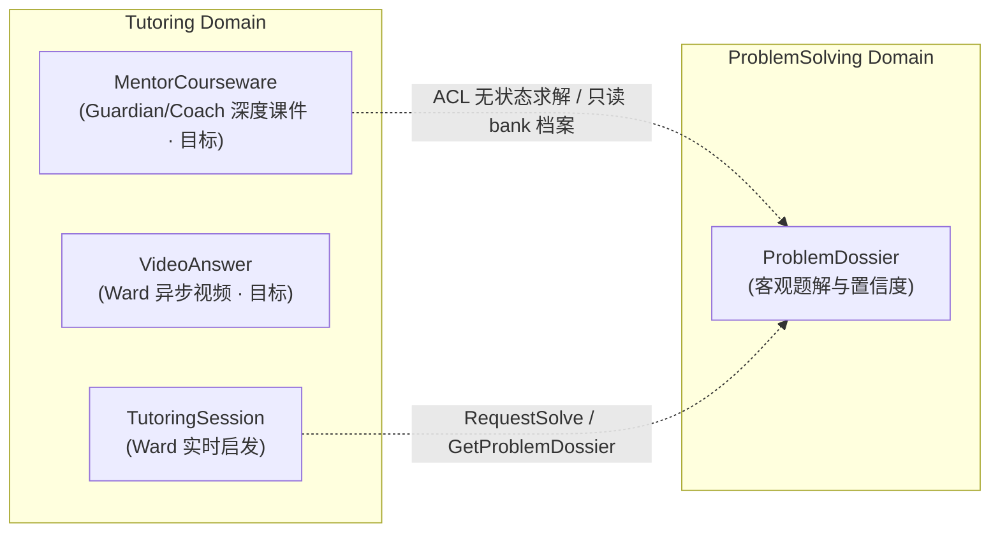
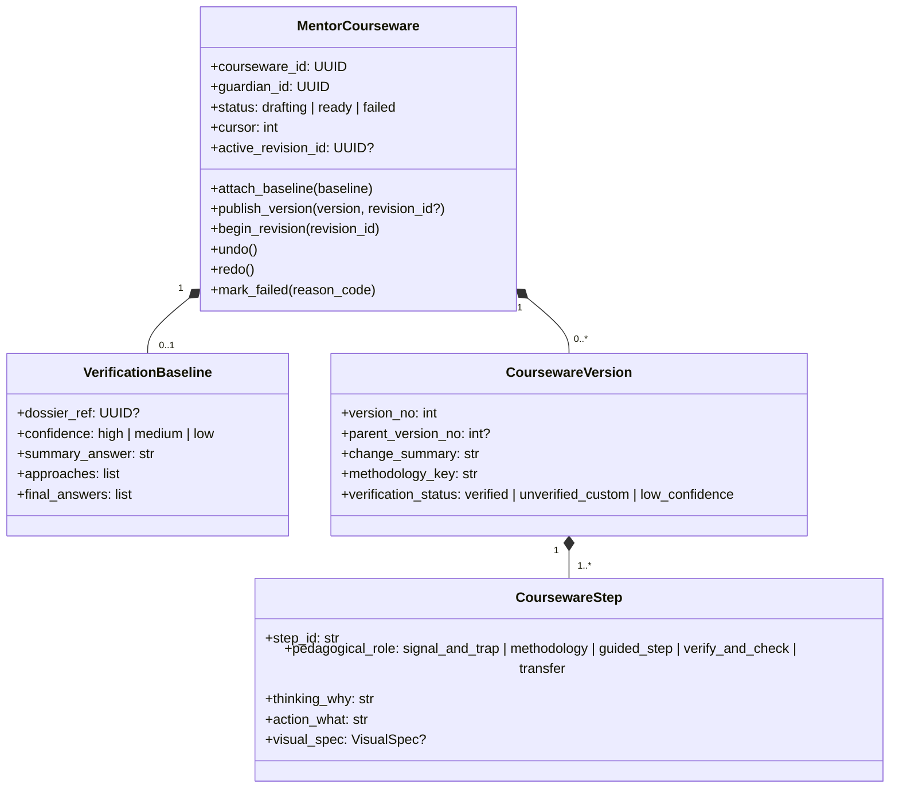
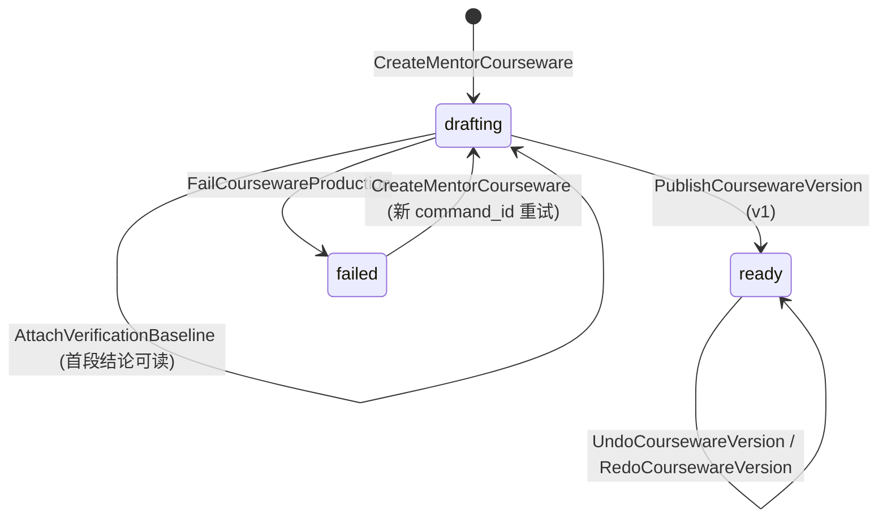
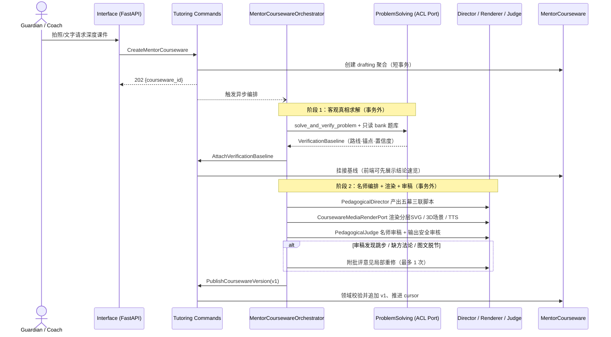

# 读学系统 — Tutoring 专题：导师视角深度课件与对话式修订

> 状态：目标设计（**未实现**；P0 / P1 / P2 分期见 [§八](#八分期演进与兼容边界)） · 版本：v1.0 · 2026-11-26
>
> 方法：[domain-driven-design skill](../../.cursor/skills/domain-driven-design/SKILL.md)
>
> 范围：面向成人导师视角（Guardian / Coach 的 `guardian_explain`）的深度可修订课件——将 `ProblemSolving` 的客观核验结果转化为「高级名师五幕思维法 + 图文强绑定 + 可选立体几何 3D / 动态微课」结构化课件，支持对话式局部修订（纠正、修改、删减、补充）与毫秒级 Undo / Redo。
>
> 关联：[DDD 系统总览](ddd-overview.md) · [Tutoring 主域](domain-tutoring.md) · [ProblemSolving](domain-problem-solving.md) · [Companion · 家长问答体验](domain-companion.md#guardian-问答体验2026-11-17-验收2026-11-18-扩展双视角) · [答疑表达设计](domain-tutoring-presentation.md) · [知识讲解视频专题](tutoring-video-answer.md) · [用户 PRD §7.2](../product/prd-user.md#72-家长问答体验)

本文是 [domain-tutoring.md](domain-tutoring.md) 的专题扩展，**不新增 Domain**。全系统 Domain Inventory 与 Domain Map 唯一归属 [ddd-overview.md](ddd-overview.md)；客观解题、多路共识与确定性算子核验唯一归属 [domain-problem-solving.md](domain-problem-solving.md) 与 [tutoring-math.md](tutoring-math.md)；现有成人无状态直出体验协议归属 [domain-companion.md](domain-companion.md)。

---

## 一、边界与统一语言

### 1.1 职责与非目标

- **职责**：
  1. 承接成人导师视角（`guardian_explain`）“直接给答案，但要把底层思维彻底讲通、像名师课件一样生动形象”的深度讲解需求；
  2. 将“解对题（客观真相）”与“讲透理（教学法编排）”解耦：在 `ProblemSolving` 核验基线之上，强制以**高级老师五幕思维结构**（审题信号与直觉陷阱 → 抽象方法论 → 图文强绑定推演 → 严谨计算与自检 → 母题变式迁移）组织课件；
  3. 支持对已生成课件发起**对话式局部修订**（删减、拆细、补充类比、纠正步骤、更换解法、调整学段口吻），只重算和重渲受影响节点；
  4. 提供基于不可变版本栈的确定性 **Undo / Redo**；
  5. 以统一 `VisualSpec` 协议渐进承载三档媒体形态：方案 A（渐进分层 SVG 板书 + 立体几何受控 3D 场景）→ 方案 B（有声动态图解微课，复用 `VideoAnswer` 播放器）→ 方案 C（理科专项隔离沙箱连续动画）。
- **非目标**：
  - **不改变 `ProblemSolving` 边界**：不把个人对话、教学偏好或版本修订塞入 `ProblemDossier`，不重复建设求解器或确定性数学引擎；
  - **绝不触碰学生域与记忆域**：不接受 `ward_id`，不复用 `TutoringSession` / `TutorPermitPolicy`，不发布 `LearningFactRecorded.v1` 到 `Memory`；
  - **不做端到端文生视频或数字人播报**（公式与几何精度不可控，违背核验诚实底线）；
  - **不开放整页试卷批量报答案或整篇作文代写**（沿用 [用户 PRD §7.2](../product/prd-user.md#72-家长问答体验) 红线）。

### 1.2 上下游契约

| 方向 | Domain / 契约 | 集成方式 | 说明 |
| :--- | :--- | :--- | :--- |
| 上游 | `Identity & Relationship` | Authorization ACL | 校验 Guardian / Coach 身份与成人附件对象键归属 |
| 上游 | `ProblemSolving` | ACL / Port（无状态求解核验内核 + 只读 `scope="bank"` 题库） | 获取只读 `VerificationBaseline`（题面、解法路线、锚点、采分点、置信度）；修订涉及数学纠错或换法时再次调用复核 |
| 下游 | 无跨域 Integration Event | — | 成人体验与学生学习事实严格隔离，不向 `Memory`、`Evaluation` 或 `Study` 发布任何事件 |

### 1.3 统一语言

| 术语 | 本专题中的含义 | 明确不是 |
| :--- | :--- | :--- |
| `MentorCourseware` | 一次成人导师深度讲解请求拥有的可版本化课件聚合根 | `ProblemDossier`、`TutoringSession`、单条聊天消息 |
| `VerificationBaseline` | 来自 `ProblemSolving` 的只读客观核验快照（题面、已验证路线、锚点、置信度） | 可由教学模型自由改写的草稿 |
| `CoursewareVersion` | 不可变的课件完整版本快照（`v1, v2, ...`），支持 Undo / Redo 指针切换 | 原地覆写的草稿表 |
| `CoursewareStep` | 课件内带稳定 `step_id` 的最小可寻址教学单元，强制包含 `{thinking_why, action_what, visual_spec}` 三联 | 纯文字段落或无动机操作流水账 |
| `PedagogicalDirector` | 负责把客观解法翻译为五幕思维课件脚本或局部 Patch 的教研编排 Port | 聚合根或求解器 |
| `PedagogicalJudge` | 独立教研审稿 Port，专门检查“无动机跳步 / 缺抽象方法论 / 图文脱节” | 替代数学确定性核验或内容安全审核 |
| `CoursewarePatch` | 对话式修订产生的结构化增量补丁（`insert / update / delete / split / replace_method`） | 全篇重新生成的纯文本 |

---

## 二、Domain Model

### 2.1 Aggregate Map

- **图示位置**：下述 Mermaid（本专题内维护；全系统 Domain Map 见 [ddd-overview.md](ddd-overview.md#三ddd-domain-map)）。
- **写聚合与边界**：`Tutoring` 现共规划 **3 个相互独立的写聚合根**——`TutoringSession`（学生实时启发答疑）、`VideoAnswer`（学生异步专题知识视频，未实现）与本专题新增的 `MentorCourseware`（成人导师深度课件，未实现）。
- **一致性关系**：三者互不共享事务，不直接持有对方对象引用；`MentorCourseware` 仅通过只读值对象 `VerificationBaseline`（携带可选 `dossier_ref`）消费 `ProblemSolving` 的核验结果。



### 2.2 Aggregate Root Summary

本专题在 `Tutoring` Domain 中新增 **1 个写聚合根**（连同既有 `TutoringSession` 与待实现 `VideoAnswer`，`Tutoring` 总计 3 个写聚合根）：

| Aggregate Root | Consistency boundary | Business responsibility |
| :--- | :--- | :--- |
| `MentorCourseware` | 单份成人导师课件的生命周期状态、核验基线、不可变版本链（`versions`）、当前激活指针（`cursor`）与至多 1 个活跃修订槽位；不包含异步渲染过程日志、模型原始草稿或学生域数据 | 守卫版本不可变、Undo/Redo 指针合法性、五幕思维与图文三联完整性、以及核验诚实状态标记 |

### 2.3 Entity & Value Object Inventory

| Object | Kind | Identity | Behavior and invariant responsibility |
| :--- | :--- | :--- | :--- |
| `CoursewareVersion` | Value Object | `version_no`（聚合内单调递增序号） | 不可变版本快照：持有 `parent_version_no`、`change_summary`、`verification_status`（`verified \| unverified_custom \| low_confidence`）、`methodology_key`（一句话思维钥匙）与有序 `steps` |
| `CoursewareStep` | Value Object | `step_id`（聚合内稳定寻址键） | 强制图文强绑定三联：`pedagogical_role`（五幕角色）+ `thinking_why`（为何这么想）+ `action_what`（在图/式上做什么）+ `visual_spec`（画出来是什么样及高亮锚点）；三联缺失视为非法候选 |
| `VisualSpec` | Value Object | None | 判别联合：`layered_svg`（方案 A/B 同画布分层矢量）、`scene_3d`（立体几何受控 3D 场景原语：点/棱/面/截面/旋转/抽面/展开）、`beat_timeline`（方案 B 音画时间轴，复用 `VideoAnswer` 播放器原语）、`rendered_clip_ref`（方案 C 理科沙箱渲染片断引用） |
| `VerificationBaseline` | Value Object | 可选 `dossier_ref` | 冻结来自 `ProblemSolving` 的结构化题面、已验证路线、锚点、最终结论与 `confidence`；仅允许由 `AttachVerificationBaseline` 写入或因换法/纠错复核更新 |
| `CoursewarePatch` | Value Object | `patch_id` | 结构化局部修订指令：`op`（`insert \| update \| delete \| split \| replace_method`）、`target_step_id`、`requires_reverify`、新步骤载荷；用于局部重算与差异审计 |

### 2.4 Aggregate Internal UML



### 2.5 Lifecycle State Diagram



> 说明：`ready` 态发起修订时，聚合保持 `ready`（通过 `active_revision_id` 防止并发修订冲突），当前已发布版本始终可读、可 Undo/Redo；修订失败时仅释放 `active_revision_id` 并返回失败提示，不破坏既有版本。

### 2.6 Domain Services

1. **`CoursewareInvariantPolicy`**（无状态）
   - **输入 / 输出**：`(candidate_version, baseline, is_initial_draft, patch?) -> ValidationResult`
   - **规则**：
     - 初版（`v1`）必须覆盖五幕思维结构（至少包含 `signal_and_trap`、`methodology`、`guided_step`、`verify_and_check`；`transfer` 仅在题型适用时强制）；用户显式删减修订允许裁剪指定幕次；
     - 每个 `guided_step` 必须同时具备非空 `thinking_why` 与 `action_what`；当存在 `visual_spec` 时，其高亮锚点须与 `action_what` 对齐；
     - **核验诚实规则**：若修订触发了 `requires_reverify=true`（纠正数学推导、更换解法、修改公式结论）且 `ProblemSolving` 复核未通过或与确定性引擎矛盾，禁止将 `verification_status` 标为 `verified`（拒绝发布或经用户显式确认后标为 `unverified_custom`）。
2. **`CoursewareVersionPolicy`**（无状态）
   - **输入 / 输出**：`(versions, cursor, op) -> NextVersionState`
   - **规则**：
     - `undo` 要求 `cursor > 0`，仅回退指针，不修改任何历史版本；
     - `redo` 要求 `cursor < len(versions) - 1`，仅前进指针；
     - 当 `cursor < len(versions) - 1` 时发布新修订版本，截断 `versions[cursor+1:]` 的旧 redo 分支并追加新版本，推进 `cursor` 指向新版本；单份课件版本上限默认 20 版。

---

## 三、Application 层：Commands、Process Manager 与触发矩阵

### 3.1 State-change Trigger Matrix

| Trigger and source | Interface / entrypoint | Receiving Command or Process Manager | Aggregate / domain method | Local domain event | Outbox / next local action | Consistency, idempotency, failure |
| :--- | :--- | :--- | :--- | :--- | :--- | :--- |
| Guardian 发起新题课件 | `POST /guardian/courseware` | `CreateMentorCourseware` | `MentorCourseware.create()` | `MentorCoursewareCreated` | 投递异步编排任务给 `MentorCoursewareOrchestrator` | 本地短事务；幂等键 `guardian_id + command_id`；超频返回 `429` |
| Worker 完成阶段一求解核验 | Infrastructure Worker Adapter | `AttachVerificationBaseline` | `MentorCourseware.attach_baseline()` | `VerificationBaselineAttached` | 刷新只读视图（前端立刻展示“答案与题眼速览”） | 本地短事务；幂等键 `courseware_id + baseline_hash` |
| Worker 完成编排/渲染/审稿 | Infrastructure Worker Adapter | `PublishCoursewareVersion` | `CoursewareInvariantPolicy` + `CoursewareVersionPolicy` + `publish_version()` | `CoursewareVersionPublished` | 释放 `active_revision_id`；刷新只读视图 | 本地短事务；幂等键 `courseware_id + revision_id`；校验不过不落库 |
| Guardian 发起对话修订 | `POST /guardian/courseware/{id}/revisions` | `RequestCoursewareRevision` | `MentorCourseware.begin_revision()` | `CoursewareRevisionRequested` | 投递局部修订任务给 `MentorCoursewareOrchestrator` | 本地短事务；幂等键 `courseware_id + command_id`；已有在途修订返回 `409` |
| Guardian 点击 Undo / Redo | `POST /guardian/courseware/{id}/{undo\|redo}` | `UndoCoursewareVersion` / `RedoCoursewareVersion` | `CoursewareVersionPolicy` + `undo()` / `redo()` | `CoursewareCursorMoved` | 无（同步返回最新视图） | 强一致本地短事务；**零模型调用**；越界返回 `409` |
| 编排有界重试耗尽 | Infrastructure Worker Adapter | `FailCoursewareProduction` | `MentorCourseware.mark_failed()` | `CoursewareProductionFailed` | 附带纯文本降级解析引用（如有） | 本地短事务；幂等键 `courseware_id + revision_id` |

### 3.2 核心 Command Cards

#### `CreateMentorCourseware`
```python
class CreateMentorCoursewareInput(BaseModel):
    guardian_id: UUID
    command_id: str
    prompt_text: str = Field(max_length=2400)
    attachment_keys: list[str] = Field(default_factory=list, max_length=4)
    target_grade_hint: str | None = None
    media_profile: Literal["storyboard", "microcourse", "manim_addon"] = "storyboard"
```
- **授权与前置**：校验 Guardian 身份、成人专属附件键前缀 `guardian/{guardian_id}/experience/`、账号级滑动窗口频控与输入安全预检。
- **事务边界**：短事务仅创建 `drafting` 聚合并记录投递任务；**模型求解、编排、渲染与审稿全部在事务外执行**。
- **幂等**：同一 `guardian_id + command_id` 重复提交返回同一 `courseware_id`；同键异载拒绝（`409`）。

#### `RequestCoursewareRevision`
```python
class RequestCoursewareRevisionInput(BaseModel):
    guardian_id: UUID
    courseware_id: UUID
    command_id: str
    instruction: str = Field(min_length=1, max_length=1200)
    target_step_id: str | None = None           # 可选显式点选锚点；缺省由编排器按自然语言定位
    allow_unverified_override: bool = False     # 仅在引擎提示分歧后二次确认时允许置 True
```
- **授权与前置**：校验 `courseware.guardian_id == guardian_id`、`status == "ready"`、当前无活跃 `active_revision_id`、输入安全审核通过。
- **行为**：锁定 `active_revision_id`（防止并发修订互相覆盖），唤醒 `MentorCoursewareOrchestrator` 执行局部 Patch 管线。

#### `PublishCoursewareVersion`
```python
class PublishCoursewareVersionInput(BaseModel):
    courseware_id: UUID
    revision_id: UUID | None                    # v1 为 None；后续修订必填且须匹配 active_revision_id
    candidate_version: CoursewareVersion
    requires_reverify: bool
    reverify_passed: bool | None
    allow_unverified_override: bool = False
```
- **入口**：仅允许由 Worker Adapter 触发，不直接暴露为公网写接口。
- **领域校验**：依次调用 `CoursewareInvariantPolicy`（五幕/三联/核验诚实红线）与 `CoursewareVersionPolicy`（版本上限与分支截断），通过后原子提交新版本并移动 `cursor`。

#### `UndoCoursewareVersion` / `RedoCoursewareVersion`
```python
class MoveCoursewareCursorInput(BaseModel):
    guardian_id: UUID
    courseware_id: UUID
    expected_cursor: int                        # 乐观并发控制，防双击连续越界
```
- **事务与性能**：纯本地短事务移动 `cursor`，不调用任何模型或外部服务，目标响应 `< 50ms`。

### 3.3 Process Manager：`MentorCoursewareOrchestrator`（跨 Domain 编排）

`MentorCoursewareOrchestrator` 负责事务外串联 `ProblemSolving` 与 `Tutoring` 的多步长耗时流程，按场景严格分流：



**三类场景的分流规则**：
1. **新题首版**：完整执行 `阶段 1 (ProblemSolving)` → `阶段 2 (Director + Renderer + Judge)` → `PublishCoursewareVersion`；
2. **表达类对话修订**（删减、拆细、补比喻、调年级口吻）：**跳过 `ProblemSolving`**，复用聚合已存的 `VerificationBaseline`，仅对受影响 `step_id` 生成 Patch 并局部重渲（未改动步骤的 SVG / 3D / 音频按内容哈希 100% 复用）；
3. **纠错 / 换解法类对话修订**：`Director` 标记 `requires_reverify=true`，`Orchestrator` **再次调用 `ProblemSolving`** 复核新推导与结论，再将复核结果连同候选交 `PublishCoursewareVersion` 裁决。

#### Sequence Diagram Participant Inventory

| Participant | Canonical type | Owned responsibility |
| :--- | :--- | :--- |
| Guardian / Coach | Actor | 发起深度课件请求、阅读、提出对话修订与执行 Undo / Redo |
| Interface (FastAPI) | Interface | 鉴权、参数校验、频控与 HTTP/SSE 响应映射 |
| Tutoring Commands | Command | 守卫本地短事务、幂等性并调用聚合根与领域服务 |
| `MentorCoursewareOrchestrator` | Process Manager | 事务外编排跨域求解、教研导演、媒体渲染、审稿与有界重试 |
| ProblemSolving (ACL Port) | Infrastructure (ACL) | 调用 `ProblemSolving` 无状态求解内核与只读题库，翻译为 `VerificationBaseline` |
| Director / Renderer / Judge | Infrastructure | 外部大模型编排、媒体/3D/音频渲染、独立名师审稿与安全审核适配器 |
| `MentorCourseware` | Aggregate Root | 守卫版本不可变、Undo/Redo 指针、图文三联与核验诚实不变量 |

---

## 四、CQRS Query 侧

### 4.1 `GetMentorCoursewareView`
- **用途**：供 `GuardianQuestionPage` 渲染当前 `cursor` 对应的课件；**默认返回折叠骨架防冗长**（核心结论 + 一句话思维钥匙 + 5 幕目录标题），前端按需展开单幕或翻页浏览。
- **一致性**：对 `Undo` / `Redo` 强一致（直读同一聚合存储）；对异步生成/修订最终一致（配合轮询或 SSE 状态推送）。
- **字段投影**：
  - `courseware_id`、`status`、`verification_summary`（阶段 1 就绪即可展示，不等阶段 2）；
  - `current_version`（`version_no`、`change_summary`、`verification_status`、`methodology_key`、`steps[]`）；
  - `history_controls`（`cursor`、`total_versions`、`can_undo`、`can_redo`、`version_summaries[]`）；
  - `active_revision_pending: bool`。

### 4.2 `GetCoursewareProductionStatus`
- **用途**：只读查询 `Orchestrator` 运行阶段（`solving | directing | rendering | judging | ready | failed`）与友好进度文案，不读取或修改领域聚合内部规则。

---

## 五、Interface Contracts

```text
POST /guardian/courseware                       → CreateMentorCourseware (202 Accepted)
GET  /guardian/courseware/{id}                  → GetMentorCoursewareView (200 OK)
GET  /guardian/courseware/{id}/status           → GetCoursewareProductionStatus (200 OK)
POST /guardian/courseware/{id}/revisions        → RequestCoursewareRevision (202 Accepted)
POST /guardian/courseware/{id}/undo             → UndoCoursewareVersion (200 OK + View)
POST /guardian/courseware/{id}/redo             → RedoCoursewareVersion (200 OK + View)
```

- **向后兼容**：现有同步直出接口 `POST /guardian/experience/turn`（`mode="guardian_explain"`）保持不变，供轻量快速问答与现有离线评测回归使用；深度课件作为独立资源路径渐进灰度上线。
- **错误映射**：越权/跨账号访问统一 `403`；并发修订冲突或 Undo/Redo 越界返回 `409`；超频返回 `429 {"code": "mentor_rate_limited"}`；编排整体超时降级返回核验结论 + 纯文本解析并标注 `degraded=true`。

---

## 六、Infrastructure Mapping

### 6.1 Ports and Adapters

| Port owned by Domain/Application | Concrete adapter | Protocol / dependency | Configuration / secret boundary | Timeout, retry, rate limit | Error mapping / fallback |
| :--- | :--- | :--- | :--- | :--- | :--- |
| `ProblemVerificationPort` | `ProblemSolvingAclAdapter` | 进程内受权调用 `solve_and_verify_problem` + `SubprocessMathEngineAdapter` | 复用既有 `ProblemSolving` Admin 配置与数学执行器 socket | 共享阶段 1 预算（默认 60s），不阻塞事务 | 核验失败或超时标 `confidence="low"`，绝不伪装已核验 |
| `PedagogicalDirectorPort` | `AdminModelDirectorAdapter` | OpenAI-compatible LLM API | Admin 组件 `tutoring.mentor-director`（版本化 Prompt + Schema） | 单次 45s，结构错误最多重试 1 次 | 失败触发 `FailCoursewareProduction`，回退直出文本解析 |
| `PedagogicalJudgePort` | `AdminModelPedagogicalJudgeAdapter` | 异构 LLM API（严禁与 Director 同型号） | Admin 组件 `tutoring.mentor-pedagogical-judge` | 单次 25s，审稿打回最多重修 1 次 | Judge 不可用时记录观测告警；安全审核不可用仍 fail-closed |
| `CoursewareMediaRenderPort` | `CompositeCoursewareRenderer`（按 profile 分派） | P0: SVG 确定性校验器 + 3D 场景 Schema 校验器；P1: TTS + Flutter Headless 抽帧；P2: 隔离 Manim 沙箱 | 对象存储（私有前缀 `guardian/{id}/courseware/`）与独立沙箱配置 | 单媒体渲染有界超时（SVG/3D < 5s；TTS < 30s；沙箱 < 120s） | 单个 `visual_spec` 校验/渲染失败只降级该步为静态图或纯文本，不整份回退 |
| `MentorCoursewareRepository` | P0: `RedisCoursewareRepository`（4h TTL）<br/>P1: `PgCoursewareRepository` | Redis / PostgreSQL | 复用服务端连接池配置 | 读写超时 2s，乐观锁版本校验 | 过期返回 `404 courseware_expired`，提示重新生成 |

### 6.2 Persistence & Entity-Relationship 边界

- **P0 阶段（无数据库表）**：沿用 [domain-companion.md](domain-companion.md#guardian-问答体验2026-11-17-验收2026-11-18-扩展双视角) 的成人无持久化边界——`MentorCourseware` 及其不可变版本栈保存在 Redis（4 小时 TTL，退出或过期自动清理），媒体大对象（音频/渲染片段）存私有 OSS 临时前缀并随生命周期清理。**因此 P0 不新增 PostgreSQL 表，不提供虚构 ER 图，也不涉及数据库迁移。**
- **P1 阶段（面向 To B2C Coach 沉淀复用课件时）**：新增 `mentor_coursewares` 与 `mentor_courseware_versions` 表（仅以 `guardian_id` 索引，无任何学生域外键），届时补齐正式 ER 图、Alembic 迁移与回滚方案，Domain 与 Application 层零改动。

### 6.3 Async Delivery、Security & Observability

- **异步执行**：复用既有 Celery 基础设施（新增独立队列或复用 `solving` 低优先级队列，Worker 仅调用 Application Command，绝不直接改存储）；长任务以 `courseware_id + revision_id` 幂等，设置租约防崩溃死锁。
- **安全与隐私**：输入与每一版输出（含 `thinking_why`、`action_what` 与 `visual_spec` 内全部可见文字）均强制经过双向内容安全审核；音频与临时素材路径严格隔离在成人账号前缀下。
- **可观测性**：沿用 OpenTelemetry + Grafana + Langfuse，为每轮记录 `courseware_id`、`version_no`、`stage_latency_ms`、`pedagogical_judge_verdict`、`reused_step_count`、`reverify_triggered` 与成本 Token 拆解。

---

## 七、验收场景（Acceptance Scenarios）

```gherkin
Given Guardian 上传一道立体几何题并请求深度课件
When 系统完成 ProblemSolving 核验并进入编排阶段
Then 前端在阶段 1 结束时即可通过 GetMentorCoursewareView 看到核验结论与题眼速览
And 阶段 2 发布 v1 后，课件包含五幕思维结构，每一步均具备 thinking_why、action_what 与对应 visual_spec（含受控 3D 场景或平面抽出图）

Given 课件处于 ready 且当前为 v1
When Guardian 发起修订“把第 5 幕变式删掉，第 3 步补一个生活类比”
Then Orchestrator 跳过 ProblemSolving 求解，仅重编并重渲受影响步骤，其余步骤内容与媒体哈希保持不变
And 发布 v2 后，cursor 指向 v2，can_undo 为 true

Given 课件版本链为 [v1, v2] 且当前 cursor 指向 v2
When Guardian 连续调用 Undo 再发起新修订“把第 3 步改用相似三角形”
Then Undo 在零模型调用下毫秒级回到 v1
And 新修订通过 ProblemSolving 复核后发布为 v3，旧 v2 从 Redo 分支截断，can_redo 为 false

Given 课件处于 ready 且当前为 v1（答案已由确定性引擎核验）
When Guardian 发起纠错“你算错了，答案应该是 10，按 10 改”且确定性引擎复核原解正确
Then PublishCoursewareVersion 拒绝将该修订标记为 verified
And 系统向 Guardian 返回引擎复核依据，仅在显式确认 allow_unverified_override=true 时才允许生成标记为 unverified_custom 的草稿版本

Given 任意 MentorCourseware 创建、修订或 Undo/Redo 操作
When 请求执行完成
Then 不产生任何学生域（TutoringSession / ProblemRecord）写入，也不向 Memory 发布任何 LearningFactRecorded 事件
```

---

## 八、分期演进与兼容边界

| 期别 | 核心交付 | 复用与新增 |
| :--- | :--- | :--- |
| **P0（最小可用 · 方案 A + 立体几何 3D + 修订/Undo）** | `MentorCourseware` 聚合 + `Orchestrator` + `PedagogicalDirector` + `PedagogicalJudge` + 渐进分层 SVG + 受控 3D 场景协议 + 对话式局部修订 + Undo/Redo（Redis 4h 临时态） | 复用 `ProblemSolving`、`VisualBlock`、LaTeX；新增 Flutter 折叠骨架课件页与轻量 3D 几何查看器 |
| **P1（有声微课 · 方案 B + Coach 持久化）** | 接入逐 Beat TTS、毫秒级时间轴与 Flutter 脚本驱动播放器（与 [VideoAnswer](tutoring-video-answer.md) 共享播放器原语）；按需开放 PostgreSQL 持久化供伴学师复用 | 仅替换 `CoursewareMediaRenderPort` 与 `MentorCoursewareRepository` 适配器 |
| **P2（理科极限增强 · 方案 C 插件）** | 针对动点轨迹、函数动态变换、物理电磁过程引入隔离 Manim/Python 渲染沙箱作为 `rendered_clip_ref` 插件 | 仅新增一个 `CoursewareMediaRenderPort` 适配器，不影响文科与常规题路径 |
