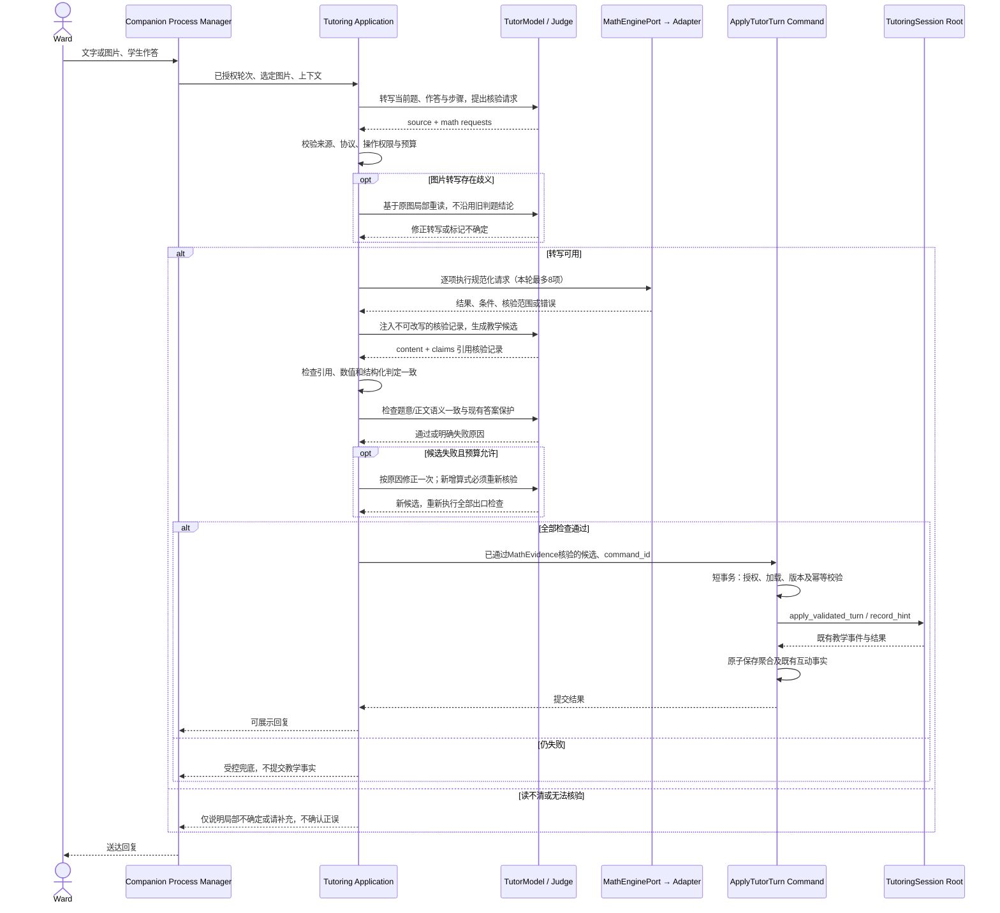

# Tutoring 数学核验设计

> 状态：代码已实现，待环境验收与真实模型评测；未发布。实现边界与启用步骤见 §6。
> 方法：[DDD 规范](../../.cursor/skills/domain-driven-design/SKILL.md)。领域事实源：[Tutoring](domain-tutoring.md)；全系统领域清单、Domain Map 与分层图复用 [DDD Overview](ddd-overview.md)，不新增数学 Domain。

## 1. 归属与分层

本能力属于 **Tutoring / Core**：拥有数学核验如何支持教学判断的规则。Companion 负责路由与送达；Study 提供会话授权上下文；Memory 仅消费提交后的学习事实。跨域契约保持不变。

| 层 / 参与者 | 类型与职责 |
|---|---|
| CompanionCoordinator | Process Manager：接收学生轮次，路由 Tutoring，送达回复 |
| TutoringWorkflow / TutorTurnLoop | Application 编排：读题、执行工具、组装证据、检查回复；不另建 Process Manager 或聚合 |
| ApplyTutorTurn | Command：校验身份、版本和幂等键，提交通过审核的教学结果 |
| TutoringSession | Aggregate Root：通过现有行为更新题目状态、记录已验证互动；不调用模型或 SymPy |
| MathEvidence（新增） | Value Object：来源、核验范围、条件与结论；由 Application 将工具 DTO 转换后供领域规则使用，无独立生命周期 |
| MathEnginePort（新增） | Application 只读端口：接受规范化数学请求，返回计算结果 |
| MathEngineAdapter（新增） | Infrastructure：精确四则与受限 SymPy；翻译引擎类型、异常，禁止泄漏第三方对象到 Domain |
| TutorModel / Judge | Infrastructure 模型适配器：读题、生成提示、判断语义一致性和披露范围 |

本扩展涉及 **1 个既有写聚合 TutoringSession，新增聚合数为 0**。ProblemRecord、VerifiedTurn 及聚合内部关系、状态机、ER 复用领域主文档及其服务端设计链接；不新增表、Repository 或核算事件。

**不变量：**只能依据来源匹配且范围明确的证据判定；数值正确不等于步骤、列式或理解正确；未知不能判错；计算结果不改变答案披露权限，不自动触发 ConfirmUnderstanding。

## 2. 主要执行时序

下图是调用顺序，非跨层依赖图。A 为 Tutoring Application 编排；所有模型与工具调用均在数据库事务之外。



导师可主动调用同一工具。出口检查要求每条计算性判定引用成功核验记录；遗漏的数学声明由语义检查发现，不使用关键词/正则猜测。工具不支持的推理只允许说明核验边界，不伪造通过。

## 3. 内部交互协议

这是 **Application Tool DTO**，不是公开 HTTP API 或聚合接口。`math.v1` 同时服务文字与图片，原图转写正确性不由数学引擎保证。

```typescript
// 模型调用：{"tool":"math","args":MathInput}
MathInput = {
  op: "evaluate" | "equivalent" | "solve" |
      "differentiate" | "integrate" | "limit",
  args: MathArgs,
  symbols?: { name: string, domain: "real" | "complex" | "integer" }[],
  assumptions?: string[], // 仅 name:positive|negative|nonzero|nonnegative
  image_ref?: string, step_ref?: string
}
// 服务端绑定source并生成request_id/input_digest；模型不能指定或伪造。
MathObservation = {
  request_id: string, input_digest: string,
  source: {turn_id: string, run_id: string, problem_ref?: string,
           instruction_digest: string},
  request: MathInput, engine_version?: string,
  status: "ok" | "unknown" | "error", result?: string,
  verdict?: "equal" | "not_equal" | "unknown",
  conditions: string[], checked_scope: "value" | "equivalence" | "solution_set",
  error_code?: "invalid_input" | "unsupported" | "timeout" | "resource_limit" | "unavailable"
}
TutorCandidate += {
  math_claims: {request_id: string, step_ref?: string,
               assertion: "equal" | "not_equal" | "unknown" | "result", value?: string}[]
}
```

| 操作 | MathArgs 必需字段 | 结果语义 |
|---|---|---|
| evaluate | expression | 精确值；近似计算需显式 precision |
| equivalent | left, right | 在给定域与条件下是否等价；失败不能映射 not_equal |
| solve | equations, variables | 首期仅单变量单方程，输入 lhs-rhs；解集及条件，未求出不等于无解 |
| differentiate | expression, variable, order | 导数表达式 |
| integrate | expression, variable；定积分另给 bounds | 原函数或定积分；未求值返回 unknown |
| limit | expression, variable, point, direction | 指定方向的极限或 unknown |

表达式与假设使用受限数学语法，由适配器的受限执行器解析为白名单对象，不执行任意 Python。不把模型字符串直接传给 eval、exec、parse_expr 或字符串 sympify；以受限语法树显式构造 SymPy 对象，假设也只接受已定义谓词。`request_id`、来源摘要及记录由服务端校验/绑定，模型不能伪造工具结果。超时/错误不得携带可用判定。公开回复不得直接透传 result。

例：核验 `90-37` 与学生的 `53`，使用 equivalent；成功得到 equal 后，仅能确认该计算，不能据此确认整页或全部过程正确。原图若无法确认写的是 53，计算结果不能消除读图歧义。

## 4. 写入与查询边界

| 触发 → Application | Domain 行为 | 事务、事件与失败 |
|---|---|---|
| 核验及出口通过 → ApplyTutorTurn | TutoringSession.apply_validated_turn / record_hint；复用 TutorPermitPolicy | 沿用领域主文档短事务、教学事件与互动事实；command_id 幂等，同键异载荷拒绝；版本冲突不提交旧证据 |
| 工具成功但回复失败/来源不确定 | 无聚合变更 | 不新增 VerifiedTurn、不推进题目、不投递学习事实 |

工具执行无副作用，不单独设计写 Command、Query 或 Integration Event。证据保留在本轮运行上下文；教学记录查询继续使用既有已提交结果，不暴露内部答案。提交后查询的一致性及 Memory 最终一致契约沿用 [Tutoring](domain-tutoring.md)，不在核算时直接写 Memory。

## 5. 基础设施与验收

- **落点：**端口放 `app/application/ports/`，编排沿用 `app/application/workflows/`；MathEvidence 归 `app/contexts/tutoring/domain/`；引擎放 `app/infrastructure/`，由 bootstrap 装配。抽取现有 image_review 的四则核心，避免并行维护两个计算器。
- **执行与隔离：**MathEngineAdapter 负责协议转换和调度，SymPy 实际运行在其受限执行器中，不在 API 主进程内运行。生产执行器置于独立最小权限容器，禁网络、非 root、只读根文件系统、不挂载业务目录或注入业务凭据，并限制 CPU/内存/进程数/输出大小；容器内计算子进程超时须终止并回收，不能只停止等待。子进程本身不是权限沙箱，不能继承业务环境后声称已隔离。初始预算每次 2 秒、每轮最多 8 项且累计执行预算 16 秒；数学分歧最多修正一次，不再切备用模型重复裁决。整轮模型调用仍受既有 Workflow 预算约束。执行器并发 2、队列 4。确定性错误不原样重试；预算耗尽映射 timeout/resource_limit，不产生有效判定。
- **沙箱边界：**首期需要上述受限计算隔离，但不建设允许模型提交任意 Python 的通用代码沙箱。未来开放代码执行必须另评估更强隔离；容器及白名单均不构成绝对安全保证。表达式深度、节点数、数字位数、指数与矩阵规模在执行前受限，解析和对象构造也计入执行预算。
- **配置与发布：**工具授权及提示词仍由 Admin 完整包管理；协议与安全上限归代码。无迁移/回填、新队列或独立 Outbox；回滚至兼容代码与配置组合。未配置能力时明确不可用，不退回模型心算并标记已核验。
- **观测：**记录 trace、组件包摘要、引擎版本、请求摘要、耗时和状态；不新增原图/学生原文日志，沿用既有留存删除规则。核算记录是运行证据，不是领域事件。
- **验收：**覆盖精确分数、定义域/增根、未知与超时、图片读错、伪造引用、正文反转、重试新增算式、答案泄露、重复提交。以真实回放比较误判率、漏错率、覆盖率与延迟；计算器单测通过不代表端到端可靠。

## 6. 实现与启用

| 边界 | 当前实现 |
|---|---|
| 计算 | 六种标量操作；四则核心从 image_review 抽出复用。SymPy 1.14.0 / mpmath 1.3.0 固定版本；暂不支持矩阵、方程组、任意 Python |
| 等价性 | 未证明定义域安全则 unknown；不以数值抽样证明恒等。对无法确证不等价的符号式保守返回 unknown |
| 证据 | 每轮服务端账本，绑定题目/输入摘要/授权图片；重试复用相同请求，不跨轮复用。图片四则自动走同一工具；分数作答可核验 |
| 语义审核 | 复用独立 leak-judge 的模型配置，新增独立 math_consistent 调用，检查正文、配图及结构化进展；遗漏claims也须审核，不能靠act或non_work跳过。原答案保护继续执行 |
| 可用性 | socket缺失或引擎异常返回unknown；无主进程SymPy、无心算兜底。未授权math的旧行为保持，但发布包仍需显式迁移契约 |
| 数据 | MathEvidence仅在本轮约束候选，ApplyTutorTurn复用既有已验证结果写入路径；不保存工具原文，不新增数据库表 |

工具授权、主/备导师提示词（同一Agent定义）及Judge补充通过**一次性离线迁移**进入Admin草稿，不作为运行时默认配置。升级脚本保留模型及现有Prompt，检查原始摘要，不覆盖输入文件；启用时编译要求导师/Judge共同声明math.v1。

环境准备、快照迁移和发布顺序唯一见 [数学执行器部署](../deployment.md#数学执行器与配置升级)。本地仅通过子进程/socket测试不能代表容器隔离已验收；未进行真实模型回放前，不声明数学准确率改善已验证。
