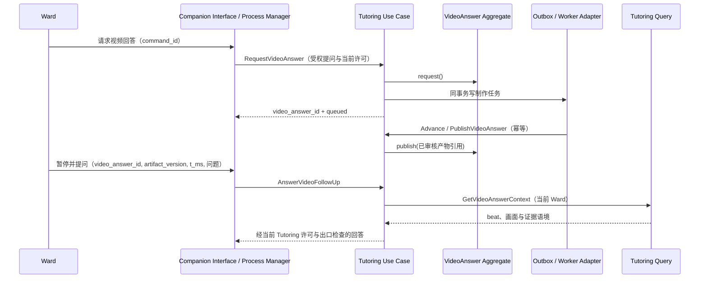
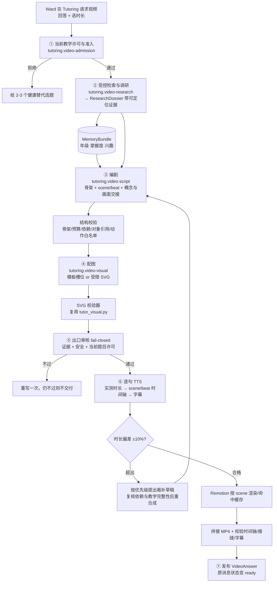

# 读学系统 — Tutoring 专题：知识讲解视频回答

> 状态：设计修订稿，**未实现**（§十二 为分期与门禁） · 版本：v1.2
>
> 范围：Ward 对知识问题请求视频回答；Tutoring 异步调研、编剧和制作 3/5/8 分钟讲解片；Ward 可在任意播放位置暂停，围绕该处内容继续向 Tutoring 追问。
>
> 关联：[陪伴与答疑 PRD](../product/prd-companion.md) · [DDD Overview](ddd-overview.md) · [Companion 编排](domain-companion.md) · [Tutoring](domain-tutoring.md) · [Memory](domain-memory.md) · [AI Component](infra-ai-components.md) · [答疑表达设计](domain-tutoring-presentation.md) · [离线评测](eval-offline.md) · [部署](../deployment.md)
>
> 文档定位：这是 [domain-tutoring.md](domain-tutoring.md) 的专题补充，**不是另一个 Domain 或 Bounded Context 设计文档**。Tutoring 的边界、教学红线和会话聚合以主文档为准；Thread/Run 和交互信封以 [domain-companion.md](domain-companion.md) 为准；物理表、留存与删除以 [design-server.md](design-server.md) 为准；AI 调用的 id/版本/模型以 `app/infrastructure/ai/components.py` 为准。本文只细化异步视频回答用例、制作协议与验收。
>
> 产品规格归属 [prd-companion.md](../product/prd-companion.md)；该 PRD 已区分「不做系列视频大课」与「待验证的单条知识视频回答」，实施前仍须补全 Ward 发起、等待、播放、追问和失败场景的产品验收。兴趣探索引导归 `prd-explore.md`，可以推荐主题，但不拥有视频回答。

---

## 一、问题与目标

Ward 在学习或闲聊中会冒出「黑洞为什么跑不出光」「为什么彩虹是弯的」这类知识问题。现有 Tutoring 可以用文字和静态配图回答；当 Ward 想要一个可反复观看的完整讲解时，视频是一种延迟交付的回答形式，后续追问仍是同一条教学对话的延续。

**目标：**

1. Ward 请求视频回答 → Tutoring 异步制作一条**深入浅出、有节奏、适龄健康**的讲解片 → 在原对话显示制作状态和完成结果 → 可回看。
2. **时长由 Ward 选（3 / 5 / 8 分钟），且是被测量出来的，不是被祈祷出来的。**
3. 播放中可暂停追问：把视频 ID、播放位置和 Ward 的实际问题交给 Tutoring，服务端恢复该处经审核的讲解上下文并继续回答。
4. "深入浅出"靠该 Ward 的真实画像（年级、已掌握知识点、兴趣图谱）选择讲到哪一层、用什么类比——这是本产品相对通用工具的唯一真实差异化。

**非目标：**

- **不用端到端视频生成模型**（Sora / 可灵 / 万相类）。知识讲解需要可核对事实、可控时长和可定位到脚本/素材的修订；当前 MP4 路线改动后仍须重新渲染产物，见 §7.1。
- **不做数字人 / 实拍 / 真人配音**。对儿童科普，一个人头说话的信息密度远低于图解，且按分钟计费、不可控。
- **不做无边界全网爬取**。允许受控检索并读取新资料，事实须能定位到实际材料；见 §四.1。
- **不在 Flutter 内用 WebView 渲染**。理由与答疑配图当初排除 WebView 相同：内存开销、手势冲突、离线 CDN 失效、难做确定性文本抽取防泄露（`.agent/notes/124-tutor-visual-svg.md` 决策 1）。
- 首期不自动为兴趣信号批量制作视频，不宣称学习效果提升。离线评测只做冒烟（与 [eval-offline.md §一](eval-offline.md) 一致）。

---

## 二、核心技术决策

### 2.1 路线：结构化可执行脚本 + 确定性编译（不是像素生成）

业界在"事实性讲解视频"上已经收敛到同一条路：**LLM 产出结构化、可编译的视频脚本，再由确定性模板编译成画面 + 配音**。

| 参考 | 可借鉴的做法 | 本设计的落点 |
|---|---|---|
| **LASEV**（[arXiv 2602.11790](https://arxiv.org/pdf/2602.11790)）：Orchestrating Agent + Solution/Illustration/Narration 三 worker，输出"structured executable video script"后模板化确定性编译 | 整体架构；语义批判 + 规则约束 + 编译检查三重校验 | §四 六段管线；§五 beat 协议即"可执行脚本" |
| **TheoremExplainAgent**（ACL 2025，[项目页](https://tiger-ai-lab.github.io/TheoremExplainAgent/)）：planner 写故事线与旁白 → coding agent 生成 Manim 脚本；五维评测 | 评测五维直接采用；**它的头号失败模式是元素布局（0.61，人工 0.73）** | §六 模板化版式：模型只填语义槽位，布局交给确定性代码；§十一 评测维度 |
| **NotebookLM Video Overviews**（[notebooklm.google](https://notebooklm.google/)） | 旁白 + 动态图示 + **时长可选**，这是现实的效果目标档位 | §二.4 效果预期 |
| **Learn Your Way**（[blog.google](https://blog.google/outreach-initiatives/education/learn-your-way/)、[arXiv 2509.13348](https://finn.lub.lu.se/EdsRecord/edsarx,edsarx.2509.13348)） | 同一份教材按学习者重写成不同形态 | §四.3 用 `MemoryBundle` 决定讲解层次与类比锚点 |

### 2.2 语义最小单元是 beat，构建与连续性单元是 scene ★

**这是让产物"像视频"而不是"有配音的 PPT"的唯一关键决策，是协议层硬约束，不是实现细节。**

```
❌ 分镜级：一张图 + 25 秒旁白            → 孩子必然走神
✅ beat 级：一句旁白 = 一个视觉动作

  "黑洞的引力大到连光都跑不掉"      → reveal  光线箭头
  "可以把它想成一个很深的漏斗"      → morph   网格 → 漏斗
  "漏斗最窄处，叫事件视界"          → highlight + zoom 到颈部
  "一旦越过，就再也回不来了"        → move    箭头单向穿过 + erase 回头路
```

beat 让 Agent 能定位一句讲解和对应的视觉变化；scene 把相邻 beats、教学目标、概念依赖及前后画面状态组织成可独立渲染的单元。构建边界按 scene，不在每个 beat 处拼视频；跨 scene 的连续性由 §五的协议检查。脚本粒度有助于音画同步，最终是否流畅仍须对真实渲染结果抽帧和播放验收。

管线逐句 TTS，每句实测时长可确定 beat 的时间区间，不需要额外 forced alignment；时间区间属于编译结果，不写进可编辑脚本。视觉动作在 beat 内的位置由模板的确定性进度函数计算。

### 2.3 渲染：Remotion 单渲染器，按 scene 构建，MP4 为播放产物

曾考虑"一份脚本、两个渲染端"（Flutter 原生动画 P0 + 服务端 MP4 P1）。**放弃**：同一套动画逻辑要在 Dart 和服务端各实现一遍，App 内看到的和分享出去的会漂移，防住它又要加黄金脚本 + 视觉回归测试。

**决策：一套渲染器、一份可编辑的语义脚本、一个经版本化的播放产物。** 首版即按 scene 编译和缓存；App 仍只播放最终 MP4。

```
VideoAnswerScript（教学语义、scene/beat、证据、视觉交接；可编辑）
        ├─ 逐 beat TTS + scene 渲染 + 内容哈希缓存
        └─ 编译 ──▶ VideoAnswerTimeline（实测时长、绝对时间、场景画面快照）
                      + scene clips ──▶ 连续 MP4 + 字幕（发布版本）
                                          ├─ App 播放；暂停 t → manifest → Tutoring
                                          └─ 回看 / 后续分享
```

**「暂停追问」依赖已发布版本的语义脚本与时间轴**（§五、§七），与播放器和渲染器解耦。精确画面问题还要参考同版本的画面状态或已审核抽帧。

服务端保存的是脚本、配音片段、证据引用和已发布产物版本；App 播放的是合成后的普通 MP4，不在手机上运行 Remotion。当前系统使用阿里云 **OSS**，不是腾讯云 COS。`GetVideoAnswer` 先验证 Ward 归属，再返回短期有效的私有 OSS 播放地址；App 不保存长期公开 URL，也不通过 FastAPI 中转整个视频。播放地址过期时重新查询；MP4 要支持按需读取/拖动播放所需的 Range 请求。

**必须认清 Remotion 的真实链路**（[内部架构](https://www.negabaro.com/en/blog/remotion/remotion-architecture)、[渲染流程](https://deepwiki.com/remotion-dev/remotion/4.1-rendering-workflow)）：

```
React 组件 ─① Webpack/esbuild 打包 → 浏览器 bundle（含 fps/分辨率/总帧数）
           ─② Puppeteer 驱动 Headless Chrome：逐帧 注入 currentFrame → React 重渲 → 截图
           ─③ FFmpeg 编码 H.264 + 混音 → MP4
```

**Chrome 是主角，FFmpeg 只是收尾。** 5 分钟 @30fps = **9000 帧**，每帧一次 React 重渲 + 一次截图；`--concurrency` 的加速方式是同时开多个 Chrome 实例。官方架构分析明确："holding full HD frames in memory means high RAM consumption for long videos"，且**无 Headless Chrome 的环境无法渲染**。

| 选它的理由（按权重） | 代价（已接受） |
|---|---|
| 一套渲染器，消除 App 与导出片的行为漂移 | 引入 Node + Chrome 技术栈（仓库目前**零 Node**，全仓无 `package.json`） |
| **Studio 热重载 + 时间轴逐帧调试**；scene 可单独预览 | 局部修改仍要重审、重渲受影响 scene、重新合成整片文件；耗时须实测 |
| React 声明式 `interpolate`/`spring` + 完整 CSS 排版，生产率远高于手写 `CustomPainter` | MP4 无法做深浅色主题自适应（`materializeSvgTheme` 那套摊平用不上） |
| 产物是标准 MP4：App 可利用平台播放器实现倍速、拖动和后续分享 | 后台播放、锁屏控制和投屏仍需 App 分别实现与验证；5 分钟 720p 文件大小及渲染负载须实测（§九） |
| App 端只剩"播 + 叠一个追问按钮"，工作量大幅下降 | **许可：≤3 人组织免费，超过 3 人须买 Company License，$100/月保底**（[许可 FAQ](https://www.remotion.dev/docs/license/faq)） |

**本决策带两个硬门禁，门禁不过则走 §十二.4 降级分支。**

### 2.4 诚实的效果预期

| 档位 | 能否达到 |
|---|---|
| 配音 PPT | 远超 |
| **NotebookLM Video Overviews 水平**（旁白 + 动态图示 + 节奏） | **能到，这是承诺的目标** |
| 3Blue1Brown / Manim 级连续形变动画 | **到不了，不承诺** |
| 实拍 / 数字人 / 文生视频质感 | 不做 |

判断依据：在知识讲解品类，吸引力的约八成来自旁白写得好不好、节奏对不对、图与话是否同步，约两成来自像素动得多不多顺。真正劝退孩子的是"讲得干"和"图跟话脱节"。力气优先花在钩子是否反直觉、类比是否贴合该 Ward、每句话是否有对应视觉变化。

---

## 三、Tutoring 内的边界与统一语言

**不新增 Domain 或 Bounded Context。** 视频是 Tutoring 对知识问题的一种异步回答。Tutoring 继续拥有教学策略、当前题目的推理成果保护、回答审核和追问；Companion 只拥有 Thread/Run 连续性与消息展示。视频可以在 StudySession 结束后继续制作、回看，因此制作生命周期不放进依附 StudySession 的 `TutoringSession` 聚合。

| 项 | 内容 |
|---|---|
| 写聚合 | `VideoAnswer`：一次经 Ward 请求的异步回答，持有 Ward、原问题引用、请求时教学许可快照、制作/发布状态、已审核脚本与产物的版本化引用；同一请求幂等，不覆写已发布版本 |
| 制作材料 | `ResearchDossier`、`VideoAnswerScript` 是按版本保存的制作材料；`VideoAnswerTimeline` 是编译索引；MP4、音频和字幕是基础设施对象，`VideoAnswer` 只引用经审核且已存在的产物 |
| 上游 | Companion（受权视频请求与追问动作）、Memory（受权 `MemoryBundle`）、Study（可选受权学习会话查询）、Tutoring 当前题目许可 |
| 下游 | Companion（回答状态与媒体投影）、Memory（经 Outbox 接收 Tutoring 已确认事实） |
| 明确不拥有 | Thread/Run、`StudySession`、计划、长期画像；不会另建一套作业保护策略 |

| 术语 | 本 Context 中的含义 | 明确不是 |
|---|---|---|
| `VideoAnswer` | Tutoring 中一条可延迟交付的回答及其发布状态 | 新的 Companion Run、`TutoringSession` 或兴趣探索任务 |
| `ResearchDossier` | 带可定位来源证据的事实集合 | 网页快照、模型记忆或单纯的来源标签 |
| `VideoAnswerScript` | 可编辑的 scene → beat 教学语义、证据、视觉动作及场景交接，按版本不可变 | 实测时间轴、普通答疑轮次、渲染后的媒体文件 |
| `VideoAnswerTimeline` | 同一脚本经 TTS/渲染得到的绝对时间、音频/场景片段和代表帧索引 | 模型可编辑内容或第二份教学事实源 |
| `VideoAnswerArtifact` | 已审核并发布的视频、时间轴和字幕引用 | 可编辑脚本或独立写聚合 |
| `beat` | 一句旁白 + 一个视觉动作 + 一个语义锚点 | 一帧、一个分镜、一段字幕 |

核心不变量：

- **关键事实须有可定位证据**；单纯 `source_label` 和模型自报 `confidence` 不构成证据。无可靠材料的部分不得确定口吻讲述。
- **三道门禁全部 fail-closed**：超时、异常、结果非法一律视为不通过（§八）。
- **实测总时长与所选档位偏差须在 ±10% 内**，否则确定性裁补后重新合成。
- 请求、成稿和追问沿用 Tutoring 对**当前具体推理成果**的保护；任务标题相似不构成拒绝理由，视频或 `spontaneous_curiosity` 标签也不能放宽已有许可。
- `VideoAnswer` 与 `TutoringSession` 是同 Context 的不同一致性边界，只以 ID 互相引用；后台制作不得要求 `StudySession` 长时间保持开启。

### 3.1 聚合、用例与查询

| 概念 / 类型 | 责任与不变量 |
|---|---|
| `VideoAnswer`（Aggregate Root，`video_answer_id`） | 以 `ward_id + command_id` 幂等受理一次请求；保存提问消息 ID、可选 `tutoring_session_id` / `study_session_id`、请求时的 `TutorPermit` 摘要与版本；只允许经准入、事实/安全审核且媒体存在的版本进入 `ready`；已发布版本不可原地覆写；终态后不接受过期 Worker 回写 |
| `VideoAnswerSource`（Value Object） | 来源 ID、标题、发布者、发布时间、可定位的 URL/文档版本和引用片段；不把网页里的指令当成系统指令 |
| `VideoAnswerScript` 的 scene/beat 节点（版本化制作材料） | `scene_id`/`beat_id` 跨版本稳定，旁白、动作、教学目标、证据引用和视觉交接属于可编辑脚本；实测时间属于编译时间轴。节点不是独立写聚合，不按每个 beat 建 Repository |
| `VideoAnswerArtifact`（Value Object） | MP4、字幕、时间轴的对象引用、内容哈希与版本；经发布后供 Query 读取，存储文件不是聚合 |

`ResearchDossier` 和 `VideoAnswerScript` 是制作过程的版本化材料，不分别设写聚合或仓储。`VideoAnswer` 可在没有活跃 `TutoringSession` 时创建；当前会话存在时只保存其 ID。视频完成不改变 `ProblemRecord`，也不推进 Ward 的作业解题状态。

| 触发 | 入口 → Tutoring Use Case | 领域行为 / 本地事实 | 投影与失败处理 |
|---|---|---|---|
| Ward 在已有知识问答中请求视频 | Companion 校验动作与 Ward → `RequestVideoAnswer` | `VideoAnswer.request()` → `VideoAnswerRequested` | 同事务保存请求与异步任务 Outbox；重复 `command_id` 返回同一 ID；保护许可不允许完整讲解当前具体题目时拒绝或澄清 |
| Worker 开始及每段制作完成 | Worker Adapter → `AdvanceVideoAnswer` | `begin()`、`record_vetted_script()`；仅接受当前状态和版本 | 分段幂等、限次重试、可恢复 checkpoint；模型候选和临时文件不公开 |
| 审核与媒体渲染均成功 | Worker Adapter → `PublishVideoAnswer` | `publish()` → `VideoAnswerPublished` | 本地事务写已验证产物引用和 Outbox；投影变为 `ready`；发布前再次核对当前受保护题目的披露边界，不能使用旧许可绕过 |
| 门禁或依赖持续失败 | Worker Adapter → `FailVideoAnswer` | `fail()` → `VideoAnswerFailed` | 保存安全失败原因代码、面向 Ward 的可恢复状态；有限重试后终止，孤儿临时文件清理 |
| Ward 在视频处追问 | Companion 校验动作 → `AnswerVideoFollowUp` | 经 `GetVideoAnswerContext` 读已发布内容，随后走现有 Tutoring 回合 | 不修改 `VideoAnswer`；追问作为新 Ward Turn，按当前 `TutorPermit` 审核后写 Tutoring 事实 |
| 制作方按位置提出修订 | Tutoring 内部受权入口 → `ProposeVideoAnswerPatch` | 校验基准脚本版本，生成新草稿及受影响 scene 集合；不改当前发布版本 | 版本冲突、非法对象引用或依赖断裂时拒绝；Ward 的纠错反馈只是候选输入 |
| 修订版通过完整审核 | Worker Adapter → `PublishVideoAnswerRevision` | `publish_revision()` → `VideoAnswerRevisionPublished` | 原子切换当前产物引用；旧产物与时间轴按留存策略继续可查询；失败则当前版本保持不变 |

`GetVideoAnswer` 是 Ward 受权 Query，返回原对话卡片的状态、进度与 `ready` 时的当前 `artifact_version`、媒体引用、字幕和时长；制作状态最终一致。`GetVideoAnswerContext(video_answer_id, artifact_version, t_ms | [start_ms,end_ms), ward_id)` 是 Tutoring 内部受权 Query：验证归属、已发布版本和时间边界，返回对应 beat 及相邻 beat 的旁白、画面对象状态、可见文字、语义锚点和证据引用，不返回整份资料或未审核候选。历史消息只存 `video_answer_id`，打开时重新读当前 View；已经发出的追问须记录当时的 `artifact_version`。

App 在暂停时读取播放器当前位置；Ward 可直接问「刚才那句是什么意思」，也可拖到某个时间段再问。请求发送 `video_answer_id`、`artifact_version`、`t_ms`、Ward 原问题和幂等 `command_id`，服务端按**该已发布版本**定位 beat；若 Ward 明确选择一段，另传经边界校验的 `start_ms/end_ms`，读取该区间覆盖的 beats。跨场景过宽的时间段先澄清，不把整片脚本注入一次问答。`t_ms` 只是查找键，不代替 Ward 的问题；需要理解图中哪一部分时还须提供该 beat 的画面语义、可见文字或经审核的代表帧。播放器停在 47 秒不意味着模型单凭 `anchor.concept` 就能回答「这里为什么这样画」。



图中 Ward 是 Actor，Companion 是 Interface 与其自身的 Process Manager，Tutoring Use Case 负责授权和事务，`VideoAnswer` 是 Aggregate Root，Outbox/Worker 是 Infrastructure，`GetVideoAnswerContext` 是 Query；Worker 只调用 Use Case，不直接改聚合或 ORM。`VideoAnswerPublished` 是 Tutoring 本地 Domain Event；仅有独立消费者需要时，才由发布用例翻译为 `LearningFactRecorded.v1`。

修订沿用同一聚合：`ProposeVideoAnswerPatch` 保存候选脚本和影响分析，Worker 只渲染经复核的场景并拼接新 MP4，`PublishVideoAnswerRevision` 在全部校验通过后切换版本；修订过程不占用 Ward 的对话 Run，也不覆盖其正在观看的旧版本。

---

## 四、制作管线（六段，每段都有确定性闸门）



### 4.1 ② 调研的信息源

P0 允许受控的开放网络**检索与少量候选页面读取**，以覆盖新知识；不运行无边界爬虫。优先读取有明确作者/发布者和发布时间的教材、学术机构、公共科普机构或原始研究材料。搜索结果只作为候选，网页正文是低信任数据；限制访问域名、重定向、内容类型、大小和读取次数，遵守来源访问条款。网页中的操作指令不得进入工具调用或系统提示。

`ResearchDossier` 的每条关键断言记录 `{claim, source_refs[], evidence_spans[], checked_at, uncertainty}`；`source_refs` 指向实际获取且可定位的材料版本，`evidence_spans` 指向支持该断言的片段。模型记忆可以帮助提出检索词或编剧，但不能充当证据。覆盖范围是**断言级**而非主题白名单：有充分材料的部分可以讲，缺乏材料的部分说明不确定性或不讲；核心问题无法获得可靠依据时返回无法制作。来源冲突须明确处理，不能靠模型自报 `confidence` 直接裁决。

### 4.2 ③ 编剧的叙事骨架（结构不变量）

**"引人入胜"靠可机器检查的结构，不靠"请写得生动些"。** 这个范式仓库已有先例——[答疑表达设计](domain-tutoring-presentation.md)的"按 act 的回答形状与长度不变量"。

```
hook（一个反直觉的问题/现象）
  → conflict（认知冲突）
  → reveal × 3–5（分层揭示：由已知到未知）
  → anchor（类比锚点）
  → callback（回扣钩子）
  → invite（一个可动手的小实验或追问）
```

**任一槽位缺失 = 结构校验不通过 → 重生成。** 这是确定性检查，不交给模型。

### 4.3 时长预算（把软要求变成硬约束）★

不指望模型"写一个 5 分钟的稿"。确定性换算链：

| 档位 | `target_seconds` | 旁白字数预算（中文 ~250 字/分钟） | 场景数 | beat 数（约） |
|---|---|---|---|---|
| `short` | 180 | ~750 | 8–10 | ~30 |
| `medium` | 300 | ~1250 | 12–15 | ~50 |
| `long` | 480 | ~2000 | 18–22 | ~80 |

- 每场景字数上限 = 总预算 / 场景数，约 20–30 秒/镜 → **顺带满足"每 20–30 秒必须有视觉变化"的节奏约束**。
- 每 beat 旁白 15–40 字（约 4–10 秒），超出即结构校验不通过。
- ⑥ 阶段逐句合成、**累加实测音频时长**；偏差超 ±10% 时按优先级生成裁补候选，再复核骨架、概念依赖、证据和前后指代，重新审核与合成。不能机械删掉一个 `reveal` 导致后文失去前提。
- **档位上限 8 分钟**，不提供更长选项（与"时长不可能太长"一致）。

### 4.4 "深入浅出"：用 `MemoryBundle` 做个性化

从 Memory 的受权 `MemoryBundle` 查询取该 Ward 的年级、已掌握知识点、持续兴趣图谱（[domain-memory.md](domain-memory.md)），用于决定：

1. **讲到哪一层停**（`reveal` 的深度与层数）；
2. **用什么打比方**（`anchor` 锚点：爱足球就用射门讲抛物线）；
3. **哪些前置概念要先补**。

调用方必须按既有协议传入 actor、Ward、use case、可见性范围与预算；ACL、脱敏与最小化投影由 Memory 负责。

---

## 五、视频回答协议：语义脚本与编译时间轴

协议分两层。**`VideoAnswerScript.v1` 是唯一可编辑的教学与画面语义源**；`VideoAnswerTimeline.v1` 是 TTS 和渲染后生成的只读索引。`VideoAnswerArtifact` 绑定脚本版本、时间轴版本、字幕、场景片段和最终 MP4。`VideoAnswer` 聚合只保存经审核的版本引用与发布状态，不把逐帧渲染数据塞进聚合。

### 5.1 可编辑的 `VideoAnswerScript.v1`

下面是《云为什么会下雨？》中的两个相邻 scene **节选**；完整脚本仍须满足 §四的开头、递进和收尾骨架，`c17/c18` 必须指向同版本 `ResearchDossier` 的可定位证据。

```json
{
  "schema_version": "VideoAnswerScript.v1",
  "video_answer_id": "va_42",
  "script_version": 3,
  "dossier_version": 2,
  "duration_tier": "medium",
  "target_seconds": 300,
  "scenes": [
    {
      "scene_id": "s02",
      "role": "reveal",
      "teaches": ["cloud_condensation"],
      "requires": [],
      "template": "process_flow",
      "slots": { "title": "云怎样形成" },
      "visual_start": {
        "objects": [
          { "id": "vapor_1", "kind": "particles", "meaning": "用粒子示意不可见的水蒸气" }
        ]
      },
      "beats": [
        {
          "beat_id": "b06",
          "narration": "水蒸气上升遇冷，凝结成许多细小水滴。",
          "claim_refs": ["c17"],
          "anchor": { "concept": "凝结", "question_targets": ["云是水蒸气吗"] },
          "action": {
            "op": "morph",
            "target": "vapor_1",
            "result": { "id": "cloud_1", "kind": "droplet_cloud", "meaning": "由细小水滴组成的云" }
          }
        }
      ],
      "handoff": { "carry_object_ids": ["cloud_1"] }
    },
    {
      "scene_id": "s03",
      "role": "reveal",
      "teaches": ["precipitation"],
      "requires": ["cloud_condensation"],
      "template": "process_flow",
      "slots": { "title": "雨怎样落下来" },
      "visual_start": { "inherit_from_scene_id": "s02", "carry_object_ids": ["cloud_1"] },
      "beats": [
        {
          "beat_id": "b07",
          "narration": "云里的小水滴相互碰撞，逐渐变大。",
          "claim_refs": ["c18"],
          "anchor": { "concept": "雨滴形成", "question_targets": ["水滴为什么会变大"] },
          "action": { "op": "count", "target": "cloud_1", "preset": "droplets_merge" }
        }
      ],
      "handoff": { "carry_object_ids": [] }
    }
  ]
}
```

| 字段 | 约束与用途 |
|---|---|
| `scene_id`、`beat_id`、画面 `object.id` | 在同一 `VideoAnswer` 的各版本间稳定；删除后不复用。`beat_id` 在整片内唯一，修订或追问引用 ID，不依赖可变秒数 |
| `dossier_version` | 固定本稿引用的 `ResearchDossier` 版本；每个 `claim_ref` 必须能在该版本解析到证据片段。证据修订时创建新材料版本并重新审核受影响断言 |
| `teaches` / `requires` | 受控概念 ID；后一个 scene 的 `requires` 必须由前序 scene 已建立的概念或经证据确认的 Ward 前置知识满足。用于叙事校验及修订影响分析，不宣称孩子已掌握 |
| `visual_start` / `handoff` | 第一 scene 显式声明起始对象；后续可继承前一 scene 的对象 ID。上一 scene 的末态由其动作**计算**，下一 scene 的初态由继承与显式转场**计算**，不让模型分别写两份可能冲突的末态/初态 |
| `narration` / `claim_refs` | 一 beat 一句旁白；事实断言引用同版本 `ResearchDossier`，必须能定位原始证据；问句、类比和不确定性按实际含义审核 |
| `action` / `slots` | `action.op` 与 `preset` 是模板声明的关闭词汇表；`target` 须在动作发生前存在，`result.id` 不得冲突。模型只填语义和受控对象，不生成任意可执行 JS |
| `anchor` | Agent 检索提示，不能单独作为回答依据；回答还需旁白、对象状态、证据与相邻 beat。`question_targets` 是示例性提问角度，不限制 Ward 自由追问 |

`action.op` 白名单：`reveal` · `highlight` · `move` · `morph`（仅模板预定义形变）· `zoom` · `erase` · `count`。模板负责把语义动作转换成确定性视觉状态与帧进度；`diagram_svg` 仍走 §六的受限 SVG 校验，并必须附可供 Agent 查询的对象语义/`alt`。纯 SVG 文本抽取不足以描述图形关系时，查询还需使用已审核的代表帧。

### 5.2 由编译器产生的 `VideoAnswerTimeline.v1`

编译顺序固定：脚本结构与事实审核 → 逐 beat TTS 实测 → 计算 scene 内相对时间、再累加绝对时间 → 按 scene 渲染并抽帧 → 场景片段拼接 → 校验 MP4、字幕与时间轴 → 发布。模型不得填写 `start_ms`、`end_ms`、`measured_ms`、`audio_ref` 或 OSS 路径；这些都是可信适配器产出的派生字段。

```json
{
  "schema_version": "VideoAnswerTimeline.v1",
  "video_answer_id": "va_42",
  "script_version": 3,
  "artifact_version": 4,
  "fps": 30,
  "duration_ms": 304800,
  "scenes": [
    {
      "scene_id": "s02",
      "start_ms": 52000,
      "end_ms": 80000,
      "clip_ref": "tutoring/video-answers/ward_7/va_42/v4/s02.mp4",
      "input_hash": "sha256:...",
      "visual_end": { "objects": [{ "id": "cloud_1", "kind": "droplet_cloud" }] },
      "beats": [
        {
          "beat_id": "b06",
          "start_ms": 64000,
          "end_ms": 72000,
          "audio_ref": "tutoring/video-answers/ward_7/va_42/v4/b06.mp3",
          "frame_sample_ref": "tutoring/video-answers/ward_7/va_42/v4/b06.webp"
        }
      ]
    }
  ]
}
```

示例只列部分 scene/beat；实际 manifest 必须无空洞、无重叠地覆盖发布视频的有效时间，统一用毫秒半开区间 `[start_ms, end_ms)`，最后一帧归最后一个 beat。音频时长对齐 30fps 帧边界所需的补帧/静音进入编译记录；不能把 `304800ms` 的总长与逐 scene 时长不一致的样例当成可发布产物。全片时间轴由已拼接 MP4 重新核对，不从 TTS 理论时长直接推断。

### 5.3 场景连续性、独立渲染与缓存

1. **叙事连续性**：按顺序检查 `requires` 的概念是否已由前序 `teaches` 建立；模型/教研复核「因此」「这个」等跨 scene 指代是否仍成立。不能用关键词或正则代替语义复核。
2. **画面连续性**：确定性 reducer 从 scene 初态执行每个 beat 的动作，得到 `visual_end`；下一 scene 只能继承列出的对象 ID，或显式声明转场/重置。所继承对象的含义、类型和外观版本保持一致；跨 scene 转场若需要两侧画面，则两侧 scene 同属重渲依赖集合。
3. **独立构建**：每个 scene 的 Remotion composition 只读本 scene 脚本、确定的初态、所用模板/字体/素材版本和局部音频，不依赖全片绝对帧号或前一 scene 的运行时状态。场景边界保证编解码参数相同；合成后检查画面接缝、音频连续和时间戳。
4. **缓存键**：规范化 scene 输入 + beat 音频内容哈希 + 模板/字体/素材/渲染器版本。命中时复用经审核片段；脚本修订后重新计算后续场景的**绝对时间轴**，但仅语义、视觉、音频或边界转场受影响的 scene 需要重新渲染。发布仍生成新的整片 MP4 与版本化 manifest。

### 5.4 Agent 读取与修订协议

`GetVideoAnswerContext(video_answer_id, artifact_version, t_ms | [start_ms,end_ms), ward_id)` 先校验归属和已发布版本，再由时间轴定位 beat，返回受预算限制的 `scene_id/beat_id`、教学目标、当前及相邻旁白、时间点的对象状态、代表帧引用、证据片段和必要的 `requires/teaches`。问「第 70 秒的云是水蒸气吗」可定位上述 `b06`，读取 `cloud_1.meaning` 与 `c17`；Agent 不靠裸 MP4 猜测，也不能把未审核草稿混入追问。

例如，定位后的**内部受权查询结果**可以是下面的受限投影；`visual_state_at_t` 由画面 reducer 按 beat 内进度计算，不是模型对抽帧的自由猜测。代表帧只用于核对实际画面与对象模型是否一致。

```json
{
  "video_answer_id": "va_42",
  "artifact_version": 4,
  "t_ms": 70000,
  "scene_id": "s02",
  "beat_id": "b06",
  "teaches": ["cloud_condensation"],
  "narration": "水蒸气上升遇冷，凝结成许多细小水滴。",
  "visual_state_at_t": {
    "phase": "morphing",
    "objects": [{ "id": "cloud_1", "kind": "droplet_cloud", "meaning": "由细小水滴组成的云" }]
  },
  "frame_sample_ref": "tutoring/video-answers/ward_7/va_42/v4/b06.webp",
  "evidence": [{ "claim_ref": "c17", "source_ref": "src_3", "span_ref": "p2:lines18-21" }],
  "neighbor_beat_ids": ["b05", "b07"]
}
```

`ProposeVideoAnswerPatch` 接受 `{video_answer_id, base_script_version, target_scene_id, target_beat_id?, operation, proposed_change, reason}`。首版操作限于 `replace_narration`、`replace_claim_refs`、`replace_action`、`insert_beat`、`delete_beat`、`replace_scene_slots`、`replace_scene_dependencies`、`replace_handoff`；Patch 只生成新草稿，不直接发布或执行模型生成的代码。应用层比较 `base_script_version`，拒绝过期编辑；按概念依赖、继承对象和跨场景转场求受影响集合。证据、适龄、当前题目许可和结构检查通过后，可预览受影响 scene；整片拼接、字幕/时间轴校验和音画抽检均通过，才由 `PublishVideoAnswerRevision` 原子切换聚合的当前 `artifact_version`。旧版本及其时间轴在留存期内继续服务历史追问。

例如修改 `b06` 对云的定义时，Patch 定位到稳定 ID `s02/b06`，产出候选 `script_version=4`；影响分析发现 `s03.requires=[cloud_condensation]` 且继承 `cloud_1`，因此把 `s03` 列入**必须复核**集合。若 s03 的语义和初态仍完全相同，其片段可命中缓存；若前述条件变化，则重渲 s03。两种情况都重新计算时间轴并拼接整片。这样 Agent 可以解释修改为何传播到后续场景，制作方也能看见要审核与要重渲的范围。

---

## 六、分镜模板集（模型只填语义槽位，布局交给代码）

**这是规避 TheoremExplainAgent 头号失败模式（元素布局 0.61 vs 人工 0.73）的手段。** 视频比答疑卡更吃这一点：画面不能滚动，裁切了就是废片。

| # | 模板 | 用途 | 支持的 action |
|---|---|---|---|
| 1 | `title_card` | 开场 / 章节标题 | reveal, zoom |
| 2 | `question_hook` | 悬念提问（hook 专用） | reveal, highlight |
| 3 | `layer_reveal` | 分层揭示，逐条显现 | reveal, highlight, erase |
| 4 | `compare_two` | 左右对比 | reveal, highlight, move |
| 5 | `process_flow` | 流程 / 因果链 | reveal, move, highlight, morph, count |
| 6 | `analogy_split` | 类比并置（熟悉物 ↔ 目标概念），`anchor` 专用 | reveal, morph, highlight |
| 7 | `quantity_scale` | 数量级 / 标尺 / 数轴 | count, zoom, highlight |
| 8 | `recap_board` | 回顾板（callback 专用） | reveal, highlight |
| 9 | `invite_card` | 行动邀请（invite 专用） | reveal |
| 10 | `diagram_svg` | **逃生舱**：几何、电路、自由概念图 | reveal, highlight, zoom, erase |

### 6.1 逃生舱 `diagram_svg`

**必须保留。** 原生模板意味着"新增一种分镜类型要发版"（服务端渲染下是改 Remotion 组件 + 重新部署渲染容器），SVG 是不改模板集就能表达新图形的唯一出口。这与答疑配图当初选"两层架构、不引第三层 WebView"是同一个取舍（`.agent/notes/124-tutor-visual-svg.md`）。

- 模型输出按 beat 分层的受限 SVG：`<g data-reveal="s5b2">`，渲染器按 beat 逐组显现 / 擦除，配合 `Transform` 做镜头推移。
- **服务端校验整套复用 `app/application/workflows/tutor_visual.py`**：拒绝 `<!DOCTYPE`/`<!ENTITY`/`<html>`、唯一 `<svg>` 根、标签白名单、属性黑名单（禁 `on*` 事件 / 外链 `href` / `url(http...)`）、自动剥离 XML 注释、补齐 `fill="none"`、viewBox 高度修正。这是本设计能复用的最值钱的现成资产。
- **新增 presentation profile**：答疑卡锁死竖版 `viewBox="0 0 680 H"`，讲解需要 16:9 `viewBox="0 0 1280 720"`。校验器主体不变，只增一个 profile 参数。
- `extract_svg_texts` 提取的全部可见文本进入 ⑤ 出口审核（§八.3）。

---

## 七、暂停追问（继续 Tutoring）

```
Ward 暂停并提问：video_answer_id + artifact_version + t_ms + question + command_id
   → 服务端校验视频归属、ready 状态、脚本版本与时间范围
   → 在 beat 时间轴定位当前 beat，并读取相邻 beat 的旁白、画面文字与证据
   → 在原 Thread 的 Tutoring Run 中继续一个 Ward Turn；原 Run 已关闭则在同一 Thread 恢复/新建 Tutoring Run
   → 按当前 TutorPermit 和输出门禁审核回答；保留播放器位置以便返回
```

**复用既有能力**：追问经现有 Tutoring Turn 处理；`topic=spontaneous_curiosity` 可以记录自发好奇事实，但只是模型对本轮内容的分类，不是权限或答案保护开关。Ward 可以提问「47 秒那条光线为什么弯了」，也可以就整个视频追加新问题。若问题转向另一主题，仍是 Tutoring 中的新问答，不强行把旧 beat 塞进上下文。视频完成和追问均不能自动关闭或延长 StudySession。

Companion 侧：视频卡片属于原回答消息，`CompanionMessage.interaction_ref` 仅存受权 `video_answer_id`；按钮提交的是已校验动作而非客户端自称的概念或证据。Coordinator 只维护 Thread/Run 连续性，不解释 beat 或自行决定教学许可。App 使用服务器返回的媒体引用播放；时间戳必须由服务端重新映射，客户端提交的 `beat_id` 不可信。

### 7.1 指定位置修改与版本

原始脚本是可编辑的语义源；MP4 是不可原地编辑的发布产物。运营/制作方可用时间点或 `scene_id/beat_id` 指定问题，系统先映射到对应 beat，展示旁白、画面、来源与上下文，再形成针对该处的修订草稿。Ward 可指出错误或听不懂的位置，但其反馈不直接改写已发布视频。

- **只改字幕或画面文字**：修改对应 beat/scene，重新审核受影响画面；若文字已烧进 MP4，至少重渲该画面段并重新封装视频。外置字幕可单独换字幕版本，但仍需核对与语音一致。
- **改旁白、事实或图示**：更新来源与脚本，重审受影响断言及前后叙述；变动的句子重做 TTS。若音频时长改变，重新计算该 beat 及其后所有 `start_ms`、字幕和场景边界，连带检查 callback/类比等引用。不能只替换一个 MP3 而保持旧时间轴。
- **渲染效率**：首版按 §5.3 的 scene 单元渲染与缓存。改动 scene 与必要相邻转场重新渲染；未受影响片段复用，重新拼接整片 MP4 并重算时间轴。若片段参数、转场或音频连续性校验不过，回退到全片重渲，不交付有接缝的产物。增量构建和全片重渲的实际耗时都需样片实测。

每次修订生成不可变的 `script_version`、`artifact_version` 与新的对象路径；只有全片事实、安全、推理成果保护和音画抽检通过后，`VideoAnswer` 才把当前版本指向新产物。旧对话/追问携带 `artifact_version`，必须仍可映射其原播放时间；若旧版本因留存策略被删除，返回清楚的版本不可用状态，不能静默映射到新片同一秒。

---

## 八、内容健康：三道门禁，全部 fail-closed

按 AGENTS.md 铁律 7（**语义不靠正则**），全部交由独立 judge 裁决，**不写关键词表、不做数字检测**。

### 8.1 请求准入（`tutoring.video-admission`，protected）

判定：是否适龄、是否涉及不适合儿童的内容、是否有可讲清的核心问题。不通过 → 给出符合语境的解释或替代提问；替代选题并非固定必须 2–3 个。

**沿用 Tutoring 的推理成果保护。** 请求若要求替 Ward 交付当前具体题目的最终答案或完整解法，就不能制作该内容的视频；可以在同一 Tutoring 回合引导其完成下一步。任务标题相近、StudySession 正在进行、题目属于同一知识点都不足以拒绝一般原理讲解。请求时记录当前受保护题目与 `TutorPermit`，发布前重新取得当前许可并审核完整旁白、画面和字幕；不能仅凭请求时的旧快照放行。

### 8.2 事实门（② → ③ 之间）

关键断言无可定位的来源材料与证据片段不得进稿；不确定内容须按实际证据程度表述，不能把不同的不确定性一律改写成「目前还没有定论」。违反时修订该 beat；核心论证缺证据则终止制作。

### 8.3 成稿出口（`tutoring.video-fact-judge` + `tutoring.video-safety-judge`，后者 protected）

- 审核对象 = 全文旁白、字幕、模板槽位、SVG 可见文字、语义动作与其对应的证据，以及发布前抽样渲染帧；仅抽取文字无法发现错误图形、遮挡或音画不同步。
- 两个 judge 并行，与答疑的文字/配图双判官结构一致。
- **超时、异常、结果非法一律视为不通过**。
- 不通过 → 重写一次 → 仍不过则**宁可不交付**，告诉 Ward"这个话题我还没准备好讲清楚"。

---

## 九、Infrastructure Design Card

### 9.1 新增 AI Component（注册进 `app/infrastructure/ai/components.py`）

| Component | 类别 | 风险 | 说明 | 调用方保留的边界 |
|---|---|---|---|---|
| `tutoring.video-admission@v1` | judge | **protected** | 视频请求适龄、可讲性与当前推理成果边界 | 失败或超时 → 不制作，返回安全状态 |
| `tutoring.video-research@v1` | extractor | standard | 从已获取材料产出可追溯 `ResearchDossier` | 无证据片段的关键断言剔除 |
| `tutoring.video-script@v1` | generator | standard | 骨架槽位 + 字数预算 + beat 动作序列 | 结构校验（骨架/预算/槽位/`action.op` 白名单） |
| `tutoring.video-visual@v1` | generator | standard | 模板槽位填充 or `diagram_svg` SVG | `tutor_visual.py` 校验器 + presentation profile |
| `tutoring.video-fact-judge@v1` | judge | standard | 成稿与可定位证据是否相符 | 不过则修订或终止制作 |
| `tutoring.video-safety-judge@v1` | judge | **protected** | 成稿与画面的适龄、安全及推理成果边界 | fail-closed，不过则不交付 |

**无需在 `companion.intent` 中新增 Context 标签**：开放文本的知识问答仍路由 `tutoring`。Ward 明确选择「做成视频」时传经过服务端校验的 Tutoring 动作；自然语言提出视频意图时，由 Tutoring 在该场景内澄清或选择回答形式。若因此修改提示词，仍按 [infra-ai-components.md §4.2.2](infra-ai-components.md) 升组件版本并更新摘要锁。

所有 JSON 组件带 `enable_thinking: false`。模型选型待定，但须遵循既有依据（是否需视觉、是否在等待关键路径、答错代价、调用量）——讲解管线全部是离线路径，可用更强模型换质量。

### 9.2 TTS

`app/infrastructure/ai/aliyun_tts.py` 当前 `VOICE_BY_LOCALE` 只注册 `en-US: betty` / `en-GB: emily`，且 `MAX_TTS_CHARS = 300`——那是给发音点读用的。本设计需要：

- 新增**中文音色**（面向儿童的亲和音色）；
- 长旁白**分句合成**，每 beat 一个音频片段（`audio_ref`），天然绕过单次字数上限；
- 缓存键沿用既有语义（不含 Ward，只由原文 + 音色 + 倍速决定）。

### 9.3 渲染容器与队列

```
docker compose:  api · worker · beat · [新] explainer-renderer (Node + Chrome Headless Shell)
Celery:          [新] 独立队列 explainer，与帧分析队列隔离
```

**必须独立队列。** 会话帧分析是 200–400 帧并发、守 P90 < 20s 的短任务池（[ARCHITECTURE.md §五](ARCHITECTURE.md)）；讲解制作是分钟级长任务，混在一起会堵死复盘管线。

渲染容器隔离成独立 service，**不污染 Python 主干**（仓库目前纯 Python + Docker Compose，零 Node）。部署沿用单生产机约定 `/home/duxue/duxue-server`（[deployment.md](../deployment.md)）。

### 9.4 状态机与结果呈现

```
queued → admitting → researching → scripting → vetting → synthesizing → rendering → ready
                ↘ rejected（准入不通过，带替代选题）
                              ↘ failed（出口审核两次不过 / 渲染失败）
```

App 可经 `GetVideoAnswer` 查进度；原 Companion 消息中的卡片按同一 `video_answer_id` 更新展示。P0 在 App 打开或轮询时呈现完成状态。现有 `start_cue` 的 `notifications` 是客户端请求时安排的本地定时通知，不能在 App 关闭后响应服务端未知时刻的渲染完成事件；若产品要求后台制作完成即提醒，应另设计服务端推送及设备令牌、去重和权限。不得把本地通知称为完成通知的既有能力。

### 9.5 存储与留存 ★

| 产物 | 位置 | 留存 |
|---|---|---|
| MP4 + 字幕 | 私有 OSS `tutoring/video-answers/<ward>/<video_answer>/<artifact_version>/` | 按视频回答留存策略，版本化保留 |
| beat 音频片段、scene 片段与代表帧 | 私有 OSS 视频回答前缀；scene 片段可按内容哈希缓存 | 已发布版本引用的对象随 MP4；未引用的临时缓存按独立规则清理 |
| `VideoAnswerScript` 版本与 `VideoAnswerTimeline` 索引 | PostgreSQL 或版本化受控对象存储；物理映射见 [design-server.md](design-server.md) | 与对应已发布产物版本一起留存 |

**必须独立 bucket/prefix + 独立生命周期规则。** OSS 现有规则是抓拍帧 90 天自动物理擦除（[ARCHITECTURE.md §七](ARCHITECTURE.md)）；视频回答复用那条规则会导致三个月后无声消失。App 经受权 Query 获取短期签名播放 URL，OSS 支持 Range 读取；地址过期后刷新。删除边界并入 Guardian 的「一键清除历史记忆 / 账号注销物理擦除」。旧版本保留多久需与历史追问可回溯时长一起确定，不能笼统写成永久保留。

### 9.6 新增物理表（逻辑映射，物理定义归 design-server.md）

物理映射待 [design-server.md](design-server.md) 定义；建议以 `tutoring_video_answers` 保存 `VideoAnswer` 根与状态/版本，以版本化材料表或受控 JSONB 保存 dossier/script 引用，OSS 保存媒体对象。表数不由领域名词个数决定。聚合状态变更和异步任务 Outbox 在同一事务；`ward_id + command_id` 唯一，Worker 以 `video_answer_id + stage + input_version` 幂等。迁移先加表与只读 Query，再启用入口；回滚停止新任务，已发布视频仍可读，临时对象按清理策略回收。

### 9.7 App 端

`duxue-app/pubspec.yaml` 需新增播放器依赖（选型和版本以实现时验证为准）。App 需实现制作状态卡片、视频播放/字幕、暂停时输入问题、恢复播放位置、跨页面/历史消息回看及授权失败降级；播放器不是仅叠一个按钮。

### 9.8 发布的事实

经 Outbox 发 `LearningFactRecorded.v1`（`app/infrastructure/messaging/outbox.py`，禁止直接写 Memory 的 `learning_events`）：

| `event_type` | 时机 |
|---|---|
| `tutoring.video_requested` | 请求受理且准入通过；不单凭此认定稳定兴趣 |
| `tutoring.video_watched` | 经客户端播放事件去重后记录观看进度；不把单次播放认定为掌握 |
| `tutoring.video_followed_up` | 追问经 Tutoring 验证并提交；与普通好奇心事实去重，避免一问双计 |

这些是 Tutoring 的已确认事实，可经既有 `LearningFactRecorded.v1` 送 Memory；Memory 自行决定是否形成兴趣信号，不由观看时长或视频制作次数直接宣布。事件契约须补齐来源四元组、版本、消费者、重复投递与删除行为；单纯渲染成功不是学习事实。

---

## 十、成本与时延

### 10.1 单条成本（5 分钟档，粗估）

| 项 | 量 | 估算 |
|---|---|---|
| 调研 + 编剧 LLM | ~50k in / 15k out | ≈ ¥0.3 |
| 配图（12–15 镜） | | ≈ ¥0.2 |
| 出口双 judge | | ≈ ¥0.1 |
| 中文 TTS | ~1250 字 | 几分钱 |
| **合计** | | **< ¥1** |

对比：走端到端视频生成，同样 5 分钟是几十到数百倍成本，且事实不可控。

### 10.2 时延（LLM 段，可估）

调研 60–90s + 编剧 30s + 配图并发 40s + 出口审核 20s + TTS 30s ≈ **3–4 分钟**。

**渲染段耗时不估，必须实测**（§十二.1）。本功能是异步制作、原消息状态更新；端到端耗时目标须以样片实测和 Ward 等待体验校准，不预设 10 分钟均可接受。

### 10.3 回答入口与兴趣推荐的关系

本设计的业务入口是 **Ward 在 Tutoring 请求视频回答**。兴趣探索可以推荐主题，但推荐本身不是视频请求；只有 Ward 确认要视频回答后，才进入同一 Tutoring 用例。

产品边界按各自 PRD 维护：`prd-companion.md` 定义视频回答交互，`prd-explore.md` 只定义主题推荐与引流，不复制制作规则。

| 入口 | 触发 | 准入 |
|---|---|---|
| `ward_initiated` | Ward 在 Tutoring 问答中提出或点选「做成视频」（P0） | 走 §八.1 与 Tutoring 当前许可 |
| `system_suggested` | 兴趣探索展示主题建议（后期） | Ward 确认后才向 Tutoring 发起请求，仍走相同准入 |

---

## 十一、观测与评测

### 11.1 观测

每段调用记录 `trace_id`、`request_id`、`component_id@version`、模型与来源、延迟、token、结果类别。渲染段额外记录帧数、墙上时间、峰值 RSS、并发度、失败原因。

**不得记录**：API Key、图像 data URL、完整上下文、思维链、儿童原文（与 [infra-ai-components.md §七](infra-ai-components.md) 一致）。

### 11.2 离线评测

复用 `duxue-server/evals/` 的重放判分框架（[eval-offline.md](eval-offline.md)）。指标三级，沿用其既有约束：只做冒烟、不宣称学习效果、候选只能是评测进程内的具名 variant、不得绕过组件注册表直连提供商。

| 维度 | 来源 | 判分 |
|---|---|---|
| 准确性与深度 | TheoremExplainBench | judge（需校准集） |
| 视觉相关性 | 同上 | judge |
| 逻辑流 | 同上 | **部分确定性**（骨架槽位完整性） |
| 元素布局 | 同上 | 确定性（模板槽位溢出检查） |
| 视觉一致性 | 同上 | judge |
| **适龄与安全** | 本项目 | **硬门槛，不过即阻断发布** |
| **时长偏差** | 本项目 | **确定性，无需模型** |

---

## 十二、分期与门禁

### 12.1 P0-spike（先做，结论决定后续）★

一条 **60 秒 @720p/30fps**（1800 帧）样片，在生产机规格上实测：

1. **墙上时间与峰值 RAM**；
2. **渲染进行时，帧分析管线的 P90 是否仍守得住 20s**；
3. 外推 5 分钟档（9000 帧）是否仍在可接受范围。

同时验证 §五的两层协议：两个相邻 scene 共享画面对象，一次暂停追问能定位对象状态与证据；分别修改旁白、画面和跨场景概念，实测受影响集合、缓存命中、片段接缝、音轨连续、时间轴重算与全片/增量构建耗时。模板清单见 §六。

### 12.2 两个硬门禁

| 门禁 | 内容 | 不过则 |
|---|---|---|
| **G-A 许可** | 团队总人数是否 ≤3。超过则触发 Company License $100/月保底 | 评估付费或走 §12.4 |
| **G-B 性能** | §12.1 的 1 与 2 | 走 §12.4 |

### 12.3 P1（门禁通过后）

先完成一种时长、少量模板的真实 Ward 样片与追问验证，再扩至 10 模板、3 档时长；同步实现三道门禁、中文 TTS、Companion 新交互协议、App 播放器与追问、受控的 Tutoring 事实以及评测数据集。`companion.intent` 不新增标签。

### 12.4 降级分支（门禁不过时）

| 备选 | 评价 |
|---|---|
| Remotion 跑在**独立渲染机** | 仅解 G-B，不解 G-A；成本从许可转为机器 |
| **Flutter 原生动画播放器** | 零新基础设施（`visual_block.dart` 已有 `StepsData`/`CompareData`/`SegmentData`/`NumberLineData`，`_NumberLinePainter` 是 `CustomPainter`，加 `progress` 即可真动画）；改字即时、主题自适应、产物 KB 级。代价：以后补 MP4 要写第二套渲染器。**注意 `flutter_svg` 不支持 SMIL/CSS 动画，SVG 自身不会动，动画必须由 Flutter 侧驱动。** |
| **Manim** | Python 原生、契合零 Node 仓库、TheoremExplainAgent 用它。但渲染慢、版式控制差（正是其布局 0.61 的来源）、偏数理、美学偏学术不偏儿童 |
| `resvg`/`cairosvg` + ffmpeg 手搓 | 无许可、纯 Python，但所有动画自己写，三条里工程量最大、效果最差 |

### 12.5 P2

产物归档与外部渠道分享另行定义授权与留存；兴趣探索可推荐主题，但仍由 Ward 确认后发起 Tutoring 视频回答。

---

## 十三、待确认事项

1. **团队总人数**（G-A 门禁）。
2. **生产机规格**（G-B 门禁）。
3. **谁能发起**：P0 定为仅 Ward；Guardian 是否可提出建议由 `prd-companion.md` 后续定义，不能直接替 Ward 提交 Tutoring 请求。
4. **检索服务、来源访问条件与证据保留**（§4.1）须在实现前确定；开放检索不得把网页内容升级为指令。
5. **分镜模板集的完备性**：估 10 种覆盖九成讲解，但新增模板要改 Remotion 组件 + 重部署渲染容器，故模板集应在 P1 一次性想全，`diagram_svg` 逃生舱必须保留。
6. **评测 judge 的校准集**：§11.2 的三个 judge 维度按 [eval-offline.md §六.4](eval-offline.md) 要求，加 judge 前须先有校准集；P1 先只上确定性维度 + 安全硬门槛。

---

## 十四、验收条件

```text
Given Ward 在 Tutoring 问「黑洞为什么跑不出光」并请求 5 分钟视频
When RequestVideoAnswer 受理
Then 原对话返回 video_answer_id 和 queued 状态
And 重复 command_id 返回同一 video_answer_id，不重复制作

Given 上述请求通过事实、安全与当前题目许可审核
When PublishVideoAnswer 提交
Then 原对话的 GetVideoAnswer 状态变为 ready，并有受权媒体引用
And 产出一条 MP4，实测时长在 270–330 秒内
And 脚本骨架含 hook/conflict/reveal×3-5/anchor/callback/invite 全部槽位
And 每个 beat 都有一句旁白、一个白名单内的视觉动作和一个语义锚点
And 产出与脚本版本绑定的 VideoAnswerTimeline.v1、句级字幕与最终 MP4，且不经过任何 forced alignment

Given VideoAnswerScript.v1 中 s03 的 requires 指向 s02 教过的概念，且继承 s02 的画面对象
When 编译器按 scene 计算画面末态与后续初态
Then s03 可引用同一对象 ID 和语义，跨场景图示连续
And Agent 能用任一已发布 artifact_version 的时间点定位 beat、对象状态、旁白与证据

Given 修改 s02 的事实或视觉动作后，s03 的依赖或继承对象失效
When ProposeVideoAnswerPatch 计算影响集合
Then 修订草稿须包含 s03 并经叙事与画面复核，不能只重渲 s02 后直接发布

Given 仅 s02 的旁白变长，s03 的语义、初态和渲染输入哈希未变
When 构建新 artifact_version
Then s03 片段命中缓存，而其绝对 start_ms、字幕与最终 MP4 仍重新计算并核对

Given 某条关键断言只有 source_label，却没有实际来源版本与证据片段
When 编剧阶段引用它
Then 该断言不能以确定事实进入成稿
And 核心问题无可靠证据时状态变为 failed，向 Ward 说明无法可靠制作

Given Ward 请求涉及不适合儿童的内容
When 准入裁决执行
Then 请求进入 rejected，并给出符合语境的安全回应
And 不进入调研阶段

Given Ward 把当前需独立推理的具体题目包装成「讲解这类题的完整解法」
When 准入裁决执行
Then 不制作替 Ward 完成该题推理成果的视频，并在 Tutoring 中给出下一步引导
And 同学科的一般原理讲解不因任务标题相近而被拒绝

Given tutoring.video-safety-judge 超时或返回非法结果
When 出口审核执行
Then 视为不通过（fail-closed）
And 重写一次；仍不过则不交付，并告知 Ward"这个话题我还没准备好讲清楚"

Given diagram_svg 的 SVG 含 on* 事件属性或外链 href
When 服务端校验执行
Then 该 SVG 被拒绝
And 该分镜回退到原生模板或被剔除，不影响其余分镜

Given 逐句 TTS 后实测总时长为 360 秒（5 分钟档，超出 +20%）
When 时长校验执行
Then 按优先级提出裁补草稿，复核叙事依赖与证据后重新合成
And 不通过提示词要求模型"写短一点"

Given Ward 在已发布视频第 47 秒暂停并问「光线为什么弯了」
When 提交受权 video_answer_id、artifact_version、t_ms、问题和 command_id
Then 服务端定位已审核脚本版本的当前及相邻 beat，读取旁白、画面文字、语义锚点与证据
And 在同一 Thread 的 Tutoring 回合回答，保留播放位置
And 按当前 TutorPermit 决定是否检查推理成果泄露，topic 标签不能放宽保护

Given Ward 选择视频第 47–61 秒并问「这段比较是什么意思」
When 提交合法的 start_ms/end_ms
Then 服务端只取覆盖该区间的已审核 beats 及必要相邻语境
And 不把未审核脚本或整片资料送入追问模型

Given 制作方指出第 47 秒的某句事实错误
When 修订对应 beat 的来源、旁白或图示
Then 生成新脚本和产物版本，重新审核受影响内容并校正其后时间轴
And 当前版本只在新 MP4、字幕、时间轴均审核通过后切换
And 旧版本历史追问不静默映射到新版本的第 47 秒

Given 制作方用过期 base_script_version 或不存在的画面对象 ID 提交 Patch
When ProposeVideoAnswerPatch 校验
Then 拒绝候选，不修改当前发布版本或其缓存

Given 新版 scene 片段拼接后出现接缝、音轨不连续或时间轴空洞
When 发布前校验执行
Then 尝试全片重渲并重新校验；仍不通过则保持旧 artifact_version 为 ready

Given 该视频制作期间原 StudySession 已结束
When Worker 完成视频，或 Ward 之后继续追问
Then 制作仍可完成、历史视频仍可读
And 追问先走不强制依附已结束 StudySession 的受权 Tutoring 会话路径

Given 另一个 Ward 提交该视频 ID 或提交越界播放时间
When GetVideoAnswerContext 校验请求
Then 拒绝访问或返回可恢复的时间边界错误，不泄露脚本与媒体

Given 讲解片渲染任务正在执行
When 同时有会话完成触发帧分析
Then 帧分析走独立队列，P90 仍 < 20s

Given 讲解产物上传 90 天后
When OSS 生命周期规则执行
Then 讲解 MP4 仍然存在（独立 prefix 与留存策略，不受抓拍帧 90 天擦除规则影响）

Given Ward 播放完成一条讲解片
When 去重后的观看事实被 Tutoring 确认
Then 可经 Outbox 发出 LearningFactRecorded.v1（tutoring.video_watched）
And 不直接写 Memory 的 learning_events，也不把一次观看当作已掌握
```
