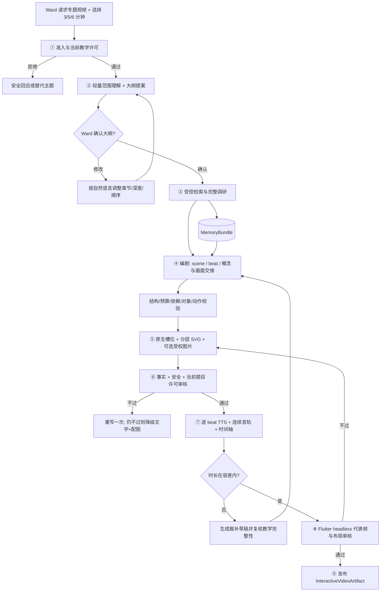

# 读学系统 — Tutoring 专题：知识讲解视频回答

> 状态：设计修订稿，**未实现**（§十二为 P0 / P2 分期与门禁） · 版本：v1.3
>
> 范围：Ward 在 Agent 对话中提出想系统了解某个知识主题；Tutoring 先与 Ward 协商大纲，再异步调研、编剧并制作最长 6 分钟的交互式讲解视频。Ward 可按时间、区间、画面或文字描述定位内容，继续追问或发起修订。
>
> 关联：[陪伴与答疑 PRD](../product/prd-companion.md) · [DDD Overview](ddd-overview.md) · [Companion 编排](domain-companion.md) · [Tutoring](domain-tutoring.md) · [Memory](domain-memory.md) · [AI Component](infra-ai-components.md) · [答疑表达设计](domain-tutoring-presentation.md) · [离线评测](eval-offline.md) · [部署](../deployment.md)
>
> 文档定位：这是 [domain-tutoring.md](domain-tutoring.md) 的专题补充，**不是另一个 Domain 或 Bounded Context**。Tutoring 的边界、教学红线和会话聚合以主文档为准；Thread/Run 和交互信封以 [domain-companion.md](domain-companion.md) 为准；物理表、留存与删除以 [design-server.md](design-server.md) 为准；AI 调用的 id / 版本 / 模型以 `app/infrastructure/ai/components.py` 为准。本文只细化专题视频回答、交互式播放协议、内容定位、修订和验收。

---

## 一、问题、目标与产品边界

Ward 会在学习或闲聊中提出「宇宙是怎么诞生的」「蜻蜓为什么飞得那么快」这类主题。普通文字答疑适合回答一个点；当 Ward 希望获得较完整、连贯且可反复观看的解释时，系统应把它制作成一条短而完整的知识讲解视频，并允许 Ward 围绕任意部分继续探索。

这里的“视频”是**产品体验**，不等同于 MP4 文件：P0 由 Flutter 播放结构化脚本、音频和矢量画面；P2 才按需导出标准 MP4。两者使用同一份已审核脚本和时间轴。

### 1.1 目标

1. Ward 请求全面了解一个主题后，AI **先提出短大纲并与 Ward 确认范围**，避免制作完成才发现方向不对。
2. Tutoring 异步制作一条深入浅出、适龄健康、最长 **6 分钟**的讲解片；原对话持续显示状态，完成后可回看。
3. P0 使用 **Flutter 脚本驱动播放器**：音频是主时钟，App 根据时间轴驱动原生布局、分层 SVG、文字和受控图片素材；不生成 MP4，不引入 Node / Chrome / WebView。
4. Ward 可用三类方式指定内容：
   - 播放时间点 `t_ms`；
   - 时间区间 `[start_ms, end_ms)`；
   - 自然语言内容描述，如「刚才那张蜻蜓翅膀图」「写着‘事件视界’的字」「讲引力的那一段」。
5. Ward 可以对任意部分提出修改意图。系统负责定位、生成差异预览、执行事实与安全门禁并发布新版本；产品不把修订能力限定为运营后台专属能力。
6. “深入浅出”使用该 Ward 的受权画像（年级、已掌握知识、持续兴趣）决定讲解深度、类比锚点和需要补充的前置概念。
7. P2 如有分享或归档需求，使用**同一 Flutter 渲染实现**离屏逐帧输出，再由 FFmpeg 编码 MP4；不维护第二套画面实现。

### 1.2 非目标

- 不做替代学校课程的系列视频大课；一次请求只制作一条最多 6 分钟的专题讲解。主题过大时通过大纲明确本条的范围，不自动扩展为系列课程。
- 不使用端到端文生视频模型作为知识讲解主链路。其事实、时长、定位和局部修订都难以可靠控制。
- 不做数字人、实拍主持人或真人配音。
- 不做无边界全网爬取；只允许受控检索和少量候选材料读取。
- 不在 Flutter 中用 WebView 运行模型生成的 HTML / JS；模型不得生成可执行代码。
- P0 不产生 MP4，也不承诺外部渠道分享；分享与标准媒体导出属于 P2。
- 不宣称提升学习效果。离线评测只做事实、安全、结构、音画一致性和交互可用性的冒烟验证。

---

## 二、核心技术决策

### 2.1 路线：结构化可执行脚本 + 确定性播放器

知识讲解视频需要可核对事实、可控时长、可定位和可局部修订。唯一可编辑源因此不是像素或 MP4，而是结构化语义脚本：

```text
VideoAnswerOutline      范围、章节、每章目标与预计时长；先由 Ward 确认
        ↓
ResearchDossier         可定位来源与断言级证据
        ↓
VideoAnswerScript       scene / beat、旁白、对象语义、动作、证据、画面交接
        ↓ TTS 实测
VideoAnswerTimeline     beat / scene 绝对时间、字幕、音频引用、代表帧索引
        ↓
InteractiveArtifact     P0：脚本 + 时间轴 + 连续音轨 + 受控素材
        ↓ 同源离屏渲染
MP4Artifact             P2：标准 MP4；不是第二份教学或画面事实源
```

P0 的播放效果不是由 SVG 自身动画产生。`flutter_svg` 只负责静态矢量绘制；Flutter 根据时间轴对分层 SVG 和原生 Widget 施加透明度、位移、缩放、裁切和高亮动画。

### 2.2 语义最小单元是 beat，连续性单元是 scene

```text
❌ 一张图 + 25 秒旁白             → 有配音的 PPT
✅ 一句旁白 = 一个 beat = 一个视觉变化

“黑洞的引力大到连光都跑不掉”  → reveal 光线箭头
“可以把它想成一个很深的漏斗”  → crossfade 网格与漏斗层
“漏斗最窄处叫事件视界”          → zoom + highlight 标签
“一旦越过，就再也回不来了”      → move 箭头穿过 + erase 回头路径
```

- **beat**：一句旁白、一个主要视觉动作、一个语义锚点和可选证据引用。
- **scene**：相邻 beats、教学目标、概念依赖、布局与画面对象状态的连续单元。
- TTS 按 beat 生成并实测时长；时间区间属于编译结果，不由模型填写。
- 音频播放位置是 P0 唯一主时钟。暂停、拖动和倍速后，画面都从当前 `t_ms` 重新计算，不用独立动画计时器追赶音频。

### 2.3 P0：Flutter 脚本驱动，而不是 MP4

```text
服务端                                        Ward App
──────────────────────────────────────        ─────────────────────────
已审核 Script + Timeline + AssetManifest ─┐
连续音轨 + 字幕                         ─┼──▶ 音频播放器提供 t_ms
分层 SVG / 受权图片素材                 ─┘          ↓
                                                   定位 scene / beat
                                                   ↓
                                             计算归一化进度 0..1
                                                   ↓
                                             Flutter 绘制当前画面
```

选择 P0 Flutter 路线的决定性原因是**Ward 可修改**：

- 修改脚本、旁白或某个 scene 后，只需重新审核受影响内容、合成受影响音频并发布新 bundle；不必等待整片逐帧渲染和上传。
- 暂停追问、对象选择、文字选择和章节跳转都发生在可寻址的原生画面中，比 MP4 覆盖层更自然。
- P0 只有 App 一个播放端，不存在 App 动画和导出视频两套实现漂移的问题。
- 当前 App 已有 `flutter_svg`、`audioplayers` 和 `VisualBlock`，可以复用安全 SVG 与主题适配经验。

#### 2.3.1 两层原语，而不是十套互相重复的动画模板

P0 不把动效分别写进每个模板。播放器分为两层共享原语：

| 层 | 关闭词汇表 | 责任 |
|---|---|---|
| 布局原语 | `stage`、`split`、`flow`、`scale`、`card` | 16:9 安全区、槽位、文本换行、窄屏适配、裁切和层级 |
| 动画原语 | `reveal`、`erase`、`highlight`、`move`、`zoom`、`count`、`crossfade` | 对原生对象或完整 SVG 图层执行确定性进度函数 |

模板只是“布局原语 + 允许的对象类型 + 允许的动作”的薄配置。P0 首批场景预设：

1. `title_card`：开场、章节标题；
2. `question_hook`：悬念问题与反直觉现象；
3. `focus_stage`：单一主体、局部放大和标注；
4. `compare_split`：左右对比和类比；
5. `process_flow`：过程、因果链、循环；
6. `scale_timeline`：数量级、时间线、标尺；
7. `recap_invite`：回顾与下一步探索邀请；
8. `diagram_svg`：前述版式无法表达时的受限矢量逃生舱。

首批预设不是八套动画实现；它们共享同一组布局和动画原语。新增图形通常只增加 SVG / 素材数据，不增加 App 代码；只有新增版式或动画语义才需要升级 renderer。

#### 2.3.2 `diagram_svg` 的真实边界

`flutter_svg` 不支持本设计所需的 SMIL / CSS 动画，也不能在渲染后可靠操作 SVG 内部 DOM。因此 P0 **不**把一个 SVG 内的 `<g>` 当作可运行时间层。

每个可独立动画的矢量层都是一张同尺寸、同 `viewBox` 的受限 SVG：

```json
{
  "layer_id": "wing_airflow",
  "kind": "svg",
  "meaning": "蜻蜓前后翅周围的气流箭头",
  "svg_ref": "asset:svg_17"
}
```

App 用 `Stack` 叠放图层，对整层执行 `Opacity`、`Transform`、`ClipRect/ClipPath` 或高亮蒙层。这样可稳定实现：

- 分层淡入 / 擦除；
- 镜头推拉和平移；
- 遮罩擦出；
- 箭头、标签和高亮框移动；
- 两层交叉淡化。

任意路径连续 morph、粒子物理和骨骼动画不属于通用 SVG 能力。确有必要时只能使用 renderer 内预定义、可测试的原生 preset；不能让模型输出任意动画代码。

#### 2.3.3 包体积、素材与设备要求

- 模板和原语是 Dart 代码，预计只有百 KB 量级；**包体积主要风险不是模板，而是字体和内置素材**。
- P0 不把专题插画和图片预装进 App。受权图片、模型生成插画和 SVG 经私有 OSS 按需下载、内容哈希校验和本地缓存。
- 中文优先使用系统字体；如必须固定字体，采用按需子集化下载，不把多个完整中文字重打进安装包。
- 同一时刻只允许少量图层变化，静止层置于 `RepaintBoundary`；默认 30fps，低性能设备可确定性降级为淡入、平移和静态切换，不减少教学内容。
- 脚本携带 `renderer_profile` 与 `min_renderer_version`。服务端按客户端能力生成或返回兼容 artifact；旧 renderer 不认识新动作时不得猜测执行，应降级到已审核静态代表帧 + 音频 / 字幕。
- P0 发布前必须在最低目标机型上验证一条完整 6 分钟样片的帧耗时、掉帧、峰值内存、耗电和热降频。最低目标机型尚待产品确认，是硬门禁而非实现期默认值。

### 2.4 同源离屏审核与 P2 导出

事实、安全和布局审核不能只看脚本文字。P0 增加一个 **Flutter Review Renderer**：

- 将 App 的播放器组件抽成可独立输入 bundle 与 `t_ms` 的渲染库；
- 通过 Flutter headless test / golden harness 在固定尺寸、字体和主题下离屏渲染代表帧；
- 每个 scene 至少捕获起始、关键动作中点和结束帧；结构检查再覆盖文字溢出、越界和空白画面；
- 抽帧送视觉 judge 审核，发布后保存帧引用供内容追问核对；
- 用固定 golden corpus 对比 headless 输出与真实 Android / iOS 截图，避免测试后端和真机字体、抗锯齿或布局漂移。

P2 复用同一播放器组件和发布 bundle，在固定帧率下推进 `t_ms`，把离屏帧送给 FFmpeg，与 P0 的连续音轨、字幕复用后编码 MP4。P2 不另写一套动画实现。

P2 开工前必须先用 6 分钟、10800 帧（30fps）样片实测墙上时间、峰值内存、磁盘 / 管道吞吐和与真机画面的视觉一致性；性能不过时先优化同源 Flutter 导出器，不在本文预先批准第二套渲染语义。

### 2.5 诚实的效果预期

| 档位 | P0 预期 |
|---|---|
| 配音 PPT | 应明显超过：每个 beat 都有视觉变化，支持镜头、遮罩和标注 |
| AI 自动生成的动态图解 / limited animation | **目标档位** |
| 高质量人工 motion design | 不承诺；美术一致性与素材质量仍是主要差距 |
| 3Blue1Brown / 任意连续形变 | 不承诺 |
| 实拍 / 数字人 / 文生视频质感 | 不做 |

吸引力优先来自旁白、叙事节奏、图与话同步和插画质量，不靠堆动画 API。P0 的验证重点是 Ward 是否愿意看完、能否准确定位追问、能否顺畅提出修改，而不是动作数量。

---

## 三、Tutoring 内的边界与统一语言

**不新增 Domain 或 Bounded Context。** 视频是 Tutoring 对知识主题的一种异步、可修订回答。Tutoring 继续拥有教学策略、当前题目推理成果保护、事实与安全审核、追问和修订；Companion 只拥有 Thread / Run 连续性与消息展示。

| 项 | 内容 |
|---|---|
| 写聚合 | `VideoAnswer`：一次 Ward 请求的异步回答，持有 Ward、原问题引用、请求时教学许可摘要、已确认大纲、当前已发布版本和修订草稿引用 |
| 制作材料 | `VideoAnswerOutline`、`ResearchDossier`、`VideoAnswerScript` 按版本保存；`VideoAnswerTimeline` 是编译索引 |
| 播放产物 | P0 `InteractiveVideoArtifact`；P2 可追加 `Mp4VideoArtifact`。二者都不是独立写聚合 |
| 上游 | Companion、Memory 的受权 `MemoryBundle`、可选 Study 查询、Tutoring 当前许可 |
| 下游 | Companion 的回答状态与交互投影；Memory 经 Outbox 接收已确认事实 |
| 明确不拥有 | Thread / Run、`StudySession`、计划、长期画像、客户端播放器状态 |

| 术语 | 本文含义 | 明确不是 |
|---|---|---|
| `VideoAnswer` | Tutoring 中一条可延迟交付、可版本化修订的回答 | 新 Companion Run、课程或兴趣探索任务 |
| `VideoAnswerOutline` | Ward 已确认的章节范围、教学目标和时长预算 | 最终事实稿或不可修改的课程目录 |
| `ResearchDossier` | 带实际来源版本和证据片段的事实集合 | 模型记忆、网页快照或来源标签 |
| `VideoAnswerScript` | 唯一可编辑的 scene / beat 教学与画面语义源 | 实测时间轴或播放器状态 |
| `VideoAnswerTimeline` | TTS 后产生的绝对时间、字幕、音频和代表帧索引 | 模型可编辑内容 |
| `InteractiveVideoArtifact` | P0 发布 bundle 的版本化引用 | MP4 或可执行代码 |
| `beat` | 一句旁白 + 一个主要视觉动作 + 一个语义锚点 | 一帧或一整章 |

核心不变量：

- **未经 Ward 确认的大纲不得进入完整制作。** 若完整调研迫使范围发生实质变化，必须回到大纲确认。
- 关键事实须有可定位证据；来源标签和模型自报 `confidence` 不构成证据。
- 请求、成稿、追问和修订沿用 Tutoring 对当前具体推理成果的保护。
- 已发布版本不可原地覆写；所有修订生成新 `script_version` 与 `artifact_version`。
- Ward 可以提出任意位置和类型的修订，但错误、无依据或不安全的主张不能绕过事实与安全门禁进入系统署名的视频。
- `VideoAnswer` 与 `TutoringSession` 是同 Context 的不同一致性边界，只以 ID 引用；后台制作不要求 `StudySession` 长时间开启。
- 制作步骤、重试次数和百分比是 Process Manager / Worker checkpoint，不是 `VideoAnswer` 聚合的领域状态。

### 3.1 聚合、用例与查询

#### 聚合状态

`VideoAnswer` 只保存有业务意义的状态：

```text
awaiting_outline → producing → ready
        ↘ rejected     ↘ failed
```

`ready` 状态下可以同时存在一个未发布修订草稿；当前已发布版本继续可看，不切换成“修订中”。`researching / scripting / synthesizing / reviewing` 等技术进度写入 `VideoAnswerProductionView`，不进入聚合状态机。

| 概念 / 类型 | 责任与不变量 |
|---|---|
| `VideoAnswer`（Aggregate Root） | 以 `ward_id + command_id` 幂等受理；保存提问消息、可选会话 ID、许可摘要、当前确认大纲和已发布版本；只允许经审核且对象存在的 artifact 发布 |
| `VideoAnswerOutline`（版本化材料） | 稳定 `chapter_id`、标题、每章回答的问题、范围排除、预计秒数；Ward 每次调整创建新版本 |
| `VideoAnswerSource`（Value Object） | 来源、发布者、时间、可定位 URL / 文档版本、证据片段及素材权利信息 |
| scene / beat / object 节点 | 稳定 ID；节点不是独立写聚合，不按 beat 建 Repository |
| `VideoAnswerArtifact`（Value Object） | 格式、脚本 / 时间轴版本、对象引用、内容哈希、renderer profile；发布后不可变 |

#### 命令与用例

| 触发 | Use Case | 领域行为与结果 |
|---|---|---|
| Ward 请求专题视频 | `RequestVideoAnswer` | 幂等创建 `awaiting_outline`，写 Outbox；只做准入和轻量范围理解 |
| AI 生成初版大纲 | `ProposeVideoAnswerOutline` | 保存候选 outline，原消息展示章节、时长和范围 |
| Ward 修改大纲 | `ReviseVideoAnswerOutline` | 接受自然语言增删、顺序、深浅和关注点，生成新候选版本 |
| Ward 确认大纲 | `ConfirmVideoAnswerOutline` | 固定当前 outline 版本，状态进入 `producing`，启动完整调研与制作 |
| 制作完成 | `PublishVideoAnswer` | 核对许可、审核结果、bundle 对象与版本后发布，状态进入 `ready` |
| 持续失败 | `FailVideoAnswer` | 有限重试后进入 `failed`；保留安全原因码并提供文字 + 配图降级回答 |
| Ward 追问 | `AnswerVideoFollowUp` | 先解析时间 / 区间 / 内容描述，再走现有 Tutoring 回合；不修改聚合 |
| Ward 要求修改 | `ProposeVideoAnswerRevision` | 解析目标，生成差异预览和影响集合；不覆盖当前版本 |
| Ward 确认差异 | `ConfirmVideoAnswerRevision` | 启动受影响内容制作与完整门禁；当前版本保持可用 |
| 修订通过 | `PublishVideoAnswerRevision` | 原子切换当前 artifact；旧版本按留存策略继续服务历史追问 |
| Ward 撤销 | `RestoreVideoAnswerVersion` | 把仍在留存期、仍通过当前许可检查的历史版本发布为新当前版本；不篡改历史 |

Worker 只能调用 Application Use Case，不能直接改 ORM 或聚合。聚合变更和 Outbox 同事务提交；Worker 以 `video_answer_id + stage + input_version` 幂等。

#### 查询

- `GetVideoAnswer`：返回大纲确认卡、领域状态、制作进度投影以及 `ready` 时的当前 artifact。
- `LocateVideoAnswerContent`：把自然语言内容说明解析为同一发布版本中的 chapter / scene / beat / object 候选。
- `GetVideoAnswerContext`：按已解析的规范目标读取受限语境，用于追问或修订。
- `GetVideoAnswerRevisionPreview`：返回改前 / 改后摘要、证据变化、影响 scenes、预计重新合成内容和验证状态。

历史消息只存 `video_answer_id`。打开时读取当前 View；已发出的追问和修订必须记录当时的 `artifact_version`，不能静默映射到新版同一秒。

---

## 四、制作管线



### 4.1 先确认大纲

初版大纲必须在 30 秒内可读完，至少包含：

```json
{
  "outline_version": 2,
  "duration_tier": "long",
  "target_seconds": 360,
  "scope": "从大爆炸后的早期宇宙讲到第一批恒星形成",
  "out_of_scope": ["宇宙最终命运", "复杂数学推导"],
  "chapters": [
    {"chapter_id": "c01", "title": "宇宙不是在空房间里爆炸", "question": "大爆炸到底是什么意思", "budget_seconds": 65},
    {"chapter_id": "c02", "title": "最初几分钟发生了什么", "question": "物质怎样出现", "budget_seconds": 90},
    {"chapter_id": "c03", "title": "黑暗之后亮起第一颗星", "question": "恒星怎样形成", "budget_seconds": 125},
    {"chapter_id": "c04", "title": "回到最开始的问题", "question": "今天我们能确定什么", "budget_seconds": 80}
  ]
}
```

- 大纲阶段只做轻量检索与范围判断，不为节省一次确认而提前完成全部制作。
- Ward 可以说「少讲恒星，多讲最初一秒」「不要数学」「加一段我们怎么知道的」。系统必须把自然语言修改落到新 outline 版本后再次展示。
- 章节预算之和必须等于目标时长预算；最终脚本可在章节间小幅调整，但不能越出已确认范围。
- 完整调研发现关键前提错误、证据不足或需要新增 / 删除章节时，回到 `awaiting_outline` 让 Ward 确认，不暗中改变主题。

### 4.2 调研与来源

P0 允许受控开放网络检索和少量候选页面读取。优先教材、学术机构、公共科普机构和原始研究材料。网页正文是低信任数据；限制域名、重定向、内容类型、大小和读取次数，网页中的指令不得进入工具调用或系统提示。

`ResearchDossier` 每条关键断言记录：

```text
claim + source_refs[] + evidence_spans[] + checked_at + uncertainty
```

模型记忆只能帮助提出检索词或编剧，不能充当证据。来源冲突要明确处理，不能用模型自报置信度裁决。

图片 / 插画素材额外记录：

```text
asset_id + origin + creator/publisher + usage_basis + source_version
+ content_hash + safety_review + alt + object_meanings[]
```

不得直接把网页图片抓进成片。允许的来源只有：项目自有素材、明确许可素材、按供应商条款生成的插画，或版权 / 使用依据经确认的公共材料。素材从私有 OSS 经受权引用，不允许脚本携带任意外链 URL。

### 4.3 编剧骨架

```text
hook（反直觉问题 / 现象）
  → conflict（纠正常见误解）
  → reveal × 3–5（由已知到未知分层揭示）
  → anchor（贴合 Ward 的类比）
  → callback（回扣开头）
  → invite（可做的小实验或下一问）
```

骨架是默认教学结构，不要求每个章节重复一遍。整片缺失关键功能时结构校验不通过；具体句式不写死。

### 4.4 时长预算：最多 6 分钟

| 档位 | `target_seconds` | 中文旁白预算（约 250 字 / 分钟） | scene 数 | beat 数（约） |
|---|---:|---:|---:|---:|
| `short` | 180 | 750 | 8–10 | 30 |
| `medium` | 300 | 1250 | 12–15 | 50 |
| `long` | 360 | 1500 | 15–18 | 60 |

- 不提供超过 6 分钟的选项。
- 每 beat 旁白通常 15–40 字、约 4–10 秒；超出先拆 beat，不靠加速朗读掩盖。
- 每 scene 通常 15–30 秒；scene 内可以有多个视觉变化，不能把“每 scene 一张图”误当节奏要求。
- 允许偏差为 `min(target_seconds × 10%, 20 秒)`；逐 beat TTS 后用实测总时长判断。
- 超出容差时生成裁补候选，再复核大纲覆盖、概念依赖、证据、回指和适龄性；不得机械删除一个 reveal 或强行调快语速。

### 4.5 个性化

受权 `MemoryBundle` 只用于：

1. 决定解释深度和停止层级；
2. 选择 Ward 熟悉且不误导的类比；
3. 判断哪些前置概念需要补；
4. 调整词汇、句长和画面信息密度。

它不用于推断敏感属性，也不能把单次兴趣写成稳定偏好。调用方必须传 actor、Ward、use case、可见范围与预算；ACL、脱敏和最小化由 Memory 负责。

---

## 五、协议：脚本、时间轴与 P0 Artifact

### 5.1 `VideoAnswerScript.v1`：唯一可编辑源

```json
{
  "schema_version": "VideoAnswerScript.v1",
  "video_answer_id": "va_42",
  "outline_version": 2,
  "script_version": 3,
  "dossier_version": 2,
  "duration_tier": "medium",
  "target_seconds": 300,
  "renderer_profile": "explainer.v1",
  "scenes": [
    {
      "scene_id": "s02",
      "chapter_id": "c01",
      "role": "reveal",
      "teaches": ["cloud_condensation"],
      "requires": [],
      "layout": "process_flow",
      "slots": {"title": "云怎样形成"},
      "visual_start": {
        "objects": [
          {"id": "vapor_1", "kind": "svg_layer", "asset_ref": "asset:svg_vapor", "meaning": "上升的水蒸气示意"}
        ]
      },
      "beats": [
        {
          "beat_id": "b06",
          "narration": "水蒸气上升遇冷，凝结成许多细小水滴。",
          "claim_refs": ["c17"],
          "anchor": {"concept": "凝结", "question_targets": ["云是水蒸气吗"]},
          "action": {
            "op": "crossfade",
            "from": "vapor_1",
            "to": {"id": "cloud_1", "kind": "svg_layer", "asset_ref": "asset:svg_cloud", "meaning": "由细小水滴组成的云"}
          }
        }
      ],
      "handoff": {"carry_object_ids": ["cloud_1"]}
    }
  ]
}
```

| 字段 | 约束与用途 |
|---|---|
| `scene_id` / `beat_id` / `object.id` | 在同一 VideoAnswer 各版本间尽量稳定，删除后不复用；修订和追问引用 ID，不依赖可变秒数 |
| `outline_version` | 固定本稿实现的 Ward 已确认大纲；脚本不得越出范围 |
| `dossier_version` / `claim_refs` | 每条事实断言能解析到实际来源与证据片段 |
| `teaches` / `requires` | 受控概念 ID，用于叙事校验和修订影响分析，不宣称 Ward 已掌握 |
| `visual_start` / `handoff` | 画面对象初态和跨 scene 交接；对象有机器 ID 和面向 Agent 的 `meaning` |
| `action` | 关闭词汇表；引用对象必须存在；模型不能输出 Dart、JS、CSS 动画或任意 shader |
| `anchor` | 内容定位与追问提示，不单独作为事实依据 |

### 5.2 SVG 与素材协议

`AssetManifest` 把 SVG、图片、字体子集和音频都变成内容寻址对象。脚本只引用 `asset_ref`，不内联 OSS URL。

```json
{
  "asset_id": "svg_cloud",
  "kind": "svg",
  "sha256": "...",
  "width": 1280,
  "height": 720,
  "meaning": "由细小水滴组成的云层",
  "visible_texts": [],
  "object_ids": ["cloud_1"],
  "storage_ref": "tutoring/video-answers/.../svg_cloud.svg"
}
```

- 新增 16:9 `video_1280x720` presentation profile，复用 `tutor_visual.py` 的 XML 安全解析、标签白名单、属性黑名单、文本提取和主题色规范化思想。
- 每个可独立动画层是一张完整 SVG，不依赖对内部 `<g>` 的运行时选择。
- 同一 scene 的所有图层共享 viewBox、坐标系和安全区。
- 总图层数、节点数、文字数和解码后图片尺寸设预算；超出时拒绝，不把超大素材交给 App 碰运气。
- 图片必须带 `alt`、对象语义、内容哈希、权利依据与安全审核；禁止任意外链。

### 5.3 `VideoAnswerTimeline.v1`：只读编译索引

模型不得填写时间或存储路径。编译顺序固定：结构与事实审核 → 逐 beat TTS → 实测时长 → 绝对时间轴 → 连续音轨 / 字幕 → Flutter 代表帧 → 发布。

```json
{
  "schema_version": "VideoAnswerTimeline.v1",
  "video_answer_id": "va_42",
  "script_version": 3,
  "timeline_version": 4,
  "duration_ms": 304800,
  "audio_track_ref": "asset:audio_main",
  "scenes": [
    {
      "scene_id": "s02",
      "start_ms": 52000,
      "end_ms": 80000,
      "beats": [
        {
          "beat_id": "b05",
          "start_ms": 52000,
          "end_ms": 64000,
          "audio_segment_ref": "asset:audio_b05"
        },
        {
          "beat_id": "b06",
          "start_ms": 64000,
          "end_ms": 72000,
          "audio_segment_ref": "asset:audio_b06",
          "review_frame_refs": ["asset:frame_b06_mid"]
        },
        {
          "beat_id": "b07",
          "start_ms": 72000,
          "end_ms": 80000,
          "audio_segment_ref": "asset:audio_b07"
        }
      ]
    }
  ]
}
```

发布 manifest 必须用毫秒半开区间 `[start_ms, end_ms)` 无空洞、无重叠地覆盖有效时长。连续音轨由 beat 音频按时间轴重新混音 / 封装，避免逐片播放产生接缝；字幕和时间轴再与最终音轨核对。

### 5.4 `InteractiveVideoArtifact.v1`

```json
{
  "format": "InteractiveVideoArtifact.v1",
  "artifact_version": 4,
  "script_version": 3,
  "timeline_version": 4,
  "renderer_profile": "explainer.v1",
  "min_renderer_version": 1,
  "script_ref": "...",
  "timeline_ref": "...",
  "asset_manifest_ref": "...",
  "audio_track_ref": "...",
  "subtitle_ref": "...",
  "fallback_frame_refs": ["..."],
  "content_hash": "sha256:..."
}
```

`GetVideoAnswer` 验证 Ward 归属后返回短期有效的私有对象访问能力；App 不持有长期公开 URL，也不经 FastAPI 中转大文件。bundle 下载必须支持断点、内容哈希校验和本地 LRU 清理。

### 5.5 场景连续性与缓存

1. `requires` 必须由前序 `teaches` 或 Ward 已确认前置知识满足；跨 scene 指代由独立语义复核，不靠关键词或正则。
2. 画面 reducer 从 `visual_start` 顺序执行动作得到末态；下一 scene 只能继承明确列出的对象，或显式重置。
3. 缓存键包含规范化 scene 输入、beat 音频内容、素材哈希、字体 / renderer 版本和主题 profile。
4. 修订导致旁白时长变化时，后续绝对时间全部重算；未变 scene 的素材和音频片段可以复用。
5. P0 不需要重渲视频，但必须重新生成受影响代表帧、重新混合连续音轨并重新审核 bundle。

---

## 六、播放与 App 运行时

### 6.1 播放状态

```text
load artifact → 校验版本 / 哈希 → 预取首章资源 → ready
play audio → position stream(t_ms) → scene / beat → action progress → paint
seek / speed change → audio player 更新 → 画面从新 t_ms 纯函数重算
pause → 保留 artifact_version + t_ms + 当前可见 object ids
```

- 不使用独立动画控制器作为业务时钟。
- 画面 reducer 必须是 `script + timeline + t_ms → visual state` 的纯函数；App 重建、旋转或切后台回来后可恢复。
- 每个 scene 外层 `RepaintBoundary`，静止底图与变化层分离；只重绘变化对象。
- 图片先展示低分辨率占位或代表帧，再替换完整资源，不能阻塞音频开始。
- 资源不可用时降级到该 scene 的代表帧 + 字幕 + 音频；不得白屏或跳过旁白。

### 6.2 可访问性与交互

- 字幕默认可开关；播放速度、暂停、前后 10 秒、章节跳转和进度拖动可用。
- 每个可见对象暴露 `Semantics` 标签和稳定 object id。Ward 点击对象后提问或修订时，客户端可提交受信任范围内的 `selected_object_id`，服务端仍验证它属于该 artifact。
- 系统文字缩放过大时优先改成滚动字幕 / 静态布局，不缩到不可读。
- P0 不承诺锁屏画面；如支持后台音频，画面回前台后按音频位置恢复。

### 6.3 Renderer 版本兼容

App 请求中上报关闭词汇表式 capabilities，例如：

```json
{
  "renderer_profile": "explainer.v1",
  "renderer_version": 1,
  "actions": ["reveal", "erase", "highlight", "move", "zoom", "count", "crossfade"],
  "asset_kinds": ["svg", "image", "text"]
}
```

服务端不得依据任意客户端字符串放宽安全校验，只用它选择兼容发布物。若当前版本无法执行：

1. 优先返回同脚本的兼容 artifact；
2. 没有兼容版时用代表帧 + 音频 + 字幕播放；
3. 不把未知动作静默当作已支持动作。

---

## 七、内容定位、追问与 Ward 修订

### 7.1 三类定位统一成规范目标

外部请求可提供以下 selector 之一或组合：

```json
{
  "video_answer_id": "va_42",
  "artifact_version": 4,
  "selector": {
    "t_ms": 47000,
    "start_ms": null,
    "end_ms": null,
    "description": "写着事件视界的那张漏斗图",
    "selected_object_id": null
  },
  "question_or_change": "这里能换一个更容易懂的比喻吗",
  "command_id": "cmd_..."
}
```

解析优先级不是“相信客户端”：

1. 校验 Ward 归属、artifact 版本和时间边界；
2. `selected_object_id` 只能作为候选，必须存在于该发布版本；
3. 时间点 / 区间映射到对应 beats；
4. `description` 交由语义定位器在**封闭候选集**中选择；
5. 多种 selector 同时存在时取交集或用播放位置作邻近先验；冲突时向 Ward 澄清。

### 7.2 语义内容索引

发布时为每个 artifact 建立受限索引：

```text
chapter: title / question
scene: role / title / teaches / narration summary
beat: narration / anchor / question_targets
object: id / meaning / visible_text / alt / first_visible_ms / last_visible_ms
```

`LocateVideoAnswerContent` 接受 Ward 原话、可选当前播放位置和上述候选摘要，由模型返回**已存在的 ID 列表**，不能生成新 ID 或把自由文本当作匹配结果。开放语义匹配不得用关键词表、数字检测或正则替代。

- 「刚才那张图」使用当前 / 最近播放位置作为强先验；
- 「写着‘事件视界’的字」可同时命中可见文字和所在对象；
- 「蜻蜓翅膀怎么扭的那段」可命中对象 meaning、旁白和语义锚点；
- 两处以上同样合理时展示简短候选让 Ward 选，不用模型自报置信度强猜。

内容定位结果是：

```json
{
  "artifact_version": 4,
  "chapter_id": "c02",
  "scene_id": "s07",
  "beat_ids": ["b21"],
  "object_ids": ["event_horizon_label"],
  "start_ms": 46000,
  "end_ms": 53000,
  "resolution": "resolved"
}
```

### 7.3 暂停追问

`GetVideoAnswerContext` 只返回目标 beats、必要相邻语境、当前对象状态、可见文字、代表帧和证据片段，不把整份 dossier 或未审核草稿注入问答。

追问继续走 Tutoring 当前许可和出口检查。若原 Run 已关闭，在同一 Thread 恢复 / 新建合法 Tutoring Run；视频 ID 不能绕过当前 `TutoringSession` 依附 StudySession 的既有约束，实施前须补不强制依附已结束 StudySession 的问答路径。

### 7.4 Ward 修订：产品不限制发起者，系统守住发布门禁

Ward 可直接说：

- 「把这段讲浅一点」；
- 「把足球的比喻换成积木」；
- 「这里太快，拆成两步」；
- 「这张图里的字太多」；
- 「你这里说错了，蜻蜓不是这样飞的」；
- 「删掉最后一段，前面多讲一点」。

系统不要求 Ward 理解 scene / beat / operation，也不把修订入口限为内部运营工具。Application 先把自然语言意图解析成受控 Patch，再展示差异与影响范围：

```text
目标：s07 / b21 / wing_airflow
变化：替换旁白 + 替换两张 SVG 层 + 本章增加 8 秒
传播：后续 b22 的“这种运动”回指须复核；总时长需裁减 8 秒
证据：c31 保留，新增 c32
```

修订分流：

| 类型 | 例子 | 门禁 |
|---|---|---|
| 本地播放偏好 | 倍速、字幕、音量 | 即时生效，不产生视频版本 |
| 表达与可读性 | 讲浅 / 讲深、换类比、拆慢、改配色、减文字 | 结构、适龄、安全、概念依赖、视觉审核 |
| 事实纠错 | 「这里不对，应该是……」 | 必须重新检索并通过证据 / 事实审核；Ward 的说法是候选，不自动成为事实 |
| 范围变化 | 新增 / 删除章节、改变主题重心 | 回到大纲修订和确认，再制作受影响范围 |
| 深入探索 | 对某一点追加解释但不替换原片 | 默认先作为追问；Ward 明确要并入视频时才转修订 |

默认流程是“定位 → 差异预览 → Ward 确认 → 制作 / 审核 → 发布新版本”。失败时当前版本保持可用。旧版本和其时间轴在留存期继续服务历史追问；撤销也是发布一个新当前版本，不篡改历史。

### 7.5 影响分析

Patch 接受 `{video_answer_id, base_script_version, selector/resolved_target, intent, proposed_change, reason}`。应用层拒绝过期基准版本和不存在对象，并按以下关系求影响集合：

- `requires / teaches` 概念依赖；
- 旁白中的跨 beat / scene 回指；
- `visual_start / handoff` 画面对象继承；
- 章节与总时长预算；
- callback、类比与开头问题的呼应；
- 证据引用和素材权利变化。

不能因为 P0 无需重渲 MP4，就只替换一个 JSON 字段后直接发布。新 bundle 仍须重新生成连续音轨、字幕、后续绝对时间、代表帧和内容索引，并通过完整发布校验。

---

## 八、内容健康与发布门禁

遵守 AGENTS.md 铁律：开放语义不靠关键词列表、数字检测或正则裁决。确定性校验只用于协议、ID、时间、XML 安全、预算和对象引用。

### 8.1 请求准入

`tutoring.video-admission@v1` 判断适龄、安全、可讲性和当前具体题目的推理成果边界。不通过时给符合语境的解释或替代方向，不进入大纲制作。

请求时保存当前 `TutorPermit` 摘要；发布和每次修订发布前重新取得当前许可，不能凭旧快照放行。

### 8.2 事实门

- 关键断言无实际来源版本和证据片段不得进入成稿。
- 不确定内容按证据程度表达，不能统一改写成“目前没有定论”。
- 核心论证无可靠依据时停止视频制作，但应尽可能返回经审核的文字 + 配图解释，而不是让 Ward 只得到失败状态。
- Ward 提出的纠错不能直接写入成稿；先作为检索假设验证。

### 8.3 成稿与画面出口

审核对象包括：

- 全文旁白和字幕；
- 模板槽位、所有 SVG 可见文字、图片 alt 和对象 meaning；
- 语义动作与对应证据；
- Flutter headless 代表帧；
- 时间轴、字幕和音频一致性。

`tutoring.video-fact-judge` 与 `tutoring.video-safety-judge` 并行；后者是 protected。超时、异常或结果非法一律不通过。允许定向重写一次；仍不过则不发布该视频版本，并降级到经审核的文字 + 静态配图回答。

布局与协议门是确定性的：

- 文字不得越安全区或小于最低字号；
- 代表帧不得空白、对象缺失或遮住关键文字；
- scene / beat 时间轴无空洞、无重叠；
- 所有 asset 哈希、尺寸、格式和引用存在；
- renderer golden corpus 通过；
- 未知动作 / 布局 / 素材类型 fail-closed。

---

## 九、Infrastructure Design Card

### 9.1 AI Components

| Component | 类别 | 风险 | 责任 |
|---|---|---:|---|
| `tutoring.video-admission@v1` | judge | protected | 请求适龄、可讲性和当前推理成果边界 |
| `tutoring.video-outline@v1` | generator | standard | 初版大纲及 Ward 自然语言大纲修订 |
| `tutoring.video-research@v1` | extractor | standard | 从已获取材料构建可追溯 dossier |
| `tutoring.video-script@v1` | generator | standard | 按确认大纲生成 scene / beat、对象与动作 |
| `tutoring.video-visual@v1` | generator | standard | 原生槽位、分层受限 SVG 和素材需求 |
| `tutoring.video-locator@v1` | extractor | standard | 在封闭内容索引中解析 Ward 的内容描述 |
| `tutoring.video-revision@v1` | generator | standard | 自然语言修订转受控 Patch 和影响解释 |
| `tutoring.video-fact-judge@v1` | judge | standard | 成稿 / 修订与证据一致性 |
| `tutoring.video-safety-judge@v1` | judge | protected | 成稿、画面和推理成果保护 |

`companion.intent` 不增加新 Context 标签。Ward 点选“制作视频 / 修改视频”时提交服务端校验动作；自然语言意图由 Tutoring 在本场景内澄清。所有组件通过注册表调用，提示词升版同步组件版本和摘要锁。

### 9.2 TTS 与音频

当前 `aliyun_tts.py` 的英文音色和 `MAX_TTS_CHARS=300` 只服务发音点读。视频需要：

- 新增适龄中文音色；
- 每 beat 独立合成，缓存键由文本、音色、语速和引擎版本决定，不含 Ward；
- 按时间轴把片段混合 / 封装为一条连续音轨，消除逐片播放接缝；
- 保留 beat 片段用于局部修订复用；
- 倍速由播放器完成，不为每个倍速重复生成音频。

### 9.3 P0 服务与队列

```text
docker compose:
  api · worker · beat
  [新] explainer-review-renderer（Flutter headless / golden，无 Node / Chrome）

Celery:
  [新] explainer-production   调研、编剧、TTS、bundle
  [新] explainer-review       代表帧与 golden 审核
```

长任务与会话帧分析队列隔离。Review Renderer 只接受已经过 schema、SVG 和素材校验的受控 bundle，不接受任意 Dart 代码、命令或下载 URL。

P0 没有全片逐帧服务端渲染，但离屏代表帧仍会消耗 CPU / 内存，因此也必须限并发，不能与帧分析任务共用 worker pool。

### 9.4 进度投影

领域状态只见 §3.1。面向 App 的技术进度是独立投影：

```text
checking_request → preparing_outline → waiting_for_confirmation
→ researching → writing → making_visuals → voicing → reviewing → completed
```

进度投影可以重建、可以最终一致，不作为聚合不变量。App 在原 Companion 消息展示大纲卡、确认动作和制作状态。后台完成通知如有需要，另设计服务端推送；不能复用 `start_cue` 的本地定时通知冒充服务端完成通知。

### 9.5 存储与留存

| 产物 | 位置 | 留存 |
|---|---|---|
| outline / dossier / script / timeline / 内容索引 | PostgreSQL JSONB 或版本化受控对象存储；物理映射归 design-server.md | 与对应发布版本一致 |
| 连续音轨、beat 音频、字幕 | 私有 OSS 视频回答前缀 | 已发布版本引用对象随版本留存 |
| SVG、受权图片、字体子集 | 私有 OSS，内容哈希寻址 | 引用计数 + 独立缓存清理 |
| 代表帧 / fallback 帧 | 私有 OSS | 随 artifact 版本留存 |
| P2 MP4 | 私有 OSS 独立子前缀 | 仅 P2，策略与来源 artifact 绑定 |

必须使用独立 prefix / 生命周期规则，不能复用抓拍帧 90 天自动擦除规则。删除边界并入 Guardian 清除历史和账号注销物理擦除。旧版本留存时长与历史追问可回溯时间一起确定，不能写“永久保留”。

### 9.6 物理表

建议以 `tutoring_video_answers` 保存聚合根与当前版本引用；outline / dossier / script / artifact 用版本表或受控 JSONB；生产 checkpoint 与 Query projection 分开。表数不由领域名词数量决定，最终物理模型归 [design-server.md](design-server.md)。

### 9.7 App

P0 复用现有 `flutter_svg` 和 `audioplayers`，新增：

- `InteractiveVideoPlayer`；
- 纯函数时间轴 reducer；
- 布局 / 动画原语和首批场景 preset；
- bundle 下载、哈希校验、LRU 缓存和兼容降级；
- 字幕、章节、拖动、倍速、对象选择；
- 时间 / 区间 / 内容描述追问；
- 修订差异预览、确认、版本历史与撤销；
- 性能 telemetry（不采集儿童原文）。

播放器不是把 `VisualBlock` 连播六分钟即可；现有 `VisualBlock` 的 SVG 安全、主题色和无障碍经验可复用，但视频 renderer 应是独立组件和协议。

### 9.8 学习事实

经 Outbox 发 `LearningFactRecorded.v1`，禁止直接写 Memory：

| `event_type` | 时机 |
|---|---|
| `tutoring.video_requested` | 请求受理且准入通过；不据此认定稳定兴趣 |
| `tutoring.video_watched` | 客户端播放事件去重后记录观看进度；不把一次观看认定为掌握 |
| `tutoring.video_followed_up` | 追问经 Tutoring 验证并提交，与普通好奇心事实去重 |
| `tutoring.video_revised` | Ward 确认并成功发布修订；记录其主动调节理解方式的事实，不记录完整原文 |

渲染 / 合成成功不是学习事实。Memory 自行决定是否形成兴趣或学习策略 Signal。

---

## 十、成本、时延与容量

### 10.1 P0 成本构成

P0 不支付整片服务端逐帧渲染成本。单条成本来自：

- 大纲、调研、编剧、定位 / 修订和双 judge 的模型调用；
- 中文 TTS；
- 可选插画生成或授权素材；
- Flutter 代表帧审核；
- OSS 存储和下行流量。

在真实样片前不承诺“每条低于某固定金额”。必须分别记录 3 / 5 / 6 分钟档、纯 SVG 与含图片两类成本，避免用不含素材、重试和审核的估算误导容量设计。

### 10.2 时延

用户等待分两段：

1. **大纲等待**：目标是秒级到几十秒，尽快进入 Ward 可控制的确认点；
2. **确认后制作**：分钟级异步任务，端到端目标由真实样片测定。

修订时延与影响范围有关：本地播放偏好即时；表达 / 事实修订要重新 TTS、审核和发布，不能承诺下一帧生效。App 应继续播放旧版本并显示修订进度。

### 10.3 配额与并发

P0 上线前必须定义：

- 每 Ward 每日制作与修订配额；
- 同一 Ward 同时进行中的制作数；
- 全局生产 / review 队列并发和最大排队时间；
- 6 分钟 bundle 的流量和缓存上限；
- 模型 / TTS / 素材失败时的最大重试与预算。

个性化脚本不能假定跨 Ward 全量复用；音频、通用素材和基础 scene 可按内容哈希复用，但不能为了缓存命中泄露另一个 Ward 的画像或私有内容。

---

## 十一、观测与评测

### 11.1 观测

每段记录 `trace_id`、`request_id`、`component_id@version`、模型、延迟、token、结果类别和重试。不得记录 API Key、完整上下文、思维链、儿童原文或未脱敏素材 URL。

P0 额外记录：

- 大纲确认前修改次数、确认耗时；
- bundle 大小、资源命中率和首帧时间；
- 真机帧耗时、掉帧、峰值内存、音画位置差；
- renderer / artifact 版本不兼容与降级次数；
- 语义定位一次命中、澄清和错误定位率；
- 修订类型、影响 scene 数、成功 / 驳回原因和时延；
- headless 与真机 golden 差异。

### 11.2 离线评测

| 维度 | 判分 |
|---|---|
| 准确性与深度 | 与 dossier 对照的 judge，需校准集 |
| 大纲覆盖与范围遵守 | 结构检查 + judge |
| 逻辑流和适龄性 | judge；安全为硬门槛 |
| 视觉相关性与一致性 | 代表帧 + 旁白 + 对象语义 judge |
| 布局与可读性 | 确定性溢出 / 字号 / 空白检查 + 真机 golden |
| 时长偏差 | 确定性 |
| 音画同步 | 时间轴与音轨确定性检查 + 样片人工抽检 |
| 内容描述定位 | 标注 query → canonical IDs 的 top-1 / 澄清正确率 |
| 修订传播 | 预置依赖变更 → 影响集合覆盖率 |
| 低端机播放 | 完整 6 分钟真机性能测试 |

离线评测只做冒烟，不宣称学习效果。模型 judge 上线前按 [eval-offline.md](eval-offline.md) 建校准集；候选必须是评测进程内具名 variant，不绕过组件注册表直连供应商。

---

## 十二、分期与硬门禁

本功能只定义 **P0** 与 **P2**。P0 先交付可播放、可定位、可追问、可修订的 App 内交互视频；P2 在存在真实分享 / 标准媒体需求后导出 MP4。

### 12.1 P0-spike：先验证最难的垂直切片

制作一条真实 6 分钟样片，至少包含：

- 5 个以上 scene；
- 原生文本 / 形状、三张以上分层 SVG、一张受权位图；
- reveal、move、zoom、highlight、crossfade、遮罩擦出；
- 连续音轨、字幕、拖动和倍速；
- 一次按 `t_ms` 追问；
- 一次按「写着某字的图」语义定位；
- 一次 Ward 修改旁白 / 类比并发布新版本；
- headless 代表帧与 Android / iOS 真机 golden 对比。

在最低目标 Android 机型和最低目标 iPhone 上测：首帧、平均 / P95 帧耗时、掉帧、峰值内存、6 分钟耗电、温升 / 热降频、音画偏差和切后台恢复。最低机型未确认或门禁未通过，不进入 P0 正式实现。

### 12.2 P0 正式范围

1. 请求准入与 3 / 5 / 6 分钟选择；
2. 大纲生成、自然语言修改和 Ward 确认；
3. 受控检索、证据 dossier、脚本、分层 SVG / 受权素材；
4. 三道内容门禁与 Flutter headless 代表帧审核；
5. Flutter 播放器、兼容能力、资源缓存和静态降级；
6. 时间点、时间区间、自然语言内容说明和对象选择四种定位入口；
7. 追问、Ward 修订、差异预览、版本发布、历史与撤销；
8. 中文 TTS、连续音轨、字幕；
9. 独立队列、配额、观测、删除与评测数据集。

### 12.3 P0 硬门禁

| 门禁 | 通过条件 | 不过时 |
|---|---|---|
| 教学体验 | 样片达到可接受的连贯性、图话同步与信息密度 | 优先改脚本、素材和节奏，不盲目加动画 |
| 设备性能 | 完整 6 分钟在最低目标机型无不可接受卡顿、发热和崩溃 | 降低同时动画层数 / fps；仍不过则重新评估客户端渲染路线 |
| 同源审核 | headless 代表帧与真机在可接受差异内，溢出 / 缺字可被发现 | 不发布；先解决字体、布局和测试后端一致性 |
| 内容定位 | 时间和语义测试集达到校准阈值，歧义能正确澄清 | 只开放时间 / 区间和对象点击，不开放自由描述直达 |
| 修订安全 | 事实纠错不能绕过证据门，失败保持旧版本 | 不开放自动发布，只保留预览和人工确认 |
| 成本容量 | 6 分钟样片成本、队列与流量在预算内 | 收紧配额或素材策略，不降低事实 / 安全门禁 |

### 12.4 P2：同源 MP4 导出

P2 的触发条件是已验证的外部分享、归档、投屏兼容或离线标准媒体需求，不因“视频通常是 MP4”而提前建设。

实现原则：

1. 读取某个已发布 `InteractiveVideoArtifact`；
2. 使用同一 Flutter renderer 在固定主题、尺寸、帧率下推进 `t_ms`；
3. 帧通过管道交给 FFmpeg 编码 H.264 / AAC，不把 10800 张临时图片长期落盘；
4. 复用 P0 连续音轨和字幕，重新核对最终媒体时间戳；
5. MP4 引用绑定来源 artifact 版本与 renderer 版本；
6. 抽帧与 P0 headless / 真机 golden 对比；
7. Ward 修订后按需重新导出，不把 MP4 当可编辑源。

P2 开工硬门禁：6 分钟 720p / 30fps 导出的墙上时间、峰值 RAM、失败恢复、并发隔离和视觉一致性均经实测。若同源 Flutter 导出性能不可接受，先形成新 ADR 再评估其他导出器；不得在本专题内静默引入第二套画面语义。

---

## 十三、待确认事项

1. 最低目标 Android / iOS 机型、系统版本与可接受性能阈值。
2. P0 首批允许的图片 / 插画来源、供应商条款和权利留存字段。
3. 中文音色、语速范围和 6 分钟连续收听的主观评测。
4. 每 Ward 每日制作 / 修订配额及最大排队时间。
5. 旧 artifact、旧音频与旧素材的留存时长；必须与历史追问和撤销能力一致。
6. Guardian 是否可以建议大纲或修订；P0 发起与最终确认仍默认只属于 Ward。
7. 语义定位和 judge 校准集阈值。
8. P2 的真实产品触发条件；在条件出现前不建设全片导出服务。

---

## 十四、验收条件

```text
Given Ward 问“宇宙是怎么诞生的”并请求 6 分钟视频
When RequestVideoAnswer 受理
Then 原对话返回 video_answer_id 与 awaiting_outline
And 重复 command_id 返回同一 video_answer_id，不重复创建

Given AI 提出包含范围、排除项、章节和时长预算的大纲
When Ward 说“少讲恒星，多讲最初一秒”
Then 生成新 outline_version 并重新展示修改结果
And 在 Ward 明确确认前不进入完整调研和制作

Given Ward 确认大纲
When 完整调研发现核心章节缺乏可靠证据且必须改变范围
Then 回到大纲确认而不是暗中删改章节

Given 发布 P0 artifact
Then format 为 InteractiveVideoArtifact.v1，不要求 MP4
And 总时长不超过 360 秒且在目标容差内
And 音频位置是唯一播放时钟，拖动或倍速后画面按同一 t_ms 重算
And scene / beat 时间轴无空洞、无重叠
And 每个事实断言可定位到 dossier 证据

Given diagram_svg 含多个需要独立动画的图层
Then 每层是独立、同 viewBox 的受限 SVG asset
And App 通过 Flutter Stack 与动画原语驱动整层
And 不依赖 SVG 内 SMIL、CSS 动画或 DOM 操作

Given artifact 使用客户端不支持的 renderer action
When App 获取视频回答
Then 返回兼容 artifact 或代表帧 + 音频 + 字幕降级
And 不静默猜测未知动作

Given Ward 在第 47 秒暂停问“这条光线为什么弯了”
When 提交 artifact_version、t_ms、问题和 command_id
Then 服务端定位当前及必要相邻 beat、对象、旁白、代表帧与证据
And 在合法 Tutoring 回合中回答并保留播放位置

Given Ward 未暂停而说“写着事件视界的漏斗图为什么这样画”
When LocateVideoAnswerContent 在封闭索引中解析
Then 只能返回该 artifact 已存在的 chapter / scene / beat / object IDs
And 若两处同样合理则请求 Ward 澄清，不虚构 ID 或强猜

Given Ward 点击蜻蜓翅膀对象后说“把这里讲慢一点，图也简单些”
When ProposeVideoAnswerRevision 执行
Then 系统展示受控 Patch、时长影响和传播范围
And Ward 确认后生成新 script / timeline / artifact 版本
And 当前已发布版本在新版全部通过前继续可用

Given Ward 说“这里事实错了，应该是 X”
When 系统处理纠错
Then X 只作为检索假设，不直接成为成稿事实
And 只有通过证据与事实审核后才可发布新版本

Given 修改某 beat 导致后续回指、对象继承或章节时长变化
When 计算影响集合
Then 所有依赖 scene 都进入复核
And 连续音轨、字幕、后续绝对时间、代表帧与内容索引重新生成

Given 事实或安全 judge 超时、异常或非法
When 发布门禁执行
Then 视为不通过
And 当前已发布版本保持不变
And 首次制作失败时向 Ward 提供经审核的文字 + 静态配图降级回答

Given Flutter headless 代表帧与最低目标真机 golden 存在不可接受差异
When P0 发布门禁执行
Then artifact 不发布
And 不以脚本文字检查替代真实画面审核

Given 讲解 bundle 上线 90 天后
When OSS 抓拍帧生命周期规则执行
Then 视频脚本、音频、素材和代表帧不受该规则误删

Given Ward 播放、追问或成功发布修订
When Tutoring 写学习事实
Then 仅经 Outbox 发 LearningFactRecorded.v1
And 不直接写 Memory、不把一次观看认定为掌握、不记录完整修订原文

Given P2 导出某一已发布 artifact
When Flutter headless exporter 与 FFmpeg 完成编码
Then MP4 绑定来源 artifact_version 与 renderer_version
And 抽帧与 P0 renderer 的 golden 在阈值内
And MP4 不是新的可编辑事实源
```
